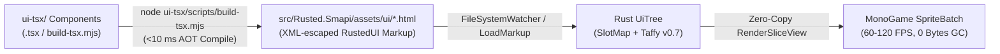

# RustedUI — React / Vite TypeScript (`.tsx`) & Shadcn/UI Authoring Guide

When plain HTML/CSS feels repetitive for complex UIs, **RustedUI** provides a zero-runtime-overhead **React / Vite JSX/TSX Component Compiler** (`ui-tsx/`). You can compose reusable components (`<ThemeBar />`, `<Badge />`, `<Switch />`, `<Icon />`), loops (`.map()`), props, and TypeScript types that compile ahead-of-time (AOT) into zero-GC RustedUI templates.

---

## 1. How the TSX Pipeline Works



- **Zero Browser/V8 Overhead in Game**: The JSX/TSX tree is evaluated at build/save time and serialized into deterministic RustedUI XML markup with automatic entity escaping (`&amp;`, `&lt;`, `&gt;`, `&quot;`).
- **Reusable Shadcn/UI & Lucide Primitives**:
  - `Icon({ name: "sparkles", size: "md" })` -> `<icon name="sparkles" class="lucide-icon lucide-md" />`
  - `Badge({ id: "bdg_status", variant: "success" }, "Active")` -> `<badge id="bdg_status" variant="success" class="sdv-badge badge-success">Active</badge>`
  - `Switch({ id: "chk_hud", checked: true, onClick: "toggle_hud" })` -> `<switch id="chk_hud" checked="true" on:click="toggle_hud" />`
  - `ThemeBar()` -> Complete 10-theme switcher header bar with live CPU/RAM telemetry badge.

---

## 2. Writing Custom TSX Components

In `ui-tsx/src/runtime/jsx-runtime.ts` and `ui-tsx/scripts/build-tsx.mjs`:

```tsx
const InventoryRow = ({ items }) =>
  h(
    "div",
    { class: "flex flex-row gap-2 w-full justify-between" },
    ...items.map((it) =>
      h("item-slot", {
        id: `slot_${it.name}`,
        item: String(it.id),
        count: String(it.count),
        quality: it.quality,
        "on:click": `slot_${it.name}`,
        tooltip: `${it.label} - Click to inspect!`,
      })
    )
  );
```

### Compiling TSX Templates
```bash
node ui-tsx/scripts/build-tsx.mjs
```
Outputs:
- `src/Rusted.Smapi/assets/ui/test_hud.html`
- `src/Rusted.Smapi/assets/ui/test_menu.html`
- `src/Rusted.Smapi/assets/ui/credits_menu.html`
- `src/Rusted.Smapi/assets/ui/feature_test_menu.html`
