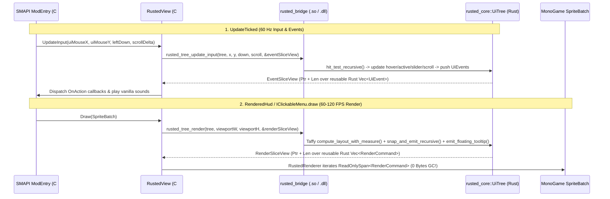

# RustedUI — Architecture, Zero-GC FFI Protocol & Cross-Platform ABI

RustedUI separates **layout, styling, hit-testing, and command generation** (written in safe, zero-GC Rust) from **GPU texture drawing and SMAPI lifecycle hooks** (written in C# for Stardew Valley 1.6 / MonoGame 3.8).

---

## 1. End-to-End Frame Pipeline

---

## 2. Memory & Performance Guarantees

- **0 Bytes Managed GC Per Frame**:
  - `RenderSliceView` and `EventSliceView` pass raw pointers and lengths to pre-allocated, reusable `Vec<RenderCommand>` and `Vec<u8>` buffers owned by Rust's `UiTree`.
  - C# wraps these pointers in stack-only `ReadOnlySpan<RenderCommand>` and `ReadOnlySpan<UiEvent>` with `[SuppressGCTransition]` P/Invoke attributes.
- **Hardware `ScissorRectangle` Clipping**:
  - `<scroll-view>` emits `PushClipRect` and `PopClipRect` commands.
  - `RustedRenderer.cs` flushes the current `SpriteBatch`, intersects the clip rectangle with `GraphicsDevice.ScissorRectangle` using a stack for nested clips, begins a `RasterizerState(ScissorTestEnable = true, CullNone)` pass, and restores `RasterizerState.CullNone` on `PopClipRect`.
- **Cross-Platform Native Binary Resolution (`NativeResolver.cs`)**:
  - **Linux Native (`linux-x64`)**: Loads `runtimes/linux-x64/native/librusted_bridge.so`.
  - **Windows & Linux Proton/Wine (`win-x64`)**: Loads `runtimes/win-x64/native/rusted_bridge.dll`, compiled via `cargo xwin` with `RUSTFLAGS="-C target-feature=+crt-static"` (.cargo/config.toml) so `vcruntime140.dll` is statically linked and never missing inside Wine/Proton sandboxes.
