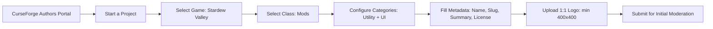
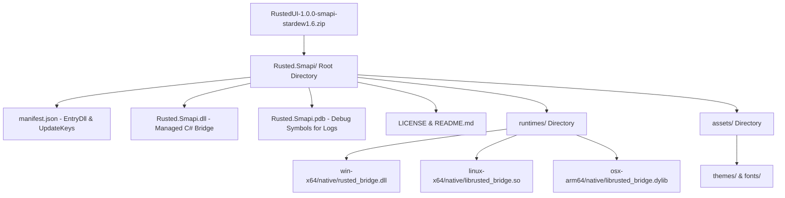
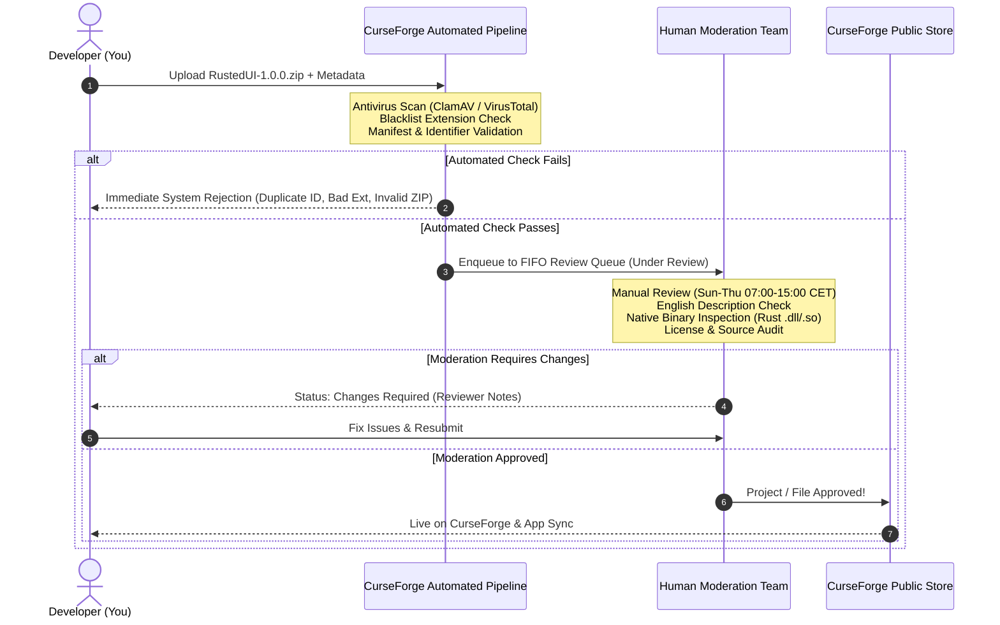

# CurseForge Stardew Valley Mod Yayınlama Kılavuzu: Rusted (RustedUI)

> **Kapsam:** Stardew Valley 1.6+ & SMAPI 4.x+ Modları İçin CurseForge Dağıtım, Paketleme, Moderasyon ve Açıklama Standartları  
> **Hedef Mod:** Rusted (RustedUI) — Zero-GC Rust + Taffy + MonoGame UI/HUD Framework  
> **Doküman Versiyonu:** 1.0.0  
> **Tarih:** 2026-11-07  

---

## İçindekiler
1. [Giriş ve CurseForge Ekosistemi Genel Bakış](#1-giriş-ve-curseforge-ekosistemi-genel-bakış)
2. [Bölüm 1: Proje Oluşturma ve Gereksinimler (Project Creation & Requirements)](#bölüm-1-proje-oluşturma-ve-gereksinimler-project-creation--requirements)
   - [1.1 Author Portal Başlangıcı](#11-author-portal-başlangıcı)
   - [1.2 Doğru Kategori ve Sınıflandırma](#12-doğru-kategori-ve-sınıflandırma)
   - [1.3 Proje İsimlendirme ve Slug Belirleme](#13-proje-isimlendirme-ve-slug-belirleme)
   - [1.4 Logo ve Görsel Varlık Standartları](#14-logo-ve-görsel-varlık-standartları)
   - [1.5 Lisans Seçimi](#15-lisans-seçimi)
   - [1.6 Dil Zorunluluğu](#16-dil-zorunluluğu)
   - [1.7 Oyun Sürümü Etiketleme (Game Version Tagging)](#17-oyun-sürümü-etiketleme-game-version-tagging)
   - [1.8 Mod Yükleyicisi & SMAPI Bağımlılık Yapılandırması](#18-mod-yükleyicisi--smapi-bağımlılık-yapılandırması)
3. [Bölüm 2: Açıklama ve Biçimlendirme Kılavuzu (Description & Formatting Guidelines)](#bölüm-2-açıklama-ve-biçimlendirme-kılavuzu-description--formatting-guidelines)
   - [2.1 Editör Modları: WYSIWYG vs Markdown](#21-editör-modları-wysiwyg-vs-markdown)
   - [2.2 Desteklenen HTML5 Etiketleri ve Nitelikleri](#22-desteklenen-html5-etiketleri-ve-nitelikleri)
   - [2.3 Desteklenen CSS3 Özellikleri ve Kısıtlamaları](#23-desteklenen-css3-özellikleri-ve-kısıtlamaları)
   - [2.4 CurseForge Yerleşik CSS Sınıfları](#24-curseforge-yerleşik-css-sınıfları)
   - [2.5 Rozetler (Badges) ve Shields.io Entegrasyonu](#25-rozetler-badges-ve-shieldsio-entegrasyonu)
   - [2.6 Görseller, Banner'lar, Kod Blokları ve Spoyler Yapısı](#26-görseller-bannerlar-kod-blokları-ve-spoyler-yapısı)
4. [Bölüm 3: Dosya Yükleme ve Paketleme En İyi Uygulamaları (Packaging Best Practices)](#bölüm-3-dosya-yükleme-ve-paketleme-en-iyi-uygulamaları-packaging-best-practices)
   - [3.1 Altın Kural: Kök Klasör Mimarisi (Root Folder Architecture)](#31-altın-kural-kök-klasör-mimarisi-root-folder-architecture)
   - [3.2 Rusted İçin İdeal ZIP Dosya Ağacı](#32-rusted-için-ideal-zip-dosya-ağacı)
   - [3.3 Sürüm Türleri: Release, Beta ve Alpha Ayrımı](#33-sürüm-türleri-release-beta-ve-alpha-ayrımı)
   - [3.4 Sürüm İsimlendirme ve SMAPI UpdateKey Eşleşmesi](#34-sürüm-isimlendirme-ve-smapi-updatekey-eşleşmesi)
   - [3.5 Değişiklik Günlüğü (Changelog) Biçimlendirmesi](#35-değişiklik-günlüğü-changelog-biçimlendirmesi)
5. [Bölüm 4: İnceleme ve Onay Süreci (CurseForge Moderation Deep Dive)](#bölüm-4-inceleme-ve-onay-süreci-curseforge-moderation-deep-dive)
   - [4.1 Moderasyon Yaşam Döngüsü: Otomasyon + İnsan Denetimi](#41-moderasyon-yaşam-döngüsü-otomasyon--insan-denetimi)
   - [4.2 Moderasyon Çalışma Saatleri ve Bekleme Süreleri](#42-moderasyon-çalışma-saatleri-ve-bekleme-süreleri)
   - [4.3 Yaygın Reddetme Nedenleri ve Çözümleri](#43-yaygın-reddetme-nedenleri-ve-çözümleri)
   - [4.4 Yerel İkili Dosyalar (Rust .dll, .so, .dylib) İçin Özel Güvenlik Protokolü](#44-yerel-ikili-dosyalar-rust-dll-so-dylib-için-özel-güvenlik-protokolü)
   - [4.5 Moderatöre Hazır İletişim Notu (Notes for Reviewers Template)](#45-moderatöre-hazır-iletişim-notu-notes-for-reviewers-template)
6. [Bölüm 5: Rusted İçin Üretime Hazır CurseForge Açıklama Şablonu (Production Template)](#bölüm-5-rusted-için-üretime-hazır-curseforge-açıklama-şablonu-production-template)
7. [Bölüm 6: Yayınlama Öncesi Kontrol Listesi (Pre-Flight Publishing Checklist)](#bölüm-6-yayınlama-öncesi-kontrol-listesi-pre-flight-publishing-checklist)

---

## 1. Giriş ve CurseForge Ekosistemi Genel Bakış

CurseForge, Nexus Mods ile birlikte Stardew Valley topluluğunun en büyük iki resmi mod dağıtım merkezinden biridir. Özellikle **CurseForge Desktop Uygulaması (Overwolf altyapısı)** sayesinde yüz binlerce oyuncu; tek tıkla mod yükleme, otomatik bağımlılık çözme ve arka planda mod güncelleme konforunu tercih etmektedir.

**Rusted (RustedUI)** projesinin CurseForge üzerinde yayınlanması, standart bir C# SMAPI moduna göre özel bir süreç gerektirir:
1. Rusted, saf C# yerine **Rust ile derlenmiş yerel ikili kütüphaneleri (`.dll`, `.so`, `.dylib`)** içerir. CurseForge otomatik kötü amaçlı yazılım (anti-malware) tarayıcıları yerel ikili dosyaları potansiyel risk olarak işaretleyebilir; bu nedenle açık kaynak şeffaflığı ve CI/CD kaynak doğrulaması şarttır.
2. Rusted bir **UI & HUD Framework/Library** projesidir. Hem son kullanıcılar (in-game HUD & Control Panel kullanan oyuncular) hem de mod geliştiricileri (C# API, Tailwind veya React/TSX kullanan modder'lar) tarafından indirilir. Bu iki kitleye hitap eden iki katmanlı bir CurseForge proje sayfası kurgulanmalıdır.

---

## Bölüm 1: Proje Oluşturma ve Gereksinimler (Project Creation & Requirements)

### 1.1 Author Portal Başlangıcı
1. [CurseForge Authors Portal](https://authors.curseforge.com/) adresine giriş yapın.
2. Sağ üstteki **"Start a Project"** butonuna tıklayın.
3. Oyun seçim ekranında **"Stardew Valley"** (Game ID: `669`) seçeneğini belirleyin.



---

### 1.2 Doğru Kategori ve Sınıflandırma
CurseForge üzerindeki keşfedilebilirliği (discoverability) en üst düzeye çıkarmak için projenin sınıf ve kategorileri doğru eşleştirilmelidir:

| Yapılandırma Alanı | Seçilmesi Gereken Değer | Açıklama & Strateji |
|---|---|---|
| **Project Class** | **Mods** | Modpack değil, doğrudan mod sınıfı seçilmelidir. |
| **Primary Category** | **Utility / Tools** | Rusted bir API/Framework olduğu için arama motoru öncelikle araçlar kategorisine yerleştirir. |
| **Secondary Category** | **UI (User Interface)** | Oyuncular arayüz, menü ve HUD modları ararken RustedUI'yi bu sekmede bulur. |
| **Optional Tag** | **Visuals** / **Miscellaneous** | Ekran görselini ve temaları zenginleştirdiği için filtreleme desteği sağlar. |

---

### 1.3 Proje İsimlendirme ve Slug Belirleme
CurseForge moderasyon politikaları gereğince:
* **Project Name:** `RustedUI - Modern Zero-GC UI & HUD Framework` veya `Rusted (RustedUI)`  
  *(Politika Uyarısı: Başlıkta gereksiz "Mod", "For Stardew Valley 1.6", "Best UI" gibi genel veya yanıltıcı ifadeler yer almamalıdır. Başlık temiz ve markaya odaklı olmalıdır.)*
* **Project Slug:** `rusted` veya `rusted-ui`  
  *(Oluşan URL: `https://www.curseforge.com/stardew-valley/mods/rusted-ui`)*
* **Short Summary (Kısa Özet):** 50 ile 250 karakter arasında, arama sonuçlarında kart üzerinde görünen özet metin.  
  *Örnek İngilizce Özet:*  
  `Zero-GC, ultra-fast in-game UI & HUD framework for Stardew Valley 1.6+ powered by Rust (Taffy Flexbox/Grid), Tailwind utility styling, and 10 vanilla-matching themes.`

---

### 1.4 Logo ve Görsel Varlık Standartları
CurseForge moderasyonunun projeleri en sık reddettiği alanlardan biri logodur:
1. **Çözünürlük:** En az **400x400 piksel** (Önerilen: 512x512 veya 1024x1024), **1:1 kare en-boy oranı**.
2. **Format:** `.png` (Saydam arka plan desteklenir).
3. **İçerik Şartı:**
   - Asla tek renkli düz bir kare veya boş resim olamaz.
   - ConcernedApe'in resmi kutu kapağı veya doğrudan vanilya logo aynen kopyalanamaz (fikri mülkiyet ihlali sayılır).
   - RustedUI'nin kendi piksel sanatı logosu (ahşap çerçeveli R harfi, Junimo veya paslanmış metal / pelican parşömen temalı özel illüstrasyon) kullanılmalıdır.

---

### 1.5 Lisans Seçimi
CurseForge formundaki açılır listeden projenin açık kaynak lisansı seçilmelidir:
- **Seçilecek Değer:** `MIT License` (veya çoklu lisanslama ise `Apache 2.0`).
- Lisans metni, GitHub deposundaki `LICENSE` dosyası ile harfiyen eşleşmelidir. CurseForge kapalı kaynak veya belirsiz lisanslı sistem ikililerini (native binary) reddeder.

---

### 1.6 Dil Zorunluluğu
> [!IMPORTANT]
> CurseForge Moderasyon Kuralı: **Tüm proje başlıkları, özetleri ve ana açıklama metni kesinlikle İNGİLİZCE olmak zorundadır.**  
> Türkçe veya diğer dillerdeki açıklamalar ana metnin altında, spoyler kutuları içinde veya iki dilli bölümlerde sunulabilir; ancak sayfanın birincil dili İngilizce değilse proje derhal "Changes Required" veya "Rejected" statüsüne alınır.

---

### 1.7 Oyun Sürümü Etiketleme (Game Version Tagging)
CurseForge dosya yükleme ekranında dosyanın uyumlu olduğu Stardew Valley sürümleri seçilir:
- **Major Versiyon:** `Stardew Valley 1.6`
- **Minor/Patch Versiyonları:** `1.6.0`, `1.6.3`, `1.6.8`, `1.6.9`, `1.6.14`, `1.6.15+` (Mevcut tüm 1.6.x sürümleri işaretlenmelidir).
- **Önemli Not:** Stardew Valley 1.5.6 (eski .NET Framework 4.5.2 / XNA) kesinlikle işaretlenmemelidir. Rusted, modern .NET 6.0 ve MonoGame 3.8+ çalışma zamanını gerektirir.

---

### 1.8 Mod Yükleyicisi & SMAPI Bağımlılık Yapılandırması

Minecraft'ta Forge/Fabric/NeoForge gibi mod yükleyicisi etiketleri varken, Stardew Valley ekosisteminde **SMAPI** tek ve evrensel mod yükleyicisidir. CurseForge üzerinde SMAPI ayrı bir "Utility" projesi olarak listelenmiştir.

#### 1.8.1 CurseForge Üzerinde SMAPI Bağımlılığını Tanımlama
RustedUI dosyasını yüklerken veya projenin **"Relations" (Bağımlılıklar)** sekmesinde:
1. **Related Project:** `SMAPI - Stardew Modding API` (Project ID: `318282`, Slug: `smapi`) aratılır.
2. **Relation Type:** **`Required Dependency`** olarak ayarlanır.
3. **Etkisi:** CurseForge Desktop uygulamasını kullanan bir oyuncu RustedUI'yi indirmek istediğinde, sistem SMAPI'nin kurulu olup olmadığını denetler; kurulu değilse SMAPI'yi otomatik indirme kuyruğuna ekler.

#### 1.8.2 `manifest.json` İçinde CurseForge Entegrasyonu
SMAPI'nin oyun içi konsolunda otomatik güncelleme bildirimleri vermesi ve CurseForge ile haberleşmesi için `manifest.json` şu şekilde yapılandırılmalıdır:

```json
{
  "Name": "RustedUI",
  "Author": "Mehmetcan",
  "Version": "1.0.0",
  "Description": "Zero-GC high-performance in-game UI & HUD framework for Stardew Valley 1.6+ powered by Rust & Taffy.",
  "UniqueID": "Mehmetcan.RustedUI",
  "EntryDll": "Rusted.Smapi.dll",
  "MinimumApiVersion": "4.1.0",
  "Dependencies": [
    {
      "UniqueID": "Pathoschild.SMAPI",
      "MinimumVersion": "4.1.0",
      "IsRequired": true
    }
  ],
  "UpdateKeys": [
    "CurseForge:XXXXXX",
    "GitHub:owner/Rusted"
  ]
}
```
*(Not: `XXXXXX` yerine CurseForge projeniz onaylandığında verilen sayısal **Project ID** yazılmalıdır).*

#### 1.8.3 SMAPI UpdateKey Kritik Kuralı: Dosya Görünen Adı (Display Name)
> [!WARNING]
> SMAPI'nin CurseForge UpdateKey denetleyicisi, yeni sürümün çıkıp çıkmadığını anlamak için CurseForge'a yüklenen dosyanın **Görünen Adını (Display Name)** okur.  
> Dosya görünen adının sonu mutlaka **boşluk ve geçerli bir Semantic Version** ile bitmelidir!  
> - **DOĞRU:** `RustedUI 1.0.0` veya `RustedUI 1.0.0-beta.2`  
> - **YANLIŞ:** `RustedUI_v1.0` veya `RustedUI-Latest` veya `RustedUI.zip`  
> Yanlış adlandırılırsa SMAPI güncelleme kontrolü hata verir veya yeni sürümleri algılayamaz.

---

## Bölüm 2: Açıklama ve Biçimlendirme Kılavuzu (Description & Formatting Guidelines)

CurseForge açıklama editörü, sıradan web sitelerine göre güvenlik nedeniyle filtrelenmiş (sanitized) özel bir HTML/Markdown motoru çalıştırır.

### 2.1 Editör Modları: WYSIWYG vs Markdown
Proje açıklamasını düzenlerken iki mod mevcuttur:
1. **WYSIWYG (Rich Text - Quill tabanlı):** Görsel butonlarla biçimlendirme sağlar; HTML kod görünümüne (`</>`) geçilerek özel etiketler eklenebilir.
2. **Markdown Editörü:** GitHub veya Modrinth `README.md` dosyalarını doğrudan aktarmak için idealdir. CurseForge Markdown motoru standart GFM (GitHub Flavored Markdown) ile uyumludur.

---

### 2.2 Desteklenen HTML5 Etiketleri ve Nitelikleri
CurseForge güvenlik duvarı harici scriptleri veya güvensiz nesneleri engeller. Açıklama sayfasında yalnızca şu etiketlere izin verilir:

| Kategori | İzin Verilen Etiketler | İzin Verilen Nitelikler (Attributes) |
|---|---|---|
| **Metin & Tipografi** | `p`, `br`, `strong`, `b`, `em`, `i`, `u`, `strike`, `del`, `ins`, `sub`, `sup`, `code`, `pre`, `blockquote`, `q`, `cite`, `abbr` | `class`, `style`, `title` |
| **Başlıklar** | `h1`, `h2`, `h3`, `h4`, `h5`, `h6` | `class`, `style` |
| **Bölücüler & Kapsayıcılar** | `div`, `span`, `hr`, `section`, `article` | `class`, `style`, `title`, `data-title` |
| **Listeler** | `ul`, `ol`, `li`, `dl`, `dt`, `dd` | `type`, `class`, `style` |
| **Bağlantılar & Medya** | `a`, `img` | `a`: `href`, `target` (`_blank`)<br>`img`: `src`, `alt`, `width`, `height`, `style` |
| **Tablolar** | `table`, `thead`, `tbody`, `tr`, `th`, `td` | `class`, `style`, `border`, `cellpadding`, `cellspacing` |

*Yasaklı Etiketler:* `<script>`, `<style>` (blok olarak yasak, yalnızca inline `style="..."` serbest), `<form>`, `<input>`, `<link>`, harici `<iframe>` (yalnızca CurseForge tarafından beyaz listeye alınmış YouTube/Vimeo yerleştirmeleri serbesttir).

---

### 2.3 Desteklenen CSS3 Özellikleri ve Kısıtlamaları
Inline CSS (`style="..."`) içinde şu özellikler kullanılabilir:
- **Font:** `font-family`, `font-weight`, `font-style`, `font-size` (**ÖNEMLİ KURAL: En fazla `40px` olabilir, üzerindekiler filtrelenir**).
- **Renk & Arka Plan:** `color`, `background-color`.
- **Kutu Modeli & Yerleşim:** `width`, `min-width`, `max-width`, `margin-left`, `margin-right`, `padding-left`, `padding-right`, `border`, `border-color`, `border-width`, `border-radius`, `display: flex`, `flex-direction`, `flex-wrap`, `align-items`, `gap`, `aspect-ratio`, `object-fit`.
- **Metin Hizalama:** `text-align` (`center`, `left`, `right`, `justify`), `line-height`, `text-decoration`.

---

### 2.4 CurseForge Yerleşik CSS Sınıfları
CurseForge, mod sayfalarında profesyonel düzenler oluşturmak için hazır sınıflar sunar:

| CSS Sınıfı | Görevi ve Kullanım Amacı |
|---|---|
| `class="spoiler"` | Tıklandığında açılan katlanabilir alan oluşturur. Sık Sorulan Sorular, Hata Çözümleri veya Detaylı Kodlar için zorunludur. |
| `class="center"` | İçeriği, görselleri ve rozetleri sayfada yatay olarak ortalar. |
| `class="alignleft"` / `class="alignright"` | Görselleri metnin sağına veya soluna hizalar (float). |
| `class="quote-content"` | Özel stillendirilmiş alıntı bloğu. |
| `class="lightbox"` | Üzerine tıklandığında resmi tam ekran modal pencerede büyütür. |

#### Spoyler Kullanım Örneği (HTML):
```html
<div class="spoiler">
    <p><strong>Click here to view the C# Fluent Builder Example</strong></p>
    <pre><code>var card = new RCard().Padding(16).Child(new RText("Hello Stardew"));</code></pre>
</div>
```

---

### 2.5 Rozetler (Badges) ve Shields.io Entegrasyonu
CurseForge açıklamalarının en üstüne profesyonel durum rozetleri yerleştirilmelidir. Shields.io CurseForge API'sini doğrudan destekler:

```markdown
<div class="center">

[](https://www.curseforge.com/stardew-valley/mods/rusted-ui)
[](https://stardewvalley.net/)
[](https://smapi.io/)
[](https://github.com/owner/Rusted)
[](LICENSE)

</div>
```

---

### 2.6 Görseller, Banner'lar, Kod Blokları ve Spoyler Yapısı
1. **Banner:** 1200x300 veya 1920x450 piksel boyutlarında, sayfanın en üstünde ortalanmış kahraman banner görseli:
   ```html
   <p class="center"></p>
   ```
2. **Kod Blokları:** Syntax highlighting için fenced code blokları (` ```csharp `, ` ```html `, ` ```tsx `) kullanılabilir. WYSIWYG modunda `<pre><code>...</code></pre>` yapısı kullanılır.

---

## Bölüm 3: Dosya Yükleme ve Paketleme En İyi Uygulamaları (Packaging Best Practices)

Stardew Valley modculuğunda arşiv paketleme biçimi, modun yüklenip yüklenemeyeceğini belirleyen en kritik adımdır.



---

### 3.1 Altın Kural: Kök Klasör Mimarisi (Root Folder Architecture)

> [!CAUTION]
> **Düz (Flat) ZIP Tuzağı:**  
> Birçok yeni mod geliştiricisi ZIP arşivinin kök dizinine doğrudan `manifest.json` ve `.dll` dosyalarını koyar.  
> Bir oyuncu veya CurseForge App bu arşivi `Stardew Valley/Mods/` klasörüne çıkardığında:  
> 1. Dosyalar `Mods/` dizinine dağılır.  
> 2. SMAPI her modun kendi özel klasöründe olmasını şart koştuğu için mod yüklenemez ve konsolda `"Cannot find manifest.json"` veya `"Ignored loose files in Mods/"` hatası basar!  
> 
> **Çözüm:** ZIP arşivi açıldığında içinde **tam olarak tek bir ana klasör** (`Rusted.Smapi/`) bulunmalıdır.

---

### 3.2 Rusted İçin İdeal ZIP Dosya Ağacı
Yayınlanacak `.zip` paketinin dosya hiyerarşisi tam olarak şu yapıda olmalıdır:

```text
RustedUI-1.0.0-smapi-stardew1.6.zip
└── Rusted.Smapi/
    ├── manifest.json
    ├── Rusted.Smapi.dll
    ├── Rusted.Smapi.pdb
    ├── LICENSE
    ├── README.txt
    ├── assets/
    │   ├── themes/
    │   │   └── default.json
    │   └── fonts/
    │       └── custom-pixel.fnt
    └── runtimes/
        ├── win-x64/
        │   └── native/
        │       └── rusted_bridge.dll
        ├── linux-x64/
        │   └── native/
        │       └── librusted_bridge.so
        ├── osx-x64/
        │   └── native/
        │       └── librusted_bridge.dylib
        └── osx-arm64/
            └── native/
                └── librusted_bridge.dylib
```

#### Neden `.pdb` Eklenmeli?
`.pdb` (Program Database) hata ayıklama sembolü dosyasının arşive eklenmesi şiddetle tavsiye edilir. Oyuncular bir çökme yaşadığında SMAPI hata günlüğünde (`SMAPI-crash.txt`) satır numarası ve metod detayları görünür; böylece mod yapımcısı sorunu anında tespit eder.

---

### 3.3 Sürüm Türleri: Release, Beta ve Alpha Ayrımı

CurseForge Author Portal dosya yüklerken 3 sürüm türü sunar:

| Sürüm Türü | CurseForge App Davranışı | Web Sitesi Görünürlüğü | Rusted İçin Ne Zaman Kullanılmalı? |
|---|---|---|---|
| **Release** | **Varsayılan yükleme.** Tüm kullanıcılara anında otomatik güncelleme bildirimi gönderir. | Ana "Download" butonunun indirdiği birincil kararlı dosya. | Kapsamlı testleri tamamlanmış, çökmeyen kararlı framework sürümleri (Örn. `v1.0.0`). |
| **Beta** | Yalnızca CurseForge uygulamasında "Beta Channel" seçen test kullanıcılarına iner. | "Recent Files" listesinde turuncu etiketle görünür. | Yeni bir temanın, React render desteğinin veya yeni bir SMAPI sürümünün topluluk testine açılması (Örn. `v1.1.0-beta.1`). |
| **Alpha** | CurseForge uygulamasında varsayılan olarak gizlidir; sadece geliştirici açık onay verirse iner. | Dosyalar sekmesinde kırmızı etiketle listelenir. | Rust layout motorunun çekirdek mimari güncellemeleri veya deneysel API denemeleri. |

---

### 3.4 Sürüm İsimlendirme ve SMAPI UpdateKey Eşleşmesi
CurseForge dosya yükleme formunda iki farklı isim alanı vardır:
1. **File Display Name (Kullanıcıya Görünen Ad):** `RustedUI 1.0.0`  
   *(Kritik: SMAPI UpdateKey regex'i bu alanı okur. Sürüm numarası boşluk ile ayrılmalıdır!)*
2. **File Name (Diskteki Dosya Adı):** `RustedUI-1.0.0-smapi-stardew1.6.zip`

---

### 3.5 Değişiklik Günlüğü (Changelog) Biçimlendirmesi
CurseForge dosya yükleme formundaki Changelog alanı Markdown destekler. Standart Keep-a-Changelog formatı kullanılmalıdır:

```markdown
### RustedUI v1.0.0 — Initial Stable Release

#### ✨ Highlights & New Features
* **Zero-GC Rust Engine:** Integrated Taffy v0.7 Flexbox & Grid layout with 0 C# garbage collections per frame.
* **10 Live Vanilla Themes:** Seamless in-game Pelican Town wood, parchment, Junimo, and dark themes.
* **Player Controls:** Added in-game Control Panel (`F8`) and Quick HUD Telemetry overlay (`F7`).
* **Developer SDK:** Fluent C# Builder API, HTML/Tailwind CSS compiler, and React/Vite TSX components.

#### 🛠️ Fixes & Improvements
* Native library auto-resolution on Linux/Steam Deck (Proton & Native glibc).
* Full gamepad navigation support with vanilla snap-to-widget cursor.
```

---

## Bölüm 4: İnceleme ve Onay Süreci (CurseForge Moderation Deep Dive)

CurseForge, platform güvenliğini sağlamak için iki aşamalı sıkı bir denetim uygular.



---

### 4.1 Moderasyon Yaşam Döngüsü: Otomasyon + İnsan Denetimi
1. **Aşama 1 — Otomasyon Hattı (Anında / İlk 10 Dakika):**
   - Dosya yüklenir yüklenmez çoklu antivirüs tarayıcılarından (ClamAV, VirusTotal) geçer.
   - Kara listedeki dosya uzantıları (`.exe`, `.bat`, `.cmd`, `.sh`) kontrol edilir.
   - `manifest.json` ayrıştırılır; UniqueID ve bağımlılıklar kontrol edilir.
2. **Aşama 2 — Manuel İnsan İncelemesi (12 – 72 Saat):**
   - Proje ilk defa yayınlanıyorsa veya güvenlik şüphesi uyandıran yerel ikili dosyalar (`.dll`, `.so`) içeriyorsa dosya insan moderatör kuyruğuna alınır.

---

### 4.2 Moderasyon Çalışma Saatleri ve Bekleme Süreleri

> [!IMPORTANT]
> **CurseForge Moderasyon Takvimi:**
> - **Aktif Moderasyon:** Pazar – Perşembe (07:00 – 15:00 CET / Türkiye saatiyle 09:00 – 17:00).
> - **Hafta Sonu Dondurulması (Weekend Freeze):** Cuma ve Cumartesi günleri CurseForge moderasyon ekibi **çalışmaz**.
> - **Hafta Sonu Tuzağı:** Perşembe akşamı veya Cuma günü yüklenen bir dosya Pazar veya Pazartesi gününe kadar kuyrukta bekler. En hızlı onay için başvurular **Pazar, Pazartesi veya Salı sabahı** yapılmalıdır.
> - **Bekleme Süreleri:** Yeni projeler için ortalama **24 – 72 saat**; onaylanmış bir projenin rutin güncellemeleri için **1 – 12 saat**.

---

### 4.3 Yaygın Reddetme Nedenleri ve Çözümleri

| Reddetme / "Changes Required" Nedeni | Açıklama | Rusted İçin Alınan Önlem |
|---|---|---|
| **Under-informative Description** | "WIP", "My first mod", "Description coming soon" gibi 100 kelimeden kısa açıklamalar anında reddedilir. | Hazırladığımız zengin, özellik listeli ve görselli detaylı şablon kullanılarak aşılır. |
| **Non-English Language** | Başlık veya ana açıklamanın İngilizce olmaması. | Ana metin tamamen profesyonel İngilizce hazırlanır, Türkçe detaylar alt bölüme eklenir. |
| **Copyright / Generic Logo** | ConcernedApe'in çizimlerini veya oyunun orijinal logosunu değiştirmeden yüklemek. | Özel tasarım RustedUI vektör/piksel logosu kullanılır. |
| **Flat Archive / Bad Packaging** | ZIP içinde kök klasör olmaması, dosyaların doğrudan zip köküne konulması. | `Rusted.Smapi/` kök klasörü içinde paketleme yapılır. |
| **Suspicious Native Binaries** | Kaynağı belirsiz `.dll` veya `.so` dosyaları. | Açık kaynak GitHub deposu, CI hash doğrulaması ve moderatör notu eklenir. |

---

### 4.4 Yerel İkili Dosyalar (Rust .dll, .so, .dylib) İçin Özel Güvenlik Protokolü

RustedUI, C# kodunun yanı sıra yüksek performanslı Rust derleme çıktıları (`rusted_bridge.dll`, `librusted_bridge.so`) barındırır. CurseForge moderatörleri bu dosyaları "kaynak kodu denetlenemeyen şüpheli makine kodu" gerekçesiyle sorgulayabilir.

Bunu önlemek ve tek seferde onay almak için:
1. **Açık Kaynak Şeffaflığı:** CurseForge açıklamasında ve proje ayarlarında açık kaynak GitHub repo bağlantısı (`https://github.com/owner/Rusted`) açıkça verilmelidir.
2. **Tekrarlanabilir Derleme (Reproducible Build) Kanıtı:** GitHub Actions CI iş akışı dosyasının linki verilerek, ikili dosyaların doğrudan bu açık kaynak koddan derlendiği belgelenmelidir.
3. **P/Invoke & NativeLibrary Açıklaması:** Dosyanın harici bir internet bağlantısı kurmadığı, işletim sistemine müdahale etmediği, yalnızca oyun içi bellek içinde Flexbox/Grid hesaplayıp MonoGame `SpriteBatch` komutu döndürdüğü belirtilmelidir.
4. **VirusTotal Raporu:** Derlenen ZIP dosyasının [VirusTotal](https://www.virustotal.com/) üzerinde taranmış 0/70 temiz rapor linki moderatöre sunulmalıdır.

---

### 4.5 Moderatöre Hazır İletişim Notu (Notes for Reviewers Template)

Dosyayı yüklerken formun en altında bulunan **"Notes for Moderators"** (veya dosya reddedilirse açılacak destek talebinde) kullanılacak hazır İngilizce beyan metni:

```text
Dear CurseForge Moderation Team,

Thank you for reviewing RustedUI!

Please note that this mod is an open-source, high-performance UI and HUD framework for Stardew Valley 1.6+ (SMAPI 4.1+).

[About Native Binaries in runtimes/]:
This package contains pre-compiled native dynamic libraries (rusted_bridge.dll for Windows x64 and librusted_bridge.so for Linux x64 / Steam Deck) located inside the standard `runtimes/` folder.
- Source Code Repository: https://github.com/owner/Rusted
- Build Script & Provenance: Built directly via GitHub Actions CI from the above public repository using Rust 2021 edition and Cargo.
- Purpose: Purely in-process mathematical computation for CSS Flexbox/Grid layout (via the MIT-licensed 'Taffy' crate). It performs zero OS network calls, zero file writing, and zero external process spawning. It only returns flat draw command buffers to Stardew Valley's MonoGame SpriteBatch.
- VirusTotal Clean Scan: https://www.virustotal.com/gui/file/INSERT_YOUR_SHA256_HASH_HERE

All dependencies and licenses (MIT License) are fully documented in the project description and root LICENSE file.

Thank you for your time and assistance!
```

---

## Bölüm 5: Rusted İçin Üretime Hazır CurseForge Açıklama Şablonu (Production Template)

Aşağıdaki şablon, CurseForge Açıklama (Description) alanına doğrudan yapıştırılmaya hazır şekilde **CurseForge uyumlu Markdown ve HTML bileşenleriyle** hazırlanmıştır:

```markdown
<div class="center">

# 🌾 RustedUI — Modern Zero-GC UI & HUD Framework for Stardew Valley

**Supercharge your Stardew Valley interface with the raw speed of Rust and the elegance of modern web layouts.**

[](https://www.curseforge.com/stardew-valley/mods/rusted-ui)
[](https://stardewvalley.net/)
[](https://smapi.io/)
[](https://github.com/owner/Rusted)
[](LICENSE)

</div>

---

## 🌟 What is RustedUI?

**RustedUI** is a lightweight, ultra-high-performance in-game User Interface (UI) and Heads-Up Display (HUD) framework built for **Stardew Valley 1.6+ (SMAPI 4.1+)**.

Whether you are a **player** looking for a beautiful, customizable in-game status HUD and snappy UI controls, or a **mod developer** tired of calculating manual X/Y pixel coordinates in C#, RustedUI delivers a seamless, butter-smooth 60+ FPS experience with **zero garbage collection pauses**.

---

## ⚡ Key Highlights & Features

* 🚀 **Zero-GC Architecture:** Every layout calculation and style resolution occurs in an ultra-fast in-process **Rust core (Taffy v0.7 Flexbox & Grid)**. Exactly **0 byte C# GC allocations per frame** — eliminating micro-stutters even in heavily modded playthroughs.
* 🎨 **10 Pelican-Native Color Themes:** Built-in live themes including *Pelican Classic (Wood & Parchment)*, *Junimo Forest*, *Midnight Oasis*, *Void Shadow*, *Solar Meadow*, and more.
* 🎮 **Full Gamepad & Steam Deck Support:** Native controller navigation with automatic cursor snap, tactile haptic/sound feedback, and 100% Proton/SteamOS compatibility.
* 🛠️ **Developer Freedom:** Author interfaces using **Fluent C# Builder API**, **HTML & Tailwind CSS Utility Classes**, or **React/Vite TSX Components**.
* 🖼️ **Pure MonoGame Rendering:** Zero external browser processes (No CEF/WebView2 bloat, under 5 MB RAM footprint). All visuals render directly inside Stardew Valley's native `SpriteBatch`.
* ⚙️ **Optional GMCM Integration:** Easily rebind keys and customize HUD settings via *Generic Mod Config Menu*, or use the built-in RustedUI Control Panel.

---

## 🎮 Player Guide: Default Keybinds & Controls

| Keybind | Controller Button | Action | Description |
|---|---|---|---|
| **`F8`** | **`Left Stick Click` (L3)** | **Open Control Panel** | Opens the main RustedUI settings and theme switcher from anywhere. |
| **`F7`** | **`Right Stick Click` (R3)** | **Toggle Mini-HUD** | Shows or hides the live game telemetry and quick-access HUD bar. |
| **`ESC`** | **`B Button` / `Back`** | **Close Menu** | Instantly closes open RustedUI dialogs with vanilla audio cues. |

*(All keybinds can be customized in `config.json` or in-game via Generic Mod Config Menu).*

---

## 📦 How to Install (Players)

1. Make sure you have **[SMAPI 4.1+](https://www.curseforge.com/stardew-valley/utility/smapi)** installed.
2. Download the latest **RustedUI** release from the Files tab.
3. Unzip the downloaded file and place the `Rusted.Smapi` folder into your `Stardew Valley/Mods/` directory.
4. Launch Stardew Valley via SMAPI and enjoy!

---

## 💻 Developer Quickstart (Mod Creators)

Creating complex, responsive menus with RustedUI requires only a few lines of C#:

```csharp
using Rusted.Smapi.Fluent;

public class MyCustomModMenu : RustedMenu
{
    protected override IRNode Build()
    {
        return R.Card()
            .Theme("PelicanClassic")
            .Padding(24)
            .Children(
                R.Text("Welcome to Pelican Town!")
                    .Font("dialogueFont")
                    .Color("#4a2c0f"),
                R.Button("Harvest Crops")
                    .Class("bg-green-600 hover:bg-green-700 text-white rounded-lg p-2")
                    .OnClick(() => Game1.addHUDMessage(new HUDMessage("Crops watered!")))
            );
    }
}
```

<div class="spoiler">
<p><strong>Click here to see the HTML + Tailwind Template Example</strong></p>

```html
<div class="flex flex-col bg-pelican-wood p-6 rounded-2xl shadow-xl gap-4">
    <h1 class="text-xl font-stardew text-amber-900">Farm Statistics</h1>
    <div class="flex flex-row justify-between items-center bg-parchment p-3 rounded-lg">
        <span class="text-sm text-stone-700">Total Gold Earned:</span>
        <span class="text-base font-bold text-yellow-600">54,200g</span>
    </div>
    <button class="bg-amber-700 hover:bg-amber-800 text-white py-2 px-4 rounded-lg">
        Collect All
    </button>
</div>
```
</div>

---

## 🛡️ Compatibility & System Requirements

* **Game Version:** Stardew Valley 1.6.0+ (MonoGame 3.8 / .NET 6.0)
* **Mod Loader:** SMAPI 4.1.0 or newer
* **Platforms Tested:**
  * ✅ Windows 10 / 11 (x64)
  * ✅ Linux (Ubuntu, Arch, Fedora, Flatpak)
  * ✅ Steam Deck / SteamOS (Native & Proton Sandbox)
  * ✅ macOS (Apple Silicon M1/M2/M3 & Intel x64)
* **Multiplayer:** 100% Client-side safe. Other players do not need the mod installed.

---

## 🔒 Open Source & Safety Guarantee

RustedUI is 100% open-source under the **MIT License**.
* **Public Source Code:** [GitHub Repository](https://github.com/owner/Rusted)
* **Zero Network Requests:** RustedUI does not connect to any remote server or track user telemetry.
* **Reproducible CI Builds:** Pre-compiled native libraries inside `runtimes/` are compiled transparently using GitHub Actions.

---

## ❓ Frequently Asked Questions (FAQ)

<div class="spoiler">
<p><strong>Q: Does RustedUI replace vanilla menus?</strong></p>
<p>A: No. Vanilla menus remain untouched. RustedUI acts as a foundation and HUD overlay for mods that choose to use it.</p>
</div>

<div class="spoiler">
<p><strong>Q: Will this hurt my FPS or battery on Steam Deck?</strong></p>
<p>A: On the contrary! Because layout calculations are performed in compiled Rust without .NET Garbage Collection overhead, RustedUI is significantly lighter than legacy UI frameworks.</p>
</div>

<div class="spoiler">
<p><strong>Q: How do I report bugs or suggest themes?</strong></p>
<p>A: Please submit issues and feature requests on our <a href="https://github.com/owner/Rusted/issues" target="_blank">GitHub Issue Tracker</a> or leave a comment on the CurseForge page.</p>
</div>

---

<div class="center">
<p><em>Created with ❤️ for the Stardew Valley Modding Community.</em></p>
</div>
```

---

## Bölüm 6: Yayınlama Öncesi Kontrol Listesi (Pre-Flight Publishing Checklist)

CurseForge Author Portal üzerinde "Submit" butonuna basmadan önce aşağıdaki 10 adımı sırayla doğrulayın:

- [ ] **1. Logo Doğrulaması:** En az 400x400 px, 1:1 kare PNG dosyası yüklendi; boş renk veya ConcernedApe telifli görsel içermiyor.
- [ ] **2. Kategori Seçimi:** Primary Class: `Mods`, Primary Category: `Utility / Tools`, Secondary Category: `UI (User Interface)`.
- [ ] **3. İngilizce İçerik:** Başlık, özet ve ana açıklama tamamen kurallara uygun İngilizce olarak girildi.
- [ ] **4. Lisans Bütünlüğü:** CurseForge formunda `MIT License` seçildi ve GitHub repo lisansıyla birebir örtüşüyor.
- [ ] **5. ZIP Arşiv Mimarisi:** ZIP dosyası açıldığında içeride tek bir `Rusted.Smapi/` kök klasörü var; dosyalar zip köküne düzensiz saçılmamış.
- [ ] **6. Yerel Kütüphaneler (Runtimes):** `runtimes/win-x64/native/rusted_bridge.dll` ve `runtimes/linux-x64/native/librusted_bridge.so` doğru alt dizinlere yerleştirildi.
- [ ] **7. Dosya Görünen Adı (Display Name):** Sürüm adı SMAPI güncelleme regex'ine uygun olarak `RustedUI 1.0.0` (boşluklu ve semver formatında) yazıldı.
- [ ] **8. Release Type Seçimi:** Kararlı ana dağıtım için **Release** (yeşil) seçildi.
- [ ] **9. Bağımlılık (Relation) Bağlantısı:** `SMAPI - Stardew Modding API` projesi aratılıp **Required Dependency** olarak bağlandı.
- [ ] **10. Moderatör Notu:** "Notes for Moderators" kutusuna Rust yerel kütüphanelerinin amacını ve GitHub açık kaynak CI bağlantısını açıklayan beyan metni eklendi.
