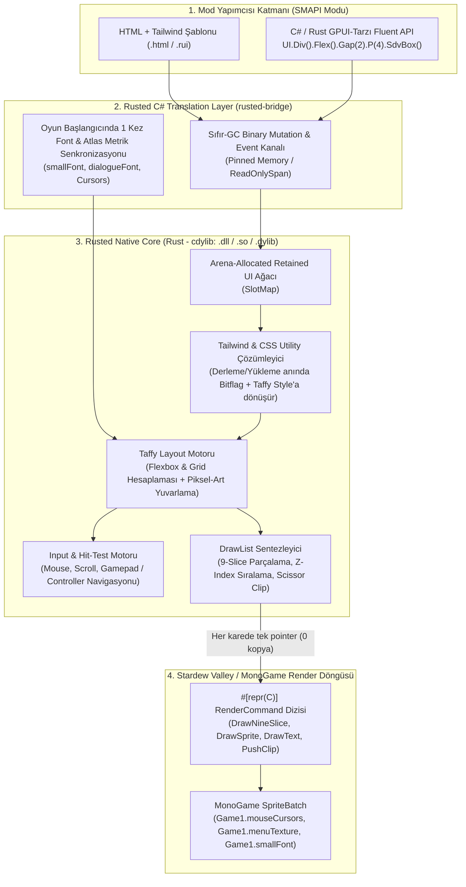

# Rusted (RustedUI) — Proje Baseline, Teknik Araştırma ve Mimari Plan

> **Durum:** Faz 0 — Araştırma & Mimari Baseline (Planning & Research)  
> **Tarih:** 2026-11-07  
> **Hedef Platform:** Stardew Valley 1.6+ (.NET 6.0 / MonoGame 3.8+) & SMAPI 4.x+  
> **Çekirdek Dil:** Rust (Core Engine, Layout, Styling, Parser) + C# (İnce SMAPI Köprüsü / Translation Layer)  
> **Desteklenen Ortamlar:** Windows (x64), Linux (Tüm Distrolar - glibc/musl, Flatpak, SteamOS), Proton / Wine Sandbox, macOS (Intel & Apple Silicon)

---

## İçindekiler
1. [Projenin Tanımı ve Vizyonu (Baseline)](#1-projenin-tanımı-ve-vizyonu-baseline)
2. [Mevcut Durum ve Çözülen Problemler](#2-mevcut-durum-ve-çözülen-problemler)
3. [Temel Tasarım İlkeleri (Non-Negotiables)](#3-temel-tasarım-ilkeleri-non-negotiables)
4. [Rust UI Teknolojileri Araştırması ve Seçim Matrisi](#4-rust-ui-teknolojileri-araştırması-ve-seçim-matrisi)
5. [Önerilen Mimari: "In-Process Rust Layout + SpriteBatch Command Buffer"](#5-önerilen-mimari-in-process-rust-layout--spritebatch-command-buffer)
6. [Stardew Valley Birebir Görsel Uyumluluk (Pelican Native Theme)](#6-stardew-valley-birebir-görsel-uyumluluk-pelican-native-theme)
7. [Geliştirici Deneyimi: HTML + Tailwind CSS & GPUI Tarzı Builder API](#7-geliştirici-deneyimi-html--tailwind-css--gpui-tarzı-builder-api)
8. [C# Sorunlarını Sıfırlayan Özel Translation Layer (`rusted-bridge`)](#8-c-sorunlarını-sıfırlayan-özel-translation-layer-rusted-bridge)
9. [Cross-Platform, Linux Distro ve Proton/Sandbox Uyumluluk Stratejisi](#9-cross-platform-linux-distro-ve-protonsandbox-uyumluluk-stratejisi)
10. [Faz Bazlı Yol Haritası (Roadmap)](#10-faz-bazlı-yol-haritası-roadmap)

---

## 1. Projenin Tanımı ve Vizyonu (Baseline)

**Rusted (RustedUI)**, *Stardew Valley* mod yapımcılarının (SMAPI üzerinde) kendi modları için **oyun içi arayüzler (Menüler, Envanter Ekranları, Diyaloglar, Tooltip'ler)** ve **kalıcı HUD bileşenleri (Barlar, Sayaçlar, Bildirimler, Mini-Paneller)** geliştirmesini sağlayan, **Rust ile yazılmış, aşırı düşük bellek tüketimli (memory-efficient) ve platform-bağımsız bir UI/HUD kütüphanesidir.**

### Ne İşe Yarar?
Stardew Valley'de vanilya yöntemlerle (`IClickableMenu` ve ham `SpriteBatch.Draw` çağrılarıyla) bir UI yazmak; her pikselin, satır kaydırmanın, 9-slice kutu kenarlıklarının ve fare/gamepad odaklamasının elle hesaplanmasını gerektirir.

**Rusted**, mod yapımcılarına modern web/uygulama geliştirmedeki konforu (**HTML/Tailwind CSS utility sınıfları** veya **GPUI tarzı akıcı builder metotları**) sunarken, arka planda tüm yerleşim (Flexbox/Grid), stil çözümleme, state farkı (diffing) ve çizim komutlarını **Rust** içinde sıfır-kopya (zero-copy) ile hesaplar ve çıktıyı doğrudan Stardew Valley'in kendi **vanilya UI dokuları (`LooseSprites/Cursors`, `Menus/MenuTiles`) ve fontlarıyla (`smallFont`, `dialogueFont`, `SpriteText`)** birebir aynı görünümde ekrana çizer.

---

## 2. Mevcut Durum ve Çözülen Problemler

| Kriter | Vanilya SMAPI (`IClickableMenu`) | Mevcut C# UI Kütüphaneleri (Örn. `StardewUI`) | Harici WebView (Tauri / Wry / CEF) | **Rusted (Bizim Yaklaşımımız)** |
|--------|----------------------------------|-----------------------------------------------|------------------------------------|---------------------------------|
| **Yerleşim (Layout)** | Manuel X/Y piksel matematiği | C# tabanlı özel layout | Tarayıcı motoru (Blink/WebKit) | **Rust `taffy` (CSS Flexbox & Grid)** |
| **Stil & Tasarım** | Kod içine gömülü sabit sayılar | Özel StarML sözdizimi | Tam CSS (ancak oyun dışı) | **Tailwind Utility Sınıfları + GPUI tarzı API + Stardew Tema Presetleri** |
| **Bellek & GC Etkisi** | Düşük ama bakımı imkansız | .NET GC Heap üzerinde binlerce nesne (GC spike riski) | **150 MB – 400 MB+ RAM** (Tarayıcı süreci) | **< 2–5 MB RAM**, Arena bellek, **0 C# GC Allocation / frame** |
| **Proton / Linux / Sandbox** | Tam uyumlu | Tam uyumlu | **Kırılgan** (WebView2/WebKitGTK eksikliği, tam ekran sorunu) | **%100 Uyumlu** (Penceresiz, oyun-içi `SpriteBatch` komut tamponu) |
| **Vanilya Görsel Uyum** | Birebir (manuel yazılırsa) | İyi | Zayıf (oyun texture'larına doğrudan erişemez) | **Birebir Vanilya** (Oyun içi canlı `Texture2D` ve `SpriteFont` referansları) |

---

## 3. Temel Tasarım İlkeleri (Non-Negotiables)

1. **Tamamen Oyun İçi Render (Zero External Window):** Kütüphane işletim sisteminde ayrı bir pencere veya overlay açmaz. Tüm çizimler Stardew Valley'in kendi MonoGame çizim döngüsü (`RenderingHud` / `RenderedHud` / `RenderedActiveMenu`) içinde gerçekleşir. Böylece tam ekran, penceresiz tam ekran, Steam Deck GameScope ve yakınlaştırma (`uiScale` / `zoomLevel`) kusursuz çalışır.
2. **Her OS, Distro ve Proton Sandbox'ta Çalışma:** Rust katmanı hiçbir işletim sistemi pencere yöneticisine (`X11`, `Wayland`, `GTK`, `WebKit`, `Win32 HWND`, `Cocoa`) bağımlı olmayacaktır. Yalnızca saf hesaplama yapan bağımsız bir yerel kütüphane (`.dll`, `.so`, `.dylib`) olarak derlenir.
3. **Sıfır C# GC Baskısı (Memory Efficiency):** Her karede (60+ FPS) C# ile Rust arasında string veya nesne kopyalanmaz. Rust tarafında Arena/SlotMap bellek modeli kullanılır; C# tarafına yalnızca düz (flat) bir `#[repr(C)]` çizim komutu dizisi (`Span<RenderCommand>`) aktarılır.
4. **Birebir Stardew Valley Estetiği:** Hiçbir ekstra stil yazılmasa bile varsayılan bileşenler (`<box>`, `<button>`, `<slot>`, `<tab>`, `<slider>`, `<tooltip>`) Stardew Valley'in ahşap çerçevelerini, parşömen dokusunu, gölgelerini, fontlarını ve ses efektlerini (`shiny4`, `bigSelect`) birebir kullanır.
5. **Sıfır C# FFI Baş Ağrısı:** Mod yapımcıları P/Invoke, pointer, bellek sızıntısı veya `DllNotFoundException` ile asla muhatap olmaz; kendi yazdığımız **Translation Layer** bunu tamamen soyutlar.

---

## 4. Rust UI Teknolojileri Araştırması ve Seçim Matrisi

Canlı ekosistem telemetrisi (`probe_ecosystem.py` — 2026-11-07 verileri) ve oyun-içi uygunluk analizi:

| Proje / Kütüphane | GitHub Yıldız | Lisans | Mimari Rolü | Oyun İçi (SMAPI) Uygunluk Analizi | Karar |
|-------------------|--------------:|--------|-------------|-----------------------------------|-------|
| **[DioxusLabs/taffy](https://github.com/DioxusLabs/taffy)** | 3,754 | MIT | Saf Rust CSS Flexbox, CSS Grid & Block yerleşim motoru | **Mükemmel.** Pencere veya GPU bağımlılığı yoktur. Bevy (`bevy_ui`), Servo ve Zed tarafından kullanılır. Milisaniyenin altında layout hesaplar. | **SEÇİLDİ (Çekirdek Layout Motoru)** |
| **[GPUI (Zed)](https://gpui.rs)** | *(Zed repo)* | GPL / Apache | Hibrit Immediate/Retained UI + Tailwind-benzeri Rust API | **Mimari İlham / API Modeli.** Doğrudan GPUI crate'i kendi Metal/Vulkan penceresini açmak ister (MonoGame ile çakışır). Ancak GPUI'nin **Tailwind-tarzı zincirleme (fluent) stil mimarisi** ve hibrit state modeli birebir benimsenecek. | **MİMARİ & API MODELİ OLARAK SEÇİLDİ** |
| **[DioxusLabs/blitz](https://github.com/DioxusLabs/blitz)** | 4,416 | Apache-2.0 | Modüler HTML/CSS -> Taffy yerel render motoru | **Kısmi Kullanım.** Blitz'in HTML/CSS'i `taffy` ağacına dönüştürme yaklaşımı harika; ancak kendi `wgpu`/`vello` penceresi yerine MonoGame `SpriteBatch` backend'imize bağlanacak. | **HTML/CSS -> Taffy yaklaşımı örnek alınacak** |
| **[tauri-apps/wry](https://github.com/tauri-apps/wry) (Tauri)** | 5,042 | Apache-2.0 | İşletim sistemi WebView sarmalayıcısı (WebKitGTK / WebView2) | **Uygun Değil.** Ayrı OS penceresi ister, Proton/Linux distrolarında `webkit2gtk` / `WebView2` sorunları çıkarır, 200+ MB RAM harcar ve oyun içi `SpriteBatch` dokularını doğrudan kullanamaz. | **ELENDİ** |
| **[slint-ui/slint](https://github.com/slint-ui/slint)** | 24,445 | GPL / Ticari | Gömülü & masaüstü özel DSL (`.slint`) UI | Lisans kısıtlamaları (NOASSERTION / GPL / Ticari) ve HTML/Tailwind yerine kendi `.slint` dilini zorunlu kılması nedeniyle açık kaynak SMAPI mod ekosistemi için kısıtlayıcı. | **ELENDİ** |
| **[linebender/vello](https://github.com/linebender/vello)** | 4,474 | Apache-2.0 | Compute-shader tabanlı 2D vektör GPU renderer | Stardew Valley piksel-sanatı (pixel-art) ve 9-slice sprite tabanlıdır; ağır `wgpu` compute shader'ları yerine doğrudan MonoGame `SpriteBatch` kullanmak 10x daha hafif ve %100 uyumludur. | **ELENDİ (Gereksiz GPU yükü)** |
| **[Cysharp/csbindgen](https://github.com/Cysharp/csbindgen)** | 960 | MIT | Rust `extern "C"` fonksiyonlarından otomatik C# `DllImport` üretici | **Mükemmel.** Rust ve C# arasındaki düşük seviyeli yapıların (`#[repr(C)]`) hatasız senkronize edilmesini sağlar. | **SEÇİLDİ (FFI Altyapısı)** |

### Sonuç Seçim:
> **`Taffy` (Flexbox/Grid Layout) + Özel Hafif HTML/Tailwind Derleyicisi + GPUI Tarzı Stil Motoru + MonoGame `SpriteBatch` Komut Üreticisi**  
> Bu kombinasyon hem **HTML/CSS/Tailwind** yazmayı destekler, hem **GPUI'nin ergonomisini ve hızını** verir, hem de **Tauri'nin aksine 0 harici bağımlılıkla Proton/Linux/Mac/Windows içinde 2 MB RAM ile çalışır.**

---

## 5. Önerilen Mimari: "In-Process Rust Layout + SpriteBatch Command Buffer"

Aşağıdaki diyagram, bir mod yapımcısının yazdığı UI kodunun ekrana sıfır kopya ile nasıl çizildiğini gösterir:



### Neden Bu Mimari Kusursuzdur?
1. **Metin Ölçümü (Text Measurement) Köprüsü:** Stardew Valley açıldığında C# katmanı `Game1.smallFont`, `Game1.dialogueFont` ve `Game1.tinyFont` içindeki her karakterin `(kerning, width, height, cropping)` değerlerini **sadece 1 kez** Rust'a tablo olarak gönderir. Böylece Rust (`taffy`), C#'a hiç sormadan bir metnin kaç piksel tutacağını ve nereden satır kaydıracağını (word-wrap) **nanosaniyeler içinde kendi içinde** hesaplar!
2. **Piksel-Sanatı Hizalaması (Pixel Snapping):** Stardew Valley'de UI ölçeği (`Game1.options.uiScale`) ve piksel çarpanı (`pixelZoom = 4`) kullanılır. Rust layout motoru tüm koordinatları otomatik olarak `pixelZoom` ızgarasına yuvarlar; böylece bulanık (sub-pixel) kenar veya kaymış sprite oluşmaz.

---

## 6. Stardew Valley Birebir Görsel Uyumluluk (Pelican Native Theme)

Mod yapımcısı hiçbir özel görsel sağlamasa bile Rusted'ın **varsayılan (default) teması** Stardew Valley'in vanilya UI dokularıyla %100 aynıdır:

### 6.1 Doğrudan Kullanılan Vanilya Texture Atlasları
Rust motorunda aşağıdaki doku kimlikleri (`TextureHandle`) yerleşik olarak tanımlıdır:
- `Tex::Cursors` -> `LooseSprites/Cursors` (Ana UI çerçeveleri, butonlar, oklar, sekmeler, checkbox, enerji/sağlık barları)
- `Tex::Cursors2` -> `LooseSprites/Cursors2` (1.5 / 1.6 yeni UI elemanları)
- `Tex::MenuTiles` -> `Menus/MenuTiles` (Envanter slotları, kenarlıklar)
- `Tex::Objects` -> `Maps/springobjects` (Eşya ikonları)
- `Tex::FontSmall`, `Tex::FontDialogue`, `Tex::FontTiny`, `Tex::SpriteText` (Parşömen başlık yazıları)

### 6.2 Yerleşik Vanilya Bileşenler (Zero-Config Components)
| Bileşen / Sınıf | Vanilya Karşılığı | Davranışı |
|-----------------|-------------------|-----------|
| `sdv-box` / `<sdv-frame>` | `IClickableMenu.drawTextureBox` | Otomatik 9-slice ahşap çerçeve + krem iç dolgu + sol-alt siyah piksel gölgesi |
| `sdv-parchment` / `<sdv-scroll>` | Görev / Mektup parşömeni | Kıvrımlı parşömen başlık veya tam sayfa mektup arka planı |
| `sdv-slot` / `<item-slot>` | Envanter kutusu (64x64) | Eşya ikonu, sağ-alt miktar sayısı (`tinyFont`), kalite yıldızı (gümüş/altın/iridyum) ve dayanıklılık barı |
| `sdv-btn` / `<sdv-button>` | Vanilya menü butonu | Üzerine gelindiğinde hafif büyüme (`scale`), `shiny4` sesi ve tıklamada `bigSelect` sesi |
| `sdv-close` | Sağ-üst Kırmızı 'X' butonu | Standart menü kapatma butonu ve gamepad `B` tuşu bağlaması |
| `sdv-tooltip` | `drawHoverText` | Fareyi takip eden, ekran dışına taşmayan vanilya eşya/açıklama kutusu |
| `sdv-bar` | Enerji / Sağlık / İlerleme barı | Dikey veya yatay, renk geçişli (yeşil->sarı->kırmızı) piksel bar |

---

## 7. Geliştirici Deneyimi: HTML + Tailwind CSS & GPUI Tarzı Builder API

Mod yapımcılarının alışkanlıklarına göre **iki farklı kullanım yöntemi** aynı Rust çekirdeği üzerinde desteklenecektir:

### Yöntem A: HTML + Tailwind Utility Sınıfları (Hot-Reload Destekli)
Mod yapımcısı mod klasörüne bir `.html` (veya `.rui`) dosyası koyar. Rusted içindeki gömülü Rust parser'ı (tarayıcı olmadan!) bu dosyayı okur ve Tailwind sınıflarını doğrudan `taffy::Style` ve `SdvTheme` kurallarına çevirir. Oyun açıkken dosya kaydedildiğinde **anında (Hot-Reload)** ekranda güncellenir!

```html
<!-- assets/ui/quest_hud.html -->
<div class="fixed top-4 right-4 w-64 p-4 flex flex-col gap-2 sdv-box">
  <div class="flex flex-row justify-between items-center border-b pb-1">
    <span class="font-dialogue text-lg text-sdv-brown">{title}</span>
    <badge class="sdv-parchment px-2 py-0.5 text-sm">{day_count}. Gün</badge>
  </div>

  <div class="flex flex-row items-center gap-3 py-1">
    <item-slot item="{target_item}" count="{current_count}" quality="gold" />
    <div class="flex flex-col flex-1 gap-1">
      <span class="font-small text-sdv-dark">{task_description}</span>
      <sdv-bar value="{progress}" max="100" class="h-4 w-full" />
    </div>
  </div>

  <button id="claim_btn" class="sdv-btn self-end px-3 py-1" on:click="ClaimReward">
    Ödülü Al
  </button>
</div>
```

### Yöntem B: GPUI-Tarzı Zincirleme (Fluent) C# / Rust API
HTML dosyası kullanmak istemeyen, doğrudan kod içinde tip-güvenli (type-safe) UI kurmak isteyen mod yapımcıları için **GPUI'den ilham alan** akıcı API:

```csharp
// C# SMAPI Modu İçinden Kullanım (Arka planda Rust command buffer'a yazar)
var hud = RustedUI.CreateHud("my_mod.quest_tracker", ui =>
    ui.Div().Fixed().Top(16).Right(16).W(256).P(16).FlexCol().Gap(8).SdvBox()
      .Children(
          ui.Div().FlexRow().JustifyBetween().ItemsCenter()
            .Children(
                ui.Text(state.Title).FontDialogue().ColorSdvBrown(),
                ui.Badge($"{state.DayCount}. Gün").SdvParchment().Px(8)
            ),
          ui.Button("claim_btn", "Ödülü Al").SdvBtn().SelfEnd().OnClick(OnClaimReward)
      )
);
```

---

## 8. C# Sorunlarını Sıfırlayan Özel Translation Layer (`rusted-bridge`)

C# (.NET 6) ve Rust arasındaki standart P/Invoke kullanımlarında sıkça yaşanan **3 büyük problemi** kendi yazacağımız **Translation Layer (`rusted-bridge`)** ile tamamen ortadan kaldırıyoruz:

### Problem 1: String ve Nesne Marshalling Kaynaklı GC Takılmaları (Stutter)
- **Klasik Hata:** Her karede C#'tan Rust'a string veya struct dizisi kopyalamak.
- **Bizim Çözümümüz (Dirty-State Diffing + Interned Strings):**
  - UI ağacı **Retained Mode** olarak Rust belleğinde yaşar.
  - C# tarafı her karede UI'ı baştan göndermez; yalnızca değişen state değerlerini (`SetText(nodeId, stringSlice)`, `SetProgress(nodeId, 0.75f)`) **Paylaşımlı Komut Tamponu (Shared OpBuffer)** üzerinden gönderir.
  - Değişiklik yoksa C# -> Rust arasında **0 bayt** veri taşınır; Rust önceki karenin hesaplanmış `RenderCommand` dizisini anında döndürür.

### Problem 2: C# Delegate / Callback'lerin Garbage Collector Tarafından Silinmesi (`ExecutionEngineException`)
- **Klasik Hata:** C#'tan Rust'a fonksiyon pointer'ı (`Action` delegate) vermek ve bir süre sonra .NET GC'nin bu delegate'i temizlemesi sonucu oyunun aniden çökmesi (Crash to Desktop).
- **Bizim Çözümümüz (Pull-Based Event Queue — Sıfır Callback):**
  - Rust'a **asla** C# fonksiyon pointer'ı verilmez!
  - Kullanıcı bir butona tıkladığında veya slider'ı kaydırdığında, Rust bu olayı kendi iç kuyruğuna `UiEvent { node_id, event_kind, payload }` olarak yazar.
  - C# köprüsü her `UpdateTicked` döngüsünde bu düz diziyi okur ve C# içindeki güvenli `Dictionary<NodeId, Action>` tablosundan ilgili metodu ana oyun thread'inde çalıştırır. **Çökme ihtimali %0'dır.**

### Problem 3: Farklı Modların Aynı Anda Kütüphaneyi Yüklemesi ve Sürüm Çakışması
- **Bizim Çözümümüz:**
  - Rusted, SMAPI üzerinde tekil bir **Ana Çekirdek Mod (`Rusted.Core`)** olarak çalışabilir veya mod içine gömülü (`Rusted.Sdk`) kullanılabilir.
  - SMAPI'nin `IModHelper.ModRegistry.GetApi<IRustedApi>()` arayüzüyle uyumlu çalışarak, 20 farklı mod Rusted kullansa bile bellekte **tek bir Rust UI motoru örneği (instance)** ve **tek bir paylaşımlı doku/font tablosu** tutulur.

---

## 9. Cross-Platform, Linux Distro ve Proton/Sandbox Uyumluluk Stratejisi

Kullanıcının oyunu hangi ortamda çalıştırdığı fark etmeksizin **%100 çalışma garantisi** için uygulayacağımız mühendislik kuralları:

| Ortam / Senaryo | Olası Risk | Rusted Çözümü |
|-----------------|------------|---------------|
| **Windows 10/11 (x64)** | Eksik `vcruntime140.dll` | Rust'ı `+crt-static` (`x86_64-pc-windows-msvc`) ile derleyerek harici C++ redistributable bağımlılığını sıfırlıyoruz. |
| **Proton / Wine / Steam Deck** | Wine içinde desteklenmeyen modern Windows API'leri (DirectComposition, WebView2 vb.) | `rusted_ui.dll` yalnızca standart bellek ve matematik işlemleri yapar. Pencere veya grafik sürücüsüyle konuşmadığı için Proton/Wine altında **100% saf CPU kodu** olarak sıfır sorunla çalışır. |
| **Linux Native (Arch, Ubuntu, Fedora, NixOS, Flatpak)** | Farklı `glibc` sürümleri (`GLIBC_2.38 not found` hatası) veya Flatpak sandbox kısıtlamaları | Linux `.so` çıktısını **`x86_64-unknown-linux-musl`** (veya `zig build` ile `glibc 2.17` hedefli) olarak sıfır dinamik sistem bağımlılığıyla (`ldd` çıktısı boş/minimal) derliyoruz. Dosya sistemi veya ağ erişimi yapmadığı için Flatpak sandbox'a hiç takılmaz. |
| **macOS (Intel & Apple Silicon M1/M2/M3/M4)** | Mimari uyumsuzluğu (`x86_64` vs `arm64`) | `lipo` ile birleştirilmiş **Universal Binary (`librusted_ui.dylib`)** paketliyoruz; hem Rosetta hem native Apple Silicon'da tek dosyayla çalışır. |

---

## 10. Faz Bazlı Yol Haritası (Roadmap)

### Faz 1: Çekirdek Köprü ve "Hello Pelican" Prototipi (Foundation)
- [ ] Workspace kurulumu: `crates/rusted-core` (Rust), `crates/rusted-ffi` (C ABI + `csbindgen`), `src/Rusted.Smapi` (C# SMAPI Modu).
- [ ] `#[repr(C)]` `RenderCommand` protokolünün tasarımı (`DrawQuad`, `DrawNineSlice`, `DrawSprite`, `DrawText`, `PushClipRect`, `PopClipRect`).
- [ ] C# `NativeLoader` ile Windows, Linux, Proton ve macOS üzerinde otomatik yerel kütüphane yükleme testi.
- [ ] Stardew Valley `Game1.smallFont` ve `Game1.dialogueFont` glif metriklerinin Rust'a aktarılması ve ilk vanilya 9-slice kutunun (`IClickableMenu` görünümünde) Rust üzerinden çizdirilmesi.

### Faz 2: Layout (`taffy`) ve Pelican Native Theme
- [ ] `taffy` Flexbox ve Grid motorunun `rusted-core` içine entegrasyonu.
- [ ] Piksel-sanatı (pixelZoom = 4) koordinat yuvarlama (snapping) ve metin satır kaydırma (word-wrap) ölçümlerinin bağlanması.
- [ ] Vanilya bileşenlerin (`sdv-box`, `sdv-parchment`, `sdv-btn`, `sdv-slot`, `sdv-bar`, `sdv-tooltip`) doku koordinatlarının (`LooseSprites/Cursors`) tanımlanması.
- [ ] Fare (hover, click, scroll) ve Gamepad/Controller yön tuşu navigasyonunun (Snap Point) Rust içinde çözülmesi.

### Faz 3: HTML + Tailwind Parser & GPUI-Tarzı Builder API
- [ ] Sıfır-bağımlılıklı hızlı HTML/XML şablon okuyucu ve Tailwind sınıf derleyicisinin (`flex`, `gap-*`, `p-*`, `w-*`, `text-*`, `sdv-*`) yazılması.
- [ ] Dosya izleyicisi (File Watcher) ile oyun açıkken `.html` dosyası değiştiğinde **anında Hot-Reload** desteği.
- [ ] C# ve Rust mod yapımcıları için GPUI tarzı zincirleme (fluent) C# Builder API'sinin (`ui.Div().Flex()...`) tamamlanması.
- [ ] State bağlama (`{variable}` interpolasyonu ve Pull-Based Event Queue) sisteminin devreye alınması.

### Faz 4: Mod Yapımcısı SDK'sı, Dokümantasyon ve Benchmark
- [ ] NuGet paketi / SMAPI `IRustedApi` arayüzünün yayınlanması.
- [ ] Örnek HUD ve Menü modlarının (Envanter genişletme, Görev takipçisi HUD, Ayarlar menüsü) hazırlanması.
- [ ] 1.000+ aktif UI düğümüyle stres testi (Hedef: **< 0.3 ms / frame** toplam Rust+C# süresi, **0 bayt GC allocation**).
