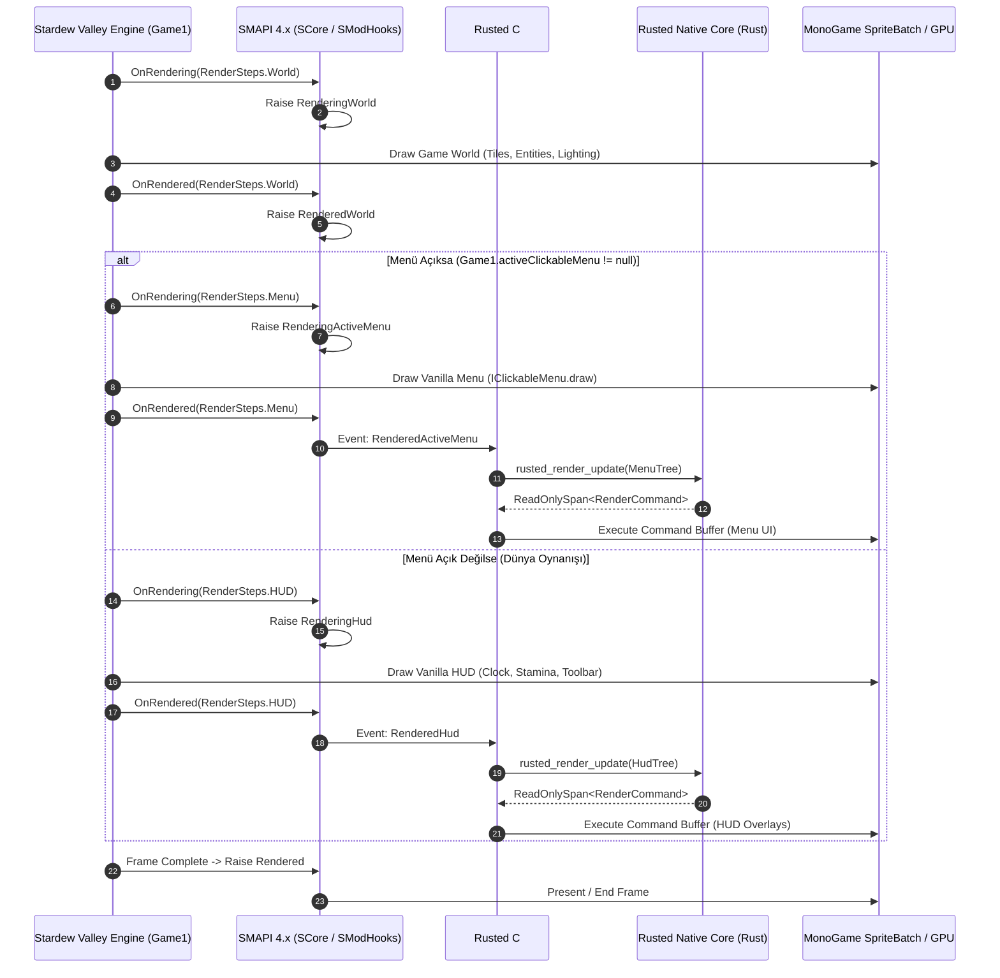
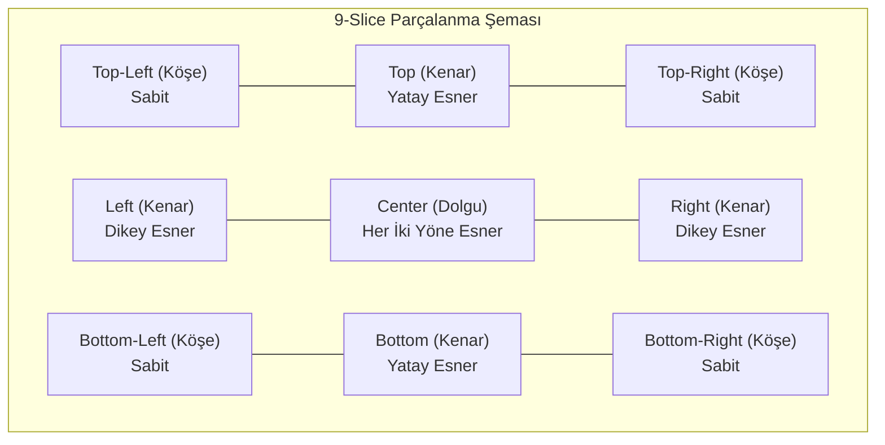
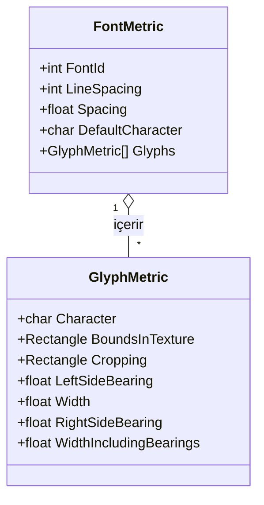
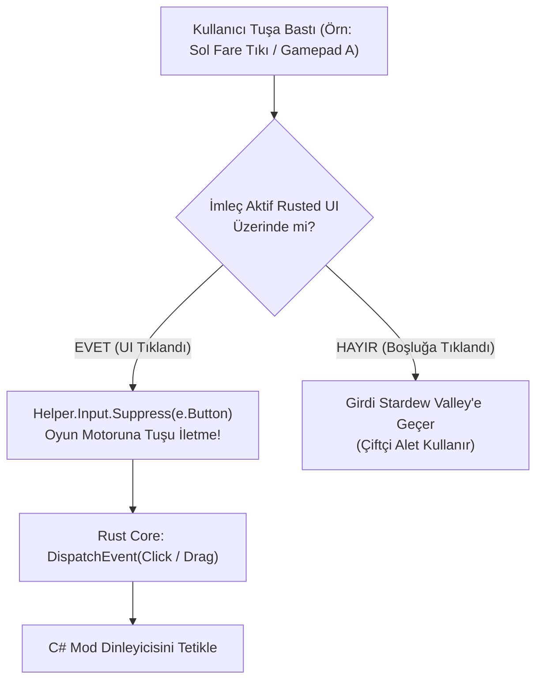

# Stardew Valley 1.6+ (SMAPI & MonoGame) UI/HUD Render Mimarisi ve Vanilya Varlık Spesifikasyonu

> **Durum:** Tamamlandı — Faz 0 Teknik Spesifikasyon  
> **Tarih:** 2026-11-07  
> **Hedef Çevre:** Stardew Valley 1.6+ (.NET 6.0 / MonoGame 3.8.1+) & SMAPI 4.x+  
> **İlişkili Doküman:** [01-project-baseline-and-architecture-plan.md](file:///home/mehmetcan/Code/Rusted/research/01-project-baseline-and-architecture-plan.md)  
> **Kapsam:** MonoGame `SpriteBatch` döngüsü, SMAPI render olayları, 9-slice kutu algoritması, vanilya texture atlas koordinatları, piksel font glif metrikleri, UI scale/zoom matematiği ve Gamepad/Fare girdi tüketimi.

---

## İçindekiler
1. [Yönetici Özeti ve Mimari Kapsam](#1-yönetici-özeti-ve-mimari-kapsam)
2. [SMAPI Render Event Yaşam Döngüsü ve Sırası](#2-smapi-render-event-yaşam-döngüsü-ve-sırası)
3. [MonoGame SpriteBatch State Yönetimi ve Clipping (Scissor Test)](#3-monogame-spritebatch-state-yönetimi-ve-clipping-scissor-test)
4. [Stardew Valley Vanilya Görsel Atlasları ve Koordinat Kataloğu](#4-stardew-valley-vanilya-görsel-atlasları-ve-koordinat-kataloğu)
5. [IClickableMenu 9-Slice Parçalanma Matematiği ve Gölge Protokolü](#5-iclickablemenu-9-slice-parçalanma-matematiği-ve-gölge-protokolü)
6. [Vanilya Renk Paleti ve Ses Efektleri Kataloğu](#6-vanilya-renk-paleti-ve-ses-efektleri-kataloğu)
7. [Font Sistemi, Glif Metrikleri ve Rust Layout Entegrasyonu](#7-font-sistemi-glif-metrikleri-ve-rust-layout-entegrasyonu)
8. [Ölçeklendirme Matematiği: pixelZoom (4x), uiScale ve zoomLevel](#8-ölçeklendirme-matematiği-pixelzoom-4x-uiscale-ve-zoomlevel)
9. [Fare & Gamepad Girdi Yakalama, Focus Search ve Tuş Tüketimi (Suppress)](#9-fare--gamepad-girdi-yakalama-focus-search-ve-tuş-tüketimi-suppress)
10. [Rusted Çekirdeği İçin C# ve Rust Veri Yapıları (Data Contract)](#10-rusted-çekirdeği-için-c-ve-rust-veri-yapıları-data-contract)
11. [Mühendislik Kontrol Listesi ve Entegrasyon Kuralları](#11-mühendislik-kontrol-listesi-ve-entegrasyon-kuralları)

---

## 1. Yönetici Özeti ve Mimari Kapsam

**Rusted (RustedUI)** motorunun Stardew Valley 1.6+ ortamında harici pencere (external OS window) açmadan, tamamen **oyun-içi yerel render (native in-game rendering)** gerçekleştirebilmesi için MonoGame grafik boru hattı (graphics pipeline) ve SMAPI mod kancaları (hooks) ile kusursuz bir uyum içinde çalışması şarttır.

Bu araştırma, Rusted'ın C# Translation Layer'ı (`rusted-bridge`) ve Rust yerel çekirdeği (`rusted-core`) arasındaki veri köprüsünü kurmak için gerekli tüm düşük seviyeli oyun parametrelerini ortaya koyar:
- **Sıfır Çizim Bozulması (Zero Visual Artifact):** MonoGame `SpriteBatch` state'lerinin (`SamplerState.PointClamp`, `BlendState.AlphaBlend`) korunması ve kaydırılabilir panellerde (scroll view) `RasterizerState.ScissorTestEnable` ile taşan piksellerin donanım seviyesinde kırpılması.
- **Doğal Pelican Estetiği (Pixel-Perfect Vanilla):** Oyunun orijinal dokularından (`LooseSprites/Cursors`, `LooseSprites/Cursors2`, `Menus/MenuTiles`, `LooseSprites/textBox`) alınan milimetrik piksel koordinatları, 9-slice kenarlık kalınlıkları ve 4x `pixelZoom` ölçeklemesi.
- **Önceden Hesaplanmış Tipografi (Pre-baked Typography):** `Game1.smallFont`, `Game1.dialogueFont` ve `Game1.tinyFont` glif metriklerinin oyun başlangıcında tek seferde Rust bellek haritasına aktarılması ve Taffy Flexbox motorunun C#'a hiç sormadan metin kutularını sıfır-kopya (zero-copy) ile hesaplaması.
- **Kusursuz Girdi Engelleme (Deterministic Input Suppression):** HUD ve menü widget'larına tıklanırken arka plandaki çiftçinin alet sallamasını veya envanterindeki tohumu ekmesini önleyen `Helper.Input.Suppress` mimarisi ile Gamepad analog/D-Pad imleç zıplatma (snapping) matematiği.

---

## 2. SMAPI Render Event Yaşam Döngüsü ve Sırası

Stardew Valley 1.6 güncellemesiyle birlikte oyunun çizim mimarisi `StardewValley.Mods.RenderSteps` aşamaları üzerinden modifiye edilmiştir. SMAPI 4.x bu aşamaları dinleyerek `IDisplayEvents` arayüzü üzerinden mod yapımcılarına olay bildirimleri sunar.

### 2.1 Render Aşamaları ve SMAPI Olay Eşlemesi

Oyunun ana çizim döngüsü (`Game1._draw`) her karede belirli adımları sırayla icra eder. SMAPI'nin `SModHooks.OnRendering` ve `SModHooks.OnRendered` kancaları aracılığıyla `SCore.RaiseRenderEvent` metodu tetiklenir:

| Çizim Adımı (`RenderSteps`) | SMAPI Başlangıç Olayı | SMAPI Bitiş Olayı | Çizilen İçerik | Koordinat Matrisi / Uzayı | Rusted UI Kullanım Amacı |
|:---|:---|:---|:---|:---|:---|
| **Genel Başlangıç / Bitiş** | `Rendering` | `Rendered` | Tüm karenin en başı ve en sonu | Ekran / Backbuffer | Tam ekran post-process, global overlay |
| **`RenderSteps.World`** | `RenderingWorld` | `RenderedWorld` | Harita karoları, binalar, çiftçi, NPC'ler, dünya nesneleri | World Matrix (`zoomLevel` çarpanı devrede) | Dünya içi UI (isimlikler, bitki sayaçları) |
| **`RenderSteps.HUD`** | `RenderingHud` | `RenderedHud` | Enerji/sağlık barları, saat/tarih, envanter toolbar'ı | UI Matrix (`uiScale` çarpanı devrede) | **Kalıcı HUD Barları, Mini Paneller, Widget'lar** |
| **`RenderSteps.Menu`** | `RenderingActiveMenu` | `RenderedActiveMenu` | `Game1.activeClickableMenu` (Envanter, sandık, diyalog, ayarlar) | UI Matrix (`uiScale` çarpanı devrede) | **Rusted Tam Ekran Pencereler ve Menüler** |
| **Herhangi Bir Aşama** | `RenderingStep` | `RenderedStep` | Spesifik `RenderSteps` aşaması | Aşamanın aktif matrisi | İnce ayarlı ara katman enjeksiyonu |

### 2.2 Render Akış Diyagramı (MonoGame Frame Lifecycle)

Aşağıdaki Mermaid sekans diyagramı, tek bir kare (frame) boyunca Stardew Valley motoru, SMAPI ve Rusted arasındaki çizim sırasını ve `SpriteBatch` durumunu gösterir:



> [!IMPORTANT]
> **Kritik Kural:** Stardew Valley varsayılan olarak bir menü açıkken (`Game1.activeClickableMenu != null`) HUD çizimini durdurur (`drawHUD = false`). Bu nedenle Rusted mimarisinde **HUD bileşenleri `RenderedHud`** olayında, **Açılır Menüler ise `RenderedActiveMenu`** olayında (veya `IClickableMenu` sarmalayıcısının `draw` metodunda) çizdirilmelidir.

---

## 3. MonoGame SpriteBatch State Yönetimi ve Clipping (Scissor Test)

MonoGame `SpriteBatch`, 2D sprite'ları GPU'ya gönderen temel çizim aracıdır. Ancak state yönetimi dikkatsiz yapılırsa piksel sanatı bulanıklaşabilir veya scroll clipping oyunun geri kalan çizimlerini bozabilir.

### 3.1 Standart State Parametreleri
Stardew Valley piksel sanatının (16x16 / 4x) bozulmaması için her render döngüsünde kullanılan `SpriteBatch.Begin` parametreleri:

- **`SpriteSortMode`**: `SpriteSortMode.Deferred`  
  Komutlar bellek kuyruğuna alınır ve `End()` çağrıldığında GPU'ya topluca (batch) gönderilir. Performans için esastır.
- **`BlendState`**: `BlendState.AlphaBlend`  
  Standart alfa harmanlama (şeffaf pikseller ve gölgeler için).
- **`SamplerState`**: `SamplerState.PointClamp`  
  **HAYATİ ÖNEMDE!** `LinearClamp` seçilirse piksel sınırları bulanıklaşır (anti-aliasing). `PointClamp`, piksellerin keskin kenarlı ve 4x büyütmede kristal netliğinde kalmasını sağlar.
- **`DepthStencilState`**: `DepthStencilState.None`  
  2D UI çiziminde Z-buffer derinlik testi devre dışı bırakılır; katman sıralaması çizim komut sırasıyla (order of arrival) belirlenir.
- **`RasterizerState`**: `RasterizerState.CullCounterClockwise` (Varsayılan) veya `RasterizerState.CullNone`.

### 3.2 Kaydırılabilir Panellerde Kırpma (Scroll Clipping / Scissor Test)

Kaydırılabilir bir liste veya envanter kutusunda (`overflow: hidden` / `overflow: scroll`), sınırları aşan içeriklerin ekran dışına taşmaması için MonoGame'in donanım bazlı **Scissor Rectangle** mekanizması kullanılır.

#### MonoGame Kırpma Kısıtları ve Çözümü:
1. **İç İçe `Begin()` Çağrılamaz:**  
   `SpriteBatch` açıkken tekrar `Begin()` çağrılırsa `InvalidOperationException: Begin cannot be called until End has been successfully called` fırlatılır.
2. **Scissor Test State Değişimi:**  
   `GraphicsDevice.ScissorRectangle`'ın devreye girmesi için `RasterizerState.ScissorTestEnable = true` olan bir rasterizer state ile yeni bir batch açılmalıdır.
3. **Piksel Ölçek Uyumsuzluğu:**  
   `GraphicsDevice.ScissorRectangle`, viewport'un **fiziksel ekran pikselleriyle (Hardware Backbuffer Coordinates)** çalışır! Ancak UI elemanları `uiScale` ile ölçeklendirilmiş UI koordinat uzayındadır.

#### Scissor Rectangle Koordinat Dönüşüm Formülü:
UI koordinat uzayındaki bir `clip_box (x, y, width, height)` donanım piksel koordinatlarına dönüştürülürken şu matematik uygulanır:

$$\text{Scissor}_X = \lfloor X_{\text{ui}} \times \text{uiScale} \rfloor$$
$$\text{Scissor}_Y = \lfloor Y_{\text{ui}} \times \text{uiScale} \rfloor$$
$$\text{Scissor}_{\text{Width}} = \lceil \text{Width}_{\text{ui}} \times \text{uiScale} \rceil$$
$$\text{Scissor}_{\text{Height}} = \lceil \text{Height}_{\text{ui}} \times \text{uiScale} \rceil$$

Ayrıca hesaplanan dikdörtgen grafik donanımının Viewport sınırları ile kesiştirilmelidir:

$$\text{FinalScissor} = \text{ScissorRect} \cap \text{ViewportBounds}$$

#### Rusted C# Clipping Protokolü (PushClip / PopClip):

```csharp
// Rusted.Smapi / Rendering / SpriteBatchContext.cs
public sealed class SpriteBatchContext
{
    private readonly SpriteBatch _batch;
    private readonly GraphicsDevice _device;
    private readonly Stack<Rectangle> _clipStack = new();
    private static readonly RasterizerState ScissorRasterizer = new() 
    { 
        CullMode = CullMode.None, 
        ScissorTestEnable = true 
    };

    public void PushClip(Rectangle uiClipRect, float uiScale)
    {
        // 1. Mevcut açık batch'i sonlandır
        _batch.End();

        // 2. UI uzayındaki rect'i fiziksel backbuffer piksellerine dönüştür
        int screenX = (int)Math.Floor(uiClipRect.X * uiScale);
        int screenY = (int)Math.Floor(uiClipRect.Y * uiScale);
        int screenW = (int)Math.Ceiling(uiClipRect.Width * uiScale);
        int screenH = (int)Math.Ceiling(uiClipRect.Height * uiScale);

        Rectangle hardwareRect = new(screenX, screenY, screenW, screenH);
        
        // Önceki clip varsa ikisinin kesişimini al (nested clipping desteği)
        if (_clipStack.Count > 0)
        {
            hardwareRect = Rectangle.Intersect(_clipStack.Peek(), hardwareRect);
        }
        _clipStack.Push(hardwareRect);

        // 3. GPU ScissorRectangle'ı ata ve scissor test ile batch'i yeniden başlat
        _device.ScissorRectangle = hardwareRect;
        _batch.Begin(
            SpriteSortMode.Deferred,
            BlendState.AlphaBlend,
            SamplerState.PointClamp,
            DepthStencilState.None,
            ScissorRasterizer,
            effect: null,
            transformMatrix: Matrix.CreateScale(uiScale)
        );
    }

    public void PopClip(float uiScale)
    {
        _batch.End();
        _clipStack.Pop();

        if (_clipStack.Count > 0)
        {
            // Bir önceki clip'e geri dön
            _device.ScissorRectangle = _clipStack.Peek();
            _batch.Begin(
                SpriteSortMode.Deferred,
                BlendState.AlphaBlend,
                SamplerState.PointClamp,
                DepthStencilState.None,
                ScissorRasterizer,
                effect: null,
                transformMatrix: Matrix.CreateScale(uiScale)
            );
        }
        else
        {
            // Scissor test olmayan normal batch'e geri dön
            _batch.Begin(
                SpriteSortMode.Deferred,
                BlendState.AlphaBlend,
                SamplerState.PointClamp,
                DepthStencilState.None,
                RasterizerState.CullCounterClockwise,
                effect: null,
                transformMatrix: Matrix.CreateScale(uiScale)
            );
        }
    }
}
```

---

## 4. Stardew Valley Vanilya Görsel Atlasları ve Koordinat Kataloğu

Rusted, harici hiçbir görsel dosyaya ihtiyaç duymadan, Stardew Valley'in kendi XNB/Texture2D varlıklarını kullanarak birebir vanilya hissi sunar.

### 4.1 Ana Doku Dosyaları (Texture Atlas Listesi)
Oyun açılışında `rusted-bridge` tarafından hafızaya alınan ve Rust çekirdeğine `TextureId` sabitleri ile eşleştirilen atlaslar:

1. `Tex::Cursors` -> `Game1.mouseCursors` (`LooseSprites/Cursors`)  
   Ana menü çerçeveleri, ikonlar, butonlar, kaydırma çubukları, oklar, checkbox, enerji/sağlık göstergeleri.
2. `Tex::Cursors2` -> `Game1.mouseCursors2` (`LooseSprites/Cursors2`)  
   1.5 ve 1.6 güncellemeleriyle eklenen yeni butonlar, çöp tenekesi varyantları ve mini ikonlar.
3. `Tex::MenuTiles` -> `Game1.menuTexture` (`Menus/MenuTiles`)  
   Ahşap menü arka planları, kalın çerçeveler, bölücü çizgiler (dividers) ve eşya yuvaları (item slots).
4. `Tex::MenuTilesUncolored` -> `Game1.uncoloredMenuTexture` (`Menus/MenuTilesUncolored`)  
   Mod yapımcılarının özel renklerle boyayabileceği (tinted) desatüre menü karoları.
5. `Tex::TextBox` -> `LooseSprites/textBox`  
   Metin giriş kutusu (input text field) 9-slice arka planı.
6. `Tex::Objects` -> `Maps/springobjects`  
   Tüm oyun içi eşyaların (ürünler, aletler, madenler, yiyecekler) 16x16 ikonları.

### 4.2 Kapsamlı Atlas Koordinat ve 9-Slice Matrisi

Aşağıdaki tablo, Stardew Valley kaynak kodlarından ve `StardewUI` testlerinden doğrulanmış, Rusted yerleşik bileşenlerinde kullanılacak kesin atlas koordinatlarıdır:

| Bileşen Adı | Atlas Dokusu | Kaynak Dikdörtgen (`SourceRect`) | Sabit Kenarlar (`FixedEdges: T, R, B, L`) | Varsayılan Ölçek | Açıklama / Vanilya Kullanımı |
|:---|:---|:---|:---|:---:|:---|
| **`MenuBorder`** | `MenuTiles` | `Rectangle(0, 0, 256, 256)` | `(64, 64, 64, 64)` | 1x (Ham) | Ana menü dış ahşap çerçevesi (Büyük menüler) |
| **`MenuBackground`** | `MenuTiles` | `Rectangle(64, 128, 64, 64)` | `(0, 0, 0, 0)` | 1x | Menü iç sarımtırak ahşap dolgu deseni |
| **`ControlBorder`** | `MenuTiles` | `Rectangle(0, 256, 60, 60)` | `(16, 16, 16, 16)` | 1x | Küçük kontrol kutuları, alt paneller |
| **`MenuSlotInset`** | `MenuTiles` | `Rectangle(0, 320, 60, 60)` | `(4, 10, 12, 4)` | 1x | Standart 64x64 gömülü eşya slotu (Envanter) |
| **`MenuSlotOutset`** | `MenuTiles` | `Rectangle(64, 320, 60, 60)` | `(8, 8, 8, 8)` | 1x | Kabarık (dışa doğru) eşya yuvası |
| **`MenuSlotTransparent`**| `MenuTiles` | `Rectangle(128, 128, 64, 64)` | `(4, 4, 4, 4)` | 1x | Şeffaf, ince kenarlıklı eşya yuvası |
| **`MenuHDivider`** | `MenuTiles` | `Rectangle(0, 64, 256, 64)` | `(64, 0, 64, 0)` | 1x | Menü içi yatay kalın ahşap ayırıcı çizgi |
| **`MenuVDivider`** | `MenuTiles` | `Rectangle(64, 0, 64, 256)` | `(0, 64, 0, 64)` | 1x | Menü içi dikey kalın ahşap ayırıcı çizgi |
| **`ThinHDivider`** | `MenuTiles` | `Rectangle(64, 412, 64, 8)` | `(0, 0, 0, 0)` | 4x | İnce yatay ayırıcı çizgi (Grid satırları) |
| **`ThinVDivider`** | `MenuTiles` | `Rectangle(156, 384, 8, 64)` | `(0, 0, 0, 0)` | 4x | İnce dikey ayırıcı çizgi (Grid sütunları) |
| **`BannerBackground`** | `Cursors` | `Rectangle(325, 318, 25, 18)` | `(12, 0, 12, 0)` | 4x | Parşömen başlık bandı (Diyalog başlıkları) |
| **`ButtonDark`** | `Cursors` | `Rectangle(256, 256, 10, 10)` | `(2, 2, 2, 2)` | 4x | Koyu buton (Normal/Neutral durum) |
| **`ButtonLight`** | `Cursors` | `Rectangle(267, 256, 10, 10)` | `(2, 2, 2, 2)` | 4x | Açık renkli buton (Hover/Üzerine gelindi durumu)|
| **`CheckboxUnchecked`**| `Cursors` | `Rectangle(227, 425, 9, 9)` | `(1, 1, 1, 1)` | 4x | Boş onay kutusu |
| **`CheckboxChecked`** | `Cursors` | `Rectangle(236, 425, 9, 9)` | `(1, 1, 1, 1)` | 4x | Yeşil "X" işaretli onay kutusu |
| **`CloseButton`** | `Cursors` | `Rectangle(337, 494, 12, 12)` | Sabit İkon | 4x (48x48) | Sağ-üst kırmızı "X" kapatma butonu |
| **`TabTopEmpty`** | `Cursors` | `Rectangle(16, 368, 16, 16)` | `(5, 5, 5, 1)` | 4x | Üst sekme butonu (Envanter menü sekmeleri) |
| **`ScrollBarTrack`** | `Cursors` | `Rectangle(403, 383, 6, 6)` | `(2, 2, 2, 2)` | 4x | Kaydırma çubuğu arka plan oluğu (Track) |
| **`ScrollThumb`** | `Cursors` | `Rectangle(435, 463, 6, 10)` | Sabit Sprite | 4x (24x40) | Kaydırma çubuğu tutamacı (Thumb) |
| **`SmallUpArrow`** | `Cursors` | `Rectangle(421, 459, 11, 12)` | Sabit Sprite | 4x (44x48) | Küçük yukarı ok (Scrollbar üstü) |
| **`SmallDownArrow`** | `Cursors` | `Rectangle(421, 472, 11, 12)` | Sabit Sprite | 4x (44x48) | Küçük aşağı ok (Scrollbar altı) |
| **`SmallLeftArrow`** | `Cursors` | `Rectangle(352, 495, 12, 11)` | Sabit Sprite | 4x (48x44) | Küçük sol ok (Sayfalama) |
| **`SmallRightArrow`**| `Cursors` | `Rectangle(365, 495, 12, 11)` | Sabit Sprite | 4x (48x44) | Küçük sağ ok (Sayfalama) |
| **`SliderTrack`** | `Cursors` | `OptionsSlider.sliderBGSource` | `(2, 2, 2, 2)` | 4x | Ses/Ayar slider oluğu |
| **`SliderButton`** | `Cursors` | `OptionsSlider.sliderButtonRect`| Sabit Sprite | 4x | Slider tutamacı |
| **`TextBoxBackground`**| `TextBox` | `Texture.Bounds (tam)` | `(16, 12, 12, 12)` | 1x | Yazı yazma input kutusu çerçevesi |
| **`TinyTrashCan`** | `Cursors` | `Rectangle(323, 433, 9, 10)` | Sabit Sprite | 4x | Küçük çöp tenekesi butonu |
| **`Digit_0` .. `9`** | `Cursors` | `Rectangle(368 + 5*i, 56, 5, 7)` | Sabit İkonlar | 4x (20x28) | Küçük sarı gölgeli rakamlar (Slot adetleri) |
| **`WhitePixel`** | `Cursors` | `Game1.staminaRect` | Tek Beyaz Piksel | 1x | Düz renk arka planlar ve progress barlar |

---

## 5. IClickableMenu 9-Slice Parçalanma Matematiği ve Gölge Protokolü

Stardew Valley'de pencereler sabit bir sprite olarak çizilmez; dinamik genişlik ve yüksekliğe göre 9 parçaya bölünerek (9-slice scaling) ölçeklendirilir.

### 5.1 9-Slice Grid Parçalanma Algoritması

Bir doku parçalanırken, kaynak dikdörtgen (`sourceRect`) ve sabit kenar kalınlıkları (`FixedEdges: Top, Right, Bottom, Left`) kullanılarak doku uzayında ve hedef ekran uzayında iki adet $3 \times 3$ matris oluşturulur:



#### Matematiksel Formülasyon:

Hedef koordinatlar: $X, Y, W, H$.  
Sabit kenarlar: $E_L, E_R, E_T, E_B$ (Piksel çarpanı ile çarpılmış hali: $E \times \text{Scale}$).

1. **Köşe Dikdörtgenleri (Fixed Corners):**
   - $\text{Dest}_{\text{TL}} = [X, Y, E_L, E_T]$
   - $\text{Dest}_{\text{TR}} = [X + W - E_R, Y, E_R, E_T]$
   - $\text{Dest}_{\text{BL}} = [X, Y + H - E_B, E_L, E_B]$
   - $\text{Dest}_{\text{BR}} = [X + W - E_R, Y + H - E_B, E_R, E_B]$

2. **Kenar Dikdörtgenleri (Stretched Edges):**
   - $\text{Dest}_{\text{Top}} = [X + E_L, Y, W - E_L - E_R, E_T]$
   - $\text{Dest}_{\text{Bottom}} = [X + E_L, Y + H - E_B, W - E_L - E_R, E_B]$
   - $\text{Dest}_{\text{Left}} = [X, Y + E_T, E_L, H - E_T - E_B]$
   - $\text{Dest}_{\text{Right}} = [X + W - E_R, Y + E_T, E_R, H - E_T - E_B]$

3. **Orta Dolgu (Center Fill):**
   - $\text{Dest}_{\text{Center}} = [X + E_L, Y + E_T, W - E_L - E_R, H - E_T - E_B]$

### 5.2 Menü İçerik Sınırları ve Kenarlık Boşlukları (Border Thickness)

`MenuBorder` (`Menus/MenuTiles`, 256x256) kullanıldığında, görsel ahşap dokusunun pürüzlü ve kıvrımlı dış kenarlarından ötürü içerik kutunun fiziksel $X, Y$ koordinatlarından başlayamaz.

StardewUI ve vanilya menü kaynak kodlarında tanımlanan kesin **İç Boşluk (Content Padding)** değerleri:

$$\text{MenuBorderThickness} = \{ \text{Top: } 36\text{px}, \text{Right: } 36\text{px}, \text{Bottom: } 40\text{px}, \text{Left: } 36\text{px} \}$$

Yani $W \times H$ boyutunda bir `sdv-box` penceresi açıldığında, içerik yerleşimi için kullanılabilir alan:
$$\text{Content}_X = X + 36$$
$$\text{Content}_Y = Y + 36$$
$$\text{Content}_{\text{Width}} = W - (36 + 36) = W - 72$$
$$\text{Content}_{\text{Height}} = H - (36 + 40) = H - 76$$

### 5.3 Piksel Gölge (Drop Shadow) Protokolü

Stardew Valley arayüzlerinin derinlik hissi iki temel gölge kuralına dayanır:

1. **Kutu ve Panel Gölgeleri (`IClickableMenu.drawTextureBox`):**
   - Eğer `drawShadow = true` ise, kutu çizilmeden önce aynı 9-slice komutu **$X + 8\text{px}, Y + 8\text{px}$** (veya $2 \times \text{pixelZoom}$) offsetiyle, renksizleştirilmiş ve siyaha boyanmış olarak ($\text{Color}(0, 0, 0, 100)$ / alfa 40%) bir kez arkaya çizilir.
2. **Metin Gölgeleri (`Utility.drawTextWithShadow`):**
   - Metin önce gölge rengiyle ($\text{Game1.textShadowColor}$) sağ-alt yönde offsetlenerek çizilir.
   - Offset miktarı:
     - `Game1.dialogueFont`: **$+3\text{px}$ X, $+3\text{px}$ Y** (Kalın gölge)
     - `Game1.smallFont`: **$+2\text{px}$ X, $+2\text{px}$ Y** (Standart gölge)
     - `Game1.tinyFont`: **$+1\text{px}$ X, $+1\text{px}$ Y** (İnce gölge)
   - Ardından orijinal metin asıl renkle ($X, Y$) koordinatına çizilir.

---

## 6. Vanilya Renk Paleti ve Ses Efektleri Kataloğu

Rusted UI bileşenlerinin harici stil yazılmadığında vanilya Stardew Valley temasıyla birebir uyumlu olmasını sağlayan renk ve ses sabitleri.

### 6.1 Renk Paleti Referans Tablosu

| Renk İsmi | MonoGame `Color` (RGB) | Hex Kodu | Kullanım Yeri / Açıklama |
|:---|:---|:---|:---|
| **`textColor`** | `Color(34, 17, 34)` | `#221122` | Standart menü metinleri, açıklamalar, görev metinleri (Çok koyu morumsu siyah) |
| **`dialogueTextColor`** | `Color(86, 22, 12)` | `#56160C` | Parşömen üzeri diyaloglar, başlıklar (Koyu kırmızımsı kahverengi) |
| **`textShadowColor`** | `Color(206, 156, 95)` | `#CE9C5F` | Parşömen zemin üzerinde altın/bej metin altı gölgesi |
| **`textShadowDarkerColor`**| `Color(34, 17, 34)` | `#221122` | Açık renkli zeminlerde veya 1.6 karanlık temalarda siyah gölge |
| **`unselectedOptionColor`**| `Color(128, 128, 128)` | `#808080` | Pasif seçenekler, seçilmemiş sekmeler |
| **`greyedOutColor`** | `Color(120, 120, 120, 180)`| `#787878B4` | Devre dışı bırakılmış (disabled) buton veya kilitli eşya yuvası |
| **`goldQualityColor`** | `Color(255, 215, 0)` | `#FFD700` | Altın kalite yıldızı ve para metinleri |
| **`iridiumQualityColor`** | `Color(230, 80, 255)` | `#E650FF` | İridyum kalite yıldızı metni |
| **`energyBarNormal`** | `Color(0, 210, 50)` | `#00D232` | Enerji barı dolu yeşil renk |
| **`energyBarLow`** | `Color(240, 50, 30)` | `#F0321E` | Enerji barı tükeniyor kırmızı renk |
| **`parchmentFill`** | `Color(255, 255, 255)` | `#FFFFFF` | Parşömen texture'ı beyaz tint ile çizilir |

### 6.2 Yerleşik UI Ses Efektleri Kataloğu

Rusted bileşenleri etkileşime girdiğinde C# tarafında `Game1.playSound(soundId)` çağrısıyla tetiklenecek vanilya ses efektleri:

| Ses ID | Ses Karakteristiği | Rusted Tetiklenme Noktası |
|:---|:---|:---|
| **`"shiny4"`** | Yumuşak, hafif ışıltılı pıtırtı | Buton üzerine fareyle gelindiğinde (`hover`), Slider sürüklendiğinde, Gamepad odağı değiştiğinde |
| **`"bigSelect"`** | Tok ve tatmin edici tıklama sesi | Ana menü butonu tıklandığında, Sekme (`Tab`) değiştirildiğinde |
| **`"smallSelect"`** | Kısa ve hafif tıklama | Checkbox tıklandığında, liste elemanı seçildiğinde, dropdown açıldığında |
| **`"dwop"`** | Yukarı doğru perde yükselen pıt sesi | Eşya yuvasından (`slot`) eşya alındığında veya bırakıldığında, bildirim kutusu belirdiğinde |
| **`"coin"`** | Madeni para şıngırtısı | Ödül talep edildiğinde, alışveriş yapıldığında, altın arttığında |
| **`"drumkit6"`** | Tahta çarpma / kapatma sesi | Büyük pencere `[X]` butonuyla veya Gamepad `B` tuşuyla kapatıldığında |
| **`"cancel"`** | Hata / geçersiz işlem sesi | Yetersiz bakiye veya kilitli bir butona tıklandığında |
| **`"trashcan"`** | Metalik çöp kutusu kapağı sesi | Eşya çöpe sürüklendiğinde veya silme butonuna basıldığında |

---

## 7. Font Sistemi, Glif Metrikleri ve Rust Layout Entegrasyonu

Stardew Valley'de metinler ya MonoGame'in `SpriteFont` formatında (`smallFont`, `dialogueFont`, `tinyFont`) ya da oyunun kendi bitmap motoru `SpriteText` ile çizilir.

### 7.1 Font Türleri ve Kullanım Alanları

1. **`Game1.dialogueFont`**: Büyük, okunaklı, kalın pikselli font. Menü başlıkları, NPC konuşmaları ve parşömen metinleri için kullanılır. (Satır yüksekliği ~32px).
2. **`Game1.smallFont`**: Standart oyun içi font. Eşya açıklamaları, ayar etiketleri, görev detayları, buton yazıları. (Satır yüksekliği ~24px).
3. **`Game1.tinyFont`**: Minyatür font. Envanter eşya yuvalarının sağ altındaki yığın sayıları (örn. "999"), mini barlar. (Satır yüksekliği ~16px).
4. **`SpriteText` (BMFont)**: Parşömen başlıklarında kıvrımlı ve renkli özel piksel font. `SpriteText.drawString` ile çizilir.

### 7.2 MonoGame `SpriteFont.Glyph` Anatomisi

MonoGame bir fontu yüklediğinde karakterleri bir doku atlasına paketler (`SpriteFont.Texture`). Her glif (`char`) için şu metrikleri hesaplar:



- **`BoundsInTexture` (`Rectangle`)**: Karakter görselinin font atlasındaki koordinatları ($X, Y, W, H$).
- **`Cropping` (`Rectangle`)**: Glifin çizim referans noktasına göre kırpılma ve baseline hizalama ofseti ($X, Y$).
- **`LeftSideBearing` (float)**: İmleç noktasından karakterin ilk çizilen pikseline kadar olan boşluk (kerning).
- **`Width` (float)**: Glifin saf piksel genişliği.
- **`RightSideBearing` (float)**: Karakterin son pikselinden bir sonraki karaktere kadar olan boşluk.
- **`WidthIncludingBearings`**: Karakterin toplam genişliği ($LSB + Width + RSB$).
- **`LineSpacing` (int)**: İki satırın taban çizgileri (baseline) arasındaki dikey mesafe.

### 7.3 Rust-C# Glif Senkronizasyon Protokolü (Zero-FFI Text Measuring)

Klasik yaklaşımlarda Taffy layout motoru her metin düğümünün genişliğini hesaplamak için C#'a FFI çağrısı yapar. Bu durum yüzlerce metin içeren bir UI'da her karede yüzlerce FFI geçişine (marshalling overhead) neden olur.

**Rusted'ın Çözümü (Pre-baked Lookup Table):**
Oyun açıldığında C# katmanı `Game1.smallFont`, `Game1.dialogueFont` ve `Game1.tinyFont`'taki tüm gliflerin metriklerini **tek bir seferde** Rust'a iletir:

```csharp
// Rusted.Smapi / Native / NativeMetricsSync.cs
[StructLayout(LayoutKind.Sequential)]
public struct NativeGlyphMetric
{
    public uint Character;        // UTF-32 codepoint
    public short BoundsX;
    public short BoundsY;
    public short BoundsW;
    public short BoundsH;
    public short CroppingX;
    public short CroppingY;
    public float LeftBearing;
    public float AdvanceWidth;
    public float RightBearing;
}

[StructLayout(LayoutKind.Sequential)]
public struct NativeFontSyncData
{
    public int FontId;           // 0: Small, 1: Dialogue, 2: Tiny
    public int LineSpacing;
    public float Spacing;
    public uint DefaultCharacter;
    public int GlyphCount;
    public IntPtr GlyphsPtr;     // NativeGlyphMetric*
}
```

Rust tarafında bu veriler düz dizilere ve hızlı arama tablolarına (`Flat Glyph Map`) dönüştürülür:

```rust
// rusted-core / text / font_metrics.rs
#[derive(Clone, Copy, Default)]
#[repr(C)]
pub struct GlyphData {
    pub bounds: [i16; 4],
    pub cropping: [i16; 2],
    pub advance: f32,
    pub left_bearing: f32,
}

pub struct RustedFont {
    pub line_spacing: f32,
    pub spacing: f32,
    pub default_char: char,
    // ASCII (0..127) için O(1) doğrudan dizi erişimi
    pub ascii_cache: [Option<GlyphData>; 128],
    // Genişletilmiş Unicode için hash map
    pub unicode_map: hashbrown::HashMap<char, GlyphData>,
}

impl RustedFont {
    #[inline(always)]
    pub fn get_glyph(&self, ch: char) -> Option<GlyphData> {
        let code = ch as usize;
        if code < 128 {
            self.ascii_cache[code]
        } else {
            self.unicode_map.get(&ch).copied()
        }
    }

    /// Taffy layout ölçüm fonksiyonu (C# çağrısı olmadan nanosaniyede biter)
    pub fn measure_string(&self, text: &str, max_width: Option<f32>) -> (f32, f32) {
        let mut max_line_width = 0.0f32;
        let mut current_line_width = 0.0f32;
        let mut lines = 1.0f32;
        let mut first_char = true;

        for ch in text.chars() {
            if ch == '\n' {
                max_line_width = max_line_width.max(current_line_width);
                current_line_width = 0.0;
                lines += 1.0;
                first_char = true;
                continue;
            }

            let glyph = self.get_glyph(ch).or_else(|| self.get_glyph(self.default_char));
            if let Some(g) = glyph {
                if first_char {
                    current_line_width += g.cropping[0].max(0) as f32;
                    first_char = false;
                } else {
                    current_line_width += g.left_bearing;
                }

                current_line_width += g.advance + self.spacing;

                // Word-wrap kontrolü
                if let Some(max_w) = max_width {
                    if current_line_width > max_w {
                        max_line_width = max_line_width.max(current_line_width - g.advance);
                        current_line_width = g.advance;
                        lines += 1.0;
                    }
                }
            }
        }

        max_line_width = max_line_width.max(current_line_width);
        (max_line_width, lines * self.line_spacing)
    }
}
```

---

## 8. Ölçeklendirme Matematiği: pixelZoom (4x), uiScale ve zoomLevel

Stardew Valley'de üç farklı ölçek çarpanı aynı anda etkindir. Bunların birbirine karıştırılması UI elemanlarının yanlış boyutta çizilmesine veya fare tıklamalarının kaymasına yol açar.

### 8.1 Ölçek Tanımları

1. **`Game1.pixelZoom = 4f`**:  
   Piksel sanatı sabiti. 16x16 olan kaynak pikselleri ekranda 64x64 piksele ($4 \times 4$) büyütür. Oyun dünyasındaki 1 karo (tile) $= 16 \times 4 = 64\text{px}$.
2. **`Game1.options.zoomLevel`**:  
   Dünya (World) yakınlaştırması (%75 ile %200 arasında değişir). Yalnızca `RenderSteps.World` aşamasında geçerlidir. **UI'ı etkilemez!**
3. **`Game1.options.uiScale`**:  
   Kullanıcı Arayüzü (UI) ölçeği (%75 ile %200 arasında ayarlanabilir). `RenderSteps.HUD` ve `RenderSteps.Menu` aşamalarında geçerlidir.

### 8.2 Koordinat Dönüşüm Formülleri

Stardew Valley UI modu açıkken (`Game1.InUIMode`), SpriteBatch'e `Matrix.CreateScale(uiScale)` transformu uygulanır. Bu durumda oyun içi UI koordinatları ile fiziksel pencere koordinatları arasındaki bağıntı şöyledir:

$$\text{Viewport}_{\text{UIWidth}} = \frac{\text{GraphicsDevice.Viewport.Width}}{\text{uiScale}}$$
$$\text{Viewport}_{\text{UIHeight}} = \frac{\text{GraphicsDevice.Viewport.Height}}{\text{uiScale}}$$

#### Fiziksel Ekran Faresinden -> UI Koordinatına Geçiş:
$$X_{\text{UI}} = \frac{X_{\text{Screen}}}{\text{uiScale}}$$
$$Y_{\text{UI}} = \frac{Y_{\text{Screen}}}{\text{uiScale}}$$

*(Not: SMAPI'nin `e.Cursor.GetScaledScreenPixels()` metodu bu bölme işlemini otomatik yaparak UI koordinatını döndürür).*

#### UI Koordinatından -> Fiziksel Ekran Scissor Kutusuna Geçiş:
$$X_{\text{Hardware}} = \lfloor X_{\text{UI}} \times \text{uiScale} \rfloor$$
$$Y_{\text{Hardware}} = \lfloor Y_{\text{UI}} \times \text{uiScale} \rfloor$$

### 8.3 Piksel-Sanatı Yuvarlama (Pixel Snapping)

Eğer Flexbox veya Grid motoru bir elemanın pozisyonunu küsuratlı (sub-pixel, örn. `x = 124.35px`) hesaplarsa, `SamplerState.PointClamp` altında piksel çizgileri titreşir (shimmering).

Rusted motoru, tüm Taffy layout koordinatlarını çizim komutu üretmeden önce `pixelZoom` (veya integer) ızgarasına kilitler:

$$\text{Snap}(v) = \text{round}(v)$$

Özellikle 4x büyütülen küçük vanilya sprite'larında ($10 \times 10 \rightarrow 40 \times 40$) elemanların genişlik ve yükseklikleri daima 4'ün tam katı olmalıdır.

---

## 9. Fare & Gamepad Girdi Yakalama, Focus Search ve Tuş Tüketimi (Suppress)

Bir UI kütüphanesinin en kritik görevi, kullanıcının UI ile etkileşime girdiği anda oyun dünyasını korumaktır.

### 9.1 Girdi Tüketimi (Input Suppression) Mekanizması

Oyuncu ekrandaki bir Rusted butonuna tıkladığında veya slider sürüklerken, arka plandaki karakterin elindeki kazmayı sallamaması veya bir tohum ekmemesi gerekir.

SMAPI bu işlem için `IInputHelper.Suppress(SButton)` API'sini sunar:



#### Hangi Olaylarda Suppress Çağrılmalı?
- **HUD Widget'ları:** HUD bileşenleri ekranda oyun dünyası ile yan yana durur. Fare bir HUD widget'ının sınırları (`bounds.Contains(cursor)`) içindeyse `SButton.MouseLeft` ve `SButton.MouseRight` kesinlikle **Suppress** edilmelidir.
- **Kaydırma:** İmleç bir scroll panel üzerindeyse fare tekerleği (`MouseWheelScrolled`) oyunun envanter toolbar slotunu değiştirmemesi için Suppress edilmelidir.
- **Tam Ekran Menüler:** Menü açıldığında `Game1.activeClickableMenu` Rusted menüsü olarak ayarlanırsa, Stardew Valley zaten dünya kontrollerini durdurur.

### 9.2 Gamepad / Controller Navigasyonu ve Odaklanma (Focus Search)

Stardew Valley konsol ve Steam Deck oyuncuları için Gamepad odaklama sistemine sahiptir.

#### Vanilya Sistem (`ClickableComponent`):
Vanilya menülerde her etkileşimli nesne bir `ClickableComponent`'tir. Menü açıldığında `allClickableComponents` taranır. D-Pad veya Sol Analog yönlendirildiğinde en yakın bileşen bulunur ve fare imleci o bileşenin merkezine zıplatılır.

#### Rusted'ın Odak Motoru (Rust Spatial Navigation):
Rusted, reflection gerektiren hantal `ClickableComponent` listesi yerine, Rust retained ağacındaki `focusable: true` düğümlerini kullanır:

1. **Yönlü Odak Araması (Spatial Search):**
   Kullanıcı Gamepad yön tuşuna bastığında (Yukarı, Aşağı, Sol, Sağ), aktif odaklı kutunun merkezinden ($C_x, C_y$) basılan yöndeki koni (cone projection) içinde kalan tüm aday kutular filtrelenir.
2. **Manhattan / Öklid Mesafe Puanlaması:**
   Aday kutular arasında açı ve mesafe ağırlıklı formül çalıştırılır:
   $$\text{Score} = \text{Distance} + (\text{AngleOffset} \times 2.0)$$
   En düşük puanlı eleman yeni odak noktası seçilir.
3. **İmleç Zıplatma (Cursor Snapping):**
   Rust yeni odak merkezini bildirdiğinde C# katmanı donanım imlecini hedefin merkezine taşır ve vanilya ses efektini çalar:

```csharp
public void SnapToNode(RustedNodeBounds bounds)
{
    int centerX = bounds.X + bounds.Width / 2;
    int centerY = bounds.Y + bounds.Height / 2;

    // ui_scale: true -> UI koordinat uzayında taşıma yapar
    Game1.setMousePosition(centerX, centerY, ui_scale: true);
    Game1.playSound("shiny4");
}
```

---

## 10. Rusted Çekirdeği İçin C# ve Rust Veri Yapıları (Data Contract)

C# ve Rust arasındaki sıfır-kopyalı çizim komut tamponu protokolü.

### 10.1 `#[repr(C)]` Render Komutu Formatı (Rust)

```rust
// crates/rusted-core/src/render/command.rs
#[repr(u8)]
#[derive(Debug, Clone, Copy, PartialEq, Eq)]
pub enum CommandKind {
    DrawQuad = 0,
    DrawNineSlice = 1,
    DrawSprite = 2,
    DrawText = 3,
    PushClip = 4,
    PopClip = 5,
}

#[repr(u8)]
#[derive(Debug, Clone, Copy, PartialEq, Eq)]
pub enum TextureId {
    None = 0,
    Cursors = 1,
    Cursors2 = 2,
    MenuTiles = 3,
    MenuTilesUncolored = 4,
    TextBox = 5,
    Objects = 6,
    Custom = 255,
}

#[repr(C)]
#[derive(Debug, Clone, Copy)]
pub struct RenderCommand {
    pub kind: CommandKind,
    pub texture_id: TextureId,
    pub custom_tex_id: u16,
    
    // Hedef Koordinatlar (X, Y, Width, Height)
    pub dest_rect: [f32; 4],
    
    // Atlas Kaynak Koordinatları (U, V, U_Width, V_Height)
    pub source_rect: [i16; 4],
    
    // 9-Slice Sabit Kenarlıklar (Top, Right, Bottom, Left)
    pub fixed_edges: [u8; 4],
    
    // Renk Tint (RGBA)
    pub color_rgba: [u8; 4],
    
    // Ek Parametreler (FontId, Rotation, Z-Index)
    pub font_or_param: u16,
    pub text_offset: u32,  // String havuzundaki başlangıç offseti
    pub text_len: u32,     // String uzunluğu
}
```

### 10.2 C# `RenderCommand` ve Yürütme Motoru (C# Bridge)

```csharp
// src/Rusted.Smapi/Rendering/RenderCommandExecutor.cs
[StructLayout(LayoutKind.Sequential, Pack = 1)]
public readonly struct RenderCommand
{
    public readonly byte Kind;
    public readonly byte TextureId;
    public readonly ushort CustomTexId;
    public readonly float DestX, DestY, DestW, DestH;
    public readonly short SourceX, SourceY, SourceW, SourceH;
    public readonly byte EdgeTop, EdgeRight, EdgeBottom, EdgeLeft;
    public readonly byte ColorR, ColorG, ColorB, ColorA;
    public readonly ushort FontOrParam;
    public readonly uint TextOffset;
    public readonly uint TextLen;
}

public static class RenderCommandExecutor
{
    public static void Execute(
        ReadOnlySpan<RenderCommand> commands, 
        ReadOnlySpan<byte> textPool,
        SpriteBatchContext ctx,
        float uiScale)
    {
        for (int i = 0; i < commands.Length; i++)
        {
            ref readonly var cmd = ref commands[i];
            Color tint = new(cmd.ColorR, cmd.ColorG, cmd.ColorB, cmd.ColorA);

            switch ((CommandKind)cmd.Kind)
            {
                case CommandKind.DrawNineSlice:
                    Texture2D tex = ResolveTexture(cmd.TextureId, cmd.CustomTexId);
                    Rectangle source = new(cmd.SourceX, cmd.SourceY, cmd.SourceW, cmd.SourceH);
                    Rectangle dest = new((int)cmd.DestX, (int)cmd.DestY, (int)cmd.DestW, (int)cmd.DestH);
                    Edges edges = new(cmd.EdgeTop, cmd.EdgeRight, cmd.EdgeBottom, cmd.EdgeLeft);
                    
                    NineSliceRenderer.Draw(ctx.Batch, tex, source, dest, edges, tint);
                    break;

                case CommandKind.DrawSprite:
                    Texture2D spriteTex = ResolveTexture(cmd.TextureId, cmd.CustomTexId);
                    Rectangle spriteSrc = new(cmd.SourceX, cmd.SourceY, cmd.SourceW, cmd.SourceH);
                    Rectangle spriteDest = new((int)cmd.DestX, (int)cmd.DestY, (int)cmd.DestW, (int)cmd.DestH);
                    
                    ctx.Batch.Draw(spriteTex, spriteDest, spriteSrc, tint);
                    break;

                case CommandKind.DrawText:
                    SpriteFont font = ResolveFont(cmd.FontOrParam);
                    string text = Encoding.UTF8.GetString(textPool.Slice((int)cmd.TextOffset, (int)cmd.TextLen));
                    Vector2 pos = new(cmd.DestX, cmd.DestY);
                    
                    ctx.Batch.DrawString(font, text, pos, tint);
                    break;

                case CommandKind.PushClip:
                    Rectangle clipRect = new((int)cmd.DestX, (int)cmd.DestY, (int)cmd.DestW, (int)cmd.DestH);
                    ctx.PushClip(clipRect, uiScale);
                    break;

                case CommandKind.PopClip:
                    ctx.PopClip(uiScale);
                    break;
            }
        }
    }
}
```

---

## 11. Mühendislik Kontrol Listesi ve Entegrasyon Kuralları

Faz 1 ve Faz 2 geliştirmeleri boyunca uyulması zorunlu kurallar bütünü:

- [ ] **Render Hook:** HUD widget'ları mutlaka `e.DisplayEvents.RenderedHud` içinde, Menü ekranları ise `RenderedActiveMenu` (veya `IClickableMenu.draw`) içinde çizilmelidir.
- [ ] **PointClamp Koruması:** Her çizim batch'i `SamplerState.PointClamp` ile açılmalı; harici modların `LinearClamp` ile açtığı batch'ler kapatılıp bizim state'imizle yeniden başlatılmalıdır.
- [ ] **Scissor Bounds Çarpımı:** `GraphicsDevice.ScissorRectangle` atanırken UI koordinatları mutlaka `uiScale` ile çarpılmalı ve `Viewport` sınırlarına kenetlenmelidir.
- [ ] **9-Slice Kenarlık Oranları:** `scale = 4` kullanılan küçük sprite'larda fixed edge kalınlıkları da 4 ile çarpılarak hedef koordinata oturmalıdır.
- [ ] **Sıfır FFI Metin Ölçümü:** Layout hesaplamalarında C#'ın `SpriteFont.MeasureString` metodu asla her frame çağrılmamalı; başlangıçta gönderilen Rust `GlyphData` tablosu kullanılmalıdır.
- [ ] **Girdi Yutma:** Aktif bir UI penceresi veya widget'ı üzerine tıklandığında `Helper.Input.Suppress(e.Button)` çağrılarak çiftçinin dünya içi eylemleri kilitlenmelidir.
- [ ] **Gamepad Cursor Snapping:** Odak değiştiğinde `Game1.setMousePosition(x, y, ui_scale: true)` çağrılmalı ve `shiny4` sesi oynatılmalıdır.
