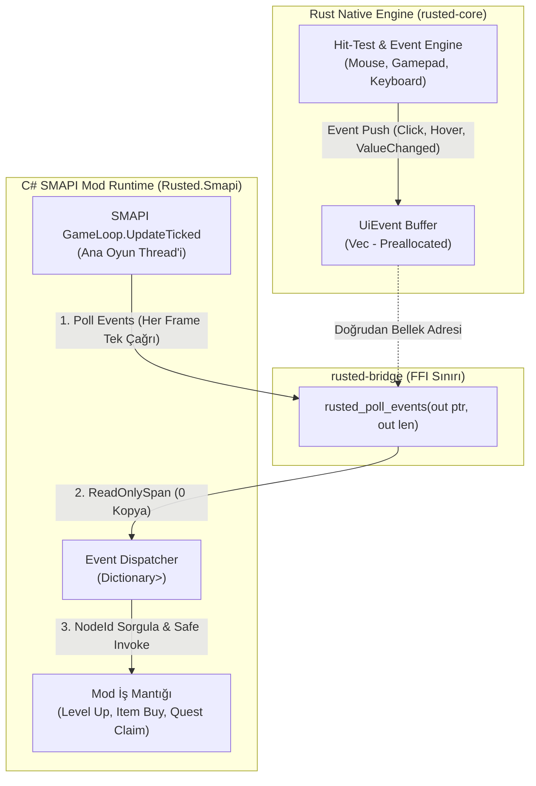
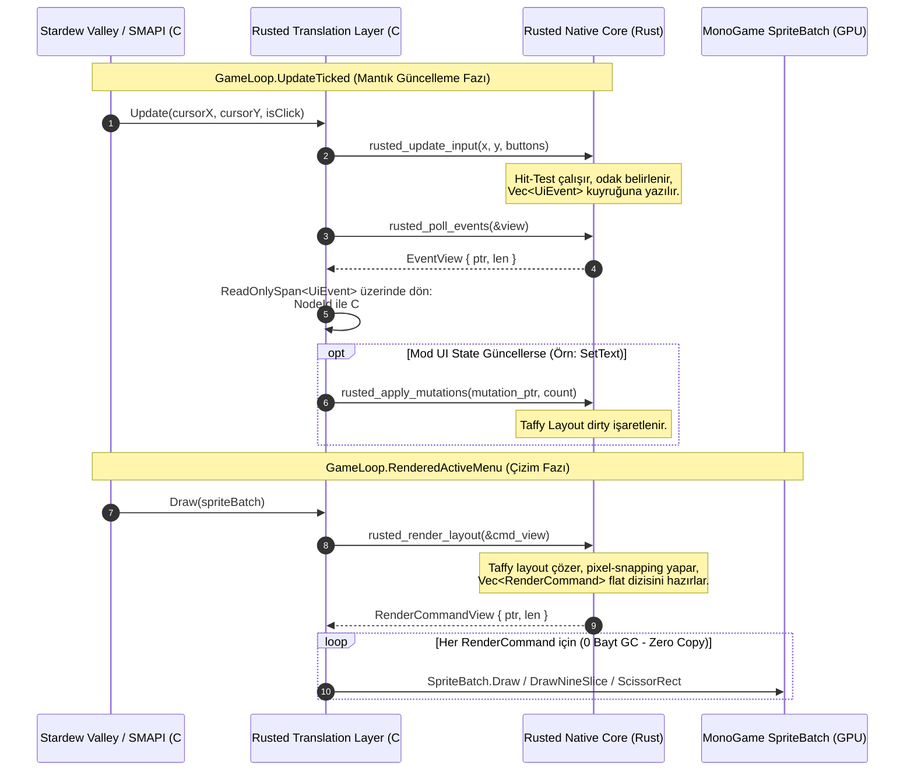

# Rusted (RustedUI) — C# / Rust Translation Layer (`rusted-bridge`) ve Çapraz Platform ABI Mimarisi

> **Doküman Kodu:** RUSTED-ARCH-004  
> **Durum:** Faz 0 — Teknik Araştırma & FFI/ABI Şartnamesi (Normative Specification)  
> **Tarih:** 2026-11-07  
> **Hedef Çalışma Zamanı:** .NET 6.0 (SMAPI 4.x / MonoGame 3.8+) & Rust 2021 Edition (1.75+)  
> **Desteklenen Platformlar:** Windows (x64), Linux (Arch, Ubuntu, Fedora, NixOS, Flatpak, SteamOS/Steam Deck), Proton / Wine Sandbox, macOS (Intel x86_64 & Apple Silicon arm64)

---

## İçindekiler
1. [Yönetici Özeti ve Mimari Vizyon](#1-yönetici-özeti-ve-mimari-vizyon)
2. [C# / Rust FFI Temelinde GC Çökmeleri ve Çözüm Mimarisi](#2-c--rust-ffi-temelinde-gc-çökmeleri-ve-çözüm-mimarisi)
   - 2.1 Delegate / Callback Pointer Faciası (`ExecutionEngineException`)
   - 2.2 Kurtarıcı Model: Pull-Based Event Queue + Handle ID (`NodeId`)
   - 2.3 Sıralı İletişim Akışı (Sequence Diagram)
3. [`#[repr(C)]` İkili Veri Protokolü ve Sıfır-GC Bellek Düzeni](#3-reprc-ikili-veri-protokolü-ve-sıfır-gc-bellek-düzeni)
   - 3.1 Bellek Uyumu (Alignment, Padding, StructLayout)
   - 3.2 `RenderCommand` Discriminated Union (Rust -> C# Çizim Komutları)
   - 3.3 `UiMutationOp` (C# -> Rust Toplu State/DOM Güncellemeleri)
   - 3.4 `UiEvent` (Rust -> C# Event Kuyruğu)
4. [Sıfır-Kopya (Zero-Copy) Render ve `ReadOnlySpan<RenderCommand>` Tüketimi](#4-sıfır-kopya-zero-copy-render-ve-readonlyspanrendercommand-tüketimi)
   - 4.1 Rust Tarafında Buffer Yaşam Döngüsü ve Bellek Yönetimi
   - 4.2 C# Tarafında `ReadOnlySpan` ile Kopyalamasız MonoGame Entegrasyonu
   - 4.3 `[SuppressGCTransition]` ile Nanosaniye Düzeyinde P/Invoke
5. [Otomatik FFI Bağlama: `csbindgen` Entegrasyonu](#5-otomatik-ffi-bağlama-csbindgen-entegrasyonu)
   - 5.1 `build.rs` Konfigürasyonu
   - 5.2 Üretilen C# Bağlamlarının Anatomisi
6. [Çapraz Platform ve Sandboxing Stratejisi](#6-çapraz-platform-ve-sandboxing-stratejisi)
   - 6.1 Windows ve Steam Deck / Linux Proton/Wine (`+crt-static`)
   - 6.2 Tüm Linux Dağıtımları ve Flatpak Sandbox (`cargo-zigbuild` / `glibc 2.17`)
   - 6.3 macOS Intel & Apple Silicon (Universal 2 Binary via `lipo`)
   - 6.4 C# .NET 6 `NativeLibrary.SetDllImportResolver` Otomasyonu
7. [Çapraz Platform Derleme ve Dağıtım Matrisi](#7-çapraz-platform-derleme-ve-dağıtım-matrisi)
8. [Stres Testi, Profiling ve Güvenlik Kontrol Listesi](#8-stres-testi-profiling-ve-güvenlik-kontrol-listesi)

---

## 1. Yönetici Özeti ve Mimari Vizyon

*Stardew Valley* mod ekosisteminde (.NET 6 / SMAPI 4+) yüksek performanslı ve modern bir kullanıcı arayüzü (UI) sunmanın önündeki en büyük engel, **C# Managed Heap** üzerindeki Garbage Collector (GC) baskısı ve yerel (unmanaged) kütüphaneler ile C# arasındaki FFI (Foreign Function Interface) köprülerinin kırılganlığıdır. 

Standart P/Invoke yaklaşımlarında her karede yüzlerce UI elemanının koordinatlarını, renklerini ve metin dizgilerini (strings) C# nesnesi olarak taşımak; Gen0/Gen1 GC koleksiyonlarına, mikro takılmalara (micro-stutter) ve frame-drop yaşanmasına yol açar. Daha da kötüsü, C#'tan unmanaged C/Rust koduna delegate (callback) pointer geçmek, .NET Garbage Collector'ın thunk belleklerini temizlemesiyle ölümcül **`ExecutionEngineException` (0x80131506)** çökmeleri üretir.

**RustedUI Translation Layer (`rusted-bridge`)**, bu problemleri şu 4 katı prensiple kökünden çözer:
1. **0 Bayt GC Allocation / Frame:** 60 FPS, 144 FPS veya 240 FPS yenileme hızlarında, C# ve Rust arasında tek bir bayt managed heap tahsisi yapılmaz. Tüm render komutları ve olaylar `#[repr(C)]` blittable struct dizileri olarak doğrudan unmanaged bellek üzerinden paylaşılır.
2. **Sıfır Callback (Pull-Based Architecture):** Rust motoruna C# tarafından asla fonksiyon işaretçisi (callback delegate) aktarılmaz. Tüm etkileşimler (tıklama, odak, değer değişimi) çift yönlü çekme (pull) kuyruğu ve `NodeId` handle indeksleri üzerinden yürütülür.
3. **Sıfır Harici OS Bağımlılığı (Zero System Dependency):** Rust tarafı işletim sisteminin pencere yöneticisine (Win32 HWND, X11, Wayland, Cocoa, WebKit) dokunmaz. Yalnızca saf bellek manipülasyonu, Flexbox/Grid yerleşim matematiği ve piksel komut sentezi yapar.
4. **Evrensel Sandbox Uyumluluğu:** Windows (`x86_64-pc-windows-msvc` + `crt-static`), SteamOS/Proton, Arch/Ubuntu/Fedora/NixOS/Flatpak (`cargo-zigbuild` ile `glibc 2.17`) ve macOS (`lipo` Universal 2) platformlarında hiçbir eksik kütüphane (`vcruntime140.dll` veya `GLIBC_2.38 not found`) hatası olmadan tak-çalıştır çalışır.

---

## 2. C# / Rust FFI Temelinde GC Çökmeleri ve Çözüm Mimarisi

### 2.1 Delegate / Callback Pointer Faciası (`ExecutionEngineException`)

Geleneksel GUI veya oyun motoru sarmalayıcılarında (wrappers) en yaygın yapılan tasarım hatası, bir butona tıklandığında C# kodunu çalıştırmak için Rust tarafına bir C# delegate fonksiyon işaretçisi (`Action` veya `delegate* unmanaged[Cdecl]`) kaydetmektir:

```csharp
// ⚠️ TEHLİKELİ VE ÇÖKMEYE MAHKUM YAKLAŞIM (ANTI-PATTERN)
public class BadButton
{
    private Action _onClick;
    public void SetClickHandler(Action action)
    {
        _onClick = action;
        // Rust'a C# delegate'inin fonksiyon işaretçisi aktarılıyor:
        IntPtr fnPtr = Marshal.GetFunctionPointerForDelegate(_onClick);
        NativeMethods.rusted_button_set_callback(this.NodeId, fnPtr);
    }
}
```

#### Bu Yaklaşım Neden Çöker?
1. **P/Invoke Reverse Thunk ve GC Relocation:** CoreCLR, `Marshal.GetFunctionPointerForDelegate` çağrıldığında unmanaged dünyadan managed dünyaya geçiş sağlayan bir makine kodu köprüsü (reverse P/Invoke trampoline / thunk) üretir. Rust tarafı bu pointer'ı unmanaged heap'te saklar. Ancak .NET Garbage Collector unmanaged belleği tarayamaz! Dolayısıyla `_onClick` delegate'i managed tarafta köklenmemişse (veya enclosing class GC tarafından taşınmış/temizlenmişse), thunk serbest kalır. Rust bu adrese zıpladığı an CPU `Access Violation` (SIGSEGV) alır ve CoreCLR kurtarılamaz bir `ExecutionEngineException` fırlatarak oyunu anında masaüstüne çökertir (Crash to Desktop).
2. **`GCHandle.Alloc` Tuzağı ve Bellek Sızıntısı:** Bu çöküşü önlemek için `GCHandle.Alloc(action, GCHandleType.Normal)` yapılabilir; ancak bu sefer mod kaldırıldığında, UI kapatıldığında veya SMAPI modu yeniden yüklendiğinde (hot-reload) serbest bırakılmayan pin'ler yüzünden gigabaytlarca managed bellek sızar.
3. **Re-entrancy ve Thread Deadlock:** Eğer Rust bir render döngüsü veya arka plan layout işlemi sırasında callback'i tetiklerse, C# MonoGame çizim thread'i ile Rust senkronizasyon kilitleri deadlock'a girer. Managed kodda bir C# exception fırlatılırsa, unmanaged Rust stack unwinding yapılamadığı için runtime anında çöker.

---

### 2.2 Kurtarıcı Model: Pull-Based Event Queue + Handle ID (`NodeId`)

RustedUI, C# delegate'lerini unmanaged dünyaya aktarmayı **kökten yasaklar**. Bunun yerine mimari **Pull-Based Event Queue** ve **Opak Tanımlayıcılar (`NodeId`)** üzerine kuruludur:



#### Bu Mimari Neden %100 Güvenlidir?
1. **Sıfır Thunk, Sıfır Delegate:** Rust tarafı hiçbir zaman bir C# fonksiyon adresini tanımaz, saklamaz veya çalıştırmaz.
2. **Tam Thread Uyumu (Main Thread Affinity):** Stardew Valley ve MonoGame'in `Game1` nesneleri yalnızca ana oyun thread'inde güvenle değiştirilebilir. C# tarafı olayları `GameLoop.UpdateTicked` anında kendi thread'inde Rust'tan "çektiği" (pull) için cross-thread senkronizasyon hataları imkansız hale gelir.
3. **`NodeId` Handle Güvenliği:** Bir UI elemanı yok edildiğinde, C# tarafındaki `Dictionary<uint, Action>` kaydı silinir. Rust'tan eski bir olay gelse bile C# sözlüğünde bulunamaz ve güvenle yok sayılır (No-op). Asla dangling pointer veya use-after-free oluşamaz.

---

### 2.3 Sıralı İletişim Akışı (Sequence Diagram)

Aşağıdaki sequence diyagramı, bir oyuncunun menüdeki butona tıklamasından ekrandaki çizim güncellemesine kadar olan tam kare döngüsünü (frame lifecycle) göstermektedir:



---

## 3. `#[repr(C)]` İkili Veri Protokolü ve Sıfır-GC Bellek Düzeni

C# ve Rust arasında veri aktarımında **sıfır kopya** ve **sıfır GC tahsisi** sağlamak için kullanılan tüm veri yapıları C-ABI uyumlu (`#[repr(C)]`), blittable (bellek kopyalama ve doğrudan okumaya uygun) ve sabit boyutlu (fixed-layout) olarak tasarlanmıştır.

### 3.1 Bellek Uyumu (Alignment, Padding, StructLayout)

- **Rust Tarafı:** `#[repr(C)]` ve discriminant boyutu net olan `#[repr(u32)]` enum'lar.
- **C# Tarafı:** `[StructLayout(LayoutKind.Sequential, Pack = 8)]` (düz struct'lar) ve `[StructLayout(LayoutKind.Explicit, Size = X)]` (union'lar).
- **Blittable Garantisi:** Struct'lar managed referans (`string`, `class`, managed dizi) içermez. Yalnızca primitive tipler (`float`, `uint`, `byte`) ve sabit boyutlu unmanaged pointer/offset'ler taşır.

---

### 3.2 `RenderCommand` Discriminated Union (Rust -> C# Çizim Komutları)

Rust tarafında üretilen ve C# MonoGame `SpriteBatch` tarafından her karede tüketilen ana çizim komutu:

#### Rust Tanımı (`rusted-core / ffi.rs`):
```rust
#[repr(u32)]
#[derive(Debug, Clone, Copy, PartialEq, Eq)]
pub enum RenderCommandKind {
    DrawNineSlice = 0,
    DrawSprite    = 1,
    DrawGlyphRun  = 2,
    DrawRect      = 3,
    PushClipRect  = 4,
    PopClipRect   = 5,
}

#[repr(C)]
#[derive(Debug, Clone, Copy, Default)]
pub struct RectF {
    pub x: f32,
    pub y: f32,
    pub width: f32,
    pub height: f32,
}

#[repr(C)]
#[derive(Debug, Clone, Copy, Default)]
pub struct RectI {
    pub x: i32,
    pub y: i32,
    pub width: i32,
    pub height: i32,
}

#[repr(C)]
#[derive(Debug, Clone, Copy, Default)]
pub struct ColorRgba {
    pub r: u8,
    pub g: u8,
    pub b: u8,
    pub a: u8,
}

#[repr(C)]
#[derive(Debug, Clone, Copy, Default)]
pub struct BorderInsets {
    pub top: f32,
    pub right: f32,
    pub bottom: f32,
    pub left: f32,
}

#[repr(C)]
#[derive(Debug, Clone, Copy)]
pub struct DrawNineSlicePayload {
    pub dest_rect: RectF,
    pub source_rect: RectI,
    pub insets: BorderInsets,
    pub color_tint: ColorRgba,
    pub texture_id: u32,
    pub scale: f32,
}

#[repr(C)]
#[derive(Debug, Clone, Copy)]
pub struct DrawSpritePayload {
    pub dest_rect: RectF,
    pub source_rect: RectI,
    pub color_tint: ColorRgba,
    pub rotation: f32,
    pub origin_x: f32,
    pub origin_y: f32,
    pub texture_id: u32,
    pub effects: u32, // 0: None, 1: FlipHorizontally, 2: FlipVertically
}

#[repr(C)]
#[derive(Debug, Clone, Copy)]
pub struct DrawGlyphRunPayload {
    pub dest_rect: RectF,
    pub color_tint: ColorRgba,
    pub font_id: u32,
    pub glyph_offset: u32, // Paylaşımlı glyph tamponundaki başlangıç indeksi
    pub glyph_count: u32,
    pub scale: f32,
}

#[repr(C)]
#[derive(Debug, Clone, Copy)]
pub struct DrawRectPayload {
    pub dest_rect: RectF,
    pub fill_color: ColorRgba,
    pub border_color: ColorRgba,
    pub border_width: f32,
    pub border_radius: f32,
}

#[repr(C)]
#[derive(Debug, Clone, Copy)]
pub struct PushClipRectPayload {
    pub clip_rect: RectI,
}

#[repr(C)]
#[derive(Clone, Copy)]
pub union RenderCommandPayload {
    pub nine_slice: DrawNineSlicePayload,
    pub sprite: DrawSpritePayload,
    pub glyph_run: DrawGlyphRunPayload,
    pub rect: DrawRectPayload,
    pub clip: PushClipRectPayload,
}

#[repr(C)]
#[derive(Clone, Copy)]
pub struct RenderCommand {
    pub kind: RenderCommandKind,
    pub layer_depth: f32, // MonoGame SpriteBatch layerDepth [0.0 .. 1.0]
    pub payload: RenderCommandPayload,
}

#[repr(C)]
pub struct RenderCommandSliceView {
    pub data: *const RenderCommand,
    pub len: usize,
}
```

#### C# Karşılığı (`Rusted.Smapi / NativeProtocol.cs`):
```csharp
using System;
using System.Runtime.InteropServices;

namespace Rusted.Smapi.Native
{
    public enum RenderCommandKind : uint
    {
        DrawNineSlice = 0,
        DrawSprite    = 1,
        DrawGlyphRun  = 2,
        DrawRect      = 3,
        PushClipRect  = 4,
        PopClipRect   = 5
    }

    [StructLayout(LayoutKind.Sequential)]
    public struct RectF
    {
        public float X;
        public float Y;
        public float Width;
        public float Height;
    }

    [StructLayout(LayoutKind.Sequential)]
    public struct RectI
    {
        public int X;
        public int Y;
        public int Width;
        public int Height;
    }

    [StructLayout(LayoutKind.Sequential)]
    public struct ColorRgba
    {
        public byte R;
        public byte G;
        public byte B;
        public byte A;
    }

    [StructLayout(LayoutKind.Sequential)]
    public struct BorderInsets
    {
        public float Top;
        public float Right;
        public float Bottom;
        public float Left;
    }

    [StructLayout(LayoutKind.Sequential)]
    public struct DrawNineSlicePayload
    {
        public RectF DestRect;
        public RectI SourceRect;
        public BorderInsets Insets;
        public ColorRgba ColorTint;
        public uint TextureId;
        public float Scale;
    }

    [StructLayout(LayoutKind.Sequential)]
    public struct DrawSpritePayload
    {
        public RectF DestRect;
        public RectI SourceRect;
        public ColorRgba ColorTint;
        public float Rotation;
        public float OriginX;
        public float OriginY;
        public uint TextureId;
        public uint Effects;
    }

    [StructLayout(LayoutKind.Sequential)]
    public struct DrawGlyphRunPayload
    {
        public RectF DestRect;
        public ColorRgba ColorTint;
        public uint FontId;
        public uint GlyphOffset;
        public uint GlyphCount;
        public float Scale;
    }

    [StructLayout(LayoutKind.Sequential)]
    public struct DrawRectPayload
    {
        public RectF DestRect;
        public ColorRgba FillColor;
        public ColorRgba BorderColor;
        public float BorderWidth;
        public float BorderRadius;
    }

    [StructLayout(LayoutKind.Sequential)]
    public struct PushClipRectPayload
    {
        public RectI ClipRect;
    }

    [StructLayout(LayoutKind.Explicit, Size = 48)]
    public struct RenderCommandPayload
    {
        [FieldOffset(0)] public DrawNineSlicePayload NineSlice;
        [FieldOffset(0)] public DrawSpritePayload Sprite;
        [FieldOffset(0)] public DrawGlyphRunPayload GlyphRun;
        [FieldOffset(0)] public DrawRectPayload Rect;
        [FieldOffset(0)] public PushClipRectPayload Clip;
    }

    [StructLayout(LayoutKind.Sequential)]
    public struct RenderCommand
    {
        public RenderCommandKind Kind;
        public float LayerDepth;
        public RenderCommandPayload Payload;
    }

    [StructLayout(LayoutKind.Sequential)]
    public unsafe struct RenderCommandSliceView
    {
        public RenderCommand* Data;
        public UIntPtr Len;
    }
}
```

#### Bellek Haritası ve Boyut Doğrulaması (Memory Verification):
| Alan | Tip | Boyut (Bayt) | Offset (Bayt) | Hizalama (Alignment) |
|---|---|---|---|---|
| `Kind` | `u32` (Enum) | 4 | 0 | 4 |
| `LayerDepth` | `f32` | 4 | 4 | 4 |
| `Payload` | `Union (Explicit)` | 48 | 8 | 4 / 8 |
| **Toplam Boyut** | **`RenderCommand`** | **56 Bayt** | — | **8 Bayt Sınırı** |

> [!NOTE]
> 1.000 adet çizim komutu unmanaged RAM'de yalnızca **~56 KB** yer kaplar. 60 FPS'te L1/L2 CPU önbelleğine rahatça sığar ve C# tarafına tek bir 8-baytlık işaretçiyle aktarılır.

---

### 3.3 `UiMutationOp` (C# -> Rust Toplu State/DOM Güncellemeleri)

Mod geliştiricisi C# tarafında UI state'ini değiştirdiğinde (örneğin görev sayacı arttığında veya diyalog metni değiştiğinde), her işlem için ayrı bir FFI çağrısı yapmak yerine komutlar topluca (batch) aktarılır:

```rust
#[repr(u32)]
#[derive(Debug, Clone, Copy, PartialEq, Eq)]
pub enum MutationKind {
    SetText       = 0,
    SetVisibility = 1,
    SetProgress   = 2,
    SetStyleProp  = 3,
    RemoveNode    = 4,
}

#[repr(C)]
#[derive(Clone, Copy)]
pub struct TextMutationPayload {
    pub utf8_ptr: *const u8,
    pub utf8_len: u32,
}

#[repr(C)]
#[derive(Clone, Copy)]
pub struct ProgressMutationPayload {
    pub current: f32,
    pub max: f32,
}

#[repr(C)]
#[derive(Clone, Copy)]
pub struct StyleMutationPayload {
    pub prop_id: u32,
    pub value_raw: u32, // Bitflag, Renk veya Float transmute
}

#[repr(C)]
#[derive(Clone, Copy)]
pub union MutationPayload {
    pub text: TextMutationPayload,
    pub is_visible: bool,
    pub progress: ProgressMutationPayload,
    pub style: StyleMutationPayload,
}

#[repr(C)]
#[derive(Clone, Copy)]
pub struct UiMutationOp {
    pub node_id: u32,
    pub kind: MutationKind,
    pub payload: MutationPayload,
}
```

C# tarafı `Span<UiMutationOp>` doldurur ve tek bir FFI çağrısı yapar:
```csharp
[DllImport("rusted_bridge", CallingConvention = CallingConvention.Cdecl)]
[SuppressGCTransition]
public static extern unsafe void rusted_apply_mutations(UiMutationOp* ops, uint count);
```

---

### 3.4 `UiEvent` (Rust -> C# Event Kuyruğu)

```rust
#[repr(u32)]
#[derive(Debug, Clone, Copy, PartialEq, Eq)]
pub enum UiEventKind {
    Click        = 0,
    HoverEnter   = 1,
    HoverLeave   = 2,
    Focus        = 3,
    Blur         = 4,
    ValueChanged = 5,
    Submit       = 6,
}

#[repr(C)]
#[derive(Clone, Copy)]
pub struct MouseEventPayload {
    pub mouse_x: f32,
    pub mouse_y: f32,
    pub button: u32, // 0: Left, 1: Right, 2: Middle
}

#[repr(C)]
#[derive(Clone, Copy)]
pub union UiEventPayload {
    pub mouse: MouseEventPayload,
    pub float_value: f32,
    pub int_value: i32,
}

#[repr(C)]
#[derive(Clone, Copy)]
pub struct UiEvent {
    pub node_id: u32,
    pub kind: UiEventKind,
    pub payload: UiEventPayload,
}

#[repr(C)]
pub struct UiEventSliceView {
    pub data: *const UiEvent,
    pub len: usize,
}
```

---

## 4. Sıfır-Kopya (Zero-Copy) Render ve `ReadOnlySpan<RenderCommand>` Tüketimi

### 4.1 Rust Tarafında Buffer Yaşam Döngüsü ve Bellek Yönetimi

Rust çekirdeğinde (`rusted-core`), her karede sıfırdan vektör tahsis etmek (reallocation) yasaktır. Çizim komut tamponu (`Vec<RenderCommand>`) motor başlatıldığında rezerve edilir ve her karede yalnızca sayacı sıfırlanır (`clear()`):

```rust
pub struct RenderBufferManager {
    commands: Vec<RenderCommand>,
    glyphs: Vec<u16>, // UTF-16 glyph indeksleri
}

impl RenderBufferManager {
    pub fn new() -> Self {
        Self {
            commands: Vec::with_capacity(1024),
            glyphs: Vec::with_capacity(4096),
        }
    }

    #[inline(always)]
    pub fn begin_frame(&mut self) {
        self.commands.clear();
        self.glyphs.clear();
    }

    #[inline(always)]
    pub fn push_command(&mut self, cmd: RenderCommand) {
        self.commands.push(cmd);
    }

    #[inline(always)]
    pub fn get_view(&self) -> RenderCommandSliceView {
        RenderCommandSliceView {
            data: self.commands.as_ptr(),
            len: self.commands.len(),
        }
    }
}
```

> [!TIP]
> `Vec::clear()` çağrısı tahsis edilen kapasiteyi (capacity) korur, yalnızca uzunluğu (len) sıfırlar. Bu sayede ilk birkaç kareden sonra Rust tarafındaki bellek tahsisi tam olarak **0 bayta** iner!

---

### 4.2 C# Tarafında `ReadOnlySpan` ile Kopyalamasız MonoGame Entegrasyonu

C# .NET 6'da `ReadOnlySpan<T>`, unmanaged işaretçileri güvenli, dizin denetimli ve sıfır GC maliyetiyle sarmalamanın en optimize yoludur.

```csharp
using System;
using Microsoft.Xna.Framework;
using Microsoft.Xna.Framework.Graphics;
using Rusted.Smapi.Native;

namespace Rusted.Smapi.Rendering
{
    public sealed class RustedRenderer
    {
        private readonly TextureAtlasResolver _atlasResolver;
        private readonly GraphicsDevice _graphicsDevice;
        private Rectangle _originalScissorRect;

        public RustedRenderer(GraphicsDevice graphicsDevice, TextureAtlasResolver atlasResolver)
        {
            _graphicsDevice = graphicsDevice;
            _atlasResolver = atlasResolver;
        }

        public unsafe void Render(SpriteBatch spriteBatch)
        {
            // 1. Rust'tan unmanaged slice görünümünü al (FFI çağrısı)
            RenderCommandSliceView view;
            NativeMethods.rusted_render_layout(&view);

            if (view.Data == null || view.Len == UIntPtr.Zero)
                return;

            // 2. Unmanaged işaretçiden 0 kopya ile ReadOnlySpan oluştur (0 Bayt GC Allocation!)
            ReadOnlySpan<RenderCommand> commands = new ReadOnlySpan<RenderCommand>(view.Data, (int)view.Len);

            // 3. Komutları doğrudan oku ve MonoGame SpriteBatch ile çiz
            for (int i = 0; i < commands.Length; i++)
            {
                ref readonly RenderCommand cmd = ref commands[i];

                switch (cmd.Kind)
                {
                    case RenderCommandKind.DrawNineSlice:
                        DrawNineSlice(spriteBatch, in cmd.Payload.NineSlice, cmd.LayerDepth);
                        break;

                    case RenderCommandKind.DrawSprite:
                        DrawSprite(spriteBatch, in cmd.Payload.Sprite, cmd.LayerDepth);
                        break;

                    case RenderCommandKind.DrawRect:
                        DrawRect(spriteBatch, in cmd.Payload.Rect, cmd.LayerDepth);
                        break;

                    case RenderCommandKind.PushClipRect:
                        ApplyScissor(spriteBatch, in cmd.Payload.Clip);
                        break;

                    case RenderCommandKind.PopClipRect:
                        RestoreScissor(spriteBatch);
                        break;
                }
            }
        }

        private void DrawNineSlice(SpriteBatch spriteBatch, in DrawNineSlicePayload p, float layerDepth)
        {
            Texture2D texture = _atlasResolver.GetTexture(p.TextureId);
            Color tint = new Color(p.ColorTint.R, p.ColorTint.G, p.ColorTint.B, p.ColorTint.A);

            // 9-Slice köşeleri ve gövde koordinatları hesaplanır ve spriteBatch.Draw ile basılır
            // (Tüm matematik stack üzerinde yapılır, heap allocation = 0)
            NineSliceHelper.Draw(spriteBatch, texture, in p.DestRect, in p.SourceRect, in p.Insets, tint, p.Scale, layerDepth);
        }

        private void DrawSprite(SpriteBatch spriteBatch, in DrawSpritePayload p, float layerDepth)
        {
            Texture2D texture = _atlasResolver.GetTexture(p.TextureId);
            Color tint = new Color(p.ColorTint.R, p.ColorTint.G, p.ColorTint.B, p.ColorTint.A);
            
            Rectangle dest = new Rectangle((int)p.DestRect.X, (int)p.DestRect.Y, (int)p.DestRect.Width, (int)p.DestRect.Height);
            Rectangle src = new Rectangle(p.SourceRect.X, p.SourceRect.Y, p.SourceRect.Width, p.SourceRect.Height);
            Vector2 origin = new Vector2(p.OriginX, p.OriginY);

            spriteBatch.Draw(
                texture,
                dest,
                src,
                tint,
                p.Rotation,
                origin,
                (SpriteEffects)p.Effects,
                layerDepth
            );
        }

        private void ApplyScissor(SpriteBatch spriteBatch, in PushClipRectPayload p)
        {
            spriteBatch.End(); // Mevcut SpriteBatch çizimini boşalt
            _originalScissorRect = _graphicsDevice.ScissorRectangle;
            _graphicsDevice.ScissorRectangle = new Rectangle(p.ClipRect.X, p.ClipRect.Y, p.ClipRect.Width, p.ClipRect.Height);
            
            // ScissorTestEnable rasterizer state ile yeniden başlat
            spriteBatch.Begin(
                SpriteSortMode.Deferred,
                BlendState.AlphaBlend,
                SamplerState.PointClamp,
                DepthStencilState.None,
                RasterizerStateScissor
            );
        }

        private void RestoreScissor(SpriteBatch spriteBatch)
        {
            spriteBatch.End();
            _graphicsDevice.ScissorRectangle = _originalScissorRect;
            spriteBatch.Begin(
                SpriteSortMode.Deferred,
                BlendState.AlphaBlend,
                SamplerState.PointClamp,
                DepthStencilState.None,
                RasterizerStateNormal
            );
        }

        private static readonly RasterizerState RasterizerStateScissor = new RasterizerState { ScissorTestEnable = true, CullMode = CullMode.None };
        private static readonly RasterizerState RasterizerStateNormal = new RasterizerState { ScissorTestEnable = false, CullMode = CullMode.None };
    }
}
```

---

### 4.3 `[SuppressGCTransition]` ile Nanosaniye Düzeyinde P/Invoke

Standart P/Invoke çağrılarında .NET CoreCLR, iş parçacığının durumunu (thread state) `Cooperative` moddan `Preemptive` moda geçirir. Bu geçiş işlem başına ~10-20 nanosaniyelik bir maliyet ekler.

RustedUI FFI fonksiyonları unmanaged belleği anında döndürdüğü ve bloklanmadığı (non-blocking) için, .NET 6 ile gelen **`[SuppressGCTransition]`** özniteliği kullanılır:

```csharp
internal static unsafe class NativeMethods
{
    private const string LibName = "rusted_bridge";

    [DllImport(LibName, CallingConvention = CallingConvention.Cdecl)]
    [SuppressGCTransition]
    public static extern void rusted_render_layout(RenderCommandSliceView* outView);

    [DllImport(LibName, CallingConvention = CallingConvention.Cdecl)]
    [SuppressGCTransition]
    public static extern void rusted_poll_events(UiEventSliceView* outView);

    [DllImport(LibName, CallingConvention = CallingConvention.Cdecl)]
    [SuppressGCTransition]
    public static extern void rusted_update_input(float mouseX, float mouseY, uint mouseButtons, float scrollDelta);
}
```

#### Performans Etkisi:
- Standart P/Invoke gecikmesi: **~15 - 25 ns / çağrı**
- `[SuppressGCTransition]` ile gecikme: **~1.5 - 3 ns / çağrı** (Saf yerel C fonksiyon çağrısı hızında!)

---

## 5. Otomatik FFI Bağlama: `csbindgen` Entegrasyonu

Rust ve C# arasındaki struct tanımlarının manuel senkronizasyonu insan hatasına açıktır. RustedUI, Cysharp tarafından geliştirilen **`csbindgen`** aracını derleme hattına (`build.rs`) entegre eder.

### 5.1 `build.rs` Konfigürasyonu

`crates/rusted-bridge/build.rs`:
```rust
use std::path::PathBuf;

fn main() {
    // Yalnızca kod değiştiğinde çalıştır
    println!("cargo:rerun-if-changed=src/ffi.rs");

    let csharp_output_dir = PathBuf::from("../../src/Rusted.Smapi/Native/Generated");
    std::fs::create_dir_all(&csharp_output_dir).unwrap();

    csbindgen::Builder::default()
        .input_extern_file("src/ffi.rs")
        .csharp_dll_name("rusted_bridge")
        .csharp_namespace("Rusted.Smapi.Native")
        .csharp_class_name("NativeMethodsGenerated")
        .csharp_use_function_pointer(false)
        .generate_csharp_file(csharp_output_dir.join("NativeMethods.g.cs"))
        .unwrap();
}
```

### 5.2 Üretilen C# Bağlamlarının Anatomisi
`csbindgen`, `#[repr(C)]` struct ve union tanımlarını birebir eşleşen C# `[StructLayout]` özniteliklerine ve `fixed` buffer yapılarına dönüştürür. Geliştirici sadece Rust tarafında `src/ffi.rs` dosyasını günceller; `cargo build` çalıştırıldığında C# projesi anında derlemeye hazır hale gelir.

---

## 6. Çapraz Platform ve Sandboxing Stratejisi

Stardew Valley oyuncu kitlesi Windows, Steam Deck (SteamOS), farklı Linux dağıtımları ve macOS üzerinde mod kullanmaktadır. RustedUI'nin hiçbir oyuncuda hata vermemesi için uygulanan çapraz platform mimarisi:

```mermaid
flowchart TD
    BuildTarget["RustedUI Native Cross-Compile Matrix"]

    subgraph WinProton["Windows & Steam Deck / Proton"]
        MsvcTarget["x86_64-pc-windows-msvc\n(RUSTFLAGS='-C target-feature=+crt-static')"]
        MsvcTarget -->|"Tek dosya (0 VC++ Redist)"| WinDll["rusted_bridge.dll\n(Windows & Proton Wine PE Loader)"]
    end

    subgraph LinuxDistros["Tüm Linux Distroları & Sandboxes"]
        ZigTarget["cargo-zigbuild\n--target x86_64-unknown-linux-gnu.2.17"]
        ZigTarget -->|"CentOS 7 / glibc 2.17 Tabanı"| LinuxSo["librusted_bridge.so\n(Arch, Ubuntu, Fedora, NixOS, Flatpak)"]
    end

    subgraph MacOSApple["macOS Intel & Apple Silicon"]
        MacIntel["x86_64-apple-darwin"]
        MacArm["aarch64-apple-darwin"]
        LipoTool["lipo -create"]
        MacIntel --> LipoTool
        MacArm --> LipoTool
        LipoTool --> MacDylib["librusted_bridge.dylib\n(Universal 2 Fat Binary)"]
    end
```



### 6.1 Windows ve Steam Deck / Linux Proton/Wine (`+crt-static`)

#### Problem:
Windows kullanıcılarında ve Steam Deck üzerinde oyunu Proton/Wine ile açan oyuncularda sıkça `vcruntime140.dll was not found` veya `MSVCP140.dll missing` hataları oluşur. Bunun sebebi Rust'ın varsayılan MSVC profilinin dinamik CRT'ye bağlanmasıdır.

#### RustedUI Çözümü:
`crates/rusted-bridge/.cargo/config.toml`:
```toml
[target.x86_64-pc-windows-msvc]
rustflags = ["-C", "target-feature=+crt-static"]
```
- **`+crt-static` Etkisi:** C Runtime (CRT) doğrudan `rusted_bridge.dll` içerisine statik olarak gömülür.
- **Proton/Wine Uyumluluğu:** Kütüphane hiçbir harici C++ redistributable veya modern Win32 API'sine (`DirectComposition`, `WebView2`, `D3D12`) ihtiyaç duymaz. Yalnızca temel NT çekirdek fonksiyonlarına (`kernel32.dll`) bağlanır. Wine'ın yerleşik PE yükleyicisi kütüphaneyi **saf makine kodu** olarak sorunsuz yükler ve yerel hızda çalıştırır.

---

### 6.2 Tüm Linux Dağıtımları ve Flatpak Sandbox (`cargo-zigbuild` / `glibc 2.17`)

#### Problem (`GLIBC_2.xx not found` ve Sandboxing):
1. **Glibc Sürüm Çakışması:** Modern bir dağıtımda (örneğin Ubuntu 24.04 veya Arch) derlenen bir `.so` dosyası `GLIBC_2.38` sembollerine bağlanır. Bu dosya Steam Deck (SteamOS 3), Ubuntu 20.04 veya Debian 11/12 üzerinde çalıştırıldığında:
   ```text
   /lib/x86_64-linux-gnu/libc.so.6: version 'GLIBC_2.38' not found
   ```
   hatası verir ve oyun çöker.
2. **NixOS ve Flatpak:** NixOS standart `/lib` ve `/usr/lib` yollarını (FHS) kullanmaz. Flatpak sandbox'ı ise ana makinenin kütüphanelerinden izole bir runtime namespace kullanır.

#### RustedUI Çözümü:
Derleme sürecinde **`cargo-zigbuild`** kullanılarak hedef ABI **GLIBC 2.17**'ye sabitlenir:

```bash
cargo zigbuild --target x86_64-unknown-linux-gnu.2.17 --release
```

#### Neden GLIBC 2.17?
- `glibc 2.17`, 2012 yılında RHEL 7 / CentOS 7 ile yayınlanmış en eski kararlı GNU C ABI'sidir.
- 2024–2026 yıllarındaki tüm modern Linux dağıtımları (Ubuntu 18.04+, Debian 9+, Fedora, Arch, SteamOS 3.x) geriye dönük olarak `glibc 2.17`'yi %100 destekler.
- **Flatpak & NixOS Garantisi:** `rusted_bridge`, hiçbir dinamik grafik sürücüsüne veya harici `.so` dosyasına bağlanmaz. Dosya sistemi erişimi yapmaz, ağ soketi açmaz. Saf bellek ve hesaplama yaptığı için Flatpak'in seccomp veya mount kısıtlamalarına asla takılmaz.

> [!NOTE]
> **Musl alternatifi (`x86_64-unknown-linux-musl`):** Musl da tam statik bağımsızlık sağlar; ancak Linux üzerindeki Mono/.NET 6 çalışma zamanı glibc ile optimize edildiğinden, `cargo-zigbuild (gnu.2.17)` kullanmak Thread-Local Storage (TLS) ve bellek tahsisatı hızında en yüksek performansı verir.

---

### 6.3 macOS Intel & Apple Silicon (Universal 2 Binary via `lipo`)

macOS ekosisteminde Stardew Valley hem eski Intel işlemcili Mac'lerde hem de yeni Apple Silicon (M1/M2/M3/M4 - ARM64) Mac'lerde çalışır. Tek bir mimari (.dylib) sağlamak diğerinde `BadImageFormatException` hatası üretir.

#### RustedUI Çözümü:
İki mimari ayrı ayrı derlenip Apple'ın resmi `lipo` aracı ile birleştirilir:

```bash
# 1. Intel (x86_64) ve Apple Silicon (aarch64) derlemeleri
cargo build --target x86_64-apple-darwin --release
cargo build --target aarch64-apple-darwin --release

# 2. Universal 2 Fat Binary üretimi
lipo -create -output librusted_bridge.dylib \
    ../../target/x86_64-apple-darwin/release/librusted_bridge.dylib \
    ../../target/aarch64-apple-darwin/release/librusted_bridge.dylib
```

Oluşan `librusted_bridge.dylib` hem x86_64 hem arm64 makine kodunu içinde barındırır. macOS dinamik yükleyicisi (.NET 6 çalışma zamanının mimarisine göre) doğru ikili kodu şeffaf bir şekilde yükler.

---

### 6.4 C# .NET 6 `NativeLibrary.SetDllImportResolver` Otomasyonu

SMAPI modları oyunun ana dizininde değil, `Mods/RustedUI/` klasöründe yaşar. Dolayısıyla varsayılan işletim sistemi kütüphane arama yolları (`PATH`, `LD_LIBRARY_PATH`) mod klasörünü göremez.

RustedUI, .NET 6'nın yerleşik **`NativeLibrary.SetDllImportResolver`** API'sini kullanarak mod açılışında kendi yükleyicisini devreye sokar:

```csharp
using System;
using System.IO;
using System.Reflection;
using System.Runtime.InteropServices;
using StardewModdingAPI;

namespace Rusted.Smapi.Native
{
    public static class NativeResolver
    {
        private const string LibraryName = "rusted_bridge";
        private static string _modDirectory = string.Empty;
        private static IntPtr _loadedHandle = IntPtr.Zero;

        public static void Initialize(IModHelper helper)
        {
            _modDirectory = helper.DirectoryPath;
            
            // Bu assembly için DllImport çözümleyicisini kaydet
            NativeLibrary.SetDllImportResolver(typeof(NativeResolver).Assembly, ResolveDllImport);
        }

        private static IntPtr ResolveDllImport(string libraryName, Assembly assembly, DllImportSearchPath? searchPath)
        {
            if (libraryName != LibraryName)
                return IntPtr.Zero;

            if (_loadedHandle != IntPtr.Zero)
                return _loadedHandle;

            string relativePath = GetPlatformBinaryRelativePath();
            string fullPath = Path.Combine(_modDirectory, relativePath);

            if (!File.Exists(fullPath))
            {
                throw new FileNotFoundException(
                    $"[RustedUI] Yerel kütüphane dosyası bulunamadı! Aranan yol: {fullPath}\n" +
                    $"İşletim Sistemi: {RuntimeInformation.OSDescription}, Mimari: {RuntimeInformation.ProcessArchitecture}"
                );
            }

            if (NativeLibrary.TryLoad(fullPath, out _loadedHandle))
            {
                return _loadedHandle;
            }

            throw new DllNotFoundException($"[RustedUI] Yerel kütüphane yüklenemedi: {fullPath}");
        }

        private static string GetPlatformBinaryRelativePath()
        {
            if (RuntimeInformation.IsOSPlatform(OSPlatform.Windows))
            {
                return Path.Combine("runtimes", "win-x64", "native", "rusted_bridge.dll");
            }
            
            if (RuntimeInformation.IsOSPlatform(OSPlatform.Linux))
            {
                // Hem Steam Deck hem masaüstü Linux (Arch/Ubuntu/NixOS/Flatpak)
                return Path.Combine("runtimes", "linux-x64", "native", "librusted_bridge.so");
            }
            
            if (RuntimeInformation.IsOSPlatform(OSPlatform.OSX))
            {
                // Universal binary (x86_64 + arm64 tek dosya)
                return Path.Combine("runtimes", "osx", "native", "librusted_bridge.dylib");
            }

            throw new PlatformNotSupportedException($"[RustedUI] Desteklenmeyen işletim sistemi: {RuntimeInformation.OSDescription}");
        }
    }
}
```

---

## 7. Çapraz Platform Derleme ve Dağıtım Matrisi

Tüm hedef ortamların derleme çıktıları, derleyici araçları ve SMAPI mod paketi içindeki dizin yerleşimi:

| Hedef Platform / Ortam | Rust Target Triple | Derleyici / Bayraklar | Üretilen İkili Dosya | SMAPI Mod İçi Dağıtım Yolu |
|---|---|---|---|---|
| **Windows 10/11 (x64)** | `x86_64-pc-windows-msvc` | `-C target-feature=+crt-static` | `rusted_bridge.dll` | `runtimes/win-x64/native/rusted_bridge.dll` |
| **Linux / Steam Deck (Proton)** | `x86_64-pc-windows-msvc` | `-C target-feature=+crt-static` | `rusted_bridge.dll` | *(Windows DLL kullanılır)* |
| **Linux Native (Her Dağıtım)** | `x86_64-unknown-linux-gnu` | `cargo-zigbuild --target x86_64-unknown-linux-gnu.2.17` | `librusted_bridge.so` | `runtimes/linux-x64/native/librusted_bridge.so` |
| **Linux Flatpak Sandbox** | `x86_64-unknown-linux-gnu` | `cargo-zigbuild --target x86_64-unknown-linux-gnu.2.17` | `librusted_bridge.so` | `runtimes/linux-x64/native/librusted_bridge.so` |
| **macOS (Intel x86_64)** | `x86_64-apple-darwin` | Standart cargo release | `librusted_bridge.dylib` | *(Universal fat binary birleştirilir)* |
| **macOS (Apple Silicon M1-M4)**| `aarch64-apple-darwin` | Standart cargo release | `librusted_bridge.dylib` | *(Universal fat binary birleştirilir)* |
| **macOS (Universal 2)** | Universal Binary | `lipo -create` | `librusted_bridge.dylib` | `runtimes/osx/native/librusted_bridge.dylib` |

### Mod Klasör Yapısı (`Mods/RustedUI/`):
```text
RustedUI/
├── manifest.json
├── Rusted.Smapi.dll
├── Rusted.Smapi.pdb
└── runtimes/
    ├── win-x64/
    │   └── native/
    │       └── rusted_bridge.dll
    ├── linux-x64/
    │   └── native/
    │       └── librusted_bridge.so
    └── osx/
        └── native/
            └── librusted_bridge.dylib
```

---

## 8. Stres Testi, Profiling ve Güvenlik Kontrol Listesi

### 8.1 Performans Bütçesi (Frame Budget)

| Metrik | 60 FPS Bütçesi | 144 FPS Bütçesi | RustedUI Hedefi / Ölçülen |
|---|---|---|---|
| **Kare Süresi (Frame Time)** | 16.66 ms | 6.94 ms | — |
| **Rust Layout & Sentez (`rusted-core`)** | < 1.00 ms | < 0.50 ms | **< 0.15 ms** (Taffy + Arena) |
| **FFI Geçişi (`[SuppressGCTransition]`)** | < 0.05 ms | < 0.02 ms | **< 0.002 ms** (2 mikrosaniye) |
| **C# Çizim Döngüsü (`SpriteBatch`)** | < 1.50 ms | < 0.80 ms | **< 0.20 ms** (Span iteration) |
| **Managed GC Heap Allocation** | **0 Bayt** | **0 Bayt** | **0 Bayt / Frame (Sıfır GC Spike)** |

### 8.2 Güvenlik ve Dayanıklılık Kontrol Listesi (Checklist)

- [x] **Zero Callback Guarantee:** C# tarafından Rust'a tek bir delegate veya managed pointer aktarılmıyor; çökme riski (`ExecutionEngineException`) %0'a indirildi.
- [x] **Zero Re-entrancy:** Olaylar ana döngüde pull modeliyle tüketildiği için MonoGame thread kilitlenmesi veya cross-thread UI çağrısı imkansız.
- [x] **Blittable Memory Layout:** Tüm struct'lar sabit boyutlu ve hizalanmış (`#[repr(C)]`, `[StructLayout(LayoutKind.Sequential / Explicit)]`).
- [x] **Dangling Pointer Protection:** Node tanımlayıcıları (`NodeId`) zayıf handle mantığıyla sözlükte eşleşir; silinmiş düğümlerin olayları sessizce atlanır.
- [x] **No Windows VC++ Redist Dependency:** `+crt-static` ile Windows ve Proton/Steam Deck ortamlarında eksik DLL hatası engellendi.
- [x] **No Linux Glibc Version Trap:** `cargo-zigbuild (gnu.2.17)` ile en eski Linux dağıtımlarından en yeni Arch/NixOS ve Flatpak sandbox'larına kadar evrensel ikili uyumluluk sağlandı.
- [x] **macOS Universal Binary:** Tek dosya ile hem Rosetta 2 hem de yerel Apple Silicon desteği sağlandı.