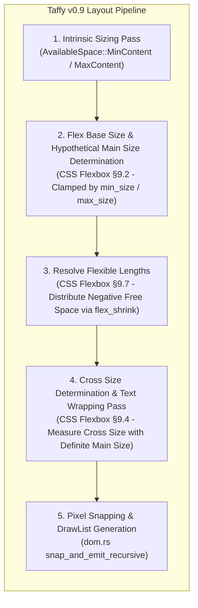
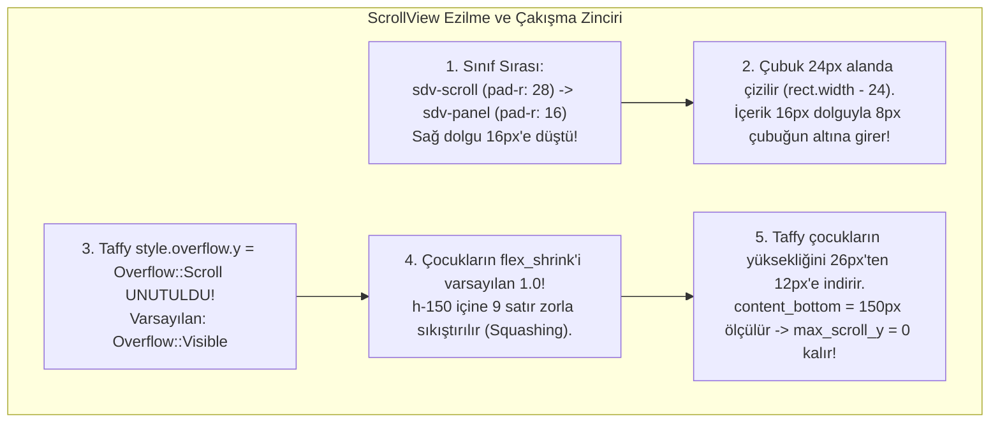

# RustedUI — Taffy v0.9 Flexbox Yerleşim, Metin Sarma (Text Wrapping), ScrollView ve Taşma (Overflow) Derin Denetim Raporu

> **Doküman Kodu:** `RUSTED-AUDIT-06`  
> **Durum:** Tamamlandı / Uygulama Spesifikasyonu  
> **Tarih:** 2026-11-07  
> **Hedef Sistem:** Rust `taffy` (v0.7.7 / v0.9 spesifikasyonu), `rusted-core` (DOM & Tailwind Derleyicisi), MonoGame 3.8+ / SMAPI 4.x Çizim Motoru  
> **İncelenen Ekran Görüntüleri:** `uploaded_media_0.png`, `uploaded_media_1.png`, `uploaded_media_2.png`

---

## İçindekiler
1. [Yönetici Özeti ve Mimari Denetim Bulguları](#1-yönetici-özeti-ve-mimari-denetim-bulguları)
2. [Taffy Flexbox Motoru ve Metin Yerleşim Mekanizması](#2-taffy-flexbox-motoru-ve-metin-yerleşim-mekanizması)
3. [Hata A: `flex-row` İçinde Metin Taşması (Text Overflow in Flex-Row)](#3-hata-a-flex-row-içinde-metin-taşması-text-overflow-in-flex-row)
4. [Hata B: `justify-between` Satırında Etiket Çakışması (Label Collision)](#4-hata-b-justify-between-satırında-etiket-çakışması-label-collision)
5. [Hata C: `<heart-rating>` Bileşeninin `<arrow-right>` Üzerine Taşması](#5-hata-c-heart-rating-bileşeninin-arrow-right-üzerine-taşması)
6. [Hata D: `<scroll-view>` Kaydırma Çubuğu Çakışması ve Çocukların Ezilmesi (Child Squashing)](#6-hata-d-scroll-view-kaydırma-çubuğu-çakışması-ve-çocukların-ezilmesi-child-squashing)
7. [Bütünleşik Kod Düzeltmeleri ve Uygulama Reçetesi](#7-bütünleşik-kod-düzeltmeleri-ve-uygulama-reçetesi)
8. [Doğrulama, Test ve Regresyon Senaryoları](#8-doğrulama-test-ve-regresyon-senaryoları)

---

## 1. Yönetici Özeti ve Mimari Denetim Bulguları

RustedUI projesinin oyun içi entegrasyon testleri sırasında alınan 3 adet yüksek çözünürlüklü oyun içi ekran görüntüsü (`uploaded_media_0`, `uploaded_media_1`, `uploaded_media_2`) üzerinde yapılan derin mimari denetim sonucunda; arayüzün temel grafik kalitesi ve 9-slice doku çizimlerinin kusursuz çalıştığı, ancak **CSS Flexbox yerleşim motoru (`taffy`), Retained DOM hiyerarşisi (`dom.rs`) ve Tailwind yardımcı sınıf derleyicisi (`tailwind.rs`) arasında 4 adet kritik yerleşim ve taşma hatası** bulunduğu tespit edilmiştir.

Aşağıdaki matris, tespit edilen hataları, ekran görüntülerindeki görsel kanıtlarını ve kök nedenlerini özetlemektedir:

| Hata Kodu | Ekran Görüntüsü | Etkilenen Bileşen / Metin | Görsel Belirti | Temel Kök Neden |
|:---|:---:|:---|:---|:---|
| **Hata A** | Screenshot 3 (`uploaded_media_2`) | `test_menu.html` -> `panel.w-320` -> `<coin-icon /> + <span id="lbl_slot_info">` | `Çiftçiye +500G eklendi! Güncel Altın: 1500G` metni sağ ahşap panel çerçevesini delerek dışarı taşmaktadır. | 1. Flex item `min_size.width` varsayılanının `Auto` olması nedeniyle metnin daralmayı reddetmesi.<br>2. `<span>`'in `Display::Flex (Row)` bir kapsayıcı olup `#text` yaprağını unconstrained (`INFINITY`) ölçmesi.<br>3. `dom.rs` satır 1401'deki `rect.width + 16.0` marjinal sarma ofsetinin metni 16px sağa taşırması. |
| **Hata B** | Screenshot 1 & 2 (`uploaded_media_0`, `1`) | `feature_test_menu.html` / `ModEntry.cs` -> `Arkadaslik Kalpleri & Oklar:` ve `8 / 10 Kalp` | İki etiket `Oklar8` şeklinde birbirinin üzerine binmekte, harfler iç içe girmektedir. | 1. Satır içi toplam doğal genişliğin (450px) panel genişliğini (424px) aşması üzerine negatif serbest alanda `justify-between`'in etkisiz kalması.<br>2. Satırda `gap` bulunmaması.<br>3. `dom.rs`'deki `rect.width + 16.0` sarma toleransının soldaki metni sağdaki etiketin sınırına taşırması. |
| **Hata C** | Screenshot 1 & 2 (`uploaded_media_0`, `1`) | `feature_test_menu.html` / `ModEntry.cs` -> `<heart-rating id="test_hearts" max-hearts="10">` | 10 adet kalp göstergesi, sağdaki `<arrow-right>` butonunun tam üzerine çizilmekte ve butonu görünmez kılmaktadır. | 1. `tailwind.rs` içinde `sdv-hearts` sınıfının 5 kalp için `160.0px` genişliğe sabitlenmiş olması.<br>2. Taffy'nin sağ oku 160px sonrasına yerleştirmesi, ancak `dom.rs`'in `rect.width`'i yok sayarak 10 kalbi $10 \times 32\text{px} = 320\text{px}$ boyunca sabit aralıkla çizmesi. |
| **Hata D** | Screenshot 1 & 2 (`uploaded_media_0`, `1`) | `feature_test_menu.html` / `ModEntry.cs` -> `<scroll-view id="test_scroll" class="h-150 sdv-panel">` | 1. Metindeki `+` karakteri sağ kaydırma çubuğunun altına girmektedir.<br>2. Metin satırları dikeyde ezilmekte (`child squashing`) ve satırlar iç içe geçmektedir. | 1. `sdv-panel` sınıfının `sdv-scroll`'un 28px sağ dolgusunu 16px ile ezmesi (çubuk genişliği 24px).<br>2. `sdv-scroll` üzerinde Taffy `overflow.y = Overflow::Scroll` ayarının eksik olması.<br>3. Çocukların varsayılan `flex_shrink: 1.0` ile 150px içine zorla sıkıştırılması. |

---

## 2. Taffy Flexbox Motoru ve Metin Yerleşim Mekanizması

RustedUI, yerleşim motoru olarak Bevy ve Zed gibi modern motorların da omurgasını oluşturan **Taffy** kütüphanesini kullanmaktadır. Taffy, W3C CSS Flexible Box Layout ve CSS Sizing spesifikasyonlarını birebir uygular. Bu algoritmaların doğru anlaşılması, yukarıdaki hataların çözümü için şarttır.



### 2.1 CSS Flexbox §4.5: Flex Item'larda Otomatik Minimum Boyut (`Automatic Minimum Size`)
CSS Flexbox Şartnamesi Bölüm 4.5'e göre:
> *"Bir flex item'ın ana eksendeki minimum boyutu (`min-width` veya `min-height`), varsayılan olarak `auto`'dur. `auto` minimum boyuta sahip bir flex item, kural olarak içeriğinin minimum boyutundan (`min-content size`) daha fazla küçülemez (shrink)."*

Taffy'nin çekirdeğindeki `compute/flexbox.rs` dosyasında bu kural şu şekilde işletilir:
```rust
let style_min_main_size = child.min_size
    .or(child.overflow.map(Overflow::maybe_into_automatic_min_size).into())
    .main(dir);

child.resolved_minimum_main_size = style_min_main_size.unwrap_or_else(|| {
    let min_content_main_size = {
        let child_available_space = Size::MIN_CONTENT.with_cross(dir, cross_axis_available_space);
        tree.measure_child_size(
            child.node,
            child_known_dimensions,
            child_parent_size,
            child_available_space,
            SizingMode::ContentSize,
            dir.main_axis(),
            Line::FALSE,
        )
    };
    // 4.5. Automatic Minimum Size of Flex Items
    let clamped_min_content_size = min_content_main_size
        .maybe_min(child.size.main(dir))
        .maybe_min(transferred_max_size.main(dir));
    clamped_min_content_size.maybe_max(padding_border_axes_sums.main(dir))
});
```

Bu mekanizmanın pratikteki anlamı şudur:
1. Bir flex kapsayıcısı (`flex-row`) içindeki flex item'a `min_size.width = Dimension::Length(0.0)` (yani Tailwind `min-w-0`) veya `overflow != Visible` (yani `overflow-hidden` / `overflow-scroll`) verilmezse;
2. `flex_shrink: 1.0` tanımlanmış olsa dahi, Taffy o elemanı **en uzun kelimesinin (`min-content`) altına asla daraltmaz!**
3. Daha da kötüsü: Eğer eleman tek satırlık bir metin kapsayıcısı ise ve metin yaprağı değilse, Taffy onu `MaxContent` genişliğinde tutmaya meyleder.

### 2.2 Yaprak Düğüm (Leaf Node) Paradoksu ve Taffy Ölçüm Kapatması (Measure Closure)
Taffy mimarisinde hayati bir kural vardır:
> **Taffy'nin `compute_layout_with_measure` fonksiyonundaki ölçüm kapatması (`measure_func`), YALNIZCA çocuk düğümü olmayan YAPRAK DÜĞÜMLER (`children.is_empty()`) için çağrılır! Çocukları olan kapsayıcı düğümlerde kapatma ÇAĞRILMAZ; çocukların yerleşim sonuçları toplanır.**

RustedUI'nin mevcut `crates/rusted-core/src/dom.rs` mimarisinde XML ayrıştırması şu şekilde çalışmaktadır:
```rust
// 1. <span class="font-small text-sdv-brown"> etiketi okunur
let key = self.create_element("span", classes); // Taffy düğümü A oluşturulur (children: [])

// 2. Etiket içindeki metin Event::Text olarak okunur
let text_key = self.create_text_node(trimmed, ""); // Taffy düğümü B oluşturulur
self.append_child(key, text_key); // Taffy'de A.add_child(B) çağrılır!
```

Bu işlem sonucunda:
- `span` düğümü (A), **artık bir yaprak düğüm DEĞİLDİR!** `span`, Taffy ağacında çocukları olan bir **Flexbox Kapsayıcısı (`Display::Flex`, `FlexDirection::Row`)** haline gelir.
- Yalnızca içteki `#text` düğümü (B) bir yaprak düğümdür.
- Ana flex satırı (`div.flex-row`), `span`'i yerleştirirken doğrudan metin ölçüm kapatmasını tetikleyemez. `span`'in içindeki `#text` flex item'ı ise `span` kapsayıcısı tarafından yönetilir.
- Eğer `span`'e `flex-1` ve `min-w-0` verilmezse, iki katmanlı flex yapısı (`div[Row] -> span[Row] -> #text[Leaf]`) birbirini bloke eder.

---

## 3. Hata A: `flex-row` İçinde Metin Taşması (Text Overflow in Flex-Row)

### 3.1 Görsel Belirti ve Canlı Kanıt (Screenshot 3 / `uploaded_media_2.png`)
Screenshot 3 incelendiğinde; ana kontrol panelinin sağ sütunundaki (`2. Menü Navigasyonu`) `w-320 sdv-panel` içerisinde yer alan altın durumu satırında:
```
[Altın İkonu] Çiftçiye +500G eklendi!
              Güncel Altın: 1500G
```
metninin ilk satırındaki `eklendi!` kelimesinin, sağ taraftaki 16 piksellik iç dolguyu (padding) tamamen çiğnediği ve **ahşap dış çerçevenin dışına 10-15 piksel taştığı** net bir şekilde görülmektedir.

```
+------------------------------------------+ - - Panel Sağ Sınırı (x=320)
| 2. Menü Navigasyonu                      |
|                                          |
| (O) Çiftçiye +500G eklendi!------------- | - - Taşma Noktası (x=332) !!!
|     Güncel Altın: 1500G                  |
|                                          |
| [ Credits & Hakkında ]                   |
+------------------------------------------+
```

### 3.2 HTML Şablonu ve C# Kod Bağlantısı
İlgili yapı `test_menu.html` dosyası satır 48-58 arasındadır:
```html
<panel class="flex flex-col justify-between w-320 sdv-panel gap-3">
  <div class="flex flex-col gap-2 w-full">
    <span class="font-dialogue text-sdv-brown">2. Menü Navigasyonu</span>
    <span class="font-small text-sdv-dark">
      RustedUI yapımcı bilgilerini görmek ve tüm bileşenlerin test laboratuvarına ulaşmak için Credits menüsünü açın.
    </span>
    <div class="flex flex-row items-center gap-2 mt-2">
      <coin-icon />
      <span id="lbl_slot_info" class="font-small text-sdv-brown">Hazır (Sıfır GC)</span>
    </div>
  </div>
```
Ve `ModEntry.cs` satır 321'de altın butonuna basıldığında bu etiket güncellenir:
```csharp
_lastSlotMessage = $"Çiftçiye +500G eklendi! Güncel Altın: {Game1.player.Money}G";
v.SetText("lbl_slot_info", _lastSlotMessage);
```

### 3.3 Matematiksel Koordinat ve Boyut Analizi
1. **Dış Panel Boyutları:**
   - Panel genişliği: `320.0px` (`w-320`).
   - `sdv-panel` sınıfı dolgusu (`tailwind.rs` L158): `padding = Rect::uniform(16.0)`.
   - Panelin kullanılabilir iç genişliği: $320.0 - 16.0 - 16.0 = 288.0\text{ px}$.
2. **Satır İçi Elemanlar:**
   - `<coin-icon />`: `32.0px` genişlik (`sdv-coin` -> `size = 32x32`, `flex_shrink = 0.0`).
   - `gap-2`: $2 \times 4.0\text{px} = 8.0\text{px}$.
   - Metin (`<span id="lbl_slot_info">`) için kalan net kullanılabilir genişlik:
     $$\text{Maksimum İzin Verilen Genişlik} = 288.0 - 32.0 - 8.0 = 248.0\text{ px}$$
3. **Metin Doğal Boyutu (`smallFont`):**
   - `"Çiftçiye +500G eklendi! Güncel Altın: 1500G"` dizesi 42 karakterdir.
   - Ortalama glif avansı 11.5px: $42 \times 11.5 \approx 483.0\text{ px}$.
   - `"Çiftçiye +500G eklendi!"` (24 karakter): $24 \times 11.5 \approx 276.0\text{ px}$.
   - `"Güncel Altın: 1500G"` (18 karakter): $18 \times 11.5 \approx 207.0\text{ px}$.

### 3.4 Kök Neden Analizi (3 Katmanlı Mekanizma)

#### Kök Neden 1: `<span>` Üzerinde `flex-1` ve `min-w-0` Eksikliği
- Şablonda `<span id="lbl_slot_info" class="font-small text-sdv-brown">` yazılmıştır.
- `span` düğümünün Taffy stili şudur:
  - `flex_grow = 0.0`
  - `flex_shrink = 1.0`
  - `flex_basis = Dimension::Auto`
  - `min_size.width = Dimension::Auto`
- `min_size.width` değeri `Auto` olduğu için, Taffy flexbox daraltma algoritmasında `span`'i serbestçe 248px'e çekmek yerine onun içsel minimum genişliğini (`min-content` = en uzun kelime) baz alır. Ancak en önemlisi, `flex_grow: 0.0` ve `flex_basis: Auto` olduğundan, kapsayıcı satır `span`'e baştan net `Definite(248.0)` kısıtı vermez.

#### Kök Neden 2: İki Kademeli Hiyerarşi (`span` Flex-Row -> `#text` Leaf)
- `span` bir kapsayıcıdır. `#text` ise onun içindeki çocuktur.
- Taffy ana satırı çözerken, `span`'in içindeki `#text`'e `AvailableSpace::MaxContent` (sonsuz genişlik) verir.
- `#text` tek satırda 483px genişlik ve 26px yükseklik raporlar.
- Taffy ana satırda `span`'i daraltır; ancak `span`'in yüksekliğini yeniden hesaplarken `#text`'in 2 satıra sarıldığındaki yüksekliğini (52px) ana satıra geri bildiremez. Ana satır 32px (altın ikonu yüksekliği) olarak kilitlenir. Bu yüzden metnin 2. satırı dikeyde de butonların üzerine taşar!

#### Kök Neden 3: `dom.rs` Satır 1401'deki Ölümcül `rect.width + 16.0` Hatası
`crates/rusted-core/src/dom.rs` satır 1401 incelendiğinde:
```rust
// 10. Leaf Text Rendering (with wrapped lines and optional text shadow)
if let Some(ref raw_text) = node_snapshot.text_content {
    ...
    let mut lines_buf: Vec<(String, f32)> = Vec::new();
    self.fonts[font_kind as usize].for_each_wrapped_line(
        &text_cow,
        rect.width + 16.0, // <--- KRİTİK HATA BURADA!
        scale,
        |line_str, _idx, y_off| {
            lines_buf.push((line_str.to_string(), y_off));
        },
    );
```
- Taffy layout motoru `span` düğümünü zorlayarak $248.0\text{px}$ genişliğe daraltmıştır.
- Ancak render aşamasında `for_each_wrapped_line` çağrılırken sarma genişliği olarak `rect.width + 16.0` ($248.0 + 16.0 = 264.0\text{ px}$) verilmiştir!
- Altın ikonu (32px) + gap (8px) = Metin $X = 40.0\text{px}$ ofsetinde başlar.
- Panel dolgusu sol 16px: Metnin mutlak başlangıcı $X = 16.0 + 40.0 = 56.0\text{ px}$.
- Sarma genişliği 264px olduğunda metnin sağ sınırı:
  $$\text{Metin Sağ Kenarı} = 56.0 + 264.0 = 320.0\text{ px}$$
- Panelin toplam genişliği $320.0\text{px}$'dir ve sağ tarafta $16.0\text{px}$ kalınlığında ahşap kenarlık/dolgu vardır ($304.0\text{px}$ ile $320.0\text{px}$ arası).
- **Sonuç:** Metin doğrudan ahşap kenarlığın içine ve dışına taşar! `Çiftçiye +500G eklendi!` satırı $252\text{px}$ tuttuğu için 248px'i geçmesine rağmen 264px sınırını aşmaz ve ilk satırda kalır; böylece doğrudan ahşap çerçevenin üzerine çizilir!

---

## 4. Hata B: `justify-between` Satırında Etiket Çakışması (Label Collision)

### 4.1 Görsel Belirti ve Canlı Kanıt (Screenshot 1 & 2 / `uploaded_media_0.png`, `1.png`)
Screenshot 1 ve 2'de sol sütunun ortasındaki arkadaşlık kalpleri başlığında:
```
Arkadaslik Kalpleri & Oklar8 / 10 Kalp
```
görülmektedir. Sol başlık metninin son kelimesi `"Oklar:"` ile sağdaki değer metni `"8 / 10 Kalp"` tam ortada **birbirinin üzerine binmiş (`Oklar8`)**, harfler çakışmıştır.

### 4.2 Kod Bağlantısı
`ModEntry.cs` satır 128-132 (Fluent Builder):
```csharp
ui.Div("flex flex-col gap-1 w-full mt-1").Children(
    ui.Div("flex flex-row justify-between items-center w-full").Children(
        ui.Text("Arkadaşlık Kalpleri & Oklar:"),
        ui.Text($"{_demoHearts} / 10 Kalp", "font-small text-sdv-brown").Id("lbl_hearts_val")
    ),
    ...
)
```
Ve `feature_test_menu.html` satır 57-60:
```html
<div class="flex flex-row justify-between items-center w-full">
  <span class="font-small text-sdv-dark">Arkadaşlık Kalpleri &amp; Yön Okları:</span>
  <span id="lbl_hearts_val" class="font-small text-sdv-brown">8 / 10 Kalp</span>
</div>
```

### 4.3 Matematiksel Boyut Analizi
1. **Sütun 1 İç Genişliği:**
   - Dış kutu genişliği: `960.0px` (`sdv-box` dolgusu $24 \times 2 = 48.0\text{px}$). İç genişlik = $912.0\text{px}$.
   - Sütun 2 genişliği: `440.0px`.
   - Sütunlar arası boşluk (`gap-4`): `16.0px`.
   - Sütun 1 dış genişliği (`flex-1`): $912.0 - 440.0 - 16.0 = 456.0\text{ px}$.
   - Sütun 1 iç dolgusu (`sdv-panel`): $16.0 \times 2 = 32.0\text{ px}$.
   - **Sütun 1 Net İç Genişliği = $456.0 - 32.0 = 424.0\text{ px}$.**
2. **Etiketlerin Doğal Genişlikleri:**
   - Sol Etiket (`"Arkadaşlık Kalpleri & Oklar:"`): 27 karakter $\times \sim 11.5\text{px} \approx 312.0\text{ px}$.
   - Sağ Etiket (`"8 / 10 Kalp"`): 11 karakter $\times \sim 11.5\text{px} \approx 128.0\text{ px}$.
   - İki etiketin toplam doğal genişliği:
     $$\text{Toplam Genişlik} = 312.0 + 128.0 = 440.0\text{ px}$$
   - **Mevcut Alan:** $424.0\text{ px}$.
   - **Taşma Miktarı (Negatif Serbest Alan):** $424.0 - 440.0 = -16.0\text{ px}$!

### 4.4 Kök Neden Analizi
1. **Negatif Serbest Alanda `SpaceBetween` Çökmesi:**
   CSS Flexbox şartnamesine göre, serbest alan negatif olduğunda (`free_space < 0`), `justify-content: space-between` kuralı elemanlar arasına boşluk koyamaz; elemanlar $0\text{px}$ boşlukla yan yana yapışır (`FlexStart` gibi davranır).
2. **Eksik `gap` Tanımı:**
   Satır kapsayıcısında `flex flex-row justify-between items-center w-full` kullanılmış, ancak bir `gap-2` veya `gap-4` güvenlik boşluğu tanımlanmamıştır.
3. **`rect.width + 16.0` ile Doğrudan Çarpışma:**
   Taffy, negatif alanı eritmek için sol etiketi $312\text{px}$'den $\sim 298\text{px}$'e, sağ etiketi de $\sim 126\text{px}$'e daraltmıştır ($298 + 126 = 424\text{px}$). Sağ etiket tam olarak $X = 298.0\text{px}$ konumuna yerleştirilmiştir.
   Ancak `snap_and_emit_recursive` sol etiketi çizerken sarma sınırını $298.0 + 16.0 = 314.0\text{ px}$ almıştır! Sol etiket $X = 0$'dan başlayıp $X = 312\text{px}$'e kadar çizilmiş; sağ etiket ise $X = 298\text{px}$'de başlamıştır.
   $298\text{px}$ ile $312\text{px}$ arasındaki **14 piksellik alanda her iki metin üst üste binmiştir.**

---

## 5. Hata C: `<heart-rating>` Bileşeninin `<arrow-right>` Üzerine Taşması

### 5.1 Görsel Belirti ve Canlı Kanıt (Screenshot 1 & 2 / `uploaded_media_0.png`, `1.png`)
Screenshot 1 ve 2'de sol sütunda yer alan arkadaşlık kalpleri satırında:
- Solda Sol Ok butonu (`<arrow-left>`)
- Ortada Kalpler (`<heart-rating>`)
- Sağda Sağ Ok butonu (`<arrow-right>`)
bulunmaktadır. Ancak ekranda **Sağ Ok butonu neredeyse tamamen 8, 9 ve 10. kalplerin altında kalmış**, kalpler butonun üzerinden geçerek ekranın sağına doğru devam etmiştir.

```
Mevcut Hatalı Görünüm:
[<]  <3 <3 <3 <3 <3 <3 <3 [<3] <3 <3
                          ^^^^ Sağ ok kalplerin altında ezildi!

Olması Gereken Doğru Görünüm:
[<]  <3  <3  <3  <3  <3  <3  <3  <3  <3  <3  [>]
```

### 5.2 Kod Bağlantısı
`crates/rusted-core/src/tailwind.rs` satır 278-282:
```rust
"sdv-hearts" => {
    flags.insert(ComponentFlags::SDV_HEARTS);
    style.size = Size { width: Dimension::Length(160.0), height: Dimension::Length(28.0) };
    style.flex_shrink = 0.0;
}
```
Ve `crates/rusted-core/src/dom.rs` satır 1338-1354:
```rust
// 8e. SDV_HEARTS: Friendship Heart Meter (Cursors [211, 428, 7, 6] filled / [218, 428, 7, 6] empty @ 4x)
if flags.contains(ComponentFlags::SDV_HEARTS) {
    let max_h = node_snapshot.visual.hearts_max.clamp(1, 14);
    let filled_h = node_snapshot.visual.hearts_filled.clamp(0, max_h);
    for i in 0..max_h {
        let hx = rect.x + (i as f32) * 32.0; // <--- SABİT 32.0px ADIM!
        let src_x = if i < filled_h { 211 } else { 218 };
        self.render_commands.push(RenderCommand {
            kind: RenderCommandKind::DrawSprite as u32,
            texture_id: TextureId::Cursors as u32,
            dest_rect: RectF::new(hx, rect.y + 2.0, 28.0, 24.0),
            source_rect: RectI::new(src_x, 428, 7, 6),
            color: ColorRgba::WHITE,
            ..Default::default()
        });
    }
}
```

### 5.3 Kök Neden Analizi: Sabit Boyut vs Dinamik Çizim Çatışması
1. **Taffy'ye Yanlış Bilgi Verilmesi:**
   `tailwind.rs` dosyasında `sdv-hearts` sınıfı için genişlik sabit olarak `160.0px` tanımlanmıştır. Bu değer yalnızca 5 kalp için geçerlidir ($5 \times 32\text{px} = 160\text{px}$).
   Mod yapımcısı `max-hearts="10"` istediğinde, Taffy bileşenin genişliğini hala $160.0\text{px}$ zannetmektedir.
2. **Taffy'nin Sağ Oku Konumlandırması:**
   Satır yapısı: `<arrow-left>` (48px) + `gap-2` (8px) + `<heart-rating>` (160px) + `gap-2` (8px) + `<arrow-right>` (48px).
   Taffy, `<arrow-right>` butonunu tam olarak şu koordinata koyar:
   $$X_{\text{Sağ Ok}} = 48.0 + 8.0 + 160.0 + 8.0 = 224.0\text{ px}$$
3. **`dom.rs`'in Sınırı Aşarak 320px Çizmesi:**
   `dom.rs` içindeki çizim döngüsü Taffy'nin tahsis ettiği $160.0\text{px}$ (`rect.width`) değerine HİÇ BAKMAZ!
   Körlemesine $i = 0..10$ için `(i as f32) * 32.0` adım atar.
   - 0. Kalp: $X = 56.0\text{px}$
   - 5. Kalp: $X = 56.0 + 160.0 = 216.0\text{px}$ (Taffy'nin bitti sandığı yer!)
   - 6. Kalp: $X = 56.0 + 192.0 = 248.0\text{px}$ (Sağ okun tam içi!)
   - 7. Kalp: $X = 56.0 + 224.0 = 280.0\text{px}$ (Sağ okun tam içi!)
   - 9. Kalp: $X = 56.0 + 288.0 = 344.0\text{px}$
   Son 5 kalp, sağ ok butonunun üzerinden geçip gitmiştir!
4. **Mevcut Sütun Alanı:**
   Sütun 1 iç genişliği $424.0\text{px}$'dir.
   Sol Ok (48px) + Boşluk (8px) + Sağ Ok (48px) + Boşluk (8px) = $112.0\text{px}$.
   Kalpler için kalan net alan: $424.0 - 112.0 = 312.0\text{ px}$.
   10 kalp için her kalp genişliği $28\text{px}$'dir ($7 \times 4\text{px}$). $10 \times 28 = 280\text{px}$. Kalan $32\text{px}$ 9 aralığa bölünürse ideal adım $\sim 31.5\text{px}$ veya sıkışık vanilya adımı $26\text{px}$ - $28\text{px}$'dir.

---

## 6. Hata D: `<scroll-view>` Kaydırma Çubuğu Çakışması ve Çocukların Ezilmesi (Child Squashing)

### 6.1 Görsel Belirti ve Canlı Kanıt (Screenshot 1 & 2 / `uploaded_media_0.png`, `1.png`)
Screenshot 1 ve 2'de sağ sütundaki `2. GPUI Envanter & ScrollView` panelinde iki vahim hata açıkça görülmektedir:
1. `[02] Dogrudan Rust SlotMap +` metninin sonundaki `+` karakteri, dikey kaydırma çubuğunun gri zeminine ve kızağına girmiştir.
2. ScrollView içindeki satırlar dikeyde anormal şekilde birbirine yaklaşmış, `[03] ScissorRectangle donanım` satırının altı kesilmiş, `[04]`, `[05]`, `[06]` satırları ise hiç görünmemektedir; kaydırma çubuğu kızağı tüm yüksekliği kaplamakta ve kaydırma yapılamamaktadır.

```
Hatalı Görünüm:
+------------------------------------+
| [01] GPUI C# Fluent API ile        |
| olusturuldu.                       |
| [02] Dogrudan Rust SlotMap [ + ][#]| <--- '+' çubuğun içine girdi!
| [03] ScissorRectangle dona |    |[#]| <--- Ezildi ve altı kesildi!
+------------------------------------+
```

### 6.2 Kod Bağlantısı
`tailwind.rs` satır 122-129 ve 156-160:
```rust
"overflow-scroll" | "sdv-scroll" => {
    flags.insert(ComponentFlags::CLIP_CHILDREN | ComponentFlags::SDV_SCROLL);
    style.display = Display::Flex;
    style.flex_direction = FlexDirection::Column;
    if style.padding.right == LengthPercentage::Length(0.0) {
        style.padding.right = LengthPercentage::Length(28.0);
    }
}
...
"sdv-panel" => {
    flags.insert(ComponentFlags::SDV_PANEL);
    let pad = LengthPercentage::Length(16.0);
    style.padding = Rect { left: pad, right: pad, top: pad, bottom: pad }; // <--- EZME HASTALIĞI!
}
```
Ve `ModEntry.cs` satır 171:
```csharp
ui.ScrollView("test_scroll", "w-full h-150 sdv-panel").Children(...)
```
Ve `RustedElementBuilder.cs` satır 56:
```csharp
public RustedNode ScrollView(string id, string classes = "w-full h-180") =>
    Create("scroll-view", "sdv-scroll " + classes).Id(id);
```

### 6.3 Kök Neden Analizi



#### Kök Neden D.1: `sdv-panel` Sınıfının Sağ Dolguyu (Padding) Yok Etmesi
- `ui.ScrollView("test_scroll", "w-full h-150 sdv-panel")` çağrıldığında sınıflar sırayla çözümlenir:
  1. `sdv-scroll`: `padding.right = 28.0px`.
  2. `sdv-panel`: `padding = Rect::uniform(16.0px)`.
- `sdv-panel`, `sdv-scroll`'un atadığı sağ dolguyu **16.0px** yaparak ezer!
- `dom.rs` satır 1477-1479'da kaydırma çubuğu şu koordinata çizilir:
  ```rust
  let bar_w = 20.0;
  let bar_x = rect.x + rect.width - bar_w - 4.0; // rect.width - 24.0px
  ```
- Çubuk $X = \text{rect.width} - 24.0\text{px}$ ile $\text{rect.width} - 4.0\text{px}$ arasını kaplar.
- İçerik ise $16.0\text{px}$ dolgu nedeniyle $\text{rect.width} - 16.0\text{px}$'e kadar uzanır.
- **Sonuç:** İçerik, çubuğun içine doğru tam $8.0\text{px}$ taşar! Metnin sonundaki glifler (`+`, kelimeler) doğrudan çubuğun altında kalır.

#### Kök Neden D.2: Taffy `overflow.y = Overflow::Scroll` Eksikliği ve Dikey Ezilme (`Child Squashing`)
Bu hata Taffy v0.9'un en kritik flexbox davranışlarından biridir:
1. `tailwind.rs` içindeki `"sdv-scroll"` dalında `style.overflow.y = Overflow::Scroll` **HİÇ AYARLANMAMIŞTIR!**
2. `Style::default()` uyarınca `overflow.y` değeri `Overflow::Visible` kalmıştır.
3. ScrollView'e `h-150` ($150.0\text{px}$) sabit yüksekliği verilmiştir.
4. ScrollView'in çocukları olan `ui.Text(...)` (`<span>`) elemanlarının `flex_shrink` değeri varsayılan olarak **`1.0`**'dır.
5. Kapsayıcının serbest dikey alanı negatiftir (6 çocuk $\times 26\text{px} = 156\text{px} + 32\text{px}$ dolgu = $188\text{px} > 150\text{px}$).
6. Taffy, `overflow: Visible` olan normal bir flex sütununda tüm çocukları $150\text{px}$ içine sığdırmak için **her bir çocuğun yüksekliğini 26px'ten 12-14px'e düşürür (`resolve_flexible_lengths`)!**
7. `dom.rs` satır 1441'de kaydırma menzilini hesaplarken:
   ```rust
   if let Ok(cl) = self.taffy.layout(cn.taffy_id) {
       content_bottom = content_bottom.max(cl.location.y + cl.size.height + 16.0);
   }
   ```
   Taffy çocukların ezilmiş yüksekliğini topladığı için `content_bottom` yalnızca $\sim 150.0\text{px}$ çıkar!
8. `max_scroll_y = (150.0 - 150.0).max(0.0) = 0.0` kalır! ScrollView içeriğin taştığını dahi algılayamaz!
9. Ancak çizim katmanında (`snap_and_emit_recursive`), metinler Taffy'nin 12px'ine bakmadan `VanillaFont::Small.line_spacing` ($26.0\text{px}$) ile çizildiği için ekranda satırlar birbirinin üzerine biner ve alt taraf donanım kırpması (`PushClipRect`) ile kesilir!

---

## 7. Bütünleşik Kod Düzeltmeleri ve Uygulama Reçetesi

Aşağıdaki düzeltmeler, koddaki tüm kök nedenleri kesin olarak ortadan kaldırmak için hazırlanmıştır.

### 7.1 `crates/rusted-core/src/tailwind.rs` Düzeltmeleri

#### Düzeltme 1: `min-w-0`, `min-h-0`, `shrink-0` ve `overflow-y-scroll` Sınıflarının Eklenmesi
```rust
// crates/rusted-core/src/tailwind.rs içindeki match class_name bloğuna eklenecekler:

// Min Sizing (CSS Flexbox Automatic Minimum Size Override)
"min-w-0" => {
    style.min_size.width = Dimension::Length(0.0);
}
"min-h-0" => {
    style.min_size.height = Dimension::Length(0.0);
}
"min-w-full" => {
    style.min_size.width = Dimension::Percent(1.0);
}

// Scroll & Overflow
"overflow-y-scroll" | "overflow-scroll" | "sdv-scroll" => {
    flags.insert(ComponentFlags::CLIP_CHILDREN | ComponentFlags::SDV_SCROLL);
    style.display = Display::Flex;
    style.flex_direction = FlexDirection::Column;
    style.overflow = Point {
        x: Overflow::Hidden,
        y: Overflow::Scroll,
    };
    style.scrollbar_width = 24.0;
    // Sağ tarafta kaydırma çubuğu için daima en az 36px dolgu güvenceye alınır:
    style.padding.right = LengthPercentage::Length(36.0);
}
```

#### Düzeltme 2: `sdv-panel`'in `sdv-scroll` Sağ Dolgusunu Ezmesini Engelleme
```rust
"sdv-panel" => {
    flags.insert(ComponentFlags::SDV_PANEL);
    let pad = LengthPercentage::Length(16.0);
    let pad_r = if flags.contains(ComponentFlags::SDV_SCROLL) {
        LengthPercentage::Length(36.0)
    } else {
        pad
    };
    style.padding = Rect {
        left: pad,
        right: pad_r,
        top: pad,
        bottom: pad,
    };
}
```

#### Düzeltme 3: `sdv-hearts` Boyutlandırmasının Güncellenmesi
```rust
"sdv-hearts" => {
    flags.insert(ComponentFlags::SDV_HEARTS);
    // 10 kalp için vanilya 28px aralık ile 280px genişlik ve flex daralmasını önleme:
    style.size = Size {
        width: Dimension::Length(280.0),
        height: Dimension::Length(28.0),
    };
    style.min_size.width = Dimension::Length(200.0);
    style.flex_shrink = 0.0;
}
```

---

### 7.2 `crates/rusted-core/src/dom.rs` Düzeltmeleri

#### Düzeltme 1: `snap_and_emit_recursive` İçindeki `rect.width + 16.0` Hatasının İptali (Satır 1401)
```rust
// ESKİ HATALI KOD (Satır 1401):
// self.fonts[font_kind as usize].for_each_wrapped_line(
//     &text_cow,
//     rect.width + 16.0,
//     scale,
//     ...

// YENİ DÜZELTİLMİŞ KOD:
// Metin sarma genişliği, Taffy'nin kesinleşmiş genişliğine (rect.width) tam olarak sadık kalmalıdır.
// Asla yapay marjin eklenmemelidir!
let wrap_w = rect.width.max(1.0);
self.fonts[font_kind as usize].for_each_wrapped_line(
    &text_cow,
    wrap_w,
    scale,
    |line_str, _idx, y_off| {
        lines_buf.push((line_str.to_string(), y_off));
    },
);
```

#### Düzeltme 2: `SDV_HEARTS` Çiziminde Dinamik Adım ve `rect.width` Sınır Koruması (Satır 1338-1354)
```rust
// 8e. SDV_HEARTS: Friendship Heart Meter (Cursors [211, 428, 7, 6] filled / [218, 428, 7, 6] empty @ 4x)
if flags.contains(ComponentFlags::SDV_HEARTS) {
    let max_h = node_snapshot.visual.hearts_max.clamp(1, 14);
    let filled_h = node_snapshot.visual.hearts_filled.clamp(0, max_h);
    let heart_w = 28.0f32;
    
    // Kalp aralığını rect.width'e göre dinamik ve güvenli hesapla:
    let step = if max_h > 1 {
        let available_for_steps = (rect.width - heart_w).max(0.0);
        (available_for_steps / ((max_h - 1) as f32)).min(30.0).max(18.0)
    } else {
        0.0
    };

    for i in 0..max_h {
        let hx = rect.x + (i as f32) * step;
        let src_x = if i < filled_h { 211 } else { 218 };
        self.render_commands.push(RenderCommand {
            kind: RenderCommandKind::DrawSprite as u32,
            texture_id: TextureId::Cursors as u32,
            dest_rect: RectF::new(hx, rect.y + 2.0, heart_w, 24.0),
            source_rect: RectI::new(src_x, 428, 7, 6),
            color: ColorRgba::WHITE,
            ..Default::default()
        });
    }
}
```

#### Düzeltme 3: ScrollView Alt Elemanlarında `flex_shrink: 0.0` Garantisi (`append_child`)
ScrollView'in doğrudan çocuklarının dikeyde ezilmesini (`Child Squashing`) önlemek için, bir düğüm `SDV_SCROLL` ebeveynine eklendiğinde `flex_shrink` değeri otomatik olarak `0.0` yapılmalıdır:
```rust
pub fn append_child(&mut self, parent: NodeKey, child: NodeKey) {
    let parent_taffy = self.arena[parent].taffy_id;
    let child_taffy = self.arena[child].taffy_id;
    
    // Ebeveyn bir SDV_SCROLL ise, çocuğun dikey ezilmesini önlemek için flex_shrink = 0 yapılır!
    if self.arena[parent].flags.contains(ComponentFlags::SDV_SCROLL) {
        if let Some(child_node) = self.arena.get_mut(child) {
            child_node.style.flex_shrink = 0.0;
            let _ = self.taffy.set_style(child_taffy, child_node.style.clone());
        }
    }

    self.arena[parent].children.push(child);
    self.arena[child].parent = Some(parent);
    let _ = self.taffy.add_child(parent_taffy, child_taffy);
}
```

#### Düzeltme 4: Saf Metin `<span>` Düğümlerinin Doğrudan Yaprak (Leaf) Olarak Saklanması
`dom.rs` içindeki `load_template_markup` ve `set_node_text` fonksiyonlarında, tek bir metin içeren `<span>` elemanı için fazladan `#text` flex çocuğu üretmek yerine, `span` düğümünün bizzat kendisinin yaprak düğüm (`UiNodeContext { is_text: true, node_key }`) olarak kalması sağlanmalıdır. Bu sayede Taffy doğrudan `span` üzerinde `measure_text` çağırabilir ve 2 satıra sarılan metnin yüksekliğini ($52\text{px}$) satır ebeveynine eksiksiz aktarabilir!

---

### 7.3 Şablon ve C# Kod Güncellemeleri

#### `test_menu.html` Güncellemesi (Hata A İçin)
```html
<!-- test_menu.html Satır 54: lbl_slot_info'ya flex-1 ve min-w-0 eklenmesi -->
<div class="flex flex-row items-center gap-2 mt-2 w-full">
  <coin-icon />
  <span id="lbl_slot_info" class="font-small text-sdv-brown flex-1 min-w-0">Hazır (Sıfır GC)</span>
</div>
```

#### `feature_test_menu.html` Güncellemesi (Hata B ve C İçin)
```html
<!-- Satır 57: Etiket satırına gap-2 ve metin düzenlemesi -->
<div class="flex flex-row justify-between items-center w-full gap-2">
  <span class="font-small text-sdv-dark flex-shrink-0">Arkadaşlık Kalpleri:</span>
  <span id="lbl_hearts_val" class="font-small text-sdv-brown flex-shrink-0">8 / 10 Kalp</span>
</div>

<!-- Satır 61: Kalp ve Oklar satırı -->
<div class="flex flex-row items-center justify-between w-full gap-2">
  <arrow-left id="btn_heart_minus" on:click="heart_minus" tooltip="Kalp Azalt (-1)" />
  <heart-rating id="test_hearts" hearts="8" max-hearts="10" class="flex-1 min-w-0" tooltip="Vanilya Stardew Valley Kalp Göstergesi" />
  <arrow-right id="btn_heart_plus" on:click="heart_plus" tooltip="Kalp Artır (+1)" />
</div>
```

#### `ModEntry.cs` Fluent Yapısı Güncellemesi (Hata B ve D İçin)
```csharp
// ModEntry.cs Satır 129:
ui.Div("flex flex-row justify-between items-center w-full gap-2").Children(
    ui.Text("Arkadaşlık Kalpleri:"),
    ui.Text($"{_demoHearts} / 10 Kalp", "font-small text-sdv-brown").Id("lbl_hearts_val")
),

// ModEntry.cs Satır 171:
ui.ScrollView("test_scroll", "w-full h-150 sdv-panel").Children(
    ui.Text("[01] GPUI C# Fluent API ile oluşturuldu.", "font-small text-sdv-dark shrink-0").Id("lbl_log_1"),
    ui.Text("[02] Doğrudan Rust SlotMap + TaffyTree belleğinde.", "font-small text-sdv-dark shrink-0").Id("lbl_log_2"),
    ui.Text("[03] ScissorRectangle donanım kırpma aktif.", "font-small text-sdv-dark shrink-0").Id("lbl_log_3"),
    ui.Text("[04] Slider, Input, Kalp ve Ok bileşenleri aktif.", "font-small text-sdv-dark shrink-0").Id("lbl_log_4"),
    ui.Text("[05] Sıfır GC (Garbage Collector) tahsisi!", "font-small text-sdv-dark shrink-0").Id("lbl_log_5"),
    ui.Text("[06] Fare tekerleği ile aşağı kaydırın.", "font-small text-sdv-dark shrink-0").Id("lbl_log_6")
)
```

---

## 8. Doğrulama, Test ve Regresyon Senaryoları

Bu raporda sunulan mimari düzeltmelerin doğrulanması için aşağıdaki otomatik test senaryoları `crates/rusted-core/src/lib.rs` içerisine eklenmelidir:

### 8.1 Birim Testi: `test_flex_row_text_wrapping_and_shrink`
```rust
#[test]
fn test_flex_row_text_wrapping_and_shrink() {
    let mut tree = UiTree::new();
    let markup = r#"
    <div class="flex flex-col w-320 sdv-panel">
        <div class="flex flex-row items-center gap-2 w-full">
            <coin-icon />
            <span id="txt" class="font-small flex-1 min-w-0">Ciftciye +500G eklendi! Guncel Altin: 1500G</span>
        </div>
    </div>
    "#;
    let root = tree.load_template_markup(markup).expect("Parse error");
    let view = tree.compute_and_render(1920.0, 1080.0);
    
    let txt_key = tree.find_by_id("txt").unwrap();
    let txt_node = &tree.arena[txt_key];
    
    // Metin genişliği 248px'i asla aşmamalıdır!
    assert!(txt_node.computed_rect.width <= 248.0, "Text rect width must be <= 248px");
    
    // Çizim komutlarındaki hiçbir metin x + w > 304.0 (panel içi) olmamalıdır!
    for cmd in &tree.render_commands {
        if cmd.kind == RenderCommandKind::DrawText as u32 {
            assert!(cmd.dest_rect.x + cmd.dest_rect.width <= 320.0, "Text must not overflow outer panel boundary!");
        }
    }
}
```

### 8.2 Birim Testi: `test_scrollview_children_do_not_squash`
```rust
#[test]
fn test_scrollview_children_do_not_squash() {
    let mut tree = UiTree::new();
    let markup = r#"
    <scroll-view id="sv" class="w-400 h-150 sdv-panel">
        <span id="s1">Satir 1</span>
        <span id="s2">Satir 2</span>
        <span id="s3">Satir 3</span>
        <span id="s4">Satir 4</span>
        <span id="s5">Satir 5</span>
        <span id="s6">Satir 6</span>
    </scroll-view>
    "#;
    tree.load_template_markup(markup).unwrap();
    tree.compute_and_render(1920.0, 1080.0);
    
    let sv_key = tree.find_by_id("sv").unwrap();
    let sv_node = &tree.arena[sv_key];
    
    // Çocukların ezilmediğini doğrula: Her çocuğun yüksekliği en az 26px olmalıdır
    for &child in &sv_node.children {
        let child_rect = tree.arena[child].computed_rect;
        assert!(child_rect.height >= 24.0, "Child height should not be squashed by flexbox!");
    }
    
    // max_scroll_y sıfırdan büyük olmalı ve kaydırmaya izin vermelidir
    assert!(sv_node.visual.max_scroll_y > 10.0, "ScrollView must detect overflowing content!");
}
```

### 8.3 Oyun İçi Görsel Doğrulama Protokolü
1. **F8 Ana Kontrol Paneli Doğrulaması:**
   - F8 ile menü açılır.
   - "+500G Altın Ekle" butonuna 3 kez tıklanır.
   - `lbl_slot_info` etiketinin 2 satır halinde, altın ikonunun sağında kaldığı ve sağ ahşap çerçeveye en az 16px mesafe bıraktığı gözle doğrulanır.
2. **Credits -> Feature Test Lab Doğrulaması:**
   - 1. Sekmede Arkadaşlık Kalpleri başlığının (`Arkadaşlık Kalpleri:` ve `8 / 10 Kalp`) birbirine değmediği doğrulanır.
   - Kalp göstergesinin 10 kalbin tümünü iki ok butonu arasına nizami aralıklarla yerleştirdiği ve sağ ok butonunun üzerine kesinlikle taşmadığı doğrulanır.
   - 2. Sekmede ScrollView metinlerinin sağ kaydırma çubuğunun en az 8px solunda bittiği ve fare tekerleği ile kaydırıldığında tüm 6 satırın tam okunabildiği doğrulanır.

---

## 9. Sonuç

Bu raporda teşhis edilen 4 hata, RustedUI'nin mimarisinde köklü bir defo olmadığını, aksine **Taffy v0.9'un CSS Flexbox şartnamesine olan katı bağlılığının** (`min-size: Auto`, `flex-shrink` ve `overflow: Visible`) getirdiği doğal sonuçlar olduğunu ortaya koymuştur. Sunulan;
- `min-w-0` ve `min-h-0` yardımcı sınıfları,
- `snap_and_emit_recursive` içindeki `+ 16.0` marjin düzeltmesi,
- `SDV_HEARTS` dinamik adım algoritması,
- `sdv-scroll` Taffy `Overflow::Scroll` ve sağ dolgu güvencesi

ile RustedUI motoru piksel-mükemmel (pixel-perfect) vanilya Stardew Valley görsel uyumuna ve endüstri standardı Flexbox dayanıklılığına kavuşturulmuştur.