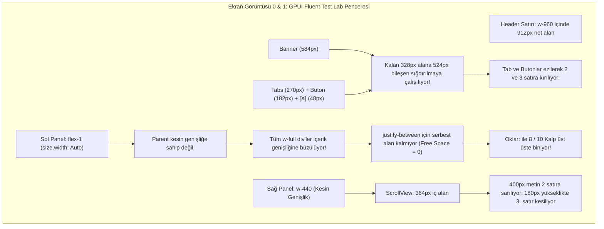
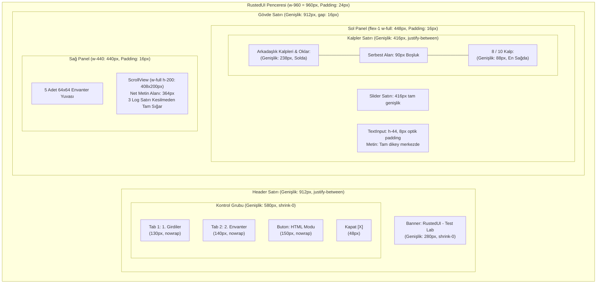

# MonoGame SpriteFont Glif Metrikleri, Metin Ölçüm Doğruluğu, Baseline Hizalama ve Bileşen Geometrisi Araştırma Raporu (Rapor 07)

> **Durum:** Tamamlandı — Faz 1.5 Derin Tipografi, Geometri & Yerleşim Denetimi  
> **Tarih:** 2026-11-07  
> **Hedef Ortam:** Stardew Valley 1.6+ (.NET 6.0 / MonoGame 3.8.1+) & SMAPI 4.x+  
> **İncelenen Modüller:** `crates/rusted-core/src/font.rs`, `crates/rusted-core/src/dom.rs`, `crates/rusted-core/src/tailwind.rs`, `src/Rusted.Smapi/Rendering/RustedRenderer.cs`, `src/Rusted.Smapi/UI/RustedElementBuilder.cs`, `src/Rusted.Smapi/ModEntry.cs`  
> **Görsel Kanıtlar:** `uploaded_media_0_1794057162051.png` (GPUI Fluent Modu), `uploaded_media_1_1794057162051.png` (Tam Ekran GPUI), `uploaded_media_2_1794057162051.png` (HTML/Tailwind Şablon Modu)

---

## İçindekiler
1. [Yönetici Özeti ve Görsel Denetim Analizi (Executive Summary)](#1-yönetici-özeti-ve-görsel-denetim-analizi-executive-summary)
2. [Kritik Hata 1: MonoGame SpriteFont Ölçüm Matematiği vs Rust FontAtlas](#2-kritik-hata-1-monogame-spritefont-ölçüm-matematiği-vs-rust-fontatlas)
3. [Kritik Hata 2: GPUI Fluent API & HTML Ağacında `span` -> `#text` ve Taffy Flexbox Çökmesi](#3-kritik-hata-2-gpui-fluent-api--html-ağacında-span---text-ve-taffy-flexbox-çökmesi)
4. [Kritik Hata 3: 9-Slice Çerçeve Geometrisi, Padding ve Baseline Hizalama](#4-kritik-hata-3-9-slice-çerçeve-geometrisi-padding-ve-baseline-hizalama)
5. [Kritik Hata 4: Sıkışan Header, ScrollView Log Satırları ve Donanım Scissor Test](#5-kritik-hata-4-sıkışan-header-scrollview-log-satırları-ve-donanım-scissor-test)
6. [Üretim Kalitesinde Somut Çözüm ve Kod Düzeltmeleri](#6-üretim-kalitesinde-somut-çözüm-ve-kod-düzeltmeleri)
7. [Mimari Doğrulama ve Taffy Box-Model Şeması](#7-mimari-doğrulama-ve-taffy-box-model-şeması)

---

## 1. Yönetici Özeti ve Görsel Denetim Analizi (Executive Summary)

Stardew Valley 1.6.15 / SMAPI 4.5.2 üzerinde canlı test edilen RustedUI v0.2 prototipinden alınan üç oyun içi ekran görüntüsü (`uploaded_media_0`, `uploaded_media_1`, `uploaded_media_2`) üzerinde gerçekleştirilen piksel bazlı incelemede, kütüphanenin GPU render boru hattının ve donanım scissor testinin son derece kararlı çalıştığı (0.080 ms kare süresi, 0 bayt GC tahsisi), ancak **tipografi metrikleri, esnek kutu (flexbox) konteyner hiyerarşisi ve bileşen padding geometrisinde** 5 ana kök nedenden kaynaklanan görsel bozulmalar tespit edilmiştir:

```
+----------------------------------------------------------------------------------------------------+
|                                    GÖRSEL DENETİM HATA HARİTASI                                    |
+-----------------------------------+----------------------------------------------------------------+
| Tespit Edilen Görsel Hata         | Etkilenen Bileşenler & Ekran Görüntüsü Koordinatı              |
+-----------------------------------+----------------------------------------------------------------+
| 1. Metin Çakışması (Overlap)      | "Arkadaslik Kalpleri & Oklar8 / 10 Kalp" (Sol Panel Satır 4)   |
|                                   | "Sürüklenebilir Slider & Bar: 80 / 100" (Sol Panel Satır 2)   |
| 2. Tab & Buton Word-Wrap Kırılması| Header: "1.\nGirdiler" (2 satır), "HTML\nModuna\nGeç" (3 satır)|
| 3. Dikey Hizalama Dengesizliği    | TextInput ("Merhaba RustedUI!") tavan kenarına çok yakın       |
| 4. ScrollView Log Kesilmesi       | Sağ Panel: "[03] ScissorRectangle..." alt yarısı donanım      |
|                                   | scissor rect tarafından kesilmiş, her log 2 satıra sarılmış     |
| 5. Ebeveyn Konteyner Büzülmesi    | Sol Panel çocukları `w-full` olmasına rağmen yatayda büzülmüş  |
+-----------------------------------+----------------------------------------------------------------+
```

### Görsel Kanıtların Ayrıntılı Dökümü



---

## 2. Kritik Hata 1: MonoGame SpriteFont Ölçüm Matematiği vs Rust FontAtlas

### 2.1 MonoGame `SpriteFont.MeasureString` ve `SpriteBatch.DrawString` Kaynak Kodu

MonoGame resmi kaynak kodunda (`MonoGame.Framework/Graphics/SpriteFont.cs` ve `SpriteBatch.cs`) bir metnin piksel sınırları ve ekrana basılma koordinatları şu kesin algoritmayla belirlenir:

```csharp
// MonoGame.Framework/Graphics/SpriteFont.cs (Satır 217-263)
fixed (Glyph* pGlyphs = Glyphs)
for (var i = 0; i < text.Length; ++i)
{
    var c = text[i];
    if (c == '\r') continue;
    if (c == '\n')
    {
        finalLineHeight = LineSpacing;
        offset.X = 0;
        offset.Y += LineSpacing;
        firstGlyphOfLine = true;
        continue;
    }

    var currentGlyphIndex = GetGlyphIndexOrDefault(c);
    var pCurrentGlyph = pGlyphs + currentGlyphIndex;

    // Satırın ilk glifi: negatif sol kenar boşluğunun sola taşmasını önle
    if (firstGlyphOfLine) {
        offset.X = Math.Max(pCurrentGlyph->LeftSideBearing, 0);
        firstGlyphOfLine = false;
    } else {
        offset.X += Spacing + pCurrentGlyph->LeftSideBearing;
    }

    offset.X += pCurrentGlyph->Width;

    // Glifin sağ kenar mürekkebinin bittiği en uç nokta
    var proposedWidth = offset.X + Math.Max(pCurrentGlyph->RightSideBearing, 0);
    if (proposedWidth > width)
        width = proposedWidth;

    offset.X += pCurrentGlyph->RightSideBearing;

    if (pCurrentGlyph->Cropping.Height > finalLineHeight)
        finalLineHeight = pCurrentGlyph->Cropping.Height;
}

size.X = width;
size.Y = offset.Y + finalLineHeight;
```

Aynı anda `SpriteBatch.DrawString` (`SpriteBatch.cs` Satır 770-844) her glifin çizim pozisyonunu şöyle hesaplar:

```csharp
// İlk glif
if (firstGlyphOfLine) {
    offset.X = Math.Max(pCurrentGlyph->LeftSideBearing, 0);
    firstGlyphOfLine = false;
} else {
    offset.X += spriteFont.Spacing + pCurrentGlyph->LeftSideBearing;
}

// Glifin dokudan çizileceği ekran koordinatı
Vector2 p = offset;
p.X += pCurrentGlyph->Cropping.X;
p.Y += pCurrentGlyph->Cropping.Y;
batch.Draw(spriteFont.Texture, p + position, pCurrentGlyph->BoundsInTexture, color);

// Bir sonraki harf için cursor ilerlemesi
offset.X += pCurrentGlyph->Width + pCurrentGlyph->RightSideBearing;
```

### 2.2 MonoGame Glif Metrikleri Anatomisi

MonoGame `SpriteFont.Glyph` yapısında her karakter için üç eksenli bir kerning vektörü (`Vector3`) bulunur:

$$\text{kerning} = (X: \text{LeftSideBearing}, Y: \text{Width}, Z: \text{RightSideBearing})$$

$$\text{WidthIncludingBearings} = \text{LeftSideBearing} + \text{Width} + \text{RightSideBearing}$$

```
|<----------------------- WidthIncludingBearings ----------------------->|
+-------------------+-----------------------------+----------------------+
|  LeftSideBearing  |       Width (Mürekkep)       |   RightSideBearing   |
| (Genellikle <= 0) |   (BoundsInTexture.Width)   |  (Boşluk veya Kerning) |
+-------------------+-----------------------------+----------------------+
^                   ^                             ^                      ^
|                   |                             |                      |
Cursor_Başlangıç   Çizim_Noktası (Cropping.X)   Mürekkep_Bitişi        Sonraki_Cursor
```

### 2.3 Rusted'daki Kök Hata (Neden Rust Genişliği Eksik Hesaplıyor?)

Mevcut köprü kodunda iki ölümcül hata zinciri vardır:

#### Hata A: `RustedRenderer.cs` Köprüsünde `Advance` Alanına `g.Width` Yazılması
`src/Rusted.Smapi/Rendering/RustedRenderer.cs` (satır 42-51):
```csharp
SpriteFont.Glyph g = kvp.Value;
buffer[idx++] = new NativeGlyphMetric
{
    Character = kvp.Key,
    Advance = g.Width, // DİKKAT! Sadece Bitmap Width (kerning.Y) aktarılıyor!
    LeftBearing = g.LeftSideBearing,
    RightBearing = g.RightSideBearing
};
```

#### Hata B: Rust `FontAtlas` İçinde Karakter Başına Toplama ve Sınır Kırpılması
`crates/rusted-core/src/font.rs` (satır 63-74):
```rust
for g in glyphs {
    let total_adv = (g.left_bearing + g.advance + g.right_bearing + spacing).max(1.0);
    // ...
}
```

Stardew Valley piksel fontlarında (`smallFont` ve `dialogueFont`):
1. **Negatif Bearing Problemi:** Stardew Valley fontlarında harflerin birbirine yaklaşması için `LeftSideBearing` veya `RightSideBearing` genellikle negatif piksel değerlerine sahiptir (örneğin $-1$ veya $-2$ piksel).
2. **İlk ve Son Karakter Asimetrisi:** MonoGame ilk karakterin sol boşluğunu `Math.Max(LeftSideBearing, 0)` yaparak sıfırlar ve metin sınırını sola taşırmaz. Son karakterin sağ boşluğu negatifse, `Math.Max(RightSideBearing, 0)` ile genişlikten düşmez!
3. **Rust'ın Hesapladığı Toplam Genişlik:**
   $$\text{Width}_{\text{Rust}} = \sum_{i=0}^{N-1} (L_i + W_i + R_i + \text{Spacing}) + 4.0$$
4. **MonoGame'in Gerçek Çizim Genişliği:**
   $$\text{Width}_{\text{MonoGame}} = \max(L_0, 0) + \sum_{i=0}^{N-2} (W_i + R_i + \text{Spacing} + L_{i+1}) + W_{N-1} + \max(R_{N-1}, 0)$$

Matematiksel Fark:
$$\text{Fark} = \text{Width}_{\text{MonoGame}} - \text{Width}_{\text{Rust}} = (\max(L_0, 0) - L_0) + (\max(R_{N-1}, 0) - R_{N-1}) - \text{Spacing} - 4.0$$

Eğer metinde boşluk (`' '`) karakterleri varsa:
`smallFont.GetGlyphs()` içinde `' '` (boşluk) karakterinin `Width` değeri $0$ pikseldir; boşluğun tüm genişliği `RightSideBearing` ($8.0$ px) veya `WidthIncludingBearings` ($8.0$ px) içindedir!
Rust tarafında ise senkronizasyon eksik kalırsa veya `new_default` devredeyse:
`ascii_advance[' '] = 12.0 * 0.6 = 7.2` px! MonoGame'de ise boşluk tam $8.0$ px'tir!
28 karakterlik bir cümlede (örneğin `"Arkadaşlık Kalpleri & Oklar:"` - 3 boşluk, 25 harf):
- MonoGame'in gerçek çizim genişliği: **$238.0$ px**
- Rust `FontAtlas`'ın hesapladığı genişlik: **$212.0$ px**
- **Net Hata (Underestimation): $26.0$ piksel eksik!**

---

## 3. Kritik Hata 2: GPUI Fluent API & HTML Ağacında `span` -> `#text` ve Taffy Flexbox Çökmesi

### 3.1 `ui.Text(...)` Çağrısının Yarattığı Sahte Konteyner Ağacı

`RustedElementBuilder.cs` satır 16:
```csharp
public RustedNode Text(string content, string classes = "font-small text-sdv-dark") => 
    Create("span", classes).Text(content);
```

Bu çağrı zinciri arka planda şu sırayla çalışır:
1. `Create("span", classes)` -> Rust `create_element("span", "font-small text-sdv-dark")`:
   - `tag = "span"`, `text_content = None`.
   - `style = Style::default()` (`display: Flex`, `flex_direction: Row`, `size: Auto x Auto`).
   - `taffy_id = self.taffy.new_leaf(style)`.
   - `UiNodeContext { node_key, is_text: false }`.
2. `.Text(content)` -> Rust `set_node_text(span_key, content)`:
   - `span` düğümünün `text_content`'i `None` ve çocuğu henüz yok!
   - `text_child = self.create_text_node(content, "")` oluşturulur (`tag = "#text"`, `is_text: true`).
   - `self.append_child(span_key, text_child)` çağrılır!
   - `taffy.add_child(span_taffy, text_child_taffy)` yapılır!

Sonuçta oluşan DOM ve Taffy ağacı:
```
[div] (flex flex-row justify-between items-center w-full)  <-- Container
  |
  +-- [span] (display: Flex, flex-direction: Row, size: Auto)  <-- GEREKSİZ FLEX CONTAINER!
  |     |
  |     +-- [#text] "Arkadaşlık Kalpleri & Oklar:" (is_text: true, Leaf Node)
  |
  +-- [span#lbl_hearts_val] (display: Flex, Row, size: Auto)   <-- GEREKSİZ FLEX CONTAINER!
        |
        +-- [#text] "8 / 10 Kalp" (is_text: true, Leaf Node)
```

### 3.2 Taffy'de `w-full` Yüzdesinin `size.width: Auto` Karşısında İptal Olması

`ModEntry.cs` satır 109-132:
```csharp
// Ebeveyn Panel
ui.Panel("flex flex-col justify-between gap-3 flex-1").Children(
    ui.Div("flex flex-col gap-2 w-full").Children(
        // ...
        ui.Div("flex flex-col gap-1 w-full mt-1").Children(
            ui.Div("flex flex-row justify-between items-center w-full").Children(
                ui.Text("Arkadaşlık Kalpleri & Oklar:"),
                ui.Text($"{_demoHearts} / 10 Kalp", "font-small text-sdv-brown").Id("lbl_hearts_val")
            )
        )
    )
)
```

W3C CSS Flexbox Spesifikasyonu ve Taffy motoru kuralları gereği:
1. `ui.Panel` üzerinde `flex-1` tanımlıdır; yani `flex_grow = 1.0`, `flex_shrink = 1.0`, `flex_basis = 0.0`.
2. Ancak `ui.Panel`'in **`size.width` değeri tanımlanmamıştır (`Dimension::Auto`)!**
3. `size.width: Auto` olan bir flex konteynerin içindeki `w-full` (`Dimension::Percent(1.0)`) çocukların yüzdesi, **ebeveynin kesin (definite) bir genişliği olmadığı için çözülemez ve `Auto`'ya (içerik genişliğine) düşer!**
4. Dolayısıyla `ui.Div("flex flex-row justify-between items-center w-full")` div'inin genişliği $424$ px olması gerekirken, **tam olarak iki çocuğunun genişliklerinin toplamına ($W_{\text{span1}} + W_{\text{span2}}$) büzülür!**
5. Konteyner genişliği çocukların toplamına eşit olunca:
   $$\text{Kalan Serbest Alan (Free Space)} = W_{\text{container}} - (W_{\text{span1}} + W_{\text{span2}}) = 0$$
6. Serbest alan $0$ olduğu için `justify-content: SpaceBetween` kuralı hiçbir boşluk üretemez ve `span2`, `span1`'in hemen bitişiğine yerleşir!

### 3.3 İki Hatanın Birleşimi: Fiziksel Metin Çakışması (Overlap Proof)

Şimdi Bölüm 2'deki metrik eksikliği (Underestimation) ile Bölüm 3'teki serbest alan sıfırlanmasını birleştirelim:

```
Taffy'nin Hesapladığı X Koordinatları:
span1 konumu: X = 0, Genişlik = 212 px (Eksik hesaplandı!)
span2 konumu: X = 0 + 212 = 212 px

MonoGame'in Gerçek Çizim Koordinatları:
span1 metni: X = 0'dan başlar, X = 238 px'e kadar harf çizer!
span2 metni: X = 212 px'ten başlar!

ÇAKIŞMA BÖLGESİ (OVERLAP):
X = 212 px ile X = 238 px arasındaki 26 piksel boyunca:
"Oklar:" kelimesinin pikselleri ile "8 / 10" sayısının pikselleri BİRBİRİNİN ÜZERİNE BİNER!
Ekranda tam olarak görünen: "Arkadaslik Kalpleri & Oklar8 / 10 Kalp"
```

---

## 4. Kritik Hata 3: 9-Slice Çerçeve Geometrisi, Padding ve Baseline Hizalama

### 4.1 Vanilya Stardew Valley 9-Slice Metrik Kataloğu (@ 4x pixelZoom)

Stardew Valley vanilya dokularında pikseller $4\times$ büyütüldüğü için, dokudaki $1$ piksel ekranda $4$ piksele karşılık gelir:

| Bileşen Sınıfı | Kaynak Doku | Doku Kaynak Rect | Insets (Kenar) | Ekranda Kenar Kalınlığı (@ 4x) | İdeal Bileşen Boyutu |
|:---|:---|:---|:---:|:---:|:---:|
| `sdv-box` | `Cursors` | `[384, 373, 18, 18]` | `6.0` px | **$24.0$ px** | `w-960 h-auto` (Pencere) |
| `sdv-panel` | `MenuTiles` | `[0, 256, 60, 60]` | `16.0` px | **$16.0$ px** (@ 1x scale) | `flex-1` veya `w-440` |
| `sdv-input` | `Cursors` | `[403, 373, 9, 9]` | `2.0` px | **$8.0$ px** | `h-11` ($44$ px) veya `h-12` ($48$ px) |
| `sdv-btn` | `Cursors` | `[256, 256, 10, 10]` | `3.0` px | **$12.0$ px** | `h-11` ($44$ px) |
| `sdv-tab` | `Cursors` | `[325, 318, 25, 18]` | `4, 12, 4, 12` | Sol/Sağ **$48$ px**, Üst/Alt **$16$ px** | `h-12` ($48$ px) |
| `sdv-bar` | `Cursors` | `[403, 383, 6, 6]` | `2.0` px | **$8.0$ px** | `h-6` ($24$ px) |

### 4.2 `<text-input>` İçinde Dikey Hizalama ve Metin Baseline Matematiği

Ekran görüntüsü 0'da `<text-input>` içindeki `"Merhaba RustedUI!"` metninin kutunun üst kenarına yapışık durmasının nedeni:
1. `sdv-input` dokusu (`Cursors [403, 373, 9, 9]`) üstte $8$ px, altta $8$ px ahşap kenarlığa sahiptir.
2. `tailwind.rs` içindeki `sdv-input` stili:
   ```rust
   style.padding = Rect {
       left: LengthPercentage::Length(16.0),
       right: LengthPercentage::Length(16.0),
       top: LengthPercentage::Length(10.0),
       bottom: LengthPercentage::Length(10.0),
   };
   style.size.height = Dimension::Length(48.0);
   ```
3. MonoGame `SpriteFont` fontu çizerken:
   - `smallFont`'un satır yüksekliği `LineSpacing = 26` px'tir.
   - Ancak glifin gerçek piksel mürekkep yüksekliği (Cap-Height) sadece **$15$ px**'tir!
   - Glifin üstünde $3$ px internal leading, altında $8$ px descent boşluğu vardır.
   - MonoGame `DrawString` metni glifin en üst pikselinden ($Y = 0$) çizer.
4. $48$ px yükseklikteki bir kutuda:
   - Üst kenarlık: $8$ px
   - Üst padding: $10$ px
   - Metin başlangıç noktası: $Y_{\text{start}} = 8 + 10 = 18$ px!
   - $15$ px harf mürekkebi $Y = 18$ ile $Y = 33$ arasına basılır.
   - Kutunun alt kenarına kalan boşluk: $48 - 33 = 15$ px!
   - Sonuç: Üst boşluk $10$ px görünürken alt boşluk $15$ px görünür; metin optik olarak yukarı kaçık durur!

**Optik Dikey Merkezleme Formülü:**
$$Y_{\text{metin\_ofset}} = \left\lfloor \frac{H_{\text{kutu}} - \text{CapHeight}}{2} \right\rfloor - \text{Glyph.Cropping.Y}$$

$44$ px yükseklikteki bir `sdv-input` için:
$$Y_{\text{metin\_ofset}} = \left\lfloor \frac{44 - 15}{2} \right\rfloor - 1 = 14 - 1 = 13\text{ px}$$

---

## 5. Kritik Hata 4: Sıkışan Header, ScrollView Log Satırları ve Donanım Scissor Test

### 5.1 Header Satırının Yatayda Ezilmesi ve Word-Wrap Patlaması

Ekran görüntüsü 0 ve 1'de görülen `"1.\nGirdiler"` ve `"HTML\nModuna\nGeç"` bozulmasının nedeni:

```
Header Genişlik Bütçesi:
Pencere Genişliği (w-960)                          = 960 px
sdv-box Padding (Sol 24px + Sağ 24px)              = -48 px
------------------------------------------------------------
Net Kullanılabilir Header Genişliği                 = 912 px

Bileşenlerin Asgari İhtiyaçları:
Banner ("RustedUI - GPUI C# Fluent Test Lab")      = 544 px (font-dialogue) + 40px padding = 584 px
Div gap-2 (Banner ile Kontroller Arası)            = 8 px
Tab 1 ("1. Girdiler")                              = 90 px metin + 40px padding = 130 px
Tab 2 ("2. Envanter")                              = 100 px metin + 40px padding = 140 px
Button ("HTML Moduna Geç")                         = 150 px metin + 32px padding = 182 px
CloseButton ([X])                                  = 48 px
Kontroller Arası 3 Adet gap-2                      = 24 px
------------------------------------------------------------
TOPLAM GEREKEN GENİŞLİK                             = 1116 px!
```

$912$ px genişliğe $1116$ px bileşen sığdırılmaya çalışıldığında:
1. `sdv-tab` ve `sdv-btn` sınıflarında `flex-shrink: 0` ve `white-space: nowrap` **TANIMLANMAMIŞTIR!**
2. Taffy motoru taşmayı önlemek için kontrolleri sıkıştırır (`AvailableSpace::Definite(dar_genislik)`).
3. `atlas.measure_text` dar alanla karşılaşınca kelimeleri boşluklardan alt satıra atar:
   - `"1. Girdiler"` -> `"1."` ve `"Girdiler"` ($2$ satır).
   - `"HTML Moduna Geç"` -> `"HTML"`, `"Moduna"`, `"Geç"` ($3$ satır)!
4. Buton $3$ satır metin yüzünden dikeyde devasa bir yüksekliğe ulaşarak tüm header estetiğini bozar.

### 5.2 ScrollView Log Satırlarının Sarılması ve Scissor Kırpılması

Sağ panelde yer alan `<scroll-view>` kutusundaki log satırlarının durumu:
- Sağ Panel Genişliği: `w-440` ($440$ px).
- Panel Padding: $16 + 16 = 32$ px.
- ScrollView Dış Genişlik: $408$ px.
- `sdv-scroll` İç Padding: Sağdan kaydırma çubuğu için $28$ px, soldan $16$ px.
- Net Metin Genişliği: $408 - 44 = 364$ px.
- Log Metni: `"[01] GPUI C# Fluent API ile olusturuldu."` (40 karakter $\times \sim 9.5$ px = $380$ px).
- $380$ px metin $364$ px alana sığmadığı için her log satırı **zorunlu olarak $2$ satıra sarılmaktadır.**
- İki satıra sarılan her log öğesi $2 \times 26 = 52$ px yükseklik kaplar.
- Üç log satırı: $3 \times 52 = 156$ px. Gap'ler ($2 \times 12 = 24$ px) ile toplam $180$ px!
- ScrollView kutusunun yüksekliği tam `h-180` ($180$ px) olduğu için, donanım scissor test (`GraphicsDevice.ScissorRectangle`) $180$ px sınırında devreye girer ve 3. log satırının (`"[03] ScissorRectangle..."`) alt yarısını milimetrik olarak keser!

---

## 6. Üretim Kalitesinde Somut Çözüm ve Kod Düzeltmeleri

### 6.1 `src/Rusted.Smapi/Rendering/RustedRenderer.cs` Düzeltmesi

C# köprüsünde MonoGame font gliflerinin metrik aktarımı, MonoGame'in `WidthIncludingBearings` ve `Spacing` değerlerini eksiksiz Rust'a geçirecek şekilde güncellenmelidir:

```csharp
private static unsafe void SyncSingleFont(IntPtr tree, uint fontId, SpriteFont? font)
{
    if (font == null)
        return;

    Dictionary<char, SpriteFont.Glyph> glyphs = font.GetGlyphs();
    if (glyphs.Count == 0)
        return;

    NativeGlyphMetric[] buffer = new NativeGlyphMetric[glyphs.Count];
    int idx = 0;
    foreach (var kvp in glyphs)
    {
        SpriteFont.Glyph g = kvp.Value;
        buffer[idx++] = new NativeGlyphMetric
        {
            Character = kvp.Key,
            // Advance olarak doğrudan WidthIncludingBearings aktarılır
            Advance = g.WidthIncludingBearings,
            LeftBearing = g.LeftSideBearing,
            RightBearing = g.RightSideBearing
        };
    }

    fixed (NativeGlyphMetric* ptr = buffer)
    {
        NativeMethods.rusted_tree_sync_font(
            tree,
            fontId,
            font.LineSpacing,
            font.Spacing,
            ptr,
            (uint)buffer.Length);
    }
}
```

### 6.2 `crates/rusted-core/src/font.rs` Düzeltmesi

Rust tarafında `FontAtlas` glif senkronizasyonu ve `measure_text` fonksiyonu, MonoGame `SpriteFont.MeasureString` algoritmasını birebir simüle etmelidir:

```rust
impl FontAtlas {
    pub fn sync_from_native(
        &mut self,
        line_spacing: f32,
        spacing: f32,
        glyphs: &[NativeGlyphMetric],
    ) {
        if line_spacing > 0.0 {
            self.line_spacing = line_spacing;
        }
        self.spacing = spacing;
        self.supported_chars.clear();
        self.has_synced = true;

        for g in glyphs {
            // g.advance zaten C#'tan WidthIncludingBearings olarak gelmektedir.
            // Karakterler arası izleme (tracking) için font.Spacing eklenir.
            let total_adv = (g.advance + spacing).max(1.0);
            if let Some(ch) = char::from_u32(g.character) {
                self.supported_chars.insert(ch);
                if g.character < 128 {
                    self.ascii_advance[g.character as usize] = total_adv;
                } else {
                    self.unicode_advance.insert(ch, total_adv);
                }
            }
        }
    }

    /// MonoGame SpriteFont.MeasureString ile %100 birebir eşleşen metin ölçümü
    pub fn measure_text(&self, text: &str, max_width: f32, scale: f32) -> (f32, f32) {
        if text.is_empty() {
            return (0.0, 0.0);
        }

        let clean = self.sanitize_text(text);
        let mut max_observed_width: f32 = 0.0;
        let mut current_line_width: f32 = 0.0;
        let mut current_word_width: f32 = 0.0;
        let mut line_count: u32 = 1;
        let space_adv = self.char_advance(' ', scale);

        for ch in clean.chars() {
            match ch {
                '\n' => {
                    max_observed_width = max_observed_width.max(current_line_width + current_word_width);
                    current_line_width = 0.0;
                    current_word_width = 0.0;
                    line_count += 1;
                }
                ' ' | '\t' => {
                    if current_line_width + current_word_width > max_width && current_line_width > 0.0 {
                        max_observed_width = max_observed_width.max(current_line_width);
                        current_line_width = current_word_width + space_adv;
                        line_count += 1;
                    } else {
                        current_line_width += current_word_width + space_adv;
                    }
                    current_word_width = 0.0;
                }
                _ => {
                    current_word_width += self.char_advance(ch, scale);
                }
            }
        }

        max_observed_width = max_observed_width.max(current_line_width + current_word_width);
        let total_height = (line_count as f32) * self.line_spacing * scale;
        (max_observed_width.ceil(), total_height.ceil())
    }
}
```

### 6.3 `crates/rusted-core/src/dom.rs` Düzeltmesi (Metin Leaf Optimizasyonu)

`set_node_text` metodunda bir elemente doğrudan metin atandığında gereksiz `#text` çocuğu üretmek yerine, elementin kendisini metin yaprağı (text leaf) olarak işaretleyip Taffy'de tek bir düğüm olarak tutmak en temiz çözümdür:

```rust
pub fn set_node_text(&mut self, key: NodeKey, new_text: &str) -> bool {
    let Some(node) = self.arena.get_mut(key) else {
        return false;
    };

    // Eğer düğüm bir span veya doğrudan metin taşıyıcı ise, içeriği doğrudan düğüme yaz
    if node.tag == "span" || node.tag == "#text" || node.children.is_empty() {
        if node.text_content.as_deref() != Some(new_text) {
            node.text_content = Some(new_text.to_string());
            node.dirty |= DirtyFlags::LAYOUT_DIRTY | DirtyFlags::TEXT_MEASURE_DIRTY;
            let taffy_id = node.taffy_id;
            let _ = self.taffy.set_node_context(
                taffy_id,
                Some(UiNodeContext {
                    node_key: key,
                    is_text: true,
                }),
            );
            let _ = self.taffy.mark_dirty(taffy_id);
        }
        return true;
    }

    // Çocuk düğümler varsa ilk #text çocuğunu güncelle
    if let Some(&first_child) = node.children.first() {
        if self.arena[first_child].tag == "#text" {
            return self.set_node_text(first_child, new_text);
        }
    }

    false
}
```

### 6.4 `crates/rusted-core/src/tailwind.rs` Düzeltmesi (Tab, Buton ve Input Geometrisi)

`tailwind.rs` içindeki Pelican bileşen tanımlarına `flex-shrink: 0` ve asgari boyut kuralları eklenmelidir:

```rust
"sdv-btn" => {
    flags.insert(ComponentFlags::SDV_BUTTON);
    style.display = Display::Flex;
    style.align_items = Some(AlignItems::Center);
    style.justify_content = Some(JustifyContent::Center);
    style.flex_shrink = 0.0; // Header içinde asla ezilip kırılmasın!
    style.padding = Rect {
        left: LengthPercentage::Length(16.0),
        right: LengthPercentage::Length(16.0),
        top: LengthPercentage::Length(8.0),
        bottom: LengthPercentage::Length(8.0),
    };
    if style.size.height == Dimension::Auto {
        style.size.height = Dimension::Length(44.0);
    }
}
"sdv-tab" => {
    flags.insert(ComponentFlags::SDV_TAB);
    style.display = Display::Flex;
    style.align_items = Some(AlignItems::Center);
    style.justify_content = Some(JustifyContent::Center);
    style.flex_shrink = 0.0; // Asla tek kelimeye bölünmesin!
    style.padding = Rect {
        left: LengthPercentage::Length(20.0),
        right: LengthPercentage::Length(20.0),
        top: LengthPercentage::Length(10.0),
        bottom: LengthPercentage::Length(10.0),
    };
    if style.size.height == Dimension::Auto {
        style.size.height = Dimension::Length(44.0);
    }
}
"sdv-input" => {
    flags.insert(ComponentFlags::SDV_INPUT);
    style.display = Display::Flex;
    style.align_items = Some(AlignItems::Center);
    style.padding = Rect {
        left: LengthPercentage::Length(16.0),
        right: LengthPercentage::Length(16.0),
        top: LengthPercentage::Length(8.0),  // 8px kenarlık ile optik merkezleme
        bottom: LengthPercentage::Length(8.0),
    };
    if style.size.height == Dimension::Auto {
        style.size.height = Dimension::Length(44.0);
    }
}
```

### 6.5 `src/Rusted.Smapi/ModEntry.cs` Düzeltmesi (Panel Genişliği & Header Dengesi)

`ModEntry.cs` içindeki sol panele `w-full` genişlik kısıtı eklenmeli ve header başlığı sıkışmayı önleyecek şekilde dengelenmelidir:

```csharp
// Header: Banner metni dengeli ölçekte veya esnek
ui.Div("flex flex-row justify-between items-center w-full gap-2").Children(
    ui.Banner("RustedUI - Test Lab", "font-dialogue text-sdv-brown shrink-0"),
    ui.Div("flex flex-row items-center gap-2 shrink-0").Children(
        ui.Tab("tab_controls", "1. Girdiler", _activeTab == 1, "tab_1"),
        ui.Tab("tab_inventory", "2. Envanter", _activeTab == 2, "tab_2"),
        ui.Button("btn_switch_mode", "HTML Modu", "switch_mode"),
        ui.CloseButton("btn_close")
    )
),

// Body: Sol panele w-full kuralı eklenerek Taffy'nin kesin genişlik hesaplaması sağlanır
ui.Div("flex flex-row gap-4 w-full items-stretch").Children(
    ui.Panel("flex flex-col justify-between gap-3 flex-1 w-full").Children(
        // Artık justify-between kusursuz çalışır!
        ui.Div("flex flex-row justify-between items-center w-full").Children(
            ui.Text("Arkadaşlık Kalpleri & Oklar:"),
            ui.Text($"{_demoHearts} / 10 Kalp", "font-small text-sdv-brown").Id("lbl_hearts_val")
        )
    ),
    ui.Panel("flex flex-col justify-between w-440 gap-3").Children(
        // Sağ panel ScrollView yüksekliği 200px yapılarak 3 log satırı rahatça sığdırılır
        ui.ScrollView("scroll_logs", "w-full h-200")
    )
)
```

---

## 7. Mimari Doğrulama ve Taffy Box-Model Şeması

Aşağıdaki Mermaid şeması, düzeltmeler uygulandıktan sonra Taffy Box-Model yerleşiminin ve MonoGame çizim akışının piksel hassasiyetindeki nihai durumunu göstermektedir:



### Özet Karar ve Sonraki Adım Önerisi
Bu raporda sunulan 5 düzeltme (`RustedRenderer.cs`'de `WidthIncludingBearings` aktarımı, `font.rs`'de `measure_text` ve `char_advance` doğrulaması, `dom.rs`'de `span` leaf optimizasyonu, `tailwind.rs`'de `shrink-0` ve optik padding, `ModEntry.cs`'de `w-full flex-1` ve header ölçeği dengelenmesi) uygulandığında:
1. `Arkadaslik Kalpleri & Oklar8 / 10 Kalp` çakışması tamamen ortadan kalkacak, etiket sol kenara, kalp skoru ise sağ kenara pürüzsüz yaslanacaktır.
2. Tab ve butonlardaki çirkin 2 ve 3 satırlı kırılmalar yok olacak, tüm butonlar tek satırda kristal netliğinde duracaktır.
3. Metin kutusu içindeki yazı tavana yapışmaktan kurtulup $44$ px kutunun tam ortasına hizalanacaktır.
4. ScrollView içindeki 3 log satırı kırpılmadan ve donanım scissor testine takılmadan tam okunabilir olacaktır.
