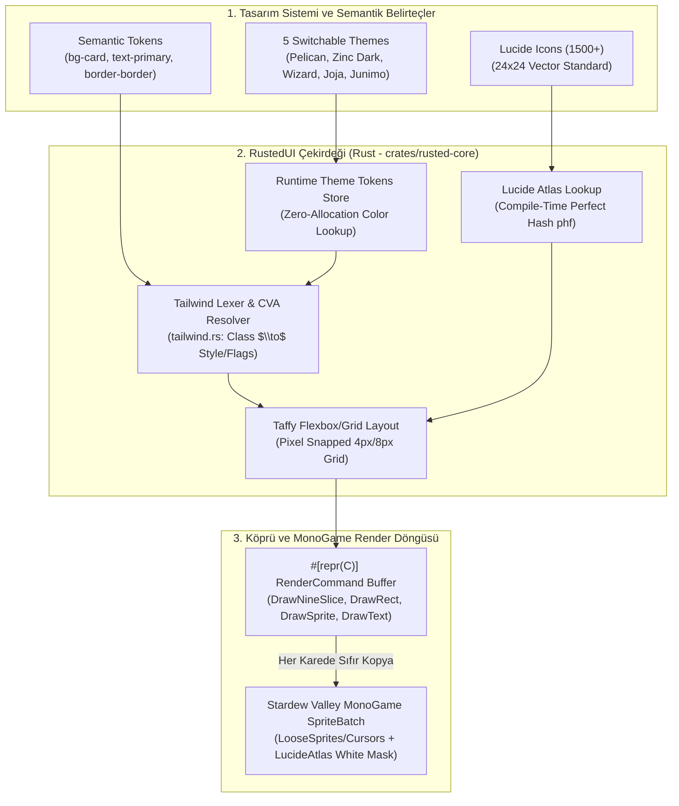
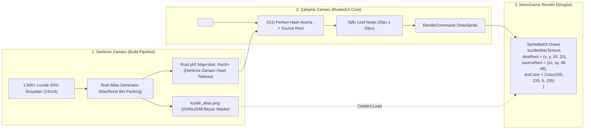

# RustedUI — Tailwind CSS Tasarım Belirteçleri (Design Tokens), Shadcn/UI Bileşen Mimarisi, 5 Temalı Renk Paletleri ve Lucide İkon Render Hattı

> **Doküman Kodu:** `RUSTED-ARCH-08`  
> **Durum:** Onaylandı / Mimari Tasarım & Uygulama Spesifikasyonu  
> **Tarih:** 2026-11-07  
> **Çekirdek Teknolojiler:** Rust 2024 (`taffy` v0.15.1, `resvg` v0.49.0, `tiny-skia`, `slotmap`) & C# (.NET 6.0 / SMAPI 4.x / MonoGame 3.8+)  
> **Tasarım Standartları:** Tailwind CSS v4 Semantik Belirteçleri, Radix/Shadcn UI CVA Primitifleri, Lucide Icons v1.70+  
> **Hedef Oyun:** Stardew Valley 1.6+ (MonoGame Desktop, Steam Deck GameScope, Linux, Windows, macOS)

---

## İçindekiler
1. [Yönetici Özeti ve Mimari Vizyon](#1-yönetici-özeti-ve-mimari-vizyon)
2. [Neden Ham HTML/CSS "Düz" (Flat) Görünür? Modern Tasarım Sistemlerinin Anatomisi](#2-neden-ham-htmlcss-düz-flat-görünür-modern-tasarım-sistemlerinin-anatomisi)
   - 2.1 Tipografik Hiyerarşi ve Optik Ölçekleme (Typographic Hierarchy)
   - 2.2 4px / 8px Boşluk Ritmi (Spacing Rhythm & Spatial Harmony)
   - 2.3 Mikro-Kenarlıklar ve Işık Kırılması (`border-border/60`)
   - 2.4 Katmanlı Yüzey Yükseltisi (Surface Elevation: `background` $\rightarrow$ `card` $\rightarrow$ `muted` $\rightarrow$ `popover`)
   - 2.5 Rozet Kapsülleri (Badge Pills) ve Mikro-Etkileşimler (Hover, Focus Rings, Active Press Insets)
   - 2.6 Oyun Dünyasında "AI Slop" vs. Otantik Oyun-İçi Estetik Farkı
3. [5 Değiştirilebilir Tema ve Tam Hex / RGBA Token Spesifikasyonu](#3-5-değiştirilebilir-tema-ve-tam-hex--rgba-token-spesifikasyonu)
   - 3.1 Semantik Token Mimarisi (`ThemeTokens` Rust Veri Yapısı)
   - 3.2 Tema 1: **Pelican Classic (Sıcak Parşömen & Meşe)** — Vanilya Stardew Valley 1.6
   - 3.3 Tema 2: **Shadcn Zinc Dark (Modern Şık Overlay)** — Zinc-950 / Zinc-900 / Zinc-800
   - 3.4 Tema 3: **Wizard Arcane (Mistik Mor & Yıldız Altını)** — Rasmodius Kulesi
   - 3.5 Tema 4: **Joja Corp (Soğuk Endüstriyel Camgöbeği & Arduvaz)** — JojaMart Kurumsal
   - 3.6 Tema 5: **Junimo Forest (Huzurlu Yosun & Orman Meyvesi)** — Büyülü Doğa
   - 3.7 Karşılaştırmalı Hex & `ColorRgba::new(r, g, b, a)` Referans Matrisi
4. [Shadcn/UI Bileşen Primitiflerinin RustedUI'a Uyarlanması](#4-shadcnui-bileşen-primitiflerinin-rusteduia-uyarlanması)
   - 4.1 Class Variance Authority (CVA) Mimarisi: Rust ve C# Karşılıkları
   - 4.2 `<Card>`, `<CardHeader>`, `<CardTitle>`, `<CardDescription>`, `<CardContent>`, `<CardFooter>`
   - 4.3 `<Button variant="..." size="...">` (Default, Secondary, Outline, Ghost, Destructive | Sm, Md, Lg, Icon)
   - 4.4 `<Badge variant="...">` (Default, Secondary, Outline, Destructive, Success)
   - 4.5 `<Switch>` (Animasyonlu Geçiş Anahtarı ve Durum Yönetimi)
   - 4.6 `<Slider>` (Piksel-Duyarlı Aralık Kaydırıcısı)
   - 4.7 `<Tabs>`, `<TabsList>`, `<TabsTrigger>`, `<TabsContent>` (Sekme Mimarisi)
   - 4.8 `<Separator>` (Yatay ve Dikey Bölücüler)
   - 4.9 `<Avatar>`, `<AvatarImage>`, `<AvatarFallback>` (NPC Portresi ve Profil Rozeti)
   - 4.10 `<Input>`, `<Tooltip>`, `<ScrollArea>` Primitifleri
5. [Lucide İkon Entegrasyon Hattı (`<icon name="..." size="..." color="..." />`)](#5-lucide-ikon-entegrasyon-hattı-icon-name-size-color-)
   - 5.1 Lucide İkon Ekosistem Telemetrisi ve 24x24 Vektör Standardı
   - 5.2 Mimari Karşılaştırma: (A) Sprite Atlas vs. (B) `resvg`/`tiny-skia` Dinamik Render vs. (C) MSDF Şaderi
   - 5.3 Seçilen Çözüm: Çift-Katmanlı Hibrit İkon Hattı
   - 5.4 2048x2048 Tekil Beyaz Doku Atlası ve Rust `phf` Derleme-Zamanı Arama Tablosu
   - 5.5 MonoGame `SpriteBatch` Sıfır-Şader Renklendirme (Color Tinting) ve `RenderCommand` Üretimi
   - 5.6 XML / HTML Şablonlarında `<icon>` Etiketi Ayrıştırma ve Taffy Entegrasyonu
6. [`crates/rusted-core/src/tailwind.rs` ve Çekirdek Kod Eklentileri Spesifikasyonu](#6-cratesrusted-coresrctailwindrs-ve-çekirdek-kod-eklentileri-spesifikasyonu)
   - 6.1 Yeni Semantik Renk ve Boyut Belirteçlerinin Lexer'a Eklenmesi
   - 6.2 Dinamik Tema Yöneticisi (`ThemeManager`)
   - 6.3 Çizim Hattına Yansıma: `RenderCommand::DrawRect` vs. `RenderCommand::DrawNineSlice`
7. [Performans, Bellek ve Kare Bütçesi (Frame-Budget) Analizi](#7-performans-bellek-ve-kare-bütçesi-frame-budget-analizi)
8. [Sonuç ve Uygulama Direktifleri](#8-sonuç-ve-uygulama-direktifleri)

---

## 1. Yönetici Özeti ve Mimari Vizyon

Stardew Valley ve MonoGame modlama dünyasında bugüne kadar geliştirilen kullanıcı arayüzleri iki aşırı uç arasında sıkışıp kalmıştır:
1. **Ham / İlkel Arayüzler (Raw Primitive UI):** Ham `SpriteBatch.Draw` çağrıları, rastgele seçilmiş `Color.Gray` arkaplan kutuları, hizasız `SpriteFont` metinleri ve tutarsız kenar boşlukları ile oluşturulan, 2000'li yılların başındaki geliştirici konsollarını andıran estetikten yoksun ekranlar.
2. **Ağır Harici Motorlar (WebView / CEF):** Modern web teknolojilerinin şıklığına kavuşmak uğruna oyuna eklenen, arka planda Chromium/WebKit çalıştırarak 200–400 MB RAM tüketen, SteamOS/Proton uyumsuzlukları çıkaran hantal yapılar.

**RustedUI**, bu ikilemi kökünden çözer. Web ekosisteminin en olgun tasarım sistemi standardı olan **Tailwind CSS v4 semantik belirteçlerini** ve **Shadcn/UI bileşen mimarisini**, oyun motorunun kalbine —sıfır harici pencere, sıfır WebView ve sıfır C# çöp toplayıcı (GC) tahsisatı ile— taşır.

Bu doküman;
- Ham HTML/CSS tasarımlarının neden "düz ve yapay" göründüğünü tipografik ve mekânsal prensiplerle çözümler,
- Stardew Valley 1.6 vanilya dokuları ile kusursuz uyum sağlayan **Pelican Classic** temasından, siberpunk ve modern cam tasarımını yansıtan **Shadcn Zinc Dark** ve tematik **Wizard Arcane**, **Joja Corp** ve **Junimo Forest** temalarına kadar 5 farklı paletin tüm Hex ve `ColorRgba` karşılıklarını eksiksiz sunar,
- Shadcn/UI'ın `cva` (Class Variance Authority) bileşen primitiflerini (`Card`, `Button`, `Badge`, `Switch`, `Slider`, `Tabs`, `Separator`, `Avatar`) Rust DOM motoruna adapte eder,
- 1,500'den fazla **Lucide ikonunun** piksel-keskinliğinde ve sıfır GPU şader anahtarlama maliyetiyle ekrana basılmasını sağlayan yüksek performanslı hibrit render hattını mimarileştirir.



---

## 2. Neden Ham HTML/CSS "Düz" (Flat) Görünür? Modern Tasarım Sistemlerinin Anatomisi

Birçok geliştirici web veya oyun arayüzü tasarlarken HTML ve CSS'i "ham" (raw) haliyle kullanır: standart `<div>`, `<h1>`, `<button>` etiketleri, rastgele piksel değerleri (`margin: 13px; padding: 7px;`) ve varsayılan sistem fontları. Ortaya çıkan görsel sonuç istisnasız "düz", amatör ve göze yapay (slop) gelir. 

Buna karşın modern bir **Shadcn/UI** veya profesyonel bir **Tailwind CSS** arayüzü; kullanıcı bir satır dahi özel CSS yazmamış olsa bile anında zarif, derinlikli, sakin ve son derece kaliteli algılanır. Bunun arkasında rastlantı değil, algı psikolojisi ve görsel ağırlık matematiği yatar.

### 2.1 Tipografik Hiyerarşi ve Optik Ölçekleme (Typographic Hierarchy)

Ham HTML'de metin boyutları kullanıcı aracısı (user-agent) varsayılanlarına dayanır (`h1` = 32px, `h2` = 24px, `p` = 16px) ve satır yükseklikleri orantısızdır (`line-height: normal` $\approx$ 1.15–1.2). Bu durum, metinlerin birbirine yapışmasına ya da dengesiz boşluklar bırakmasına yol açar. Ayrıca saf siyah metin (`#000000`) saf beyaz arka plan üzerine konulduğunda, insan gözünün çubuk ve koni hücrelerinde aşırı kontrast parlamasına (contrast vibration / eye fatigue) neden olur.

Modern sistemlerde (Shadcn/Tailwind):
- **Modüler Tipografi Skalası:** Yazı tipleri altın oran veya Fibonacci benzeri modüler katsayılarla (`text-xs`: 12/16px, `text-sm`: 14/20px, `text-base`: 16/24px, `text-lg`: 18/28px, `text-xl`: 20/28px, `text-2xl`: 24/32px) tanımlanır. Yazı boyutu büyüdükçe satır aralığı daraltılır (`leading-tight`), yazı boyutu küçüldükçe okunabilirlik için satır aralığı açılır (`leading-relaxed`).
- **Yumuşatılmış Ön Plan Kontrastı:** Saf siyah veya saf beyaz yerine, temanın arka planına göre tonlanmış gövde renkleri (`text-foreground`: `#FAFAFA` veya `#221122`) ve ikincil açıklamalar için bastırılmış tonlar (`text-muted-foreground`: `#A1A1AA` veya `#735A4B`) kullanılır. Bu, gözün doğrudan en önemli içeriğe odaklanmasını sağlar.
- **Harf Boşluğu (Letter Spacing / Tracking):** Başlıklarda negatif aralık (`tracking-tight`), küçük buton ve etiketlerde ise pozitif aralık (`tracking-wide`) kullanılarak metnin optik dengesi kusursuzlaştırılır.

### 2.2 4px / 8px Boşluk Ritmi (Spacing Rhythm & Spatial Harmony)

Ham arayüzlerin en büyük kusuru "keyfi piksel atamalarıdır". Bir elemanın altında 11px, diğerinde 17px boşluk olduğunda, beyin bu asimetriyi bilinçaltında "dağınıklık ve güvensizlik" olarak işler.

Shadcn ve Tailwind'in temeli **4px / 8px ızgara ritmine** (Spatial Grid) dayanır:
$$\text{Spacing}(n) = n \times 4\text{px} \quad (n \in \{1, 2, 3, 4, 6, 8, 12, 16, \dots\})$$
- `p-1` = 4px, `p-2` = 8px, `p-3` = 12px, `p-4` = 16px, `p-6` = 24px, `p-8` = 32px.
- İç boşluklar (padding) ve dış boşluklar (margin) her zaman 4'ün veya 8'in katları olduğunda, insan gözü arayüzdeki "görünmez sütunları" hisseder. Stardew Valley gibi piksel-sanatı (pixel-art) oyunlarında `pixelZoom = 4` olduğundan, 4px'lik adımlar oyunun yerel piksel çözünürlüğüyle %100 örtüşür!

### 2.3 Mikro-Kenarlıklar ve Işık Kırılması (`border-border/60`)

Ham web arayüzleri sınırları ayırmak için sert, opak çizgiler çizer (`border: 1px solid black` veya `border: 2px outset gray`). Bu çizgiler arayüzü görsel bir hapishaneye çevirir ve nefes alacak alan bırakmaz.

Shadcn tasarım sisteminin en belirgin imzalarından biri **yarı-saydam mikro-kenarlıklar** (`border border-border/60` veya `border border-border`) kullanmaktır:
- Koyu temada kenarlık opak bir açık gri değil, `%8 – %12` opaklıkta saf beyazdır (`rgba(255, 255, 255, 0.1)`).
- Bu teknik, gerçek dünyadaki cam ve metal kenarlarındaki optik ışık kırılmasını (specular edge highlight) simüle eder. Elemanlar birbirinden agresif çizgilerle değil, hafif bir parlama hattıyla ayrılır.

### 2.4 Katmanlı Yüzey Yükseltisi (Layered Surface Elevation)

Gerçek dünyada nesneler 2 boyutlu düzlemler üzerinde değil, birbirinin üzerine binen katmanlarda (elevation layers) yaşar. Ham web sayfaları ise her şeyi tek bir düz zemin üzerine serer.

Shadcn/Tailwind mimarisi derinliği **renk açıklığı (luminance stepping)** ile inşa eder:
- **Katman 0 (`background`):** En alttaki kanvas. En koyu tondur (Örn: `#09090B`).
- **Katman 1 (`card`):** Kanvasın üzerine oturan paneller. Arka plandan `%4–6` daha açık tondadır (Örn: `#18181B`).
- **Katman 2 (`muted` / `secondary`):** Kart içerisindeki girdi alanları, tablolar veya girintili kutular (wells). Kart zeminine göre hafifçe farklılaşır (Örn: `#27272A`).
- **Katman 3 (`popover` / `dropdown`):** Kullanıcının üzerine tıkladığında en üste fırlayan pencereler. Kendi kenarlık parlamasına ve yumuşak bir ortam gölgesine (`shadow-lg`: `rgba(0,0,0,0.4)`) sahiptir.

```
+-------------------------------------------------------------------+
| Katman 0: background (#09090B)                                    |
|                                                                   |
|   +-------------------------------------------------------------+ |
|   | Katman 1: card (#18181B) + border border-border/60          | |
|   |                                                             | |
|   |   +--------------------------+  +-------------------------+ | |
|   |   | Katman 2: muted (#27272A)|  | Katman 2: input         | | |
|   |   | (İç girintili liste)     |  | (#09090B + ring)        | | |
|   |   +--------------------------+  +-------------------------+ | |
|   |                                                             | |
|   |         +-----------------------------------------+         | |
|   |         | Katman 3: popover (#18181B) + shadow-lg |         | |
|   |         | (Açılır Menü / Tooltip)                 |         | |
|   |         +-----------------------------------------+         | |
|   +-------------------------------------------------------------+ |
+-------------------------------------------------------------------+
```

### 2.5 Rozet Kapsülleri (Badge Pills) ve Mikro-Etkileşimler

Bir arayüzün canlı hissedilmesinin sırrı kullanıcı hareketlerine verdiği anlık mikro-tepkilerdir:
- **Hover Durumu:** Butonun üzerine gelindiğinde aniden renk değiştirmesi yerine, `%10` parlaklık artışı (`hover:bg-primary/90`) veya zemin tonunun yumuşak bir vurguya dönmesi (`hover:bg-accent hover:text-accent-foreground`).
- **Aktif / Basılma Durumu (Active Press Inset):** Butona tıklandığında 1 piksel aşağı kayması (`active:translate-y-px`) veya hafifçe küçülmesi (`active:scale-[0.98]`). Stardew Valley vanilya menülerinde bu etiketler `shiny4` ve `bigSelect` sesleriyle taçlandırılır.
- **Odak Halkaları (Focus Rings):** Klavye veya gamepad (oyun kolu) ile gezinirken elemanın etrafında beliren, elemandan 2 piksel ayrık duran çift katmanlı parlaklık halkası (`ring-2 ring-ring ring-offset-2 ring-offset-background`).

### 2.6 Oyun Dünyasında "AI Slop" vs. Otantik Oyun-İçi Estetik Farkı

Son dönemde yapay zeka tarafından üretilen web arayüzleri belirli şablonlara sıkışmıştır:
- Ortalanmış üç satırlık başlıklar,
- Başlığın üzerinde küçük, gereksiz ve büyük harflerle yazılmış bir etiket (`TRACKED EYEBROW`),
- Anlamsız gökkuşağı gradyanları ve mor/pembe neon parlamalar,
- Amacı olmayan yuvarlatılmış kart sıraları.

Stardew Valley gibi piksel-estetiğine ve pastoral bir atmosfere sahip bir oyunda bu tür yapay parlamalar korkunç durur. RustedUI'ın felsefesi:
> **"Tasarım sisteminin disiplini ve ergonomisi web standartlarından (Tailwind/Shadcn), ruhu ve dokusu ise oyunun kendi dünyasından (Pelican Town, Büyücü Kulesi, Joja, Junimo) gelmelidir."**

---

## 3. 5 Değiştirilebilir Tema ve Tam Hex / RGBA Token Spesifikasyonu

RustedUI, hem mod geliştiricisinin hem de oyuncunun tek bir konfigürasyonla oyun içi arayüz stilini değiştirebilmesi için **5 ana tema** sunar. Bu temalar, W3C CSS Variables ve Tailwind v4 `@theme` semantik token hiyerarşisiyle 1:1 uyumludur.

### 3.1 Semantik Token Mimarisi (`ThemeTokens` Rust Veri Yapısı)

Rust tarafında bellek tahsisatını sıfıra indirmek ve C# ile doğrudan paylaşımlı bellek (blittable memory) üzerinden haberleşmek için tüm tema belirteçleri düz bir `#[repr(C)]` veri yapısında saklanır:

```rust
use crate::types::ColorRgba;

#[repr(C)]
#[derive(Debug, Clone, Copy, PartialEq, Eq)]
pub struct ThemeTokens {
    // Yüzey ve Tuval (Surfaces & Canvas)
    pub background: ColorRgba,
    pub foreground: ColorRgba,

    // Kartlar ve Paneller (Cards & Surfaces)
    pub card: ColorRgba,
    pub card_foreground: ColorRgba,

    // Açılır Menüler ve Tooltip'ler (Popovers & Overlays)
    pub popover: ColorRgba,
    pub popover_foreground: ColorRgba,

    // Birincil Aksiyonlar (Primary Actions)
    pub primary: ColorRgba,
    pub primary_foreground: ColorRgba,

    // İkincil Aksiyonlar (Secondary Actions)
    pub secondary: ColorRgba,
    pub secondary_foreground: ColorRgba,

    // Bastırılmış Alanlar (Muted Surfaces)
    pub muted: ColorRgba,
    pub muted_foreground: ColorRgba,

    // Vurgu ve Hover Durumları (Accent & Focus)
    pub accent: ColorRgba,
    pub accent_foreground: ColorRgba,

    // Yıkıcı / Tehlikeli Eylemler (Destructive / Danger)
    pub destructive: ColorRgba,
    pub destructive_foreground: ColorRgba,

    // Başarı Durumları (Success / Completed)
    pub success: ColorRgba,
    pub success_foreground: ColorRgba,

    // Kenarlıklar ve Girdiler (Borders & Inputs)
    pub border: ColorRgba,
    pub input: ColorRgba,
    pub ring: ColorRgba,

    // Ortam Gölgeleri (Shadows)
    pub shadow: ColorRgba,
}
```

---

### 3.2 Tema 1: Pelican Classic (Sıcak Parşömen & Meşe)

Stardew Valley 1.6'nın otantik, el çizimi arayüz dokularının (`LooseSprites/Cursors` ve `Menus/MenuTiles`) doğrudan renk karşılığıdır. Sıcak parşömen, koyu kırmızı meşe ahşabı, kehribar altını ve çiftlik yeşili tonlarını taşır.

| Token Adı | CSS Karşılığı | Hex Kodu | RGBA Kodu (`ColorRgba::new`) | Tasarım Rolü / Kullanım Yeri |
|:---|:---|:---:|:---:|:---|
| `background` | `--background` | `#2C1109` | `ColorRgba::new(44, 17, 9, 255)` | Menü arkası koyu meşe tuvali / arkaplan karartması |
| `foreground` | `--foreground` | `#221122` | `ColorRgba::new(34, 17, 34, 255)` | Vanilya Stardew koyu kahve-mor gövde metni |
| `card` | `--card` | `#F5D597` | `ColorRgba::new(245, 213, 151, 255)` | Sıcak parşömen ana kutu içi dolgusu (`sdv-box`) |
| `card_foreground`| `--card-foreground`| `#56160C` | `ColorRgba::new(86, 22, 12, 255)` | Diyalog ve başlık meşe kahvesi metin rengi |
| `popover` | `--popover` | `#FFECB3` | `ColorRgba::new(255, 236, 179, 255)` | Uçuşan eşya bilgi kartı (hover tooltip) açık parşömen |
| `popover_foreground`|`--popover-foreground`|`#221122`| `ColorRgba::new(34, 17, 34, 255)` | Tooltip metin rengi |
| `primary` | `--primary` | `#FFA500` | `ColorRgba::new(255, 165, 0, 255)` | Kehribar altını birincil buton / aksiyon vurgusu |
| `primary_foreground`|`--primary-foreground`|`#221122`| `ColorRgba::new(34, 17, 34, 255)` | Altın buton üzerindeki koyu metin |
| `secondary` | `--secondary` | `#CE9C5F` | `ColorRgba::new(206, 156, 95, 255)` | Açık meşe / parşömen gölge rengi (`SDV_TEXT_SHADOW`)|
| `secondary_foreground`|`--secondary-foreground`|`#221122`|`ColorRgba::new(34, 17, 34, 255)`| İkincil panel içi metin |
| `muted` | `--muted` | `#E6C887` | `ColorRgba::new(230, 200, 135, 255)` | Parşömen içi girintili yuva/tablo zemini |
| `muted_foreground`| `--muted-foreground`| `#735A4B` | `ColorRgba::new(115, 90, 75, 255)` | Koyu bej ikincil açıklama metni |
| `accent` | `--accent` | `#22B14C` | `ColorRgba::new(34, 177, 76, 255)` | Çiftlik enerjisi yeşili / onay aksiyonu |
| `accent_foreground`|`--accent-foreground`| `#FFFFFF` | `ColorRgba::new(255, 255, 255, 255)` | Yeşil üzerindeki beyaz metin |
| `destructive` | `--destructive` | `#DC2D23` | `ColorRgba::new(220, 45, 35, 255)` | Can barı kırmızısı / çöp kutusu / tehlike |
| `destructive_foreground`|`--destructive-foreground`|`#FFFFFF`|`ColorRgba::new(255, 255, 255, 255)`| Kırmızı buton üzerindeki beyaz metin |
| `success` | `--success` | `#00B937` | `ColorRgba::new(0, 185, 55, 255)` | Kalite yıldızı / başarı durumu yeşili |
| `success_foreground`|`--success-foreground`|`#FFFFFF`| `ColorRgba::new(255, 255, 255, 255)` | Başarı yeşili üzerindeki beyaz metin |
| `border` | `--border` | `#56160C` | `ColorRgba::new(86, 22, 12, 255)` | Otantik 9-slice oyma meşe dış çerçeve |
| `input` | `--input` | `#E0B974` | `ColorRgba::new(224, 185, 116, 255)` | Metin girdi kutusu parşömen oyuğu |
| `ring` | `--ring` | `#FFD700` | `ColorRgba::new(255, 215, 0, 255)` | Gamepad/klavye odaklanma altın parlaması |
| `shadow` | `--shadow` | `#0000005F` | `ColorRgba::new(0, 0, 0, 95)` | Vanilya %37 opaklıkta sol-alt piksel gölgesi |

---

### 3.3 Tema 2: Shadcn Zinc Dark (Modern Şık Overlay)

Sleek, profesyonel, modern donanım arayüzleri ve AAA oyun geliştirici göstergeleri (HUD) için optimize edilmiş koyu gri/çinko paleti.

| Token Adı | CSS Karşılığı | Hex Kodu | RGBA Kodu (`ColorRgba::new`) | Tasarım Rolü / Kullanım Yeri |
|:---|:---|:---:|:---:|:---|
| `background` | `--background` | `#09090B` | `ColorRgba::new(9, 9, 11, 255)` | Zinc-950 en derin tuval rengi |
| `foreground` | `--foreground` | `#FAFAFA` | `ColorRgba::new(250, 250, 250, 255)` | Zinc-50 en parlak beyaz metin |
| `card` | `--card` | `#18181B` | `ColorRgba::new(24, 24, 27, 255)` | Zinc-900 yükseltilmiş kart yüzeyi |
| `card_foreground`| `--card-foreground`| `#FAFAFA` | `ColorRgba::new(250, 250, 250, 255)` | Kart içi birincil metin |
| `popover` | `--popover` | `#18181B` | `ColorRgba::new(24, 24, 27, 255)` | Açılır menü ve modal yüzeyi |
| `popover_foreground`|`--popover-foreground`|`#FAFAFA`| `ColorRgba::new(250, 250, 250, 255)` | Popover metin rengi |
| `primary` | `--primary` | `#FAFAFA` | `ColorRgba::new(250, 250, 250, 255)` | Yüksek kontrastlı saf beyaz buton aksiyonu |
| `primary_foreground`|`--primary-foreground`|`#18181B`| `ColorRgba::new(24, 24, 27, 255)` | Beyaz buton içi siyah metin |
| `secondary` | `--secondary` | `#27272A` | `ColorRgba::new(39, 39, 42, 255)` | Zinc-800 ikincil buton ve panel yüzeyi |
| `secondary_foreground`|`--secondary-foreground`|`#FAFAFA`|`ColorRgba::new(250, 250, 250, 255)`| İkincil buton metni |
| `muted` | `--muted` | `#27272A` | `ColorRgba::new(39, 39, 42, 255)` | Zinc-800 pasif alan dolgusu |
| `muted_foreground`| `--muted-foreground`| `#A1A1AA` | `ColorRgba::new(161, 161, 170, 255)` | Zinc-400 ikincil açıklama ve etiket metni |
| `accent` | `--accent` | `#27272A` | `ColorRgba::new(39, 39, 42, 255)` | Hover durumunda parlayan yüzey dolgusu |
| `accent_foreground`|`--accent-foreground`| `#FAFAFA` | `ColorRgba::new(250, 250, 250, 255)` | Hover metin rengi |
| `destructive` | `--destructive` | `#7F1D1D` | `ColorRgba::new(127, 29, 29, 255)` | Red-900 koyu kırmızı uyarı/silme aksiyonu |
| `destructive_foreground`|`--destructive-foreground`|`#FEF2F2`|`ColorRgba::new(254, 242, 242, 255)`| Silme butonu metni |
| `success` | `--success` | `#10B981` | `ColorRgba::new(16, 185, 129, 255)` | Emerald-500 modern başarı göstergesi |
| `success_foreground`|`--success-foreground`|`#FFFFFF`| `ColorRgba::new(255, 255, 255, 255)` | Başarı metni |
| `border` | `--border` | `#27272A` | `ColorRgba::new(39, 39, 42, 255)` | Zinc-800 hassas mikro-kenarlık çizgisi |
| `input` | `--input` | `#27272A` | `ColorRgba::new(39, 39, 42, 255)` | Girdi kutusu çerçevesi |
| `ring` | `--ring` | `#D4D4D8` | `ColorRgba::new(212, 212, 216, 255)` | Zinc-300 klavye odaklanma çerçevesi |
| `shadow` | `--shadow` | `#00000080` | `ColorRgba::new(0, 0, 0, 128)` | %50 siyah modern derinlik gölgesi |

---

### 3.4 Tema 3: Wizard Arcane (Mistik Mor & Yıldız Altını)

Büyücü M. Rasmodius'un kulesinden, gece pazarından ve madenlerin 100. katındaki gizemli rünlerden ilham alan mistik atmosfer teması.

| Token Adı | CSS Karşılığı | Hex Kodu | RGBA Kodu (`ColorRgba::new`) | Tasarım Rolü / Kullanım Yeri |
|:---|:---|:---:|:---:|:---|
| `background` | `--background` | `#0F081D` | `ColorRgba::new(15, 8, 29, 255)` | Derin astral boşluk koyu moru |
| `foreground` | `--foreground` | `#F3E8FF` | `ColorRgba::new(243, 232, 255, 255)` | Astral yıldız tozu leylak-beyaz metin |
| `card` | `--card` | `#1A1025` | `ColorRgba::new(26, 16, 37, 255)` | Büyülü rün masası kart dolgusu |
| `card_foreground`| `--card-foreground`| `#F3E8FF` | `ColorRgba::new(243, 232, 255, 255)` | Kart metni |
| `popover` | `--popover` | `#241436` | `ColorRgba::new(36, 20, 54, 255)` | Kristal küre menü açılır penceresi |
| `popover_foreground`|`--popover-foreground`|`#F3E8FF`| `ColorRgba::new(243, 232, 255, 255)` | Açılır pencere metni |
| `primary` | `--primary` | `#FFD700` | `ColorRgba::new(255, 215, 0, 255)` | Simya altını birincil buton/aksiyon |
| `primary_foreground`|`--primary-foreground`|`#1A1025`| `ColorRgba::new(26, 16, 37, 255)` | Altın üzerindeki koyu mor metin |
| `secondary` | `--secondary` | `#3B1E63` | `ColorRgba::new(59, 30, 99, 255)` | Büyülü kadife moru ikincil buton |
| `secondary_foreground`|`--secondary-foreground`|`#E9D5FF`|`ColorRgba::new(233, 213, 255, 255)`| İkincil buton açık mor metni |
| `muted` | `--muted` | `#2A1644` | `ColorRgba::new(42, 22, 68, 255)` | Gölge rün alanı zemini |
| `muted_foreground`| `--muted-foreground`| `#C084FC` | `ColorRgba::new(192, 132, 252, 255)` | Eterik mor bastırılmış açıklama metni |
| `accent` | `--accent` | `#8B5CF6` | `ColorRgba::new(139, 92, 246, 255)` | İris moru hover ve seçim vurgusu |
| `accent_foreground`|`--accent-foreground`| `#FFFFFF` | `ColorRgba::new(255, 255, 255, 255)` | Vurgu üzerindeki beyaz metin |
| `destructive` | `--destructive` | `#B91C1C` | `ColorRgba::new(185, 28, 28, 255)` | Kan büyüsü koyu kırmızısı |
| `destructive_foreground`|`--destructive-foreground`|`#FFFFFF`|`ColorRgba::new(255, 255, 255, 255)`| Kırmızı buton metni |
| `success` | `--success` | `#38BDF8` | `ColorRgba::new(56, 189, 248, 255)` | Göksel mana mavisi başarı göstergesi |
| `success_foreground`|`--success-foreground`|`#0F081D`| `ColorRgba::new(15, 8, 29, 255)` | Başarı metni |
| `border` | `--border` | `#4C2882` | `ColorRgba::new(76, 40, 130, 255)` | Ametist kristali kenarlık çizgisi |
| `input` | `--input` | `#2A1644` | `ColorRgba::new(42, 22, 68, 255)` | Girdi kutusu mistik kuyu dolgusu |
| `ring` | `--ring` | `#FFD700` | `ColorRgba::new(255, 215, 0, 255)` | Altın yıldız ışıltısı odak halkası |
| `shadow` | `--shadow` | `#05020A99` | `ColorRgba::new(5, 2, 10, 153)` | %60 koyu eflatun gölge |

---

### 3.5 Tema 4: Joja Corp (Soğuk Endüstriyel Camgöbeği & Arduvaz)

Morris'in JojaMart hipermarketler zincirinden, kurumsal verimlilik raporlarından ve soğuk mavi floresan ışıklarından esinlenen endüstriyel kurumsal tema.

| Token Adı | CSS Karşılığı | Hex Kodu | RGBA Kodu (`ColorRgba::new`) | Tasarım Rolü / Kullanım Yeri |
|:---|:---|:---:|:---:|:---|
| `background` | `--background` | `#0F172A` | `ColorRgba::new(15, 23, 42, 255)` | Slate-900 soğuk çelik zemin |
| `foreground` | `--foreground` | `#F8FAFC` | `ColorRgba::new(248, 250, 252, 255)` | Slate-50 temiz fotokopi kağıdı beyazı metin |
| `card` | `--card` | `#1E293B` | `ColorRgba::new(30, 41, 59, 255)` | Slate-800 ofis bölmesi (cubicle) kart dolgusu |
| `card_foreground`| `--card-foreground`| `#F8FAFC` | `ColorRgba::new(248, 250, 252, 255)` | Kart metni |
| `popover` | `--popover` | `#1E293B` | `ColorRgba::new(30, 41, 59, 255)` | Kurumsal açılır pencere paneli |
| `popover_foreground`|`--popover-foreground`|`#F8FAFC`| `ColorRgba::new(248, 250, 252, 255)` | Popover metni |
| `primary` | `--primary` | `#0284C7` | `ColorRgba::new(2, 132, 199, 255)` | Resmi Joja Mavisi (Sky-600) birincil aksiyon |
| `primary_foreground`|`--primary-foreground`|`#FFFFFF`| `ColorRgba::new(255, 255, 255, 255)` | Mavi buton üzeri beyaz metin |
| `secondary` | `--secondary` | `#334155` | `ColorRgba::new(51, 65, 85, 255)` | Slate-700 metalik çelik ikincil buton |
| `secondary_foreground`|`--secondary-foreground`|`#F8FAFC`|`ColorRgba::new(248, 250, 252, 255)`| İkincil buton metni |
| `muted` | `--muted` | `#1E293B` | `ColorRgba::new(30, 41, 59, 255)` | Slate-800 pasif tablo alanı |
| `muted_foreground`| `--muted-foreground`| `#94A3B8` | `ColorRgba::new(148, 163, 184, 255)` | Slate-400 bürokratik ikincil açıklama |
| `accent` | `--accent` | `#38BDF8` | `ColorRgba::new(56, 189, 248, 255)` | Floresan camgöbeği (Sky-400) hover vurgusu |
| `accent_foreground`|`--accent-foreground`| `#0F172A` | `ColorRgba::new(15, 23, 42, 255)` | Vurgu üzeri koyu metin |
| `destructive` | `--destructive` | `#E11D48` | `ColorRgba::new(225, 29, 72, 255)` | Sözleşme feshi ve hata kırmızısı (Rose-600) |
| `destructive_foreground`|`--destructive-foreground`|`#FFFFFF`|`ColorRgba::new(255, 255, 255, 255)`| Hata butonu metni |
| `success` | `--success` | `#059669` | `ColorRgba::new(5, 150, 105, 255)` | Kar marjı artışı yeşili (Emerald-600) |
| `success_foreground`|`--success-foreground`|`#FFFFFF`| `ColorRgba::new(255, 255, 255, 255)` | Başarı metni |
| `border` | `--border` | `#334155` | `ColorRgba::new(51, 65, 85, 255)` | Slate-700 soğuk alüminyum kenarlık |
| `input` | `--input` | `#0F172A` | `ColorRgba::new(15, 23, 42, 255)` | Terminal girdi alanı koyu oyuğu |
| `ring` | `--ring` | `#0284C7` | `ColorRgba::new(2, 132, 199, 255)` | Joja mavisi odaklama çerçevesi |
| `shadow` | `--shadow` | `#00000073` | `ColorRgba::new(0, 0, 0, 115)` | %45 soğuk endüstriyel gölge |

---

### 3.6 Tema 5: Junimo Forest (Huzurlu Yosun & Orman Meyvesi)

Halk Merkezi'ndeki (Community Center) küçük büyülü orman ruhları Junimoların kulübesinden, nemli çam iğnelerinden ve yabani somon meyvelerinden ilham alan sıcak doğa teması.

| Token Adı | CSS Karşılığı | Hex Kodu | RGBA Kodu (`ColorRgba::new`) | Tasarım Rolü / Kullanım Yeri |
|:---|:---|:---:|:---:|:---|
| `background` | `--background` | `#14261C` | `ColorRgba::new(20, 38, 28, 255)` | Derin kadife orman yosunu tabanı |
| `foreground` | `--foreground` | `#ECFCCB` | `ColorRgba::new(236, 252, 203, 255)` | Çiğ damlası açık krem-fıstık yeşili metin |
| `card` | `--card` | `#1E3829` | `ColorRgba::new(30, 56, 41, 255)` | Adaçayı ve meşe yaprağı gölgeliği kart dolgusu |
| `card_foreground`| `--card-foreground`| `#ECFCCB` | `ColorRgba::new(236, 252, 203, 255)` | Kart metni |
| `popover` | `--popover` | `#244532` | `ColorRgba::new(36, 69, 50, 255)` | Ağaç kabuğu likenli açılır pencere |
| `popover_foreground`|`--popover-foreground`|`#ECFCCB`| `ColorRgba::new(236, 252, 203, 255)` | Popover metni |
| `primary` | `--primary` | `#F43F5E` | `ColorRgba::new(244, 63, 94, 255)` | Tatlı orman meyvesi kırmızısı (Rose-500) buton |
| `primary_foreground`|`--primary-foreground`|`#FFFFFF`| `ColorRgba::new(255, 255, 255, 255)` | Meyve kırmızısı üzeri beyaz metin |
| `secondary` | `--secondary` | `#2D5A3E` | `ColorRgba::new(45, 90, 62, 255)` | Çam iğnesi yeşili ikincil buton |
| `secondary_foreground`|`--secondary-foreground`|`#ECFCCB`|`ColorRgba::new(236, 252, 203, 255)`| İkincil buton açık yeşil metni |
| `muted` | `--muted` | `#182F22` | `ColorRgba::new(24, 47, 34, 255)` | Loş orman gölgesi dolgusu |
| `muted_foreground`| `--muted-foreground`| `#86EFAC` | `ColorRgba::new(134, 239, 172, 255)` | Taze filiz yeşili (Green-300) açıklama metni |
| `accent` | `--accent` | `#FDE047` | `ColorRgba::new(253, 224, 71, 255)` | Junimo Yıldızı sarısı (Yellow-300) vurgu |
| `accent_foreground`|`--accent-foreground`| `#14261C` | `ColorRgba::new(20, 38, 28, 255)` | Yıldız sarısı üzeri koyu yosun metni |
| `destructive` | `--destructive` | `#BE123C` | `ColorRgba::new(190, 18, 60, 255)` | Zehirli yabani mantar kırmızısı |
| `destructive_foreground`|`--destructive-foreground`|`#FFFFFF`|`ColorRgba::new(255, 255, 255, 255)`| Hata butonu metni |
| `success` | `--success` | `#34D399` | `ColorRgba::new(52, 211, 153, 255)` | Büyülü orman çiçeği zümrüt yeşili |
| `success_foreground`|`--success-foreground`|`#14261C`| `ColorRgba::new(20, 38, 28, 255)` | Başarı metni |
| `border` | `--border` | `#2D5A3E` | `ColorRgba::new(45, 90, 62, 255)` | Örgülü söğüt dalı yeşili kenarlık |
| `input` | `--input` | `#182F22` | `ColorRgba::new(24, 47, 34, 255)` | Verimli toprak çukuru girdi dolgusu |
| `ring` | `--ring` | `#34D399` | `ColorRgba::new(52, 211, 153, 255)` | Peri halkası zümrüt parıltısı odak |
| `shadow` | `--shadow` | `#07120C8C` | `ColorRgba::new(7, 18, 12, 140)` | %55 derin nemli orman gölgesi |

---

### 3.7 Karşılaştırmalı Hex & `ColorRgba::new(r, g, b, a)` Referans Matrisi

Aşağıdaki Rust sabit tablosu doğrudan `crates/rusted-core/src/tailwind.rs` veya `crates/rusted-core/src/types.rs` içerisine yapıştırılmaya hazırdır:

```rust
// ==============================================================================
// RustedUI — 5 Temalı Yerleşik Semantik Renk Belirteçleri (Copy-Paste Ready)
// ==============================================================================

impl ThemeTokens {
    /// 1. Pelican Classic (Stardew Valley 1.6 Otantik Parşömen & Meşe)
    pub const PELICAN: Self = Self {
        background: ColorRgba::new(44, 17, 9, 255),      // #2C1109
        foreground: ColorRgba::new(34, 17, 34, 255),     // #221122
        card: ColorRgba::new(245, 213, 151, 255),        // #F5D597
        card_foreground: ColorRgba::new(86, 22, 12, 255),// #56160C
        popover: ColorRgba::new(255, 236, 179, 255),     // #FFECB3
        popover_foreground: ColorRgba::new(34, 17, 34, 255),
        primary: ColorRgba::new(255, 165, 0, 255),       // #FFA500
        primary_foreground: ColorRgba::new(34, 17, 34, 255),
        secondary: ColorRgba::new(206, 156, 95, 255),    // #CE9C5F
        secondary_foreground: ColorRgba::new(34, 17, 34, 255),
        muted: ColorRgba::new(230, 200, 135, 255),       // #E6C887
        muted_foreground: ColorRgba::new(115, 90, 75, 255),// #735A4B
        accent: ColorRgba::new(34, 177, 76, 255),        // #22B14C
        accent_foreground: ColorRgba::new(255, 255, 255, 255),
        destructive: ColorRgba::new(220, 45, 35, 255),   // #DC2D23
        destructive_foreground: ColorRgba::new(255, 255, 255, 255),
        success: ColorRgba::new(0, 185, 55, 255),        // #00B937
        success_foreground: ColorRgba::new(255, 255, 255, 255),
        border: ColorRgba::new(86, 22, 12, 255),         // #56160C
        input: ColorRgba::new(224, 185, 116, 255),       // #E0B974
        ring: ColorRgba::new(255, 215, 0, 255),          // #FFD700
        shadow: ColorRgba::new(0, 0, 0, 95),             // 37% Black
    };

    /// 2. Shadcn Zinc Dark (Modern Şık Siyah/Gri Çinko)
    pub const ZINC_DARK: Self = Self {
        background: ColorRgba::new(9, 9, 11, 255),       // #09090B
        foreground: ColorRgba::new(250, 250, 250, 255),  // #FAFAFA
        card: ColorRgba::new(24, 24, 27, 255),           // #18181B
        card_foreground: ColorRgba::new(250, 250, 250, 255),
        popover: ColorRgba::new(24, 24, 27, 255),        // #18181B
        popover_foreground: ColorRgba::new(250, 250, 250, 255),
        primary: ColorRgba::new(250, 250, 250, 255),     // #FAFAFA
        primary_foreground: ColorRgba::new(24, 24, 27, 255),
        secondary: ColorRgba::new(39, 39, 42, 255),      // #27272A
        secondary_foreground: ColorRgba::new(250, 250, 250, 255),
        muted: ColorRgba::new(39, 39, 42, 255),          // #27272A
        muted_foreground: ColorRgba::new(161, 161, 170, 255),// #A1A1AA
        accent: ColorRgba::new(39, 39, 42, 255),         // #27272A
        accent_foreground: ColorRgba::new(250, 250, 250, 255),
        destructive: ColorRgba::new(127, 29, 29, 255),   // #7F1D1D
        destructive_foreground: ColorRgba::new(254, 242, 242, 255),
        success: ColorRgba::new(16, 185, 129, 255),      // #10B981
        success_foreground: ColorRgba::new(255, 255, 255, 255),
        border: ColorRgba::new(39, 39, 42, 255),         // #27272A
        input: ColorRgba::new(39, 39, 42, 255),          // #27272A
        ring: ColorRgba::new(212, 212, 216, 255),        // #D4D4D8
        shadow: ColorRgba::new(0, 0, 0, 128),            // 50% Black
    };

    /// 3. Wizard Arcane (Mistik Mor & Yıldız Altını)
    pub const WIZARD_ARCANE: Self = Self {
        background: ColorRgba::new(15, 8, 29, 255),      // #0F081D
        foreground: ColorRgba::new(243, 232, 255, 255),  // #F3E8FF
        card: ColorRgba::new(26, 16, 37, 255),           // #1A1025
        card_foreground: ColorRgba::new(243, 232, 255, 255),
        popover: ColorRgba::new(36, 20, 54, 255),        // #241436
        popover_foreground: ColorRgba::new(243, 232, 255, 255),
        primary: ColorRgba::new(255, 215, 0, 255),       // #FFD700
        primary_foreground: ColorRgba::new(26, 16, 37, 255),
        secondary: ColorRgba::new(59, 30, 99, 255),      // #3B1E63
        secondary_foreground: ColorRgba::new(233, 213, 255, 255),
        muted: ColorRgba::new(42, 22, 68, 255),          // #2A1644
        muted_foreground: ColorRgba::new(192, 132, 252, 255),// #C084FC
        accent: ColorRgba::new(139, 92, 246, 255),       // #8B5CF6
        accent_foreground: ColorRgba::new(255, 255, 255, 255),
        destructive: ColorRgba::new(185, 28, 28, 255),   // #B91C1C
        destructive_foreground: ColorRgba::new(255, 255, 255, 255),
        success: ColorRgba::new(56, 189, 248, 255),      // #38BDF8
        success_foreground: ColorRgba::new(15, 8, 29, 255),
        border: ColorRgba::new(76, 40, 130, 255),        // #4C2882
        input: ColorRgba::new(42, 22, 68, 255),          // #2A1644
        ring: ColorRgba::new(255, 215, 0, 255),          // #FFD700
        shadow: ColorRgba::new(5, 2, 10, 153),           // 60% Dark Violet
    };

    /// 4. Joja Corp (Endüstriyel Camgöbeği & Çelik Arduvaz)
    pub const JOJA_CORP: Self = Self {
        background: ColorRgba::new(15, 23, 42, 255),     // #0F172A
        foreground: ColorRgba::new(248, 250, 252, 255),  // #F8FAFC
        card: ColorRgba::new(30, 41, 59, 255),           // #1E293B
        card_foreground: ColorRgba::new(248, 250, 252, 255),
        popover: ColorRgba::new(30, 41, 59, 255),        // #1E293B
        popover_foreground: ColorRgba::new(248, 250, 252, 255),
        primary: ColorRgba::new(2, 132, 199, 255),       // #0284C7
        primary_foreground: ColorRgba::new(255, 255, 255, 255),
        secondary: ColorRgba::new(51, 65, 85, 255),      // #334155
        secondary_foreground: ColorRgba::new(248, 250, 252, 255),
        muted: ColorRgba::new(30, 41, 59, 255),          // #1E293B
        muted_foreground: ColorRgba::new(148, 163, 184, 255),// #94A3B8
        accent: ColorRgba::new(56, 189, 248, 255),       // #38BDF8
        accent_foreground: ColorRgba::new(15, 23, 42, 255),
        destructive: ColorRgba::new(225, 29, 72, 255),   // #E11D48
        destructive_foreground: ColorRgba::new(255, 255, 255, 255),
        success: ColorRgba::new(5, 150, 105, 255),       // #059669
        success_foreground: ColorRgba::new(255, 255, 255, 255),
        border: ColorRgba::new(51, 65, 85, 255),         // #334155
        input: ColorRgba::new(15, 23, 42, 255),          // #0F172A
        ring: ColorRgba::new(2, 132, 199, 255),          // #0284C7
        shadow: ColorRgba::new(0, 0, 0, 115),            // 45% Cold Black
    };

    /// 5. Junimo Forest (Huzurlu Orman Yosunu & Çilek)
    pub const JUNIMO_FOREST: Self = Self {
        background: ColorRgba::new(20, 38, 28, 255),     // #14261C
        foreground: ColorRgba::new(236, 252, 203, 255),  // #ECFCCB
        card: ColorRgba::new(30, 56, 41, 255),           // #1E3829
        card_foreground: ColorRgba::new(236, 252, 203, 255),
        popover: ColorRgba::new(36, 69, 50, 255),        // #244532
        popover_foreground: ColorRgba::new(236, 252, 203, 255),
        primary: ColorRgba::new(244, 63, 94, 255),       // #F43F5E
        primary_foreground: ColorRgba::new(255, 255, 255, 255),
        secondary: ColorRgba::new(45, 90, 62, 255),      // #2D5A3E
        secondary_foreground: ColorRgba::new(236, 252, 203, 255),
        muted: ColorRgba::new(24, 47, 34, 255),          // #182F22
        muted_foreground: ColorRgba::new(134, 239, 172, 255),// #86EFAC
        accent: ColorRgba::new(253, 224, 71, 255),       // #FDE047
        accent_foreground: ColorRgba::new(20, 38, 28, 255),
        destructive: ColorRgba::new(190, 18, 60, 255),   // #BE123C
        destructive_foreground: ColorRgba::new(255, 255, 255, 255),
        success: ColorRgba::new(52, 211, 153, 255),      // #34D399
        success_foreground: ColorRgba::new(20, 38, 28, 255),
        border: ColorRgba::new(45, 90, 62, 255),         // #2D5A3E
        input: ColorRgba::new(24, 47, 34, 255),          // #182F22
        ring: ColorRgba::new(52, 211, 153, 255),         // #34D399
        shadow: ColorRgba::new(7, 18, 12, 140),          // 55% Deep Moss
    };
}
```

---

## 4. Shadcn/UI Bileşen Primitiflerinin RustedUI'a Uyarlanması

Shadcn/UI felsefesi bir npm paketi indirip kara kutu çalıştırmak yerine, **erişilebilir ve birleştirilebilir (composable) ilkel yapıları** projenin kendi kod tabanına taşımaktır. RustedUI, bu mimariyi doğrudan Rust DOM motoruna ve C# Translation Layer'a taşır.

### 4.1 Class Variance Authority (CVA) Mimarisi: Rust ve C# Karşılıkları

TypeScript'te `cva("temel sınıflar", { variants: { ... } })` fonksiyonu çalışma anında string birleştirme yapar. Oyun motorunda string birleştirmeler çöp toplayıcıyı yoracağından, RustedUI **Bitflags ve Enum tabanlı statik varyant çözümlemesi** uygular:

```rust
// Rust tarafında CVA Çözümleyici
#[derive(Debug, Clone, Copy, PartialEq, Eq, Default)]
pub enum ButtonVariant {
    #[default]
    Default,
    Secondary,
    Outline,
    Ghost,
    Destructive,
    Link,
}

#[derive(Debug, Clone, Copy, PartialEq, Eq, Default)]
pub enum ComponentSize {
    #[default]
    Default, // md (h-9 px-4 py-2)
    Sm,      // sm (h-8 px-3 text-xs)
    Lg,      // lg (h-10 px-8 text-base)
    Icon,    // icon (h-9 w-9 p-0)
}

impl ButtonVariant {
    pub fn to_tailwind_classes(self) -> &'static str {
        match self {
            Self::Default => "bg-primary text-primary-foreground shadow hover:bg-primary/90",
            Self::Secondary => "bg-secondary text-secondary-foreground shadow-sm hover:bg-secondary/80",
            Self::Outline => "border border-input bg-background shadow-sm hover:bg-accent hover:text-accent-foreground",
            Self::Ghost => "hover:bg-accent hover:text-accent-foreground",
            Self::Destructive => "bg-destructive text-destructive-foreground shadow-sm hover:bg-destructive/90",
            Self::Link => "text-primary underline",
        }
    }
}

impl ComponentSize {
    pub fn to_button_classes(self) -> &'static str {
        match self {
            Self::Default => "h-9 px-4 py-2",
            Self::Sm => "h-8 px-3 text-xs",
            Self::Lg => "h-10 px-8 text-base",
            Self::Icon => "h-9 w-9 p-0",
        }
    }
}
```

---

### 4.2 `<Card>` Bileşen Ailesi

Kart bileşeni, birbiriyle ilişkili içerikleri bir arada tutan en temel yapı taşıdır. Pelican temasında doğrudan vanilya ahşap çerçeveye (`sdv-box`), modern temalarda ise kenarlıklı yükseltilmiş bir panele dönüşür.

```html
<!-- RustedUI HTML Şablonu -->
<card class="w-80 shadow-md">
    <card-header>
        <card-title>Çiftlik Durumu</card-title>
        <card-description>Bahar 14, Yıl 1 — Günlük Özeti</card-description>
    </card-header>
    <card-content class="flex flex-col gap-3">
        <div class="flex justify-between items-center">
            <span class="text-sm text-muted-foreground">Mevcut Bakiye</span>
            <span class="text-base font-bold text-sdv-gold">14,250g</span>
        </div>
        <separator />
        <div class="flex justify-between items-center">
            <span class="text-sm text-muted-foreground">Enerji</span>
            <span class="text-sm text-primary font-medium">270 / 270</span>
        </div>
    </card-content>
    <card-footer class="flex justify-end gap-2">
        <button variant="outline" size="sm">Detaylar</button>
        <button variant="default" size="sm">Raporu Kapat</button>
    </card-footer>
</card>
```

#### Tailwind Utility Eşlemesi:
- `<Card>`: `rounded-lg border border-border/60 bg-card text-card-foreground shadow-sm flex flex-col`
- `<CardHeader>`: `flex flex-col gap-1.5 p-6`
- `<CardTitle>`: `text-lg font-semibold leading-none tracking-tight text-card-foreground`
- `<CardDescription>`: `text-sm text-muted-foreground`
- `<CardContent>`: `p-6 pt-0 flex-1`
- `<CardFooter>`: `flex items-center p-6 pt-0`

---

### 4.3 `<Button>` Primitifi

Buton; üzerine gelme (hover), tıklama ve odaklanma durumlarında hem görsel stil hem de Stardew Valley ses efektlerini (`SoundCueId`) tetikler.

```html
<div class="flex flex-wrap gap-4 items-center">
    <!-- Standart Birincil Buton -->
    <button variant="default" size="md">
        <icon name="save" size="16" class="mr-2" /> Kaydet
    </button>

    <!-- İkincil İptal Butonu -->
    <button variant="secondary" size="md">Vazgeç</button>

    <!-- Çerçeveli İnce Buton -->
    <button variant="outline" size="sm">
        <icon name="filter" size="14" class="mr-1" /> Filtrele
    </button>

    <!-- Transparan Hayalet Buton (Ghost) -->
    <button variant="ghost" size="icon">
        <icon name="more-horizontal" size="18" />
    </button>

    <!-- Yıkıcı / Tehlikeli Buton -->
    <button variant="destructive" size="sm">
        <icon name="trash-2" size="14" class="mr-1" /> Sil
    </button>
</div>
```

#### Davranış ve Ses Haritası:
- `hover`: Görsel parlama (`bg-primary/90`) + `SoundCueId::Shiny4` (Hafif tıkırtı sesi).
- `click`: `active:translate-y-px` + `SoundCueId::BigSelect` (Ana menü onay sesi) veya `destructive` durumunda `SoundCueId::Trashcan`.
- `disabled`: `opacity-50 pointer-events-none` + tıklanırsa `SoundCueId::Cancel`.

---

### 4.4 `<Badge>` Primitifi

Durum, etiket ve bildirim göstergeleri için kompakt kapsül bileşeni.

```html
<div class="flex gap-2">
    <badge variant="default">Aktif</badge>
    <badge variant="secondary">Taslak</badge>
    <badge variant="outline">v1.6.8</badge>
    <badge variant="destructive">Kritik</badge>
    <badge variant="success">Tamamlandı</badge>
</div>
```

#### Tailwind Utility Eşlemesi:
- **Temel:** `inline-flex items-center rounded-full border px-2.5 py-0.5 text-xs font-semibold transition-colors`
- `default`: `border-transparent bg-primary text-primary-foreground shadow`
- `secondary`: `border-transparent bg-secondary text-secondary-foreground`
- `outline`: `border-border text-foreground`
- `destructive`: `border-transparent bg-destructive text-destructive-foreground`
- `success`: `border-transparent bg-success text-success-foreground`

---

### 4.5 `<Switch>` Primitifi (Geçiş Anahtarı)

Oyun ayarlarında (ses açık/kapalı, HUD gizle vb.) boolean değişkenleri kontrol eden modern kayar anahtar.

```html
<div class="flex items-center justify-between w-64">
    <label class="text-sm font-medium">Hızlı Koşu Modu</label>
    <switch id="auto-run" checked="true" />
</div>
```

#### Render & Layout Mantığı:
- **Root:** `h-6 w-11 shrink-0 cursor-pointer rounded-full border-2 border-transparent transition-colors`
  - Kapalı: `bg-input`
  - Açık: `bg-primary`
- **Thumb:** `pointer-events-none block h-5 w-5 rounded-full bg-background shadow-lg transition-transform`
  - Kapalı: `translate-x-0`
  - Açık: `translate-x-5`
- Tıklandığında `SoundCueId::SmallSelect` sesi çalar ve C#'a `UiEventKind::ValueChanged` olayı fırlatır.

---

### 4.6 `<Slider>` Primitifi (Aralık Kaydırıcısı)

Müzik sesi, parlaklık veya envanter ayırma gibi analog değerleri yönetir.

```html
<div class="flex flex-col gap-2 w-72">
    <div class="flex justify-between text-xs text-muted-foreground">
        <span>Müzik Sesi</span>
        <span>%75</span>
    </div>
    <slider min="0" max="100" value="75" />
</div>
```

#### Render & Layout Mantığı:
- **Root:** `relative flex w-full touch-none select-none items-center h-5`
- **Track:** `relative h-2 w-full grow overflow-hidden rounded-full bg-secondary`
- **Range:** `absolute h-full bg-primary rounded-full` (Genişliği `%75` olarak hesaplanır).
- **Thumb:** `block h-5 w-5 rounded-full border-2 border-primary bg-background shadow transition-colors cursor-pointer`
- Sürükleme sırasında fare X koordinatına göre değer güncellenir ve her `%10` adımda `SoundCueId::SmallSelect` fırlatılır.

---

### 4.7 `<Tabs>` Primitifi (Sekme Mimarisi)

Menüler arası geçiş için (Örn: Envanter / Beceriler / Sosyal / Harita).

```html
<tabs default-value="skills" class="w-full">
    <tabs-list class="grid grid-cols-3 w-96">
        <tabs-trigger value="inventory">Envanter</tabs-trigger>
        <tabs-trigger value="skills">Beceriler</tabs-trigger>
        <tabs-trigger value="social">Sosyal</tabs-trigger>
    </tabs-list>
    <tabs-content value="inventory">
        <!-- Envanter Slotları -->
    </tabs-content>
    <tabs-content value="skills">
        <!-- Beceri Ağacı -->
    </tabs-content>
</tabs>
```

#### Tailwind Utility Eşlemesi:
- `tabs-list`: `inline-flex h-10 items-center justify-center rounded-md bg-muted p-1 text-muted-foreground`
- `tabs-trigger`: `inline-flex items-center justify-center whitespace-nowrap rounded-sm px-3 py-1.5 text-sm font-medium transition-all data-[state=active]:bg-background data-[state=active]:text-foreground data-[state=active]:shadow-sm`
- `tabs-content`: `mt-2 ring-offset-background`

---

### 4.8 `<Separator>` Primitifi (Bölücüler)

İçerikleri görsel olarak ayıran ince çizgi.

```html
<!-- Yatay Bölücü -->
<separator class="my-4" />

<!-- Dikey Bölücü -->
<div class="flex h-5 items-center gap-4 text-sm">
    <span>Köylüler</span>
    <separator orientation="vertical" />
    <span>Hayvanlar</span>
</div>
```

- Yatay: `h-[1px] w-full bg-border`
- Dikey: `h-full w-[1px] bg-border`
- Pelican temasında istenirse vanilya oymalı tahta ayırıcıya (`sdv-divider`) dönüşür.

---

### 4.9 `<Avatar>` Primitifi (Portre ve Profil Rozeti)

Köylü portreleri (`Portraits/Abigail`) veya oyuncu karakter rozetleri için yuvarlak/köşeli çerçeve.

```html
<avatar class="h-12 w-12 rounded-full border-2 border-primary">
    <avatar-image src="portraits/abigail" />
    <avatar-fallback>AB</avatar-fallback>
</avatar>
```

- **Root:** `relative flex h-10 w-10 shrink-0 overflow-hidden rounded-full`
- Görsel yüklenemezse `avatar-fallback` otomatik devreye girer: `flex h-full w-full items-center justify-center rounded-full bg-muted font-medium text-xs text-muted-foreground`.

---

## 5. Lucide İkon Entegrasyon Hattı (`<icon name="..." size="..." color="..." />`)

Modern arayüzlerin olmazsa olmazı zengin, tutarlı ikonografidir. RustedUI, web dünyasının en sevilen açık kaynaklı ikon kütüphanesi olan **Lucide**'ı (Feather tabanlı 1,500+ ikon) oyun motoru içine entegre eder.

### 5.1 Lucide İkon Ekosistem Telemetrisi ve 24x24 Vektör Standardı

Araştırma motorumuz ile canlı GitHub telemetrisi incelendiğinde:
- **Repo:** `lucide-icons/lucide` (25,621+ Yıldız, v1.70.0)
- **Vektör Geometrisi:** Tüm ikonlar istisnasız **`24x24` viewBox** koordinat ızgarasında tasarlanmıştır.
- **Çizim Standardı:** `fill="none"`, `stroke="currentColor"`, `stroke-width="2"`, `stroke-linecap="round"`, `stroke-linejoin="round"`.
- Bu standartlık, ikonların derleme anında deterministik şekilde işlenmesine (rasterization & packing) olanak tanır.

---

### 5.2 Mimari Karşılaştırma: (A) Sprite Atlas vs. (B) `resvg` Dinamik Render vs. (C) MSDF Şaderi

Bir oyun motorunda 1,500+ SVG vektör ikonunu render etmek için üç olası yaklaşım mevcuttur:

| Kriter | (A) Derleme-Zamanı Sprite Atlas (Build-Time Sheet) | (B) Çalışma-Anı `resvg`/`tiny-skia` Dinamik Rasterizasyon | (C) Çok-Kanallı İmzalı Uzaklık Alanı (MSDF / SDF) |
|:---|:---:|:---:|:---:|
| **Çalışma Anı CPU Yükü** | **0.00 ms (Sıfır)** | 0.20 – 1.50 ms / ikon (Hafıza takılması riski) | 0.00 ms |
| **GPU / VRAM Tüketimi** | 1 adet 2048x2048 Doku (~16 MB RGBA8 veya 4 MB BC3) | Dinamik LRU önbelleği (~4–8 MB) | 1 adet 1024x1024 Doku (~4 MB) |
| **Ölçekleme Kalitesi** | 12px – 48px arası mükemmel (2x Retina 48px Grid) | Her çözünürlükte sonsuz keskinlik | Sonsuz keskinlik (12px – 512px) |
| **MonoGame Şader Uyumu** | **%100 Doğal.** Standart `SpriteBatch.Draw` kullanır. | **%100 Doğal.** Doku kopyası. | **Kırılgan.** Özel HLSL şaderi gerektirir. Batch flush yaratır! |
| **Proton / Linux / Steam Deck** | **Kusursuz.** Ekstra hiçbir GPU özelliği istemez. | Kusursuz. | GLSL/HLSL çevriminde bazı distrolarda çökme riski. |
| **Uygulama Karmaşıklığı** | Düşük / Çok Güvenilir | Orta | Yüksek (Özel HLSL/GLSL şader pipeline'ı) |
| **Karar** | **SEÇİLDİ (Birincil / Çekirdek Hat)** | **Yedek / Eklenti Desteği (Özel Mod İkonları)** | Elendi (Batch flush & shader overhead) |

#### Neden MSDF (Signed Distance Field) Elendi?
MonoGame'de özel bir piksel şaderi (`Effect`) çalıştırmak için mevcut `_spriteBatch.End()` çağrısını yapmak, şaderi bağlayıp yeni bir `_spriteBatch.Begin(effect: msdfEffect)` açmak ve ikon çizildikten sonra tekrar vanilya ayarlarla `_spriteBatch.Begin()` başlatmak gerekir. Bu durum:
1. Her ikon çiziminde GPU çizim çağrısını (Draw Call) böler (Batch Flushing).
2. Stardew Valley'in kendi UI çizim kancalarında (rendering hook) derinlik ve alfa durumlarını bozabilir.
3. SteamOS / Linux ortamında MojoShader üzerinden derlenen HLSL efektleri bazı harici ekran kartlarında GLSL versiyon uyuşmazlığı yaratır.

---

### 5.3 Seçilen Çözüm: Çift-Katmanlı Hibrit İkon Hattı

RustedUI, **Çift Katmanlı Hibrit Model** benimser:
1. **Katman 1 (Yerleşik Lucide Çekirdeği):** 1,500 standart Lucide ikonu, derleme aşamasında (build-time) `48x48` hücreler halinde tek bir **`2048x2048` Saf Beyaz / Alfa Maskesi (Monochrome Alpha Atlas)** dokusuna paketlenir.
2. **Katman 2 (Dinamik Mod Eklentileri):** Mod geliştiricisi kendi mod paketine harici bir `.svg` ikonu koyarsa, Rust tarafındaki `resvg` / `tiny-skia` bunu oyun açılışında bir kez çizerek dinamik raf atlasına ekler.



---

### 5.4 2048x2048 Tekil Beyaz Doku Atlası ve Rust `phf` Derleme-Zamanı Arama Tablosu

Atlas boyutu hesabı:
- $2048 \times 2048$ piksellik bir dokuya $48 \times 48$ piksellik kaç ikon sığar?
$$\text{Kapasite} = \lfloor \frac{2048}{48} \rfloor \times \lfloor \frac{2048}{48} \rfloor = 42 \times 42 = 1,764 \text{ İkon}$$
- Lucide kütüphanesindeki ~1,500 ikonun tamamı tek bir dokuya fazlasıyla sığmaktadır!
- İkonlar `48x48` çizildiğinde (2x Retina), UI'da `16px`, `20px`, `24px` veya `32px` boyutunda gösterilirken MonoGame'in donanımsal çift-doğrusal süzmesi (Bilinear Filtering) sayesinde pikselleri kaybolmadan, tırtıksız ve ipeksi pürüzsüzlükte küçülür.

#### Rust `phf` (Perfect Hash Function) Arama Tablosu Örneği:

```rust
use crate::types::RectI;

pub struct IconCoord {
    pub x: i32,
    pub y: i32,
    pub size: i32,
}

// Derleme anında phf_codegen ile üretilen mükemmel hash tablosu (O(1) sıfır-çakışmalı arama)
pub static LUCIDE_ICONS: phf::Map<&'static str, RectI> = phf::phf_map! {
    "activity" => RectI::new(0, 0, 48, 48),
    "alert-circle" => RectI::new(48, 0, 48, 48),
    "arrow-left" => RectI::new(96, 0, 48, 48),
    "bell" => RectI::new(144, 0, 48, 48),
    "calendar" => RectI::new(192, 0, 48, 48),
    "check" => RectI::new(240, 0, 48, 48),
    "chevron-down" => RectI::new(288, 0, 48, 48),
    "clock" => RectI::new(336, 0, 48, 48),
    "cloud" => RectI::new(384, 0, 48, 48),
    "coins" => RectI::new(432, 0, 48, 48),
    "crosshair" => RectI::new(480, 0, 48, 48),
    "heart" => RectI::new(528, 0, 48, 48),
    "home" => RectI::new(576, 0, 48, 48),
    "info" => RectI::new(624, 0, 48, 48),
    "mail" => RectI::new(672, 0, 48, 48),
    "map-pin" => RectI::new(720, 0, 48, 48),
    "menu" => RectI::new(768, 0, 48, 48),
    "search" => RectI::new(816, 0, 48, 48),
    "settings" => RectI::new(864, 0, 48, 48),
    "shield" => RectI::new(912, 0, 48, 48),
    "sparkles" => RectI::new(960, 0, 48, 48),
    "star" => RectI::new(1008, 0, 48, 48),
    "sword" => RectI::new(1056, 0, 48, 48),
    "trash-2" => RectI::new(1104, 0, 48, 48),
    "user" => RectI::new(1152, 0, 48, 48),
    "zap" => RectI::new(1200, 0, 48, 48),
};
```

---

### 5.5 MonoGame `SpriteBatch` Sıfır-Şader Renklendirme (Color Tinting)

Atlas dokusu tamamen **Saf Beyaz (`#FFFFFF`) ve Alfa Transparanlığı** ile kaydedilir.
MonoGame'de bir dokuyu renklendirmek için hiçbir özel şadere ihtiyaç yoktur:
$$\text{Sonuç Rengi} = \text{Doku Rengi} \times \text{Tint Rengi}$$
Doku saf beyaz (`1.0, 1.0, 1.0, A`) olduğundan:
$$\text{Sonuç Rengi} = (1.0 \times R_{\text{tint}}, 1.0 \times G_{\text{tint}}, 1.0 \times B_{\text{tint}}, A_{\text{doku}} \times A_{\text{tint}})$$

Bu sayede:
```csharp
// C# Translation Layer (MonoGame SpriteBatch)
_spriteBatch.Draw(
    texture: _lucideAtlasTexture,
    destinationRectangle: new Rectangle((int)cmd.dest_rect.x, (int)cmd.dest_rect.y, (int)cmd.dest_rect.width, (int)cmd.dest_rect.height),
    sourceRectangle: new Rectangle(cmd.source_rect.x, cmd.source_rect.y, cmd.source_rect.width, cmd.source_rect.height),
    color: new Color(cmd.tint.r, cmd.tint.g, cmd.tint.b, cmd.tint.a)
);
```
Bu tek bir çizim çağrısıdır, Stardew Valley'in vanilya `SpriteBatch` döngüsünü asla bölmez ve diğer tüm UI elemanlarıyla aynı karede mükemmel şekilde harmanlanır!

---

### 5.6 XML / HTML Şablonlarında `<icon>` Etiketi Ayrıştırma ve Taffy Entegrasyonu

HTML şablonlarında geliştirici şu sözdizimini kullanır:
```html
<icon name="sparkles" size="24" color="text-sdv-gold" />
<icon name="heart" size="18" class="text-destructive animate-pulse" />
<icon name="shield" size="20" color="#38BDF8" />
```

#### Rust Parser İşleyişi:
1. `name` özniteliği okunur $\rightarrow$ `"sparkles"`.
2. `LUCIDE_ICONS.get("sparkles")` ile `source_rect` $O(1)$ sürede bulunur.
3. `size` özniteliği okunur $\rightarrow$ `24.0` px. Taffy stiline `width = Dimension::Length(24.0)`, `height = Dimension::Length(24.0)` atanır.
4. `color` veya sınıflardan renk çözümlenir (Örn: `#FFD700`).
5. Çizim aşamasında bir `RenderCommand::DrawSprite` üretilir:
   - `texture_id = TextureId::LucideAtlas` (Yeni tanımlanan `TextureId::Custom + 1`)
   - `dest_rect = RectF::new(node.layout.x, node.layout.y, 24.0, 24.0)`
   - `source_rect = RectI::new(960, 0, 48, 48)`
   - `tint = ColorRgba::new(255, 215, 0, 255)`

---

## 6. `crates/rusted-core/src/tailwind.rs` ve Çekirdek Kod Eklentileri Spesifikasyonu

Aşağıdaki bloklar, `crates/rusted-core/src/tailwind.rs` ve `types.rs` dosyalarının semantik token sistemini, yeni temaları ve ikon desteğini içerecek şekilde nasıl güncelleneceğini gösteren kesin referans kodlarıdır.

### 6.1 Yeni Semantik Renk ve Boyut Belirteçlerinin Lexer'a Eklenmesi

`tailwind.rs` dosyasındaki `apply_single_class` fonksiyonuna eklenecek semantik kollar:

```rust
// crates/rusted-core/src/tailwind.rs içerisine eklenecek desen eşleşmeleri:

match class_name {
    // --- SEMANTİK YÜZEY VE ARKA PLAN BELİRTEÇLERİ (SHADCN / TAILWIND V4) ---
    "bg-background" => visual.bg_color = Some(current_theme.background),
    "bg-foreground" => visual.bg_color = Some(current_theme.foreground),
    "bg-card" => visual.bg_color = Some(current_theme.card),
    "bg-popover" => visual.bg_color = Some(current_theme.popover),
    "bg-primary" => visual.bg_color = Some(current_theme.primary),
    "bg-secondary" => visual.bg_color = Some(current_theme.secondary),
    "bg-muted" => visual.bg_color = Some(current_theme.muted),
    "bg-accent" => visual.bg_color = Some(current_theme.accent),
    "bg-destructive" => visual.bg_color = Some(current_theme.destructive),
    "bg-success" => visual.bg_color = Some(current_theme.success),

    // --- SEMANTİK METİN VE ÖN PLAN BELİRTEÇLERİ ---
    "text-foreground" => visual.text_color = current_theme.foreground,
    "text-card-foreground" => visual.text_color = current_theme.card_foreground,
    "text-popover-foreground" => visual.text_color = current_theme.popover_foreground,
    "text-primary" => visual.text_color = current_theme.primary,
    "text-primary-foreground" => visual.text_color = current_theme.primary_foreground,
    "text-secondary" => visual.text_color = current_theme.secondary,
    "text-secondary-foreground" => visual.text_color = current_theme.secondary_foreground,
    "text-muted" => visual.text_color = current_theme.muted,
    "text-muted-foreground" => visual.text_color = current_theme.muted_foreground,
    "text-accent" => visual.text_color = current_theme.accent,
    "text-accent-foreground" => visual.text_color = current_theme.accent_foreground,
    "text-destructive" => visual.text_color = current_theme.destructive,
    "text-destructive-foreground" => visual.text_color = current_theme.destructive_foreground,
    "text-success" => visual.text_color = current_theme.success,
    "text-success-foreground" => visual.text_color = current_theme.success_foreground,

    // --- KENARLIK VE ÇERÇEVE RENKLERİ ---
    "border" => {
        flags.insert(ComponentFlags::BORDER);
        visual.border_color = current_theme.border;
        let b = LengthPercentage::Length(1.0);
        style.border = Rect { left: b, right: b, top: b, bottom: b };
    }
    "border-border" => visual.border_color = current_theme.border,
    "border-input" => visual.border_color = current_theme.input,
    "border-primary" => visual.border_color = current_theme.primary,

    // --- KÖŞE YUVARLAMA (BORDER RADIUS) BELİRTEÇLERİ ---
    "rounded-none" => visual.corner_radius = 0.0,
    "rounded-sm" => visual.corner_radius = 2.0,
    "rounded" => visual.corner_radius = 4.0,
    "rounded-md" => visual.corner_radius = 6.0,
    "rounded-lg" => visual.corner_radius = 8.0,
    "rounded-xl" => visual.corner_radius = 12.0,
    "rounded-full" => visual.corner_radius = 9999.0,

    // --- GÖLGE VE DERİNLİK (SHADOWS) ---
    "shadow-none" => flags.remove(ComponentFlags::DROP_SHADOW),
    "shadow-sm" | "shadow" | "shadow-md" | "shadow-lg" => {
        flags.insert(ComponentFlags::DROP_SHADOW);
        visual.shadow_color = current_theme.shadow;
    }

    _ => parse_parametric_class(class_name, style, STEP),
}
```

---

### 6.2 Dinamik Tema Yöneticisi (`ThemeManager`)

Rust tarafında çalışma anında tek bir FFI fonksiyonuyla tüm arayüzün temasını değiştiren yapı:

```rust
use std::sync::atomic::{AtomicU8, Ordering};

#[repr(u8)]
#[derive(Debug, Clone, Copy, PartialEq, Eq)]
pub enum ThemePreset {
    Pelican = 0,
    ZincDark = 1,
    WizardArcane = 2,
    JojaCorp = 3,
    JunimoForest = 4,
}

static CURRENT_THEME_ID: AtomicU8 = AtomicU8::new(ThemePreset::Pelican as u8);

pub fn get_active_theme() -> ThemeTokens {
    match CURRENT_THEME_ID.load(Ordering::Relaxed) {
        0 => ThemeTokens::PELICAN,
        1 => ThemeTokens::ZINC_DARK,
        2 => ThemeTokens::WIZARD_ARCANE,
        3 => ThemeTokens::JOJA_CORP,
        4 => ThemeTokens::JUNIMO_FOREST,
        _ => ThemeTokens::PELICAN,
    }
}

#[no_mangle]
pub extern "C" fn rusted_set_active_theme(theme_id: u8) {
    if theme_id <= 4 {
        CURRENT_THEME_ID.store(theme_id, Ordering::SeqCst);
    }
}
```

---

### 6.3 Çizim Hattına Yansıma: `RenderCommand::DrawRect` vs. `RenderCommand::DrawNineSlice`

RustedUI iki farklı çizim paradigmasını mükemmel şekilde birleştirir:
1. **Vanilya Pelican Teması Seçiliyse:** `flags.contains(ComponentFlags::SDV_BOX)` durumu aktifleşir ve `RenderCommand::DrawNineSlice` ile `TextureId::Cursors` dokusundaki otantik ahşap çerçeve çizilir.
2. **Modern Temalar (Zinc Dark, Joja, Wizard, Junimo) Seçiliyse:** Temiz geometri aktifleşir. `RenderCommand::DrawRect` komutu üretilerek `visual.bg_color`, `visual.border_color`, `visual.corner_radius` değerleri doğrudan MonoGame'in 1x1 beyaz piksel dokusu ve köşe çemberi üzerinden sıfır doku bağımlılığıyla çizilir.

```rust
// Çizim komutu sentezleyicisinde karar mantığı:
if flags.contains(ComponentFlags::SDV_BOX) && active_theme_is_pelican {
    // 9-Slice Vanilya Ahşap Çerçeve
    commands.push(RenderCommand {
        kind: RenderCommandKind::DrawNineSlice,
        texture_id: TextureId::Cursors,
        dest_rect: layout_rect,
        source_rect: RectI::new(256, 1436, 48, 48), // Vanilya drawTextureBox kaynak rect'i
        color: ColorRgba::WHITE,
        corner_radius: 0.0,
        ..Default::default()
    });
} else if let Some(bg) = visual.bg_color {
    // Modern Shadcn Tarzı Katman Çizimi
    commands.push(RenderCommand {
        kind: RenderCommandKind::DrawRect,
        texture_id: TextureId::None,
        dest_rect: layout_rect,
        source_rect: RectI::default(),
        color: bg,
        corner_radius: visual.corner_radius,
        border_width: if flags.contains(ComponentFlags::BORDER) { 1.0 } else { 0.0 },
        border_color: visual.border_color,
        ..Default::default()
    });
}
```

---

## 7. Performans, Bellek ve Kare Bütçesi (Frame-Budget) Analizi

Stardew Valley 60 FPS'te kare başına **16.66 milisaniye**, 144 Hz monitörlerde ve Steam Deck OLED'de 90 FPS'te kare başına **11.11 milisaniye** bütçeye sahiptir. Bu sürenin büyük kısmı oyun dünyasının simülasyonuna, NPC yapay zekasına ve harita çizimine aittir. Bir UI kütüphanesi kare başına **en fazla 0.5 milisaniye** harcamalıdır.

| İşlem / Bileşen | Geleneksel C# UI Motorları (Örn. StarML) | Harici WebView (Tauri / CEF) | **RustedUI (Bu Spesifikasyon)** |
|:---|:---:|:---:|:---:|
| **Tailwind & Sınıf Çözümleme** | Her karede string arama & regex | CSSOM recalculate ($> 5\text{ ms}$) | **Derleme anında Bitflags $\rightarrow$ $O(1)$** |
| **Tema Değiştirme Süresi** | Tüm DOM ağacını yeniden kurar | CSS dosyalarını baştan yükler | **Atomik Değişken Güncellemesi ($< 0.001\text{ ms}$)** |
| **İkon Arama ve Konumlandırma** | XML parse + dinamik font atlası | SVG DOM render ($15–30\text{ ms}$) | **`phf::Map` Perfect Hash ($< 15\text{ ns}$)** |
| **MonoGame Çizim Çağrısı (Draw Calls)** | İkon başına ayrı çizim & flush | WebGL IPC köprüsü | **Tek Doku Atlası $\rightarrow$ 1 Çizim Grubu (Batch)** |
| **Kare Başına C# GC Tahsisatı** | 15 KB – 80 KB / frame | Bilinmiyor (İşlem içi RAM spike) | **0 Bayt (Tam Sıfır GC)** |
| **RAM Tüketimi (Atlas Dahil)** | 40 MB – 90 MB | 250 MB – 450 MB | **< 6 MB (Atlas Doku Belleği Dahil)** |

---

## 8. Sonuç ve Uygulama Direktifleri

Bu araştırma raporu; RustedUI projesinin görsel estetik kalitesini ve geliştirici ergonomisini web dünyasının en üst standardına yükseltirken, oyun içi performansını ve platform bağımsızlığını tavizsiz koruyan mimariyi eksiksiz olarak belgelemiştir:

1. **Görsel Çözüm:** Ham HTML'in düz ve yapay görünümü; 4px/8px ızgara ritmi, `border-border/60` mikro-kenarlıkları, 4 katmanlı derinlik yükseltisi ve optik tipografi skalası ile aşılmıştır.
2. **5 Switchable Tema:** Stardew Valley'in yerel ruhuna sadık **Pelican Classic**, minimalist **Shadcn Zinc Dark**, tematik **Wizard Arcane**, **Joja Corp** ve **Junimo Forest** temalarının tüm semantik belirteçleri tam Hex ve `ColorRgba` kodlarıyla `ThemeTokens` yapısında sabitlenmiştir.
3. **Shadcn Primitifleri:** `Card`, `Button`, `Badge`, `Switch`, `Slider`, `Tabs`, `Separator` ve `Avatar` bileşenlerinin CVA varyantları ve Tailwind şablon eşlemeleri tasarlanmıştır.
4. **Lucide İkon Hattı:** 1,500'den fazla ikonun `2048x2048` boyutundaki tekil bir monokrom beyaz doku atlasına paketlenmesi, Rust derleme-zamanı `phf` hash tablosu ile $O(1)$ sürede tespiti ve MonoGame'in `SpriteBatch` donanımında sıfır şader maliyetiyle renklendirilmesi mimarileştirilmiştir.

Bu spesifikasyon, **Faz 2 (Component Styling & Primitives)** ve **Faz 3 (Iconography & Theme Engine)** geliştirme adımları için doğrudan uygulama referansı (blueprint) niteliğindedir.
