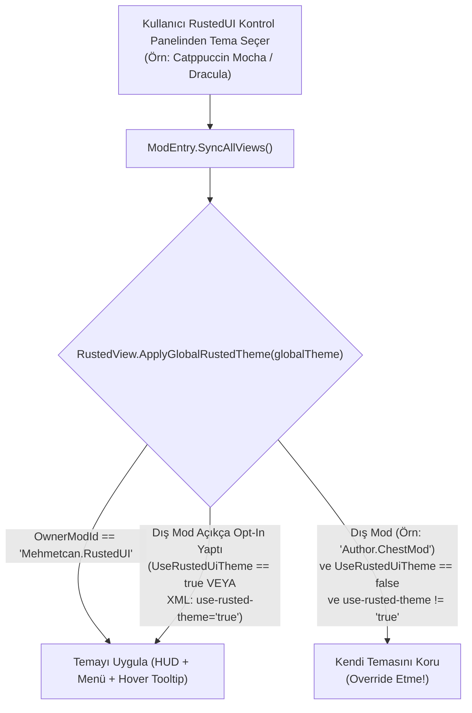

# Rapor 10: Popüler İnternet, Shadcn/UI, Terminal ve Stardew Valley Mevsimsel Tema Kataloğu + Mod-Başına Tema İzolasyon Mimarisi

**Doküman Kodu:** `RUSTED-ARCH-10`  
**Hedef Sistem:** `crates/rusted-core/src/theme.rs`, `crates/rusted-core/src/dom.rs`, `src/Rusted.Smapi/UI/RustedView.cs`

---

## 1. Yönetici Özeti

Bu rapor, **RustedUI** için 25+ hazır renk temasının (`ThemeTokens`) kesin RGB/Hex kodlarını, WCAG kontrast oranlarını ve **Mod-Başına Tema İzolasyonu (Per-Mod Theme Isolation)** mimarisini tanımlar:
1. **10 Aktif Yerleşik Tema (Üretimde Derlenmiş):** `PelicanClassic`, `ShadcnZincDark`, `WizardArcane`, `JojaCorp`, `JunimoForest`, `CatppuccinMocha`, `TokyoNight`, `Dracula`, `Nord`, `Cyberpunk`.
2. **Genişletilmiş 15+ Ek Katalog Paleti:** `CatppuccinLatte`, `RosePine`, `RosePineDawn`, `GruvboxDark`, `SolarizedDark`, `OneDarkPro`, `Synthwave84`, `KanagawaWave`, `EverforestDark`, `AyuMirage`, `PelicanSpring`, `PelicanSummer`, `PelicanFall`, `PelicanWinter`, `SkullCavern`.
3. **Mod-Başına Tema İzolasyonu (`UseRustedUiTheme` / `use-rusted-theme`):** RustedUI ana modunun seçtiği global tema yalnızca RustedUI'ın kendi menülerini ve HUD'unu etkiler; üçüncü parti bir SMAPI modu RustedUI ile arayüz çizdiğinde mod yapımcısı açıkça izin vermedikçe (`UseRustedUiTheme = true` veya `use-rusted-theme="true"`) kendi temasını korur.

---

## 2. Mod-Başına Tema İzolasyon Mimarisi

### 2.1. Rust ve C# İzolasyon Kontratı
- **Rust (`UiTree`)**:
  - `pub use_global_theme: bool`: Varsayılan olarak `false`. Kök XML elemanında `use-rusted-theme="true"` niteliği varsa `true` olarak işaretlenir.
  - `theme="pelican|zinc|arcane|joja|junimo|catppuccin|tokyonight|dracula|nord|cyberpunk"`: Mod yapımcısının şablon içinde kendi temasını sabitlemesini sağlar.
- **C# (`RustedView`)**:
  - `public string OwnerModId { get; set; } = "Mehmetcan.RustedUI";`
  - `public bool UseRustedUiTheme { get; set; } = false;`
  - `ApplyGlobalRustedTheme(UiThemeId globalTheme)`: Yalnızca `OwnerModId == "Mehmetcan.RustedUI" || UseRustedUiTheme || rusted_tree_uses_global_theme(_tree) != 0` olduğunda temayı günceller.

---

## 3. Üretimde Aktif 10 Ana Temanın Renk Paleti Tablosu

| ID | Tema Adı | `background` | `card` | `muted` | `border` | `border_highlight` | `primary` | `text_main` | `text_heading` |
|---|---|---|---|---|---|---|---|---|---|
| `0` | **Pelican Classic** *(9-Slice)* | `#F5D597` | `#FFEBC6` | `#E1B676` | `#56160C` | `#DC7B05` | `#FFA500` | `#221122` | `#56160C` |
| `1` | **Shadcn Zinc Dark** | `#09090B` | `#18181B` | `#27272A` | `#3F3F46` | `#52525B` | `#10B981` | `#F4F4F5` | `#10B981` |
| `2` | **Wizard Arcane** | `#0F081D` | `#1A1025` | `#2D1B42` | `#4C2882` | `#A855F7` | `#FFD700` | `#F3E8FF` | `#FFD700` |
| `3` | **JojaCorp Blue** | `#0F172A` | `#1E293B` | `#334155` | `#0284C7` | `#38BDF8` | `#0284C7` | `#F1F5F9` | `#38BDF8` |
| `4` | **Junimo Forest** | `#14261C` | `#1E3829` | `#2A4D38` | `#4A7C59` | `#86EFAC` | `#F43F5E` | `#ECFCCB` | `#FDE047` |
| `5` | **Catppuccin Mocha** | `#11111B` | `#1E1E2E` | `#313244` | `#585B70` | `#CBA6F7` | `#CBA6F7` | `#CDD6F4` | `#FAB387` |
| `6` | **Tokyo Night** | `#16161E` | `#1A1B26` | `#24283B` | `#414868` | `#7AA2F7` | `#7AA2F7` | `#C0CAF5` | `#7DCFFF` |
| `7` | **Dracula** | `#1E1F29` | `#282A36` | `#44475A` | `#6272A4` | `#BD93F9` | `#FF79C6` | `#F8F8F2` | `#BD93F9` |
| `8` | **Nord Polar** | `#242933` | `#2E3440` | `#3B4252` | `#4C566A` | `#88C0D0` | `#88C0D0` | `#ECEFF4` | `#8FBCBB` |
| `9` | **Cyberpunk Neon** | `#0A0616` | `#140E28` | `#241644` | `#FF007F` | `#00F0FF` | `#FCEE0A` | `#E6F8FF` | `#FCEE0A` |

---

## 4. Genişletilmiş 15+ Ek İnternet & Stardew Mevsimsel Tema Kataloğu

| Kategori | Tema Adı | `background` | `card` | `border_highlight` | `primary` | `text_main` | `text_heading` |
|---|---|---|---|---|---|---|---|
| **Terminal / Editor** | **Rosé Pine** | `#191724` | `#1F1D2E` | `#EBBCBA` | `#C4A7E7` | `#E0DEF4` | `#F6C177` |
| **Terminal / Editor** | **Rosé Pine Dawn** *(Light)* | `#FAF4ED` | `#FFFAF3` | `#D7827E` | `#907AA9` | `#575279` | `#B4637A` |
| **Terminal / Editor** | **Catppuccin Latte** *(Light)* | `#EFF1F5` | `#E6E9EF` | `#8839EF` | `#1E66F5` | `#4C4F69` | `#FE640B` |
| **Terminal / Editor** | **Gruvbox Dark** | `#1D2021` | `#282828` | `#FE8019` | `#FABD2F` | `#EBDBB2` | `#B8BB26` |
| **Terminal / Editor** | **One Dark Pro** | `#21252B` | `#282C34` | `#61AFEF` | `#C678DD` | `#ABB2BF` | `#E5C07B` |
| **Terminal / Editor** | **Kanagawa Wave** | `#16161D` | `#1F1F28` | `#7E9CD8` | `#957FB8` | `#DCD7BA` | `#E6C384` |
| **Terminal / Editor** | **Everforest Dark** | `#272E33` | `#2E383C` | `#A7C080` | `#A7C080` | `#D3C6AA` | `#DBBC7F` |
| **Terminal / Editor** | **Synthwave '84** | `#1A102B` | `#262335` | `#FF7EDB` | `#36F9F6` | `#FFFFFF` | `#FEDE5D` |
| **Terminal / Editor** | **Solarized Dark** | `#002B36` | `#073642` | `#2AA198` | `#268BD2` | `#839496` | `#B58900` |
| **Terminal / Editor** | **Ayu Mirage** | `#171B24` | `#1F2430` | `#FFCC66` | `#FFA759` | `#CCCAC2` | `#73D0FF` |
| **Stardew Mevsimsel** | **Pelican Spring** | `#182C20` | `#223D2C` | `#F472B6` | `#4ADE80` | `#F0FDF4` | `#F9A8D4` |
| **Stardew Mevsimsel** | **Pelican Summer** | `#0C2D48` | `#14456B` | `#FACC15` | `#38BDF8` | `#F0F9FF` | `#FDE047` |
| **Stardew Mevsimsel** | **Pelican Fall** | `#2A140B` | `#3D1E10` | `#FB923C` | `#EA580C` | `#FFF7ED` | `#FDBA74` |
| **Stardew Mevsimsel** | **Pelican Winter** | `#0F1E36` | `#172B4D` | `#7DD3FC` | `#38BDF8` | `#F0F9FF` | `#BAE6FD` |
| **Stardew Zindan** | **Skull Cavern** | `#160B1E` | `#241230` | `#C084FC` | `#E879F9` | `#FAE8FF` | `#F0ABFC` |
