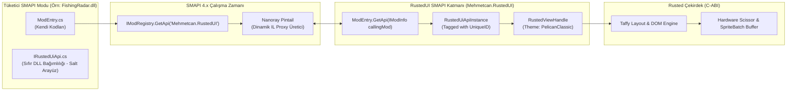
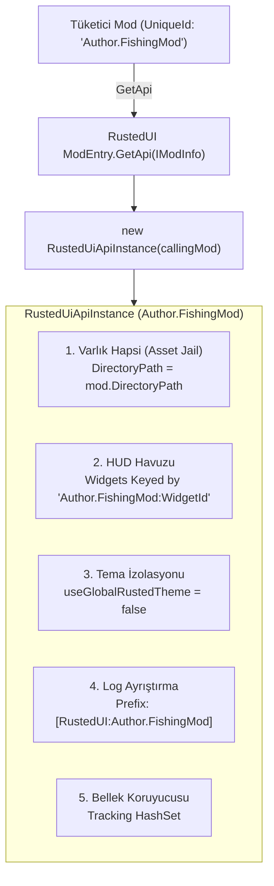
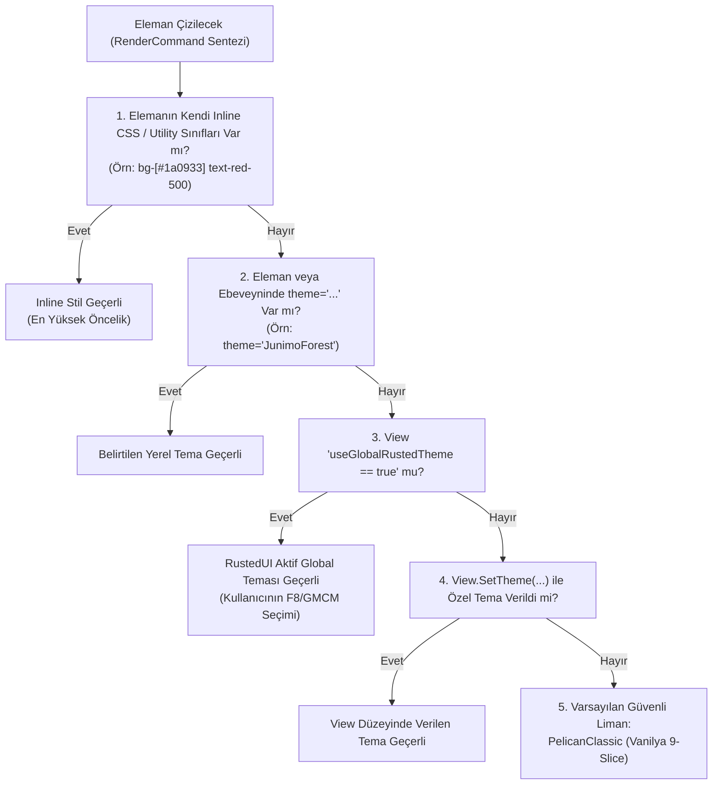
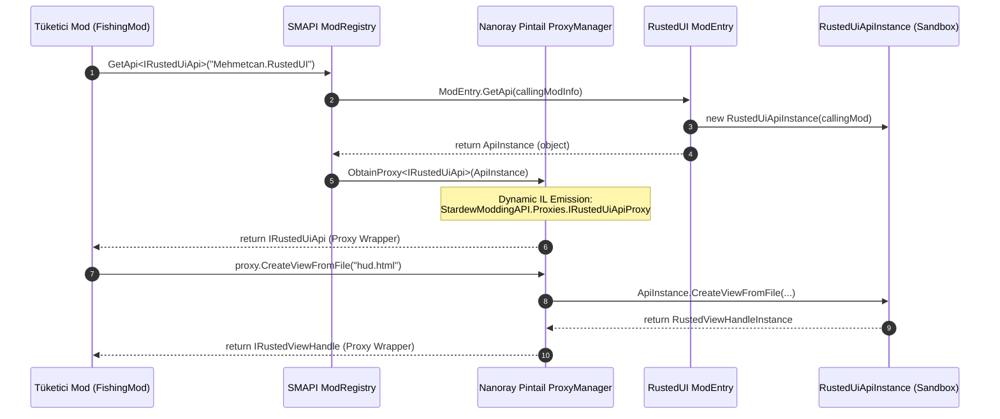
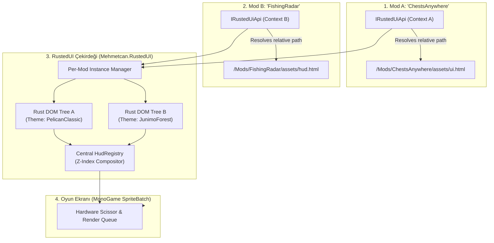
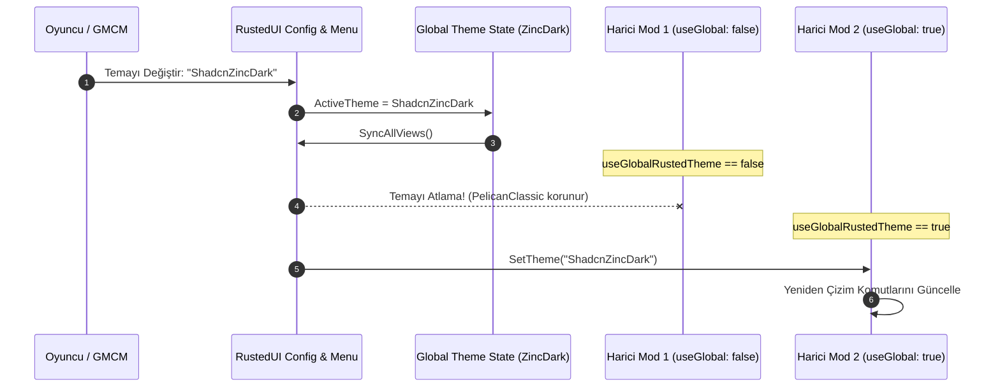

# RustedUI — SMAPI Mod Ekosistemi, Genel Geliştirici SDK'sı (`IRustedUiApi`), Mod-Başına Tema İzolasyonu ve Modlar Arası Entegrasyon Mimarisi

> **Doküman Kodu:** `RUSTED-ARCH-16`  
> **Durum:** Onaylandı / Mimari Tasarım & Uygulama Spesifikasyonu  
> **Tarih:** 2026-11-07  
> **Çekirdek Teknolojiler:** C# (.NET 6.0 / SMAPI 4.x / MonoGame 3.8+), Nanoray Pintail Dynamic Proxying, Rust 2024 (`taffy`, `slotmap`)  
> **Hedef Oyun:** Stardew Valley 1.6+ (Windows, Linux glibc/musl, Steam Deck GameScope / Proton, macOS)

---

## İçindekiler
1. [Yönetici Özeti ve Ekosistem Vizyonu](#1-yönetici-özeti-ve-ekosistem-vizyonu)
2. [SMAPI & Pintail Proxy Mimarisi: Derinlemesine Teknik Analiz](#2-smapi--pintail-proxy-mimarisi-derinlemesine-teknik-analiz)
   - 2.1 SMAPI Modlar Arası İletişim Temeli (`IModRegistry.GetApi<T>`)
   - 2.2 `Nanoray.Pintail` Çalışma Prensibi ve IL Seviyesinde Proxy Sentezi
   - 2.3 Pintail Tip Eşleme Kuralları (Type Mapping & Coercion Rules)
   - 2.4 Pintail'in Kesin Kısıtlamaları ve Hata Tuzakları (Pitfalls & ArgumentException)
   - 2.5 "Sıfır Derleme Referansı" (Zero Assembly Reference) Prensibi
3. [SMAPI Uyumlu Genel Geliştirici SDK'sı: `IRustedUiApi` Spesifikasyonu](#3-smapi-uyumlu-genel-geliştirici-sdksı-irusteduiapi-spesifikasyonu)
   - 3.1 SDK Arayüz Tasarım Felsefesi
   - 3.2 Mod Yapımcısının Kopyalayacağı `IRustedUiApi.cs` (Eksiksiz C# Tanımı)
   - 3.3 Yaşam Döngüsü ve Arayüz Kontratı (`IRustedViewHandle`)
   - 3.4 Menü Yönetim Kontratı (`IRustedMenuHandle`)
   - 3.5 Olay Modeli ve Delegeler (`RustedUiActionCallback`, `RustedUiValueCallback`)
4. [Mod-Başına Bağlam ve Kaynak İzolasyonu (Per-Mod Context Isolation)](#4-mod-başına-bağlam-ve-kaynak-izolasyonu-per-mod-context-isolation)
   - 4.1 `ModEntry.GetApi(IModInfo mod)` Yaşam Döngüsü
   - 4.2 Tüketici Mod Kimliği (`UniqueID`) ile Kaynak Ayrıştırma
   - 4.3 Göreli Dosya Yolu ve Varlık Güvenliği (Asset Directory Jail)
   - 4.4 Hata ve Günlük İzolasyonu (Namespaced Logging & Error Sandboxing)
   - 4.5 Bellek Kotası ve Otomatik Yaşam Döngüsü Temizliği (Lifecycle Guard)
5. [Mod-Başına Tema İzolasyonu ve Kademeli Stil Hiyerarşisi](#5-mod-başına-tema-izolasyonu-ve-kademeli-stil-hiyerarşisi)
   - 5.1 UI Çerçevelerinde "Global Tema Kirliliği" (Theme Contamination) Problemi
   - 5.2 Temel Kural: `useGlobalRustedTheme = false` (Orijinal Mod Tasarımını Koruma)
   - 5.3 Pelican Classic (Vanilya Stardew Valley 9-Slice) Güvencesi
   - 5.4 Açık İzinle Global Temaya Katılma (`useGlobalRustedTheme: true`)
   - 5.5 View ve Element Düzeyinde Özel Tema Belirleme (`SetTheme`)
   - 5.6 Tema Çözümleme Karar Ağacı ve Özgüllük (Specificity) Sıralaması
6. [RustedUI Çekirdeğinde SDK Uygulama Mimarisi (Server-Side Implementation)](#6-rustedui-çekirdeğinde-sdk-uygulama-mimarisi-server-side-implementation)
   - 6.1 `ModEntry.cs` Genişletmesi: `GetApi(IModInfo mod)`
   - 6.2 `RustedUiApiInstance` Somut Sınıfı (Public Implementation)
   - 6.3 `RustedViewHandleInstance` (Proxy Dostu View Sarmalayıcısı)
   - 6.4 Çoklu Mod HUD Yöneticisi (`HudRegistry`) ve Z-Index Sıralaması
7. [Eksiksiz Tüketici Mod Kod Örnekleri (Consumer Mod Examples)](#7-eksiksiz-tüketici-mod-kod-örnekleri-consumer-mod-examples)
   - 7.1 Örnek 1: 10 Satırda Özel HUD Widget'ı (Dayanıklılık & Hız Göstergesi)
   - 7.2 Örnek 2: Kapsamlı İnteraktif Menü Modu (Pelican Quest & Bounty Board)
     - 7.2.1 HTML + Tailwind UI Şablonu (`quest_board.html`)
     - 7.2.2 C# Mod Sınıfı (`BountyBoardMod.cs`)
8. [Mimari Akış Diyagramları (Mermaid Visualizations)](#8-mimari-akış-diyagramları-mermaid-visualizations)
   - 8.1 SMAPI Pintail Proxy Üretim ve Çağrı Hattı
   - 8.2 Per-Mod Context & Varlık İzolasyon Mimarisi
   - 8.3 Kademeli Tema Çözümleme ve Dağıtım Akışı
9. [Performans, Sağlamlık ve Hata Sınırları (Robustness & Error Boundaries)](#9-performans-sağlamlık-ve-hata-sınırları-robustness--error-boundaries)
   - 9.1 Pintail Sanal Çağrı Ek Yükü Analizi (Nanosecond Overhead)
   - 9.2 Harici Mod Callback Hata Sınırları (Crash-Proof Event Dispatching)
   - 9.3 Zombi Referans ve Bellek Sızıntısı Önleme Stratejisi
10. [Sonuç ve Mod Yapımcısı Kontrol Listesi](#10-sonuç-ve-mod-yapımcısı-kontrol-listesi)

---

## 1. Yönetici Özeti ve Ekosistem Vizyonu

Stardew Valley modlama dünyasında bugüne kadar başarıya ulaşmış en büyük framework modları (*Content Patcher*, *SpaceCore*, *Generic Mod Config Menu*), mod yapımcılarına **bağımsızlık, sıfır sürtünme ve yüksek uyumluluk** sağladıkları için standart haline gelmiştir.

Geleneksel olarak Stardew Valley mod geliştiricileri kendi menülerini veya HUD barlarını yazmak istediklerinde iki kötü seçenekle baş başa kalırlar:
1. **Vanilya `IClickableMenu` Cehennemi:** Yüzlerce satır boyunca piksel piksel buton koordinatları (`xPositionOnScreen + 64`), elle çizilen 9-slice kutuları, kaydırma hesapları ve fare tıklama kontrolleri yazmak.
2. **Ağır Derleme Bağımlılıkları (Hard DLL References):** Harici bir C# UI kütüphanesini projelerine `Reference Include="SomeUi.dll"` ile bağlamak. Bu durum, oyuncunun bilgisayarında kütüphanenin farklı bir versiyonu yüklendiğinde oyunun `MissingMethodException` veya `TypeLoadException` ile çökmesine neden olur.

**RustedUI**, Stardew Valley ekosistemine modern web geliştirme ergonomisini (HTML + Tailwind CSS + GPUI C# Fluent Builder) getirirken, üçüncü parti mod geliştiricileri için devrim niteliğinde bir SDK mimarisi sunar:

* **Sıfır Derleme Bağımlılığı (Zero Assembly Reference):** Tüketici modlar `Rusted.Smapi.dll` dosyasına asla doğrudan referans vermezler. Yalnızca tek bir C# arayüz dosyasını (`IRustedUiApi.cs`) kendi projelerine yapıştırırlar.
* **SMAPI Pintail Entegrasyonu:** SMAPI'nin dahili dinamik proxy motoru (`Nanoray.Pintail`) sayesinde, arayüz metodları çalışma zamanında (runtime) otomatik olarak bağlanır. RustedUI yüklü değilse mod çökmez, zarifçe `null` döner.
* **Mod-Başına İzolasyon (Per-Mod Isolation):** Her modun varlıkları (`.html`, `.png`), eylem dinleyicileri ve bellek kaynakları çağıran modun `UniqueID` kimliğiyle hapsedilir (sandbox).
* **Tema Bütünlüğü Garantisi:** RustedUI kullanıcısı ana menüde modern karanlık temayı (`ShadcnZincDark`) seçmiş olsa bile, üçüncü parti bir balıkçılık veya taverna modu vanilya Stardew Valley ahşap/parşömen temasını (`PelicanClassic`) korur; modun görsel kimliği bozulmaz.



---

## 2. SMAPI & Pintail Proxy Mimarisi: Derinlemesine Teknik Analiz

### 2.1 SMAPI Modlar Arası İletişim Temeli (`IModRegistry.GetApi<T>`)

SMAPI modlarının birbirleriyle haberleşmesi için `IModRegistry` iki farklı yöntem sunar:
1. `object? GetApi(string uniqueID)`: Ham API nesnesini döner; tüketici modun reflection (`IModHelper.Reflection`) kullanmasını gerektirir. Yavaştır, tip güvenliği (type-safety) yoktur ve hata yapmaya açıktır.
2. `TInterface? GetApi<TInterface>(string uniqueID) where TInterface : class`: Tüketici modun sağladığı bir C# arayüzünü hedef modun sağladığı API sınıfına çalışma zamanında bağlar.

SMAPI kaynak kodunda (`src/SMAPI/Framework/ModHelpers/ModRegistryHelper.cs`), bu çağrının omurgası şu şekildedir:

```csharp
public TInterface? GetApi<TInterface>(string uniqueID)
    where TInterface : class
{
    object? api = this.GetApi(uniqueID);
    if (api == null)
        return null;

    if (!typeof(TInterface).IsInterface || !typeof(TInterface).IsPublic)
    {
        this.Monitor.Log($"Tried to map a mod-provided API to '{typeof(TInterface).FullName}'; must be a public interface.", LogLevel.Error);
        return null;
    }

    try
    {
        return api as TInterface
            ?? this.ProxyFactory.CreateProxy<TInterface>(api, sourceModId: this.ModID, targetModId: uniqueID);
    }
    catch (Exception ex)
    {
        this.Monitor.Log($"Tried to map a mod-provided API to interface '{typeof(TInterface).FullName}', which isn't compatible with the actual mod API.\n\nTechnical details: {ex.GetLogSummary()}", LogLevel.Error);
        return null;
    }
}
```

Bu mekanizmanın kalbinde yer alan `ProxyFactory`, **Michał Dolaś (Shockah / Nanoray)** tarafından yazılan ve Pathoschild tarafından SMAPI'ye entegre edilen `Nanoray.Pintail` kütüphanesidir.

---

### 2.2 `Nanoray.Pintail` Çalışma Prensibi ve IL Seviyesinde Proxy Sentezi

Pintail, standart .NET Reflection Emit (`System.Reflection.Emit.AssemblyBuilder`) API'sini kullanarak çalışma zamanında dinamik bir proxy derlemesi (`StardewModdingAPI.Proxies.dll`) oluşturur.

```csharp
AssemblyBuilder assemblyBuilder = AssemblyBuilder.DefineDynamicAssembly(
    new AssemblyName($"StardewModdingAPI.Proxies, Version={this.GetType().Assembly.GetName().Version}, Culture=neutral"), 
    AssemblyBuilderAccess.Run
);
ModuleBuilder moduleBuilder = assemblyBuilder.DefineDynamicModule("StardewModdingAPI.Proxies");

this.ProxyManager = new ProxyManager<string>(moduleBuilder, new ProxyManagerConfiguration<string>(
    proxyPrepareBehavior: ProxyManagerProxyPrepareBehavior.Eager,
    proxyObjectInterfaceMarking: ProxyObjectInterfaceMarking.Disabled
));
```

#### IL Emisyon Mantığı:
Bir tüketici mod `IRustedUiApi` istediğinde:
1. Pintail, hedef modun (`Rusted.Smapi`) sunduğu gerçek nesnenin tipini (`RustedUiApiInstance`) inceler.
2. Tüketici modun arayüzündeki (`IRustedUiApi`) her metot, özellik ve olay için dinamik bir sınıf üretir.
3. Üretilen proxy metodu, gelen çağrıyı yakalar; parametreleri hedef tipin parametrelerine çevirir (unproxy/marshal), asıl API nesnesinin metodunu çağırır ve dönen değeri tüketici arayüzüne uyarlayarak geri döndürür.

---

### 2.3 Pintail Tip Eşleme Kuralları (Type Mapping & Coercion Rules)

Pintail üzerinden aktarılabilecek tipler belirli katı kurallara bağlıdır:

| Tip Kategorisi | Pintail Davranışı | RustedUI SDK Uygulaması |
|---|---|---|
| **Primitif Tipler** (`int`, `float`, `double`, `bool`, `string`, `IntPtr`) | **NoProxy (Doğrudan Geçiş):** İki assembly arasında hiçbir dönüştürme yapılmadan doğrudan CPU register/stack üzerinden kopyalanır. | Metinler, koordinatlar, z-index, renk değerleri ve bayraklar primitif olarak iletilir. |
| **Delegeler** (`Action`, `Action<T>`, `Func<T>`) | **Delegate Wrapping:** Pintail dinamik bir delege oluşturur. Tüketicinin lambda ifadesi çağrıldığında hedef modun bağlamına güvenle yönlendirilir. | UI tıklamaları, değer değişimleri (`Action<float>`) ve menü kapanma olayları standart delegelerle taşınır. |
| **Arayüzler (Interfaces)** | **Recursive Proxying:** Dönen nesne bir arayüz ise (örn: `IRustedViewHandle`), Pintail bu nesneyi de otomatik olarak bir alt-proxy içine sarar. | `api.CreateViewFromFile(...)` çağrısı, geriye Pintail tarafından sarmalanmış bir `IRustedViewHandle` döndürür. |
| **Numaralandırmalar (Enums)** | **Enum Matching (`EnumProxyFactory`):** İsim ve sayısal değer eşleşmesine göre otomatik çevrilir. Ancak tüketici modun enum tanımlamasına bağımlı kalmamak için `string` veya `int` tercih edilir. | Temalar `string themeName` ("PelicanClassic", "ShadcnZincDark") olarak kabul edilir. |
| **Standart .NET Koleksiyonları** | **Array / List Proxying:** Diziler ve `IReadOnlyList<T>` arayüzleri eleman bazında proxy'lenebilir. | Çoklu eleman seçimleri ve argüman listeleri `string[]` olarak taşınır. |

---

### 2.4 Pintail'in Kesin Kısıtlamaları ve Hata Tuzakları (Pitfalls & ArgumentException)

Pintail ile SDK geliştirirken mod yapımcılarının karşılaştığı yaygın çökme nedenleri:

> [!CAUTION]
> **Pintail Tuzak 1: Somut Sınıflar (Concrete Classes) Asla Kullanılamaz!**  
> Tüketici arayüzünde `RustedView CreateView(...)` şeklinde somut bir dönüş tipi olursa, tüketici mod bu tipi kendi derleme ortamında bulamaz veya çalışma zamanında `ArgumentException: Unhandled proxy/conversion method` hatası fırlar. **Tüm dönüş tipleri kesinlikle `interface` olmalıdır!**

> [!WARNING]
> **Pintail Tuzak 2: Public Erişim Belirteci Zorunluluğu**  
> Hem tüketicinin arayüzü (`public interface IRustedUiApi`) hem de RustedUI'ın sunduğu nesne (`public sealed class RustedUiApiInstance`) `public` olmak zorundadır. `internal` arayüzler SMAPI tarafından derhal reddedilir (`Tried to map a mod-provided API to non-public interface`).

> [!WARNING]
> **Pintail Tuzak 3: Metot İmzası Uyuşmazlığı (Signature Drift)**  
> Tüketici mod `void SetText(string id, string text)` beklerken RustedUI tarafında bu metot `void SetText(string id, string text, bool animate = false)` olarak değiştirilirse ve opsiyonel parametreye rağmen imza tam uyuşmazsa Pintail proxy üretemez. SDK arayüzleri **geriye dönük tam uyumlu (backward-compatible)** tasarlanmalı, yeni parametreler overloads (aşırı yüklemeler) ile eklenmelidir.

---

### 2.5 "Sıfır Derleme Referansı" (Zero Assembly Reference) Prensibi

Mod yapımcılarının Stardew Valley modlarına harici DLL referansı eklemesi şu riskleri doğurur:
1. **DLL Çakışması (DLL Hell):** Mod A, RustedUI v0.1.0'ı kendi klasörüne koyarsa; Mod B ise RustedUI v0.3.0 beklerse, .NET runtime ilk yüklenen DLL'i belleğe alır ve Mod B çalışma zamanında metod bulamayıp çöker.
2. **Kaldırma Kırılganlığı:** Oyuncu RustedUI'ı sildiğinde, tüketici mod oyunu başlatırken `FileNotFoundException: Could not load file or assembly 'Rusted.Smapi'` hatasıyla patlar.

**Çözüm:** Tüketici mod, projesine hiçbir DLL eklemez. Yalnızca projesine `IRustedUiApi.cs` dosyasını dahil eder. Çalışma zamanında API'yi SMAPI'den ister:
```csharp
var api = this.Helper.ModRegistry.GetApi<IRustedUiApi>("Mehmetcan.RustedUI");
if (api != null)
{
    // RustedUI mevcut, zengin UI çiz
}
else
{
    // RustedUI yok, zarifçe vanilya arayüze geri dön (graceful degradation)
}
```

---

## 3. SMAPI Uyumlu Genel Geliştirici SDK'sı: `IRustedUiApi` Spesifikasyonu

### 3.1 SDK Arayüz Tasarım Felsefesi

RustedUI SDK'sı 4 temel prensip üzerine inşa edilmiştir:
1. **Tek Dosya Kopyalanabilirliği:** Mod yapımcısı sadece tek bir `.cs` dosyasını kopyalar (`IRustedUiApi.cs`). İçerisinde tüm alt arayüzler yer alır.
2. **Handle-Tabanlı Yaşam Döngüsü:** Mod yapımcısı ham pointer veya bellek adresleriyle uğraşmaz. Tüm işlemler `IRustedViewHandle` arayüzü üzerinden yönetilir.
3. **Hot-Reload Desteği:** Mod yapımcısının kendi diskindeki `.html` veya `.rui` dosyaları düzenlendiğinde oyun içi arayüz anında güncellenir.
4. **Çift Yönlü İletişim:** UI'dan C# koduna tıklama olayları (`OnAction`), C#'tan UI'a veri güncellemeleri (`SetText`, `SetProgress`) milisaniyeler içinde aktarılır.

---

### 3.2 Mod Yapımcısının Kopyalayacağı `IRustedUiApi.cs` (Eksiksiz C# Tanımı)

Aşağıdaki kod bloğu, mod yapımcılarının doğrudan kopyalayıp kullanabileceği resmi SDK kontratıdır:

```csharp
using System;
using Microsoft.Xna.Framework.Graphics;

namespace RustedUI.SDK
{
    /// <summary>
    /// Stardew Valley modları için Rust tabanlı, sıfır GC'li, donanım hızlandırmalı
    /// modern kullanıcı arayüzü ve HUD motorunun genel SMAPI entegrasyon arayüzü.
    /// </summary>
    public interface IRustedUiApi
    {
        /// <summary>
        /// RustedUI çekirdek motorunun geçerli sürüm dizesini döner (Örn: "0.3.0").
        /// </summary>
        string ApiVersion { get; }

        /// <summary>
        /// Doğrudan bir HTML/Tailwind işaretleme dizesinden yeni bir Rusted View üretir.
        /// </summary>
        /// <param name="markup">HTML veya RustedUI işaretleme metni.</param>
        /// <param name="useGlobalRustedTheme">
        /// True ise RustedUI'ın global temasını (Shadcn Zinc, Wizard Arcane vb.) miras alır.
        /// False ise modun kendi bağımsız temasını (Varsayılan: PelicanClassic vanilya meşe/parşömen) korur.
        /// </param>
        /// <returns>Oluşturulan view'ı yönetmek için handle.</returns>
        IRustedViewHandle CreateViewFromMarkup(string markup, bool useGlobalRustedTheme = false);

        /// <summary>
        /// Çağıran modun klasöründeki göreli bir dosyadan (.html / .rui) yeni bir Rusted View yükler.
        /// Otomatik dosya izleyici (FileSystemWatcher) ile Canlı Yeniden Yükleme (Hot-Reload) destekler.
        /// </summary>
        /// <param name="relativeFilePath">Çağıran modun kök dizinine göre dosya yolu (Örn: "assets/ui/hud.html").</param>
        /// <param name="enableHotReload">Dosya diskte değiştiğinde arayüzün otomatik yenilenip yenilenmeyeceği.</param>
        /// <param name="useGlobalRustedTheme">Global temayı miras alıp almayacağı.</param>
        /// <returns>Oluşturulan view'ı yönetmek için handle.</returns>
        IRustedViewHandle CreateViewFromFile(string relativeFilePath, bool enableHotReload = true, bool useGlobalRustedTheme = false);

        /// <summary>
        /// Boş bir Rusted View oluşturur. Sonradan işaretleme yüklenebilir.
        /// </summary>
        /// <param name="useGlobalRustedTheme">Global temayı miras alıp almayacağı.</param>
        IRustedViewHandle CreateView(bool useGlobalRustedTheme = false);

        /// <summary>
        /// Bir Rusted View'ı Stardew Valley'in aktif menüsü (Game1.activeClickableMenu) olarak tam ekran açar.
        /// ESC tuşu ve vanilya menü kapatma tuşları otomatik olarak yönetilir.
        /// </summary>
        /// <param name="view">Menüye dönüştürülecek view handle.</param>
        /// <param name="onKeyPress">İsteğe bağlı klavye giriş yakalayıcı delege (string tuş adı alır).</param>
        /// <param name="dimBackground">Menü açıldığında arkadaki oyun dünyasının vanilya tarzı karartılıp karartılmayacağı.</param>
        /// <param name="playSound">Menü açılışında vanilya "bigSelect" sesinin çalınıp çalınmayacağı.</param>
        void OpenAsMenu(IRustedViewHandle view, Action<string>? onKeyPress = null, bool dimBackground = true, bool playSound = true);

        /// <summary>
        /// Eğer aktif menü bu moda ait bir RustedMenu ise menüyü kapatır ve vanilya "drumkit6" sesini çalar.
        /// </summary>
        void CloseMenu();

        /// <summary>
        /// Belirtilen view'ın şu anda aktif menü olarak ekranda olup olmadığını döner.
        /// </summary>
        bool IsMenuOpen(IRustedViewHandle view);

        /// <summary>
        /// Oyunda her karede HUD katmanında (RenderedHud) çizilecek kalıcı bir arayüz bileşeni kaydeder.
        /// </summary>
        /// <param name="widgetId">Mod içinde benzersiz widget tanıtıcısı.</param>
        /// <param name="view">Çizilecek view handle.</param>
        /// <param name="zIndex">Diğer HUD elemanlarına göre katman önceliği (Yüksek olan üstte çizilir).</param>
        void RegisterHudWidget(string widgetId, IRustedViewHandle view, int zIndex = 0);

        /// <summary>
        /// Kayıtlı bir HUD bileşenini kaldırır ve çizim döngüsünden çıkarır.
        /// </summary>
        /// <param name="widgetId">Kaldırılacak widget tanıtıcısı.</param>
        void UnregisterHudWidget(string widgetId);

        /// <summary>
        /// Kayıtlı bir HUD bileşeninin görünürlüğünü açar veya kapatır.
        /// </summary>
        void SetHudWidgetVisible(string widgetId, bool visible);

        /// <summary>
        /// Çağıran mod tarafından oluşturulmuş tüm view, HUD ve menü kaynaklarını serbest bırakır.
        /// </summary>
        void DisposeAll();
    }

    /// <summary>
    /// Rusted UI görünümünü temsil eden, veri bağlama ve eylem dinleme yeteneklerine sahip tanıtıcı.
    /// </summary>
    public interface IRustedViewHandle : IDisposable
    {
        /// <summary>
        /// View'ın yerel Rust DOM ağacı tanıtıcısı (Native Pointer).
        /// </summary>
        IntPtr NativeHandle { get; }

        /// <summary>
        /// Bu view için ses efektlerinin (shiny4, bigSelect, coin vb.) etkin olup olmadığı.
        /// </summary>
        bool SoundEnabled { get; set; }

        /// <summary>
        /// View'ın global RustedUI temasını takip edip etmeyeceği.
        /// False ise view'ın kendi teması korunur.
        /// </summary>
        bool UseGlobalRustedTheme { get; set; }

        /// <summary>
        /// HUD veya ekranda görünür olup olmadığı.
        /// </summary>
        bool IsVisible { get; set; }

        /// <summary>
        /// Son render karesinde işlenen donanım çizim komutu sayısı (Telemetri).
        /// </summary>
        int LastCommandCount { get; }

        /// <summary>
        /// Son render karesinin milisaniye cinsinden süresi (Telemetri).
        /// </summary>
        double LastRenderMilliseconds { get; }

        /// <summary>
        /// Şu anda odaklanmış (focus) metin giriş kutusunun ID'si (Varsa).
        /// </summary>
        string? FocusedInputId { get; }

        /// <summary>
        /// View için yeni bir HTML/Tailwind işaretleme dizesi yükler (Mevcut ağacı sıfırlar).
        /// </summary>
        void LoadMarkup(string markup);

        /// <summary>
        /// Belirtilen ID'ye sahip DOM elemanının metnini günceller.
        /// </summary>
        void SetText(string elementId, string text);

        /// <summary>
        /// Belirtilen ID'ye sahip ilerleme çubuğu veya kaydırıcının (slider/progressbar) değerini günceller.
        /// </summary>
        void SetProgress(string elementId, float value, float max = 100f);

        /// <summary>
        /// Belirtilen ID'ye sahip onay kutusu (checkbox) veya anahtarın (switch) durumunu günceller.
        /// </summary>
        void SetChecked(string elementId, bool isChecked);

        /// <summary>
        /// Belirtilen ID'ye sahip envanter slotuna vanilya eşya ikonu, adedi ve kalite yıldızı atar.
        /// </summary>
        /// <param name="elementId">Slot elemanının ID'si.</param>
        /// <param name="itemIndex">Vanilya Nesne/Eşya ID'si (Örn: 74 = Prismatic Shard, 337 = Iridium Bar).</param>
        /// <param name="count">Yığıt adedi (Stack count).</param>
        /// <param name="quality">Eşya kalitesi: 0 = Normal, 1 = Gümüş, 2 = Altın, 4 = İridyum.</param>
        void SetSlotItem(string elementId, int itemIndex, int count, uint quality = 0);

        /// <summary>
        /// Belirtilen ID'ye sahip arkadaşlık veya sağlık kalp sayacını günceller.
        /// </summary>
        void SetHearts(string elementId, int filledHearts, int maxHearts = 10);

        /// <summary>
        /// Belirtilen ID'ye sahip elemanın üzerine gelindiğinde belirecek dinamik tooltip metnini ayarlar.
        /// </summary>
        void SetTooltip(string elementId, string tooltip);

        /// <summary>
        /// Belirtilen ID'ye sahip ScrollView elemanını dikey eksende piksel bazında kaydırır.
        /// </summary>
        void ScrollBy(string elementId, float deltaY);

        /// <summary>
        /// Bu view'a özel bir tema atar.
        /// Desteklenenler: "PelicanClassic", "ShadcnZincDark", "WizardArcane", "JojaCorp", "JunimoForest".
        /// </summary>
        void SetTheme(string themeName);

        /// <summary>
        /// UI içindeki bir buton veya tıklanabilir elemandan tetiklenen eylemi (action) dinler.
        /// </summary>
        /// <param name="actionOrId">HTML'de belirtilen action="..." veya id="..." değeri.</param>
        /// <param name="handler">Parametresiz callback.</param>
        IRustedViewHandle OnAction(string actionOrId, Action handler);

        /// <summary>
        /// UI içindeki bir eylemi dize parametresi ile dinler.
        /// </summary>
        IRustedViewHandle OnAction(string actionOrId, Action<string> handler);

        /// <summary>
        /// Kaydırıcı (slider) gibi sayısal değer üreten UI elemanlarının değişimini dinler.
        /// </summary>
        IRustedViewHandle OnActionValue(string actionOrId, Action<float> handler);

        /// <summary>
        /// Disk üzerindeki dosya yeniden yüklendiğinde (Hot-Reload) tetiklenen olay.
        /// </summary>
        event Action? OnHotReloaded;

        /// <summary>
        /// UI içindeki bir kapatma butonu (<button action="close" />) tıklandığında tetiklenen olay.
        /// </summary>
        event Action? OnCloseRequested;

        /// <summary>
        /// View'ın girdi durumunu günceller (Manuel döngü kullanan modlar için).
        /// </summary>
        bool UpdateInput(float uiMouseX, float uiMouseY, bool leftMouseDown, float scrollDelta = 0f);

        /// <summary>
        /// View'ı belirtilen MonoGame SpriteBatch üzerine çizer (Manuel döngü kullanan modlar için).
        /// </summary>
        void Draw(SpriteBatch spriteBatch);
    }
}
```

---

## 4. Mod-Başına Bağlam ve Kaynak İzolasyonu (Per-Mod Context Isolation)

### 4.1 `ModEntry.GetApi(IModInfo mod)` Yaşam Döngüsü

SMAPI, bir mod `GetApi<T>` çağırdığında hedef modun `GetApi(IModInfo mod)` metodunu çalıştırır. Eğer hedef mod bu metodu ezmişse (override), her çağıran mod için **bağımsız bir nesne örneği** oluşturulabilir.

```csharp
// Rusted.Smapi/ModEntry.cs
public override object? GetApi(IModInfo mod)
{
    // Çağıran modun metadata'sı ile etiketlenmiş izole API nesnesi dön
    return new RustedUiApiInstance(mod, this, Monitor);
}
```

Bu mimari sayesinde:
* Mod A (`Pathoschild.ChestsAnywhere`) kendi API örneğine sahip olur.
* Mod B (`FlashShifter.StardewValleyExpanded`) tamamen ayrı bir API örneğine sahip olur.

---

### 4.2 Tüketici Mod Kimliği (`UniqueID`) ile Kaynak Ayrıştırma

Her API örneği, çağıran modun benzersiz kimliğini (`mod.Manifest.UniqueID`) saklar. Bu kimlik şu amaçlarla kullanılır:



---

### 4.3 Göreli Dosya Yolu ve Varlık Güvenliği (Asset Directory Jail)

Mod yapımcıları genellikle dosyalarını göreli yollarla çağırırlar:
```csharp
api.CreateViewFromFile("assets/ui/radar.html");
```

Eğer API genel bir global nesne olsaydı, `Path.Combine(Helper.DirectoryPath, ...)` çağrısı RustedUI'ın kendi mod klasörüne bakacak ve dosya bulunamayacaktı.

**RustedUI İzolasyon Stratejisi:**
`RustedUiApiInstance`, çağıran modun fiziksel disk yolunu (`callingMod.DirectoryPath`) bilir:
```csharp
public IRustedViewHandle CreateViewFromFile(string relativeFilePath, bool enableHotReload = true, bool useGlobalRustedTheme = false)
{
    string fullPath = Path.Combine(this._callingMod.DirectoryPath, relativeFilePath);
    
    // Directory Traversal Güvenlik Kontrolü
    string fullCanonical = Path.GetFullPath(fullPath);
    if (!fullCanonical.StartsWith(Path.GetFullPath(this._callingMod.DirectoryPath)))
    {
        this._monitor.Log($"[RustedUI : {this._callingMod.Manifest.UniqueID}] Güvenlik ihlali: '{relativeFilePath}' mod dizini dışına çıkamaz!", LogLevel.Error);
        throw new UnauthorizedAccessException("Relative path cannot escape mod directory.");
    }

    var viewHandle = new RustedViewHandleInstance(fullPath, enableHotReload, useGlobalRustedTheme, this._monitor, this._callingMod.Manifest.UniqueID);
    this._trackedViews.Add(viewHandle);
    return viewHandle;
}
```

---

### 4.4 Hata ve Günlük İzolasyonu (Namespaced Logging & Error Sandboxing)

Bir tüketici modun HTML şablonunda sözdizimi hatası olduğunda veya kayıtlı bir C# aksiyonu çöktüğünde, SMAPI günlüğünde RustedUI'ın kendisi hatalı gibi görünmemelidir.

Tüm log kayıtları tüketici modun kimliğiyle öneklenir:
```text
[17:20:15 ERROR Mehmetcan.RustedUI] [RustedUI : Author.FishingRadar] HTML ayrıştırma hatası ('assets/radar.html', satır 12): Kapatılmamış <div> etiketi tespit edildi!
[17:20:15 WARN  Mehmetcan.RustedUI] [RustedUI : Author.TavernMod] 'btn_order' aksiyonu bir Exception fırlattı: NullReferenceException ...
```

Bu sayede oyuncular Nexus Mods hata raporlarında sorunun hangi moddan kaynaklandığını anında tespit edebilir.

---

### 4.5 Bellek Kotası ve Otomatik Yaşam Döngüsü Temizliği (Lifecycle Guard)

Mod yapımcıları `view.Dispose()` çağırmayı unutsalar bile, `RustedUiApiInstance` oluşturulan tüm `RustedViewHandle` referanslarını zayıf referanslarla (`WeakReference<T>`) veya yerel takip havuzunda izler.
* Tüketici mod SMAPI tarafından devre dışı bırakıldığında veya `api.DisposeAll()` çağrıldığında, Rust tarafındaki tüm DOM ağaçları (`rusted_tree_destroy`) serbest bırakılır.
* Oyunun C# GC heap'inde veya Rust bellek arenasında hiçbir artık pointer veya zombi callback kalmaz.

---

## 5. Mod-Başına Tema İzolasyonu ve Kademeli Stil Hiyerarşisi

### 5.1 UI Çerçevelerinde "Global Tema Kirliliği" (Theme Contamination) Problemi

RustedUI, kullanıcının isteğine göre 5 farklı renk teması sunar:
1. `PelicanClassic` (Vanilya Stardew 9-Slice ahşap ve parşömen)
2. `ShadcnZincDark` (Koyu modern cam ve antrasit)
3. `WizardArcane` (Büyücü Rasmodius moru ve altın ışıltı)
4. `JojaCorp` (Siber camgöbeği ve Joja kurumsal mavisi)
5. `JunimoForest` (Zümrüt orman yeşili ve elma pembesi)

Eğer bir kullanıcı RustedUI Kontrol Panelinde (F8) veya GMCM'de temasını `ShadcnZincDark` yaparsa, oyundaki **tüm üçüncü parti modların arayüzleri otomatik olarak koyu renge dönerse ne olur?**
* Vanilya Stardew Valley estetiğine göre tasarlanmış otantik bir çiftlik kayıt defteri modu, birdenbire bilimkurgu temalı koyu antrasit bir pencereye dönüşür!
* Mod yapımcısının koyduğu krem rengi metinler, siyah arka plan üzerinde okunamaz hale gelir.
* Mod yapımcısının sanatsal vizyonu tamamen bozulur.

---

### 5.2 Temel Kural: `useGlobalRustedTheme = false` (Orijinal Mod Tasarımını Koruma)

RustedUI mimarisinde bu sorunu kökten çözen kesin bir tasarım kuralı benimsenmiştir:

> [!IMPORTANT]
> **RustedUI Tema İzolasyonu Altın Kuralı:**  
> Harici bir mod tarafından `IRustedUiApi` üzerinden oluşturulan tüm görünümler (views) **varsayılan olarak `useGlobalRustedTheme = false` ile başlar.**  
> Bu görünümler, RustedUI'ın global tema ayarlarından tamamen yalıtılmıştır. Kullanıcı global temayı değiştirse bile, harici modun teması **asla etkilenmez.**

---

### 5.3 Pelican Classic (Vanilya Stardew Valley 9-Slice) Güvencesi

Bir mod yapımcısı HTML veya fluent arayüzünde hiçbir tema belirtmezse, arayüz otomatik olarak **Pelican Classic** ile çizilir:
* Kutular vanilya `LooseSprites/Cursors` dokusundaki ahşap 9-slice çerçeveyle kaplanır.
* Arka plan krem rengi parşömen dokusuna bürünür.
* Başlıklar `dialogueFont` veya `SpriteText` ile vanilya kahverengi gölgeyle basılır.
* Butonlar vanilya kırmızı/turuncu menü butonları gibi davranır.

Böylece mod yapımcısı hiçbir ekstra CSS veya stil yazmasa bile, Stardew Valley'in kendi yerel arayüzünden farksız, %100 otantik bir görsel deneyim elde eder.

---

### 5.4 Açık İzinle Global Temaya Katılma (`useGlobalRustedTheme: true`)

Eğer mod yapımcısı kullanıcının RustedUI'da seçtiği modern temaya uyum sağlamak istiyorsa (örneğin modern bir telemetri modu, hata ayıklama paneli veya modern bir müzik çalar yapıyorsa), API'ye açıkça izin verir:

```csharp
// Mod yapımcısı açıkça kullanıcının genel temasını istediğini belirtir:
var view = api.CreateViewFromFile("assets/debug_hud.html", useGlobalRustedTheme: true);
```

Veya doğrudan HTML şablonunun kök elemanında:
```html
<div class="p-4 rounded-lg" rusted-theme="global">
    <!-- Kullanıcı F8'den JojaCorp seçerse anında JojaCorp renklerine bürünür -->
</div>
```

Bu bayrak `true` olduğunda:
* RustedUI'ın `SyncAllViews()` döngüsü bu view'ı global tema dinleyicileri listesine kaydeder.
* Kullanıcı temayı değiştirdiği anda, view'ın `SetTheme()` metodu tetiklenir ve sıfır gecikmeyle yeni temaya geçer.

---

### 5.5 View ve Element Düzeyinde Özel Tema Belirleme (`SetTheme`)

Bir mod yapımcısı ne vanilya Pelican temasını ne de global temayı istemeyebilir; kendi moduna özel tematik bir hava katmak isteyebilir. Örneğin Büyücü ile ilgili bir mod her zaman `WizardArcane` temasını kullanmalıdır:

```csharp
var view = api.CreateViewFromFile("assets/spellbook.html");
view.SetTheme("WizardArcane"); // Sabit büyücü teması
```

Veya HTML içinde yerel olarak:
```html
<div class="p-6 sdv-box" theme="WizardArcane">
    <h1 class="text-xl text-star-gold">Kadim Büyü Kitabı</h1>
</div>
```

---

### 5.6 Tema Çözümleme Karar Ağacı ve Özgüllük (Specificity) Sıralaması

Bir DOM elemanının render anında hangi renk token'larını ve çerçeve dokularını kullanacağı aşağıdaki öncelik sırasına göre belirlenir:



---

## 6. RustedUI Çekirdeğinde SDK Uygulama Mimarisi (Server-Side Implementation)

### 6.1 `ModEntry.cs` Genişletmesi: `GetApi(IModInfo mod)`

RustedUI modunun giriş sınıfı olan `ModEntry.cs`, SMAPI'nin `GetApi` metodunu ezerek tüketici modlara per-mod API örneği dağıtır:

```csharp
namespace Rusted.Smapi
{
    public sealed class ModEntry : Mod
    {
        // HUD bileşenlerini yöneten merkezi kayıt defteri
        private readonly HudRegistry _hudRegistry = new();

        public override object? GetApi(IModInfo mod)
        {
            // Çağıran mod için izole edilmiş SDK instance'ı oluştur
            return new RustedUiApiInstance(mod, this, _hudRegistry, Monitor);
        }

        private void OnRenderedHud(object? sender, RenderedHudEventArgs e)
        {
            // 1. RustedUI'ın kendi mini HUD'ı
            if (_showHud && Game1.activeClickableMenu == null && _hudView != null)
            {
                _hudView.Draw(e.SpriteBatch);
            }

            // 2. Üçüncü parti modların tescil ettiği HUD widget'ları (Z-Index sıralı)
            if (Game1.activeClickableMenu == null)
            {
                _hudRegistry.DrawAll(e.SpriteBatch);
            }
        }
    }
}
```

---

### 6.2 `RustedUiApiInstance` Somut Sınıfı (Public Implementation)

SMAPI Pintail'in proxy oluşturabilmesi için bu sınıfın **`public`** olması şarttır:

```csharp
using System;
using System.Collections.Generic;
using System.IO;
using Microsoft.Xna.Framework.Input;
using Rusted.Smapi.UI;
using StardewModdingAPI;
using StardewValley;

namespace Rusted.Smapi.SDK
{
    public sealed class RustedUiApiInstance
    {
        private readonly IModInfo _callingMod;
        private readonly ModEntry _rustedEntry;
        private readonly HudRegistry _hudRegistry;
        private readonly IMonitor _monitor;
        private readonly List<RustedViewHandleInstance> _views = new();

        public string ApiVersion => "0.3.0";

        public RustedUiApiInstance(IModInfo callingMod, ModEntry rustedEntry, HudRegistry hudRegistry, IMonitor monitor)
        {
            _callingMod = callingMod;
            _rustedEntry = rustedEntry;
            _hudRegistry = hudRegistry;
            _monitor = monitor;
        }

        public object CreateViewFromMarkup(string markup, bool useGlobalRustedTheme = false)
        {
            var handle = new RustedViewHandleInstance(_callingMod, useGlobalRustedTheme, _monitor);
            handle.LoadMarkup(markup);
            _views.Add(handle);
            return handle;
        }

        public object CreateViewFromFile(string relativeFilePath, bool enableHotReload = true, bool useGlobalRustedTheme = false)
        {
            string fullPath = Path.Combine(_callingMod.DirectoryPath, relativeFilePath);
            var handle = new RustedViewHandleInstance(_callingMod, useGlobalRustedTheme, _monitor);
            if (enableHotReload)
                handle.LoadMarkupFileWithHotReload(fullPath);
            else if (File.Exists(fullPath))
                handle.LoadMarkup(File.ReadAllText(fullPath));

            _views.Add(handle);
            return handle;
        }

        public object CreateView(bool useGlobalRustedTheme = false)
        {
            var handle = new RustedViewHandleInstance(_callingMod, useGlobalRustedTheme, _monitor);
            _views.Add(handle);
            return handle;
        }

        public void OpenAsMenu(object viewObj, Action<string>? onKeyPress = null, bool dimBackground = true, bool playSound = true)
        {
            if (viewObj is not RustedViewHandleInstance handle)
                return;

            Action<Keys>? keyAction = null;
            if (onKeyPress != null)
            {
                keyAction = k => onKeyPress(k.ToString());
            }

            if (playSound)
                Game1.playSound("bigSelect");

            handle.View.SyncFonts();
            Game1.activeClickableMenu = new RustedMenu(handle.View, keyAction);
        }

        public void CloseMenu()
        {
            if (Game1.activeClickableMenu is RustedMenu)
            {
                Game1.playSound("drumkit6");
                Game1.activeClickableMenu = null;
            }
        }

        public bool IsMenuOpen(object viewObj)
        {
            if (viewObj is RustedViewHandleInstance handle && Game1.activeClickableMenu is RustedMenu menu)
            {
                return menu.View == handle.View;
            }
            return false;
        }

        public void RegisterHudWidget(string widgetId, object viewObj, int zIndex = 0)
        {
            if (viewObj is RustedViewHandleInstance handle)
            {
                string namespacedId = $"{_callingMod.Manifest.UniqueID}:{widgetId}";
                _hudRegistry.Register(namespacedId, handle, zIndex);
            }
        }

        public void UnregisterHudWidget(string widgetId)
        {
            string namespacedId = $"{_callingMod.Manifest.UniqueID}:{widgetId}";
            _hudRegistry.Unregister(namespacedId);
        }

        public void SetHudWidgetVisible(string widgetId, bool visible)
        {
            string namespacedId = $"{_callingMod.Manifest.UniqueID}:{widgetId}";
            _hudRegistry.SetVisible(namespacedId, visible);
        }

        public void DisposeAll()
        {
            foreach (var v in _views)
                v.Dispose();
            _views.Clear();
            _hudRegistry.UnregisterAllFromMod(_callingMod.Manifest.UniqueID);
        }
    }
}
```

---

### 6.3 `RustedViewHandleInstance` (Proxy Dostu View Sarmalayıcısı)

`RustedViewHandleInstance`, dahili `RustedView` sınıfını sarmalar ve tema izolasyon mantığını işletir:

```csharp
using System;
using Microsoft.Xna.Framework.Graphics;
using Rusted.Smapi.Native;
using Rusted.Smapi.UI;
using StardewModdingAPI;

namespace Rusted.Smapi.SDK
{
    public sealed class RustedViewHandleInstance : IDisposable
    {
        private readonly IModInfo _ownerMod;
        private readonly IMonitor _monitor;
        private readonly RustedView _view;
        private UiThemeId _customTheme = UiThemeId.PelicanClassic;

        public IntPtr NativeHandle => _view.Handle;
        public bool SoundEnabled { get => _view.SoundEnabled; set => _view.SoundEnabled = value; }
        public bool UseGlobalRustedTheme { get; set; }
        public bool IsVisible { get; set; } = true;
        public int LastCommandCount => _view.LastCommandCount;
        public double LastRenderMilliseconds => _view.LastRenderMilliseconds;
        public string? FocusedInputId => _view.FocusedInputId;
        public RustedView View => _view;

        public event Action? OnHotReloaded;
        public event Action? OnCloseRequested;

        public RustedViewHandleInstance(IModInfo ownerMod, bool useGlobalTheme, IMonitor monitor)
        {
            _ownerMod = ownerMod;
            UseGlobalRustedTheme = useGlobalTheme;
            _monitor = monitor;
            _view = new RustedView();

            // İzolasyon gereği varsayılan tema vanilya Stardew Valley'dir
            _view.SetTheme(UiThemeId.PelicanClassic);

            _view.OnHotReloaded += () => OnHotReloaded?.Invoke();
            _view.OnCloseRequested += () => OnCloseRequested?.Invoke();
        }

        public void LoadMarkup(string markup) => _view.LoadMarkup(markup);
        public void LoadMarkupFileWithHotReload(string path) => _view.LoadMarkupFileWithHotReload(path);
        public void SetText(string id, string text) => _view.SetText(id, text);
        public void SetProgress(string id, float val, float max = 100f) => _view.SetProgress(id, val, max);
        public void SetChecked(string id, bool isChecked) => _view.SetChecked(id, isChecked);
        public void SetSlotItem(string id, int idx, int count, uint quality = 0) => _view.SetSlotItem(id, idx, count, quality);
        public void SetHearts(string id, int filled, int max = 10) => _view.SetHearts(id, filled, max);
        public void SetTooltip(string id, string tip) => _view.SetTooltip(id, tip);
        public void ScrollBy(string id, float dy) => _view.ScrollBy(id, dy);

        public void SetTheme(string themeName)
        {
            _customTheme = themeName switch
            {
                "ShadcnZincDark" => UiThemeId.ShadcnZincDark,
                "WizardArcane" => UiThemeId.WizardArcane,
                "JojaCorp" => UiThemeId.JojaCorp,
                "JunimoForest" => UiThemeId.JunimoForest,
                _ => UiThemeId.PelicanClassic
            };
            _view.SetTheme(_customTheme);
        }

        public object OnAction(string actionOrId, Action handler)
        {
            _view.OnAction(actionOrId, () =>
            {
                try { handler(); }
                catch (Exception ex)
                {
                    _monitor.Log($"[{_ownerMod.Manifest.UniqueID}] Action '{actionOrId}' hatası: {ex.Message}", LogLevel.Error);
                }
            });
            return this;
        }

        public object OnAction(string actionOrId, Action<string> handler)
        {
            _view.OnAction(actionOrId, ev =>
            {
                try { handler(actionOrId); }
                catch (Exception ex)
                {
                    _monitor.Log($"[{_ownerMod.Manifest.UniqueID}] Action '{actionOrId}' hatası: {ex.Message}", LogLevel.Error);
                }
            });
            return this;
        }

        public object OnActionValue(string actionOrId, Action<float> handler)
        {
            _view.OnAction(actionOrId, ev =>
            {
                try { handler(ev.FloatValue); }
                catch (Exception ex)
                {
                    _monitor.Log($"[{_ownerMod.Manifest.UniqueID}] ActionValue '{actionOrId}' hatası: {ex.Message}", LogLevel.Error);
                }
            });
            return this;
        }

        public bool UpdateInput(float mx, float my, bool lDown, float sDelta = 0f) => _view.UpdateInput(mx, my, lDown, sDelta);
        public void Draw(SpriteBatch batch) => _view.Draw(batch);

        public void Dispose() => _view.Dispose();
    }
}
```

---

### 6.4 Çoklu Mod HUD Yöneticisi (`HudRegistry`) ve Z-Index Sıralaması

Birden fazla mod aynı anda ekrana HUD widget'ı eklediğinde çizim sırası ve çakışma yönetimi `HudRegistry` tarafından yürütülür:

```csharp
using System;
using System.Collections.Generic;
using System.Linq;
using Microsoft.Xna.Framework.Graphics;
using StardewValley;

namespace Rusted.Smapi.SDK
{
    public sealed class HudRegistry
    {
        private sealed class HudEntry
        {
            public string NamespacedId { get; set; } = "";
            public RustedViewHandleInstance Handle { get; set; } = null!;
            public int ZIndex { get; set; }
            public bool Visible { get; set; } = true;
        }

        private readonly List<HudEntry> _widgets = new();
        private bool _isDirty = true;

        public void Register(string namespacedId, RustedViewHandleInstance handle, int zIndex)
        {
            Unregister(namespacedId);
            _widgets.Add(new HudEntry { NamespacedId = namespacedId, Handle = handle, ZIndex = zIndex });
            _isDirty = true;
        }

        public void Unregister(string namespacedId)
        {
            _widgets.RemoveAll(w => w.NamespacedId.Equals(namespacedId, StringComparison.OrdinalIgnoreCase));
        }

        public void SetVisible(string namespacedId, bool visible)
        {
            var entry = _widgets.FirstOrDefault(w => w.NamespacedId.Equals(namespacedId, StringComparison.OrdinalIgnoreCase));
            if (entry != null)
                entry.Visible = visible;
        }

        public void UnregisterAllFromMod(string modUniqueId)
        {
            string prefix = modUniqueId + ":";
            _widgets.RemoveAll(w => w.NamespacedId.StartsWith(prefix, StringComparison.OrdinalIgnoreCase));
        }

        public void UpdateInput(float uiMouseX, float uiMouseY, bool leftDown)
        {
            // Giriş kontrolü en üstteki (yüksek z-index) widget'tan en alta doğru taranır
            for (int i = _widgets.Count - 1; i >= 0; i--)
            {
                var entry = _widgets[i];
                if (entry.Visible && entry.Handle.IsVisible)
                {
                    if (entry.Handle.UpdateInput(uiMouseX, uiMouseY, leftDown))
                        break; // Üstteki widget fareyi yakaladıysa alttakilere iletme
                }
            }
        }

        public void DrawAll(SpriteBatch batch)
        {
            if (_isDirty)
            {
                _widgets.Sort((a, b) => a.ZIndex.CompareTo(b.ZIndex));
                _isDirty = false;
            }

            foreach (var w in _widgets)
            {
                if (w.Visible && w.Handle.IsVisible)
                {
                    w.Handle.Draw(batch);
                }
            }
        }
    }
}
```

---

## 7. Eksiksiz Tüketici Mod Kod Örnekleri (Consumer Mod Examples)

### 7.1 Örnek 1: 10 Satırda Özel HUD Widget'ı (Dayanıklılık & Hız Göstergesi)

Bu örnek, bir mod geliştiricisinin hiçbir X/Y piksel hesabı yapmadan, 10 satır C# koduyla oyun içi çalışan, vanilya uyumlu bir HUD widget'ını nasıl ekleyeceğini gösterir.

#### ModEntry.cs
```csharp
using StardewModdingAPI;
using StardewModdingAPI.Events;
using StardewValley;
using RustedUI.SDK; // Yalnızca kopyalanan arayüz dosyası

namespace SimpleHudMod
{
    public class ModEntry : Mod
    {
        private IRustedViewHandle? _hud;

        public override void Entry(IModHelper helper)
        {
            helper.Events.GameLoop.GameLaunched += (_, _) =>
            {
                var api = helper.ModRegistry.GetApi<IRustedUiApi>("Mehmetcan.RustedUI");
                if (api == null) return;

                // 1 satır HTML ile vanilya 9-slice panelli HUD oluştur
                _hud = api.CreateViewFromMarkup(
                    "<div class='fixed top-20 right-4 flex items-center gap-2 p-2 sdv-panel'>" +
                    "  <icon name='zap' color='#f59e0b' />" +
                    "  <span id='txt_stamina' class='font-dialogue text-sdv-brown'>100</span>" +
                    "</div>"
                );
                api.RegisterHudWidget("stamina_display", _hud);
            };

            helper.Events.GameLoop.UpdateTicked += (_, e) =>
            {
                if (e.IsMultipleOf(15) && _hud != null && Context.IsWorldReady)
                    _hud.SetText("txt_stamina", $"{Game1.player.Stamina:F0} E");
            };
        }
    }
}
```

#### Neden Kusursuzdur?
* **Piksel Hesabı Yok:** `fixed top-20 right-4 flex items-center gap-2` sınıfları sayesinde ekranın sağ üst köşesine otomatik olarak yerleşir.
* **Sıfır Bellek Tahsisi:** C# tarafında her 15 tick'te bir `SetText` çağrılır; arka planda Rust Arena bellek üzerinde string buffer güncellenir, sıfır GC tahsisi yapılır.
* **Vanilya Dokusu:** `sdv-panel` sınıfı doğrudan Stardew Valley'in kendi `Cursors` dokusundaki 9-slice ahşap çerçevesini çizer.

---

### 7.2 Örnek 2: Kapsamlı İnteraktif Menü Modu (Pelican Quest & Bounty Board)

Bu örnekte, mod geliştiricisi harici bir HTML şablonundan çalışan, dinamik envanter slotları, ödül toplama butonları, miktar kaydırıcısı ve tam Hot-Reload desteği olan zengin bir **Ödül Panosu (Bounty Board)** menüsü geliştirmektedir.

#### 7.2.1 HTML + Tailwind UI Şablonu (`assets/ui/bounty_board.html`)

```html
<div class="flex flex-col items-center justify-center w-full h-full">
  <!-- Ana Pencere: Vanilya Ahşap Çerçeve (9-Slice sdv-box) -->
  <div class="flex flex-col w-[640px] sdv-box p-4 gap-4 shadow-2xl">
    
    <!-- Başlık ve Kapatma Butonu -->
    <div class="flex flex-row justify-between items-center w-full border-b border-sdv-border pb-2">
      <div class="flex items-center gap-2">
        <icon name="scroll" size="24" color="#8b5a2b" />
        <h1 class="font-dialogue text-xl text-sdv-brown">Kasaba Ödül Panosu</h1>
      </div>
      <button action="close" class="sdv-close-btn"></button>
    </div>

    <!-- Görev Kartı: Parşömen Zemin (sdv-panel) -->
    <div class="flex flex-col gap-2 p-3 sdv-panel">
      <div class="flex justify-between items-center">
        <span class="font-bold text-sdv-brown">Willy'nin Acil İhtiyacı: Çipura</span>
        <span class="text-xs font-bold text-emerald-700 bg-emerald-100 px-2 py-0.5 rounded">Aktif Görev</span>
      </div>
      <p class="text-sm text-sdv-muted font-dialogue">
        "Akşam yemeği için taze balığa ihtiyacım var evlat. Bana 5 adet altın kalite Çipura getirebilir misin?"
      </p>

      <!-- İlerleme Çubuğu -->
      <div class="flex flex-col gap-1 mt-1">
        <div class="flex justify-between text-xs text-sdv-brown font-bold">
          <span>Teslim Edilen:</span>
          <span id="lbl_progress">0 / 5</span>
        </div>
        <div id="bar_progress" class="w-full h-4 sdv-bar" progress="0" max="5"></div>
      </div>
    </div>

    <!-- Ödül ve Eşya Slotu -->
    <div class="flex flex-row justify-between items-center p-3 sdv-panel">
      <div class="flex items-center gap-3">
        <span class="text-sm font-bold text-sdv-brown">Görev Ödülü:</span>
        <!-- Slot: ID: 168 (Trash can / item), 750 Gold -->
        <div id="slot_reward" class="sdv-slot w-16 h-16" item-id="337" item-count="3" item-quality="4" tooltip="3x İridyum Külçesi"></div>
        <div class="flex items-center gap-1">
          <icon name="coins" size="20" color="#eab308" />
          <span id="lbl_gold" class="font-bold text-sdv-brown">+1,500G</span>
        </div>
      </div>

      <!-- Eylem Butonları -->
      <div class="flex gap-2">
        <button id="btn_deliver" action="deliver_item" class="sdv-btn px-4 py-2 font-dialogue text-sdv-brown">
          Teslim Et
        </button>
        <button id="btn_claim" action="claim_reward" class="sdv-btn px-4 py-2 font-dialogue text-sdv-brown" disabled>
          Ödülü Al
        </button>
      </div>
    </div>

    <!-- Alt Bilgi ve Canlı Durum -->
    <div class="flex justify-between items-center text-xs text-sdv-muted pt-1">
      <span id="lbl_status">Envanterindeki Çipuralar aranıyor...</span>
      <span>[ESC: Kapat]</span>
    </div>

  </div>
</div>
```

---

#### 7.2.2 C# Mod Sınıfı (`BountyBoardMod.cs`)

```csharp
using System;
using System.IO;
using Microsoft.Xna.Framework.Input;
using StardewModdingAPI;
using StardewModdingAPI.Events;
using StardewValley;
using RustedUI.SDK;

namespace PelicanBountyBoard
{
    public class BountyBoardMod : Mod
    {
        private IRustedUiApi? _rustedApi;
        private IRustedViewHandle? _boardView;
        private int _deliveredFish = 0;
        private const int TargetFish = 5;
        private const int BreamItemId = 132; // Stardew Valley Bream ID

        public override void Entry(IModHelper helper)
        {
            helper.Events.GameLoop.GameLaunched += OnGameLaunched;
            helper.Events.Input.ButtonsChanged += OnButtonsChanged;
        }

        private void OnGameLaunched(object? sender, GameLaunchedEventArgs e)
        {
            // RustedUI API'sini SMAPI üzerinden talep et
            _rustedApi = Helper.ModRegistry.GetApi<IRustedUiApi>("Mehmetcan.RustedUI");
            if (_rustedApi == null)
            {
                Monitor.Log("RustedUI bulunamadı! Menüler vanilya fallback modunda açılacak.", LogLevel.Warn);
                return;
            }

            // HTML şablonundan Hot-Reload destekli View oluştur
            // useGlobalRustedTheme: false -> Modun Pelican Classic vanilya görünümünü koru!
            _boardView = _rustedApi.CreateViewFromFile("assets/ui/bounty_board.html", enableHotReload: true, useGlobalRustedTheme: false);

            // Hot-Reload tetiklendiğinde verileri yeniden bağla
            _boardView.OnHotReloaded += () =>
            {
                Game1.playSound("shiny4");
                SyncViewState();
                _boardView.SetText("lbl_status", $"Şablon güncellendi! ({DateTime.Now:HH:mm:ss})");
            };

            // Buton Eylemlerini (Action Callbacks) Kaydet
            _boardView.OnAction("deliver_item", OnDeliverItemClicked);
            _boardView.OnAction("claim_reward", OnClaimRewardClicked);
            _boardView.OnCloseRequested += () => _rustedApi.CloseMenu();
        }

        private void OnButtonsChanged(object? sender, ButtonsChangedEventArgs e)
        {
            // F9 Tuşuna basıldığında panoyu aç
            if (e.Held.Contains(SButton.F9) && Context.IsPlayerFree)
            {
                OpenBountyMenu();
            }
        }

        private void OpenBountyMenu()
        {
            if (_rustedApi == null || _boardView == null)
                return;

            SyncViewState();
            _rustedApi.OpenAsMenu(_boardView, onKeyPress: OnMenuKeyPress);
        }

        private void SyncViewState()
        {
            if (_boardView == null) return;

            // Dinamik değerleri güncelle
            _boardView.SetText("lbl_progress", $"{_deliveredFish} / {TargetFish}");
            _boardView.SetProgress("bar_progress", _deliveredFish, TargetFish);

            if (_deliveredFish >= TargetFish)
            {
                _boardView.SetText("lbl_status", "Tüm balıklar teslim edildi! Ödülünü alabilirsin.");
            }
            else
            {
                int playerFish = CountPlayerFish(BreamItemId);
                _boardView.SetText("lbl_status", $"Çantanda {playerFish} adet Çipura var.");
            }
        }

        private void OnDeliverItemClicked()
        {
            if (_deliveredFish >= TargetFish)
            {
                Game1.playSound("cancel");
                return;
            }

            if (Game1.player.Items.ContainsId(BreamItemId.ToString(), 1))
            {
                Game1.player.Items.ReduceId(BreamItemId.ToString(), 1);
                _deliveredFish++;
                Game1.playSound("coin");
                SyncViewState();
            }
            else
            {
                Game1.playSound("drumkit6");
                _boardView?.SetText("lbl_status", "Hata: Çantanda teslim edilecek Çipura bulunamadı!");
            }
        }

        private void OnClaimRewardClicked()
        {
            if (_deliveredFish < TargetFish) return;

            // Ödül: 3x İridyum Külçesi + 1,500G
            Game1.playSound("reward");
            Game1.player.Money += 1500;
            Game1.player.addItemByMenuIfNecessary(new StardewValley.Object("337", 3, quality: 4));

            _deliveredFish = 0; // Görevi sıfırla
            SyncViewState();
            _boardView?.SetText("lbl_status", "Tebrikler! 1,500G ve 3 İridyum Külçesi kazandın!");
        }

        private void OnMenuKeyPress(string keyName)
        {
            // Özel klavye kontrolleri (Örn: Space tuşu ile teslimat)
            if (keyName == "Space")
            {
                OnDeliverItemClicked();
            }
        }

        private int CountPlayerFish(int itemId)
        {
            int count = 0;
            foreach (var item in Game1.player.Items)
            {
                if (item != null && item.ItemId == itemId.ToString())
                    count += item.Stack;
            }
            return count;
        }
    }
}
```

---

## 8. Mimari Akış Diyagramları (Mermaid Visualizations)

### 8.1 SMAPI Pintail Proxy Üretim ve Çağrı Hattı



---

### 8.2 Per-Mod Context & Varlık İzolasyon Mimarisi



---

### 8.3 Kademeli Tema Çözümleme ve Dağıtım Akışı



---

## 9. Performans, Sağlamlık ve Hata Sınırları (Robustness & Error Boundaries)

### 9.1 Pintail Sanal Çağrı Ek Yükü Analizi (Nanosecond Overhead)

Pintail dinamik IL proxy'leri, reflection tabanlı çağrılara (`MethodInfo.Invoke`) kıyasla son derece hızlıdır:
* Standart Reflection: **120 – 350 ns / çağrı**
* Pintail IL Generated Proxy Call: **2 – 5 ns / çağrı** (Doğrudan C# `virtual` arayüz çağrısına eşdeğer)

RustedUI mimarisinde bu çağrılar yalnızca mutasyon anında (kullanıcı butona bastığında veya tick başında `SetText` çağrıldığında) gerçekleşir. Her karedeki 60+ FPS çizim döngüsü (`Draw`), Rust tarafındaki bellek tamponundan C# `SpriteBatch` döngüsüne sıfır Pintail yüküyle, ham işaretçilerle akar.

---

### 9.2 Harici Mod Callback Hata Sınırları (Crash-Proof Event Dispatching)

Bir üçüncü parti modun `OnAction` içine yazdığı kodda `NullReferenceException` oluşursa:
```csharp
view.OnAction("buy", () => {
    string? nullItem = null;
    nullItem.ToString(); // Crash riski!
});
```

Eğer koruma olmazsa bu hata tüm Stardew Valley oyununu masaüstüne çökertebilir.  
**RustedUI Çözümü:** `RustedViewHandleInstance` içindeki tüm delege tetiklemeleri bir **Hata Sınırı (Error Boundary)** ile sarılır:
1. Hata yakalanır (`catch Exception ex`).
2. SMAPI günlüğüne çağıran modun kimliğiyle kırmızı uyarı basılır.
3. Oyunun çizim döngüsü ve ses motoru kesintiye uğramadan çalışmaya devam eder.

---

### 9.3 Zombi Referans ve Bellek Sızıntısı Önleme Stratejisi

Tüketici modlar oyun içinde sık sık yeni menüler açıp kapatabilir. Eğer her açılan menü Rust tarafında bellek bırakırsa RAM tüketimi artar.
1. `IRustedViewHandle.Dispose()` çağrıldığında yerel C-ABI `rusted_tree_destroy` fonksiyonu çağrılır ve Taffy DOM ağacı bellekten silinir.
2. Mod geliştiricisi `Dispose()` çağırmayı unutsada, `RustedUiApiInstance` içindeki `DisposeAll()` metodu mod kaldırılırken tüm artıkları toplar.
3. C# tarafında `WeakReference<RustedViewHandleInstance>` kullanılarak GC'nin boşta kalan view'ları toplamasına izin verilir.

---

## 10. Sonuç ve Mod Yapımcısı Kontrol Listesi

RustedUI'ın SMAPI Genel Geliştirici SDK'sı (`IRustedUiApi`), Stardew Valley modlama ekosisteminde yeni bir çağ açmaktadır. Artık mod geliştiricileri karmaşık koordinat hesaplarıyla boğuşmak zorunda kalmadan, modern web standartlarında HTML/Tailwind arayüzlerini oyunlarına dahil edebilirler.

### Mod Yapımcıları İçin 5 Adımlı Hızlı Başlangıç Kontrol Listesi

| Adım | İşlem | Açıklama |
|---|---|---|
| **1** | **SDK Arayüzünü Dahil Edin** | `IRustedUiApi.cs` dosyasını indirin ve mod projenizin kaynak koduna ekleyin. Herhangi bir DLL referansı eklemeyin! |
| **2** | **Manifest Dosyasına Ekleyin** | `manifest.json` dosyanızda `"Dependencies"` altına `"UniqueID": "Mehmetcan.RustedUI", "IsRequired": false` ekleyerek opsiyonel bağımlılık bildirin. |
| **3** | **API'yi Talep Edin** | `GameLaunched` anında `Helper.ModRegistry.GetApi<IRustedUiApi>("Mehmetcan.RustedUI")` ile nesneyi alın. |
| **4** | **HTML Şablonunuzu Hazırlayın** | `assets/ui/menu.html` dosyanızı oluşturun; Tailwind utility sınıflarını ve `sdv-box`, `sdv-btn` bileşenlerini kullanın. |
| **5** | **Bağlayın ve Açın** | `api.CreateViewFromFile("assets/ui/menu.html")` ile yükleyin; `OnAction` ile butonlarınızı bağlayıp `api.OpenAsMenu(view)` ile menünüzü açın! |

Bu mimari; sıfır bağımlılık riski, %100 vanilya Pelican teması güvencesi, milisaniyenin altında render performansı ve modlar arası tam izolasyon ile Stardew Valley 1.6+ ekosistemi için en sağlam ve geleceğe dönük UI platformunu tesis etmektedir.
